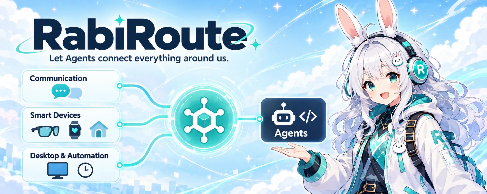
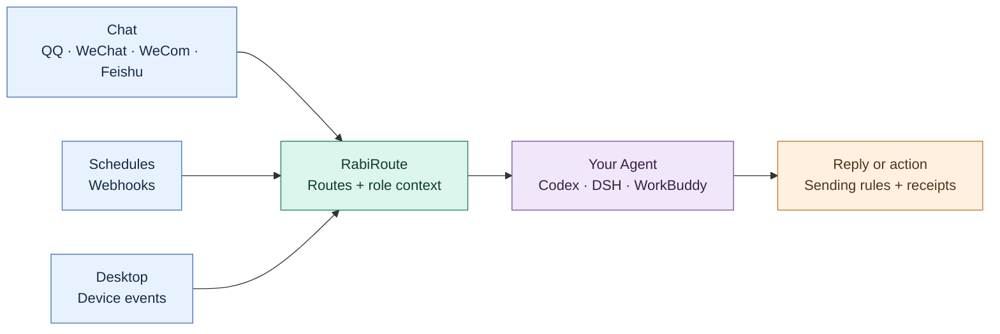
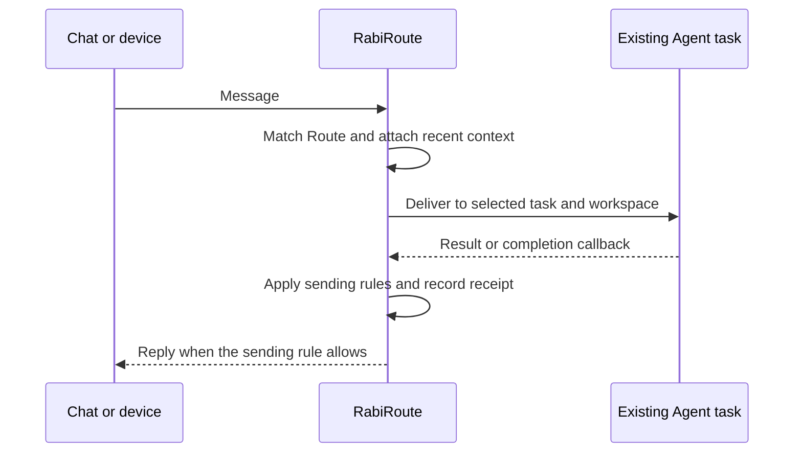
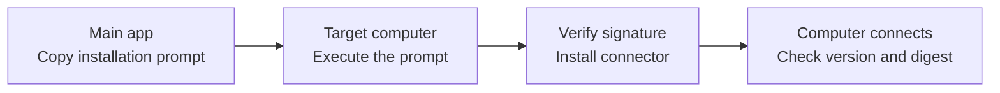
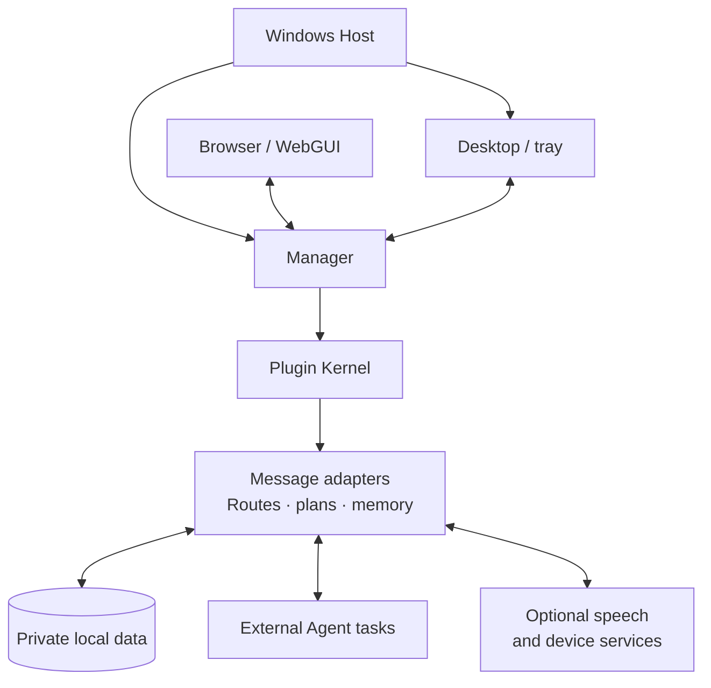
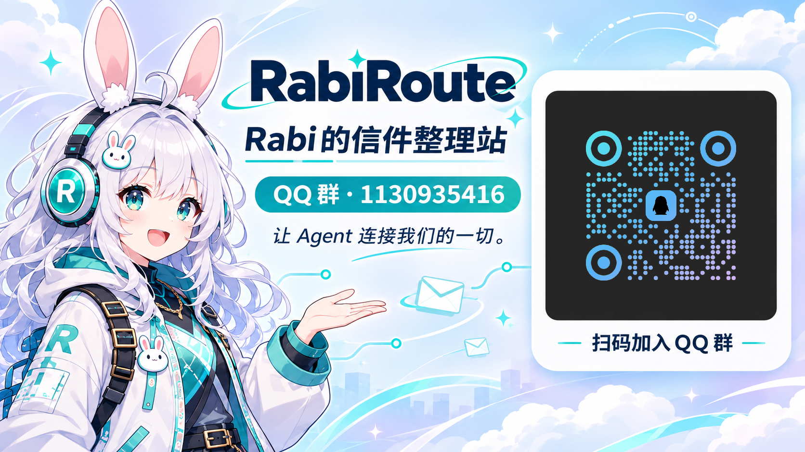

<!-- docs-language-switch -->
<div align="center">
English | <a href="./README_zh.md">简体中文</a> | <a href="./README_ja.md">日本語</a>
</div>
<!-- /docs-language-switch -->

# RabiRoute



<h2 align="center">Let Agents connect everything around us.</h2>

<p align="center">Connect communication platforms, smart devices, and desktop workflows to the right Agent.</p>

<p align="center">
  <a href="https://github.com/vb2250158/RabiRoute/commits/main"></a>
  <a href="https://github.com/vb2250158/RabiRoute/stargazers"></a>
  <a href="./LICENSE"></a>
  
  
  
  <a href="#community"></a>
</p>

RabiRoute is a **self-hosted message gateway and policy router for AI agents**. Connect chats, desktop events and smart devices to the Agent you already use, with role context, scheduled tasks and recorded results.

**RabiRoute connects and routes. Your Agent owns the model, tools and execution.**

[Overview](#what-it-connects) · [Get started](#get-started) · [Architecture](#architecture) · [Docs](#documentation) · [Community](#community)

## What it connects



QQ and Codex Desktop have verified core paths. Other adapters and physical-device integrations have their own maturity and setup requirements; see [integration status](#integration-status).

| Your goal | Start here |
| --- | --- |
| Ask an Agent from QQ, WeChat, WeCom or Feishu | [Choose a message input](docs/current-capabilities_en.md#message-inputs) |
| Run a task on a schedule or webhook | [First Route](docs/user-guide/first-route_en.md) |
| Keep role context, plans, memories and skills together | [Roles and rules](docs/user-guide/personas-and-rules_en.md) |
| Send selected text, screenshots, voice or device events | [Desktop and client guides](apps/README_en.md) |

## From message to result

A Route selects the role, Agent task, workspace and reply rules. The diagram shows a chat-triggered run; schedules use their configured destination. Sending replies remains a separate, recorded action.



## Get started

| What you need | Entry point |
| --- | --- |
| **Main application** — Manager, WebGUI and Windows desktop | [Windows installation/build guide](docs/windows-launcher-and-packaging_en.md) · [Source startup](docs/getting-started_en.md) |
| **Another computer** connected to your main application | [Connect a computer](docs/lan-rabi-agent-bootstrap_en.md) |
| **Linux browser interface** | [Linux Host](docs/linux-host_en.md) |

**Connect another computer from the main app:** generate an installation prompt and let an Agent on the target computer execute it. The prompt downloads and verifies a lightweight connector from your Manager; no separate GitHub installer is needed. The target needs Node.js 22.13+, npm and access to the Manager address. See [PC onboarding](docs/lan-rabi-agent-bootstrap_en.md) for platform requirements.



<details>
<summary>Historical Windows downloads</summary>

The [release history](https://github.com/vb2250158/RabiRoute/releases) includes legacy main-app and standalone Remote Agent packages. A `RabiRoute-Remote-Agent-…` installer does not install the main application. The current source uses Host-managed startup; follow the source/build guides above rather than assuming GitHub’s latest Release is the current main app.

</details>

1. Start the main application and open WebGUI from the tray or the Host-provided address.
2. Choose a role. Add a message Route and bind its **Agent, existing task and workspace**.
3. Use **Channel check → Delivery test**. Confirm the original Agent conversation receives the message and the delivery record shows the result.

The delivery test sends a real message. Follow the [first Route walkthrough](docs/user-guide/first-route_en.md) for prerequisites and recovery.

<details>
<summary>Run from source</summary>

**Windows:** with an existing RabiRoute installation, Node.js/npm and the .NET 9 SDK, run `Start-RabiRoute-FromSource.bat`. It builds and switches the installed application through Host, retaining its data. For a first installation or changed runtime dependencies, follow the [full package guide](docs/windows-launcher-and-packaging_en.md).

**Linux:** install Node.js 22.13+, npm and util-linux `flock`, then:

```bash
git clone https://github.com/vb2250158/RabiRoute.git
cd RabiRoute
bash Start-RabiRoute-FromSource.sh
npm run status:linux -- --json
```

Open the address returned by Host. Linux Host is experimental and provides no Windows tray, screenshots or global hotkeys. See [startup and logs](docs/getting-started_en.md).

</details>

## Integration status

The repository version is `0.9.1`.

| Area | Current scope |
| --- | --- |
| QQ / NapCat / OneBot + Codex Desktop | Core delivery path verified |
| Routes, schedules, WebGUI, role plans and memory | Core paths verified |
| Windows desktop | Core implemented; system interactions need device acceptance |
| Personal WeChat (Weixin), WeCom and Feishu | Prototype / experimental; real-account acceptance varies |
| DSH, WorkBuddy, Grok Bot and remote computer clients | Experimental; validate each backend and target computer |
| Linux Host, RabiSpeech, phones, glasses, wearables and Home Assistant | Experimental; model, network and hardware acceptance is separate |

[Full capability matrix](docs/current-capabilities_en.md) · [Changes and migrations](版本更新日志_en.md)

## Architecture

The Windows package uses **one Host** to own Manager and the desktop surface. Manager owns routing and business state; plugins provide adapters and services. Agent tasks and optional speech/device services keep their own lifecycles.



<details>
<summary>Data, execution and privacy</summary>

- Each role keeps its guidance and settings in `data/roles/<RoleId>/`; Route configuration lives under `data/route/`. Copyable public samples are in [examples/data](examples/data/).
- The target Agent owns its model, tools, sandbox and approvals. Codex message delivery uses the selected Desktop task owner.
- Platform credentials, recordings, private messages and runtime data are private operational data; keep them out of the public repository.
- Phones, glasses, wearables and remote-computer workflows require acceptance in their actual environment. See [architecture](docs/architecture_en.md) and [plugin packages](docs/plugin-bundles_en.md).

</details>

## Documentation

| I want to… | Guide |
| --- | --- |
| Complete the first task | [First Route](docs/user-guide/first-route_en.md) · [User guide](docs/user-guide/README_en.md) |
| Check status or troubleshoot | [Interface and status](docs/user-guide/interface-and-status_en.md) · [Operations](docs/user-guide/operations-and-troubleshooting_en.md) |
| Connect voice, devices or another computer | [Client apps](apps/README_en.md) · [RabiSpeech](docs/rabispeech-plugin_en.md) · [Home devices](docs/user-guide/home-devices_en.md) · [PC onboarding](docs/lan-rabi-agent-bootstrap_en.md) |
| Integrate or extend RabiRoute | [API discovery](docs/api-reference_en.md) · [Architecture](docs/architecture_en.md) · [Function map](docs/project-function-map_en.md) |
| Browse all documentation | [Documentation index](docs/README_en.md) · [Configuration](docs/configuration_en.md) |

## Community

Join **Rabi的信件整理站** (Rabi’s Letter Station) on QQ: **1130935416**. Share setups, ask questions and discuss RabiRoute. Scan with mobile QQ, or search for the group number. Click the card to open the full-size code.

[](assets/rabiroute-community-qq-qr.png)

## License

[MIT License](LICENSE).
