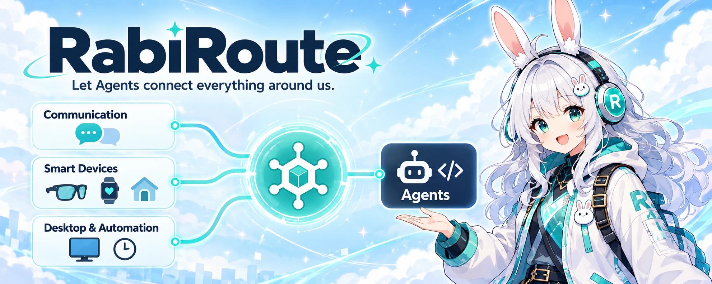
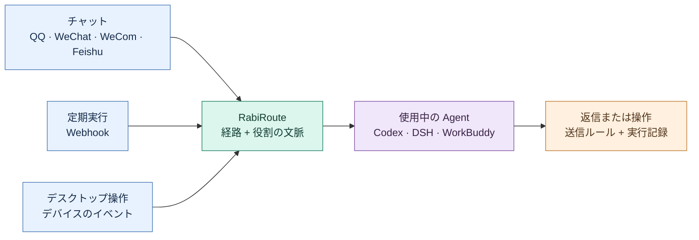
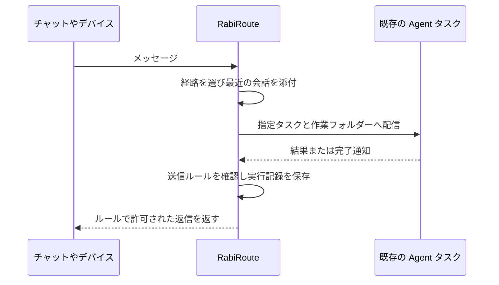
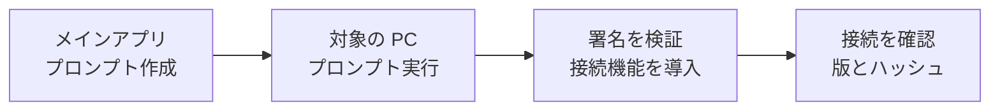
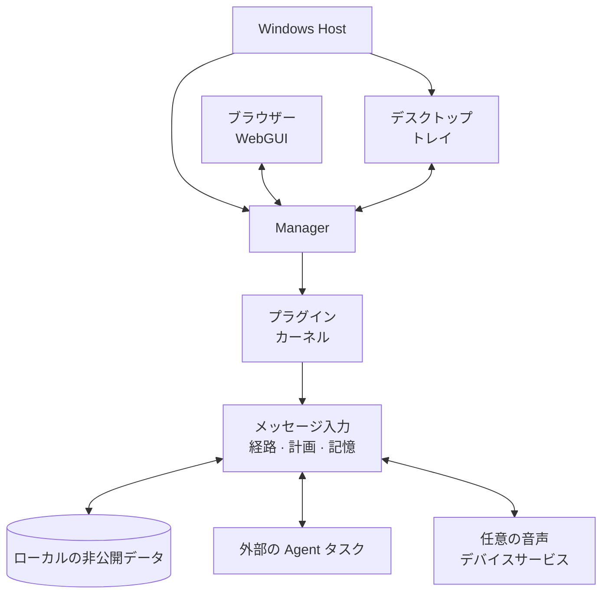
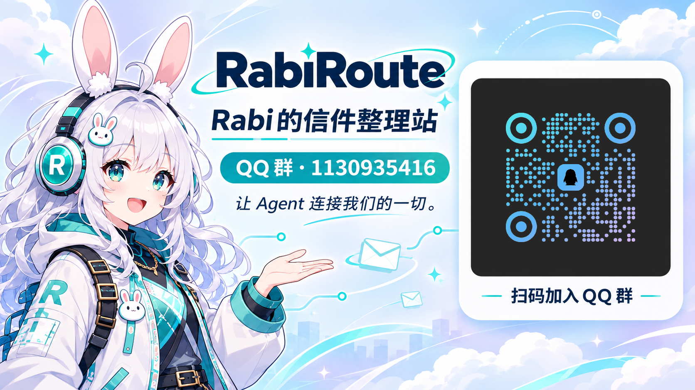

<!-- docs-language-switch -->
<div align="center">
<a href="./README.md">English</a> | <a href="./README_zh.md">简体中文</a> | 日本語
</div>
<!-- /docs-language-switch -->

# RabiRoute



<h2 align="center">Agent で、身の回りのすべてをつなぐ。</h2>

<p align="center">チャット、スマートデバイス、デスクトップの操作を、適切な Agent につなぎます。</p>

<p align="center">
  <a href="https://github.com/vb2250158/RabiRoute/commits/main"></a>
  <a href="https://github.com/vb2250158/RabiRoute/stargazers"></a>
  <a href="./LICENSE"></a>
  
  
  
  <a href="#コミュニティ"></a>
</p>

RabiRoute は、**セルフホストできる AI Agent 向けメッセージゲートウェイとポリシールーター**です。チャット、デスクトップ、スマートデバイスを普段の Agent につなぎ、役割ごとの会話、定期実行、処理結果を管理します。

**接続と経路の選択は RabiRoute が担当し、モデル・ツール・タスクの実行は Agent が担当します。**

[接続の全体像](#接続の全体像) · [はじめる](#はじめる) · [実行時の構成](#実行時の構成) · [ドキュメント](#ドキュメント) · [コミュニティ](#コミュニティ)

## 接続の全体像



QQ と Codex Desktop の基本経路は検証済みです。ほかの接続先や実機機能には、それぞれの成熟度と設定条件があります。[対応状況](#対応状況)を確認してください。

| やりたいこと | 入口 |
| --- | --- |
| QQ・WeChat・WeCom・Feishu から Agent に依頼する | [メッセージ入力の対応状況（英語）](docs/current-capabilities_en.md#message-inputs) |
| 時刻や Webhook でタスクを始める | [最初の Route（英語）](docs/user-guide/first-route_en.md) |
| 役割ごとに会話・計画・記憶・スキルをまとめる | [役割とルール（英語）](docs/user-guide/personas-and-rules_en.md) |
| 選択したテキスト・スクリーンショット・音声を送る | [デスクトップとクライアント（英語）](apps/README_en.md) |

## メッセージから結果まで

Route は役割、Agent のタスク、作業フォルダー、返信ルールを指定します。下図はチャットからの依頼です。定期実行では設定済みの返信先を使い、外部への送信は個別に記録します。



## はじめる

| 必要なもの | 入口 |
| --- | --- |
| **メインアプリ**：Manager・WebGUI・Windows デスクトップ | [Windows のインストールとビルド（英語）](docs/windows-launcher-and-packaging_en.md) · [ソース起動](docs/getting-started_ja.md) |
| メインアプリに**別のコンピューター**を接続 | [コンピューターの接続（英語）](docs/lan-rabi-agent-bootstrap_en.md) |
| **Linux のブラウザー画面** | [Linux Host（英語）](docs/linux-host_en.md) |

**別の PC を接続する場合：**メインアプリでインストール用プロンプトを作り、接続先 PC の Agent に実行させます。プロンプトが Manager から軽量コネクターを取得し、署名を検証してインストールするため、GitHub の別インストーラーを探す必要はありません。対象 PC には Node.js 22.13+、npm、Manager へ接続できるネットワークが必要です。[PC 接続ガイド（英語）](docs/lan-rabi-agent-bootstrap_en.md)で OS ごとの条件を確認してください。



<details>
<summary>過去の Windows インストーラー</summary>

[リリース一覧](https://github.com/vb2250158/RabiRoute/releases)には旧メインアプリと独立した Remote Agent が残っています。`RabiRoute-Remote-Agent-…` はメインアプリをインストールしません。現在のソースは Host が起動を管理します。GitHub の「Latest」をメインアプリの最新版と見なさず、上記のソース起動・ビルド手順を参照してください。

</details>

1. メインアプリを起動し、トレイまたは Host が示す URL から WebGUI を開きます。
2. 役割を選び、メッセージ Route に **Agent・既存のタスク・作業フォルダー**を設定します。
3. **Channel check → Delivery test** で送信し、元の Agent の会話と配信記録の両方を確認します。

このテストは実際にメッセージを送ります。準備とトラブル対応は[最初の Route（英語）](docs/user-guide/first-route_en.md)を参照してください。

<details>
<summary>ソースから起動する</summary>

**Windows：**既存の RabiRoute、Node.js/npm、.NET 9 SDK がある場合は `Start-RabiRoute-FromSource.bat` を実行します。Host を通してビルドと切り替えを行い、保存済みデータを保持します。初回インストールや実行時依存の変更時は[完全パッケージの手順（英語）](docs/windows-launcher-and-packaging_en.md)に従ってください。

**Linux：**Node.js 22.13+、npm、util-linux の `flock` を用意して実行します。

```bash
git clone https://github.com/vb2250158/RabiRoute.git
cd RabiRoute
bash Start-RabiRoute-FromSource.sh
npm run status:linux -- --json
```

Host が返す実際の URL を開きます。Linux Host は実験段階で、Windows のトレイ、スクリーンショット、グローバルホットキーは含みません。[起動とログ](docs/getting-started_ja.md)も参照してください。

</details>

## 対応状況

リポジトリのバージョンは `0.5.4` です。

| 機能 | 現在の範囲 |
| --- | --- |
| QQ / NapCat / OneBot と Codex Desktop | 基本の配信経路を検証済み |
| Route・定期実行・WebGUI・役割の計画と記憶 | 基本経路を検証済み |
| Windows デスクトップ | 基本機能を実装済み。OS 操作は対象機での確認が必要 |
| 個人用 WeChat・WeCom・Feishu | 試作または実験段階。実アカウントの検証範囲は接続先ごとに異なる |
| DSH・WorkBuddy・Grok Bot・リモート PC クライアント | 実験段階。処理端と接続先ごとの確認が必要 |
| Linux Host・RabiSpeech・スマートフォン・眼鏡・ウェアラブル・Home Assistant | 実験段階。モデル・ネットワーク・機器を個別に検証 |

[詳しい対応状況（英語）](docs/current-capabilities_en.md) · [変更と移行（英語）](版本更新日志_en.md)

## 実行時の構成

Windows パッケージでは、**1 つの Host** が Manager とデスクトップ画面を管理します。Manager が経路と業務状態を持ち、プラグインがアダプターやサービスを提供します。外部の Agent タスクと任意の音声・機器サービスは、それぞれ独立したライフサイクルを持ちます。



<details>
<summary>データ・実行・プライバシー</summary>

- 役割の本文と設定は `data/roles/<RoleId>/`、経路設定は `data/route/` に保存します。公開用サンプルは [examples/data](examples/data/) にあります。
- モデル、ツール、サンドボックス、承認は対象 Agent が管理します。Codex へのメッセージは、選択した Desktop タスクに届けます。
- 認証情報、録音、非公開メッセージ、実行時データは非公開の運用データとして扱い、公開リポジトリには含めません。
- スマートフォン、眼鏡、ウェアラブル、複数 PC の操作は実環境での確認が必要です。[アーキテクチャ（英語）](docs/architecture_en.md)と[プラグイン（英語）](docs/plugin-bundles_en.md)を参照してください。

</details>

## ドキュメント

| 目的 | ガイド |
| --- | --- |
| 最初のタスクを実行する | [最初の Route（英語）](docs/user-guide/first-route_en.md) · [ユーザーガイド（英語）](docs/user-guide/README_en.md) |
| 状態確認やトラブル対応 | [画面と状態（英語）](docs/user-guide/interface-and-status_en.md) · [運用（英語）](docs/user-guide/operations-and-troubleshooting_en.md) |
| 音声・デバイス・別の PC を接続 | [クライアント（英語）](apps/README_en.md) · [RabiSpeech（英語）](docs/rabispeech-plugin_en.md) · [家庭用機器（英語）](docs/user-guide/home-devices_en.md) · [PC 接続（英語）](docs/lan-rabi-agent-bootstrap_en.md) |
| API や拡張機能を開発する | [API（英語）](docs/api-reference_en.md) · [構成（英語）](docs/architecture_en.md) · [機能マップ（英語）](docs/project-function-map_en.md) |
| すべての資料を探す | [文書一覧（英語）](docs/README_en.md) · [設定（英語）](docs/configuration_en.md) |

## コミュニティ

QQ グループ **Rabi的信件整理站**、グループ番号 **1130935416**。設定例の共有や質問、RabiRoute の話題にどうぞ。スマートフォン版 QQ で読み取るか、グループ番号で検索してください。画像をクリックすると高解像度のコードを開けます。

[](assets/rabiroute-community-qq-qr.png)

## ライセンス

[MIT ライセンス](LICENSE)で公開しています。
