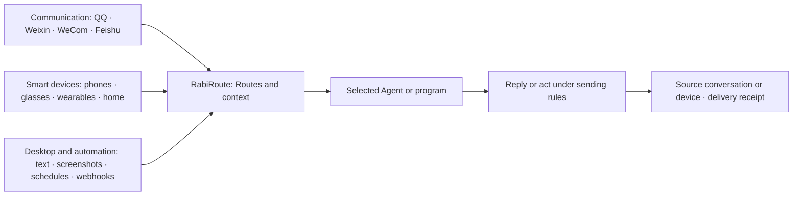

<!-- docs-language-switch -->
<div align="center">
<a href="./README.md">English</a> | <a href="./README_zh.md">简体中文</a> | 日本語
</div>
<!-- /docs-language-switch -->

# RabiRoute


<h2 align="center">Agent で、身の回りのすべてをつなぐ。</h2>

<p align="center">チャット、スマートデバイス、デスクトップの操作を、適切な Agent につなぎます。</p>

<p align="center">
  <a href="https://github.com/vb2250158/RabiRoute/commits/main"></a>
  <a href="https://github.com/vb2250158/RabiRoute/stargazers"></a>
  <a href="./LICENSE"></a>
  
  
  
</p>

RabiRoute は、**特定の Agent に依存しないメッセージゲートウェイとポリシールーター**です。チャットやスマートデバイスからの入力、デスクトップの操作、定期実行を受け取り、メッセージの経路（Route）に従って、選択した Agent やプログラムに配信します。

回答、コードの作成、ツールの呼び出し、タスクの実行は Agent が担当します。RabiRoute は、メッセージの送信元と配信先、配信時に添える最近のメッセージ、外部への返信可否、結果と配信記録の保存先を管理します。

[接続](#接続) · [クイックスタート](#クイックスタート) · [現在の機能](#現在の機能) · [仕組み](#仕組み) · [ドキュメンテーション](#ドキュメンテーション)

## 接続

|カテゴリー |何がつながるのか |あなたにできること |
| --- | --- | --- |
| **コミュニケーション** | QQ、パーソナル Weixin、WeCom、Feishu |選択したエージェントにグループ メッセージとダイレクト メッセージを送信し、ソース会話に返信を返します。 |
| **スマートデバイス** | RabiLink 携帯電話とメガネ、スマートウォッチ / バンド、Xiaomi ホーム / ホーム アシスタント |音声、ヘルス、デバイスのイベントをエージェントに送信します。音声を受信するか、サポートされているデバイスのアクションを実行します。 |
| **デスクトップとオートメーション** |選択されたテキスト、スクリーンショット、ペルソナパネル、スケジュール、Webhook |メッセージベースまたはスケジュールされたトリガーを使用して、コンピューターまたは外部プログラムからタスクを開始します。 |

対応状況は接続先によって異なります。QQ の基本経路は検証済み、個人用 Weixin は試作段階です。WeCom、Feishu、スマートデバイスは、使用するアカウント、機器、ネットワークでの動作確認が必要です。[現在の機能](#現在の機能)を参照してください。

## 構築できるもの

- **通信およびデバイスにわたってエージェントを使用する。** ルートは、ソースと応答宛先を維持しながら、各入力のエージェント、プロジェクト、およびタスクを選択する。
- **スケジュールされたエージェント作業を実行する。** ペルソナルールは、間隔、時間枠、毎日の時間、または一回限りのスケジュールによってエージェントをトリガしたり、構成されたローカルスクリプトを実行したりすることができる。
- **リモートコンピュータを操作する。** 1つのコントローラがメモリ、スキル、およびワークフローを所有する。オンライン クライアントは、エージェント バックエンドが停止している場合でも、端末、ファイル、ウィンドウ、スクリーンショットを公開します。参照 [リモート コンピュータ クライアント](docs/remote-computer-client_en.md) 実験範囲用。
- **連続的なコンテキストを伝送する。** 各ペルソナは、そのメッセージ履歴と、計画、記憶、およびスキルへの参照を所有する。すべてのルートは、配信に含まれる最近のメッセージを制限できます。
- **各ペルソナの計画ワークフローを構成する。** プランのステータス キー、ラベル、説明、色、順序、ビュー、承認動作、および遅延アーカイブは、そのペルソナの構成から取得されます。エージェントはコードをリリースしなくてもカタログを進化させることができます。
- **外部センドを制御します。** エージェントは、1つの送信APIを介してQQ、RabiLink、および他のチャネルに応答する。ターゲット、引用メッセージ、送信者 ID、および受信確認が検証され、記録されます。
- **Windows のテキストと画像を送信します。** RabiRouteデスクトップは、選択されたテキストのアクション、システムのスクリーンショット、注釈、コピー、固定、およびアクティブなペルソナへの配信をサポートする。
- **音声デバイスとモバイルデバイスを接続する。** RabiSpeech、RabiLink電話および眼鏡クライアント、ウェアラブル入力、およびリモートリレーは、実験的な統合として実装される。

## クイックスタート

### Windows インストーラー

ダウンロード `RabiRoute-<version>-windows-x64-setup.exe` から [GitHub リリース](https://github.com/vb2250158/RabiRoute/releases/latest)。パッケージには、RabiRoute Host、デスクトップ サーフェス、ローカル マネージャー、RibiWebGUI、Node.js、および運用依存関係が含まれています。 Windows では、ホストは唯一のアプリケーション ライフサイクル所有者です。ホストは 1 つのアプリケーション世代を作成し、Manager と Desktop をその同じ世代に保持します。

インストールおよびアップグレードにはセットアップを使用します。ポータブル ZIP を新しい空のディレクトリにのみ抽出します。 Windows パッケージは署名されていません: 確認してください `SHA256SUMS.txt` インストール前。参照 [Windowsのインストールとアップグレード](docs/windows-launcher-and-packaging_en.md) 検証、データ保持、および回復用。

### ソースから実行

完全な Windows ソース ビルドの場合は、ダブルクリックします。 `Start-RabiRoute-FromSource.bat`。インストールされたデータを保持しながら、ホスト、マネージャー、WebGUI、およびトレイを構築して起動します。既存の RabiRoute インストール、Node.js/npm、および .NET 9 SDK が必要です。参照してください [ソースの起動](docs/getting-started_ja.md).

Linux の場合は、Node.js 22.13+、npm、および util-linux で新しい最小ホストを使用してください。 `flock`:

```bash
git clone https://github.com/vb2250158/RabiRoute.git
cd RabiRoute
bash Start-RabiRoute-FromSource.sh
npm run status:linux -- --json
```

スクリプトが実行されます `npm ci` そして完全なビルドが完了すると、バックグラウンドでホストが起動します。ホストは Manager を所有し、その現在のループバック WebGUI URL を出力します。固定ローカルホスト ポートは製品契約の一部ではありません。使用する `npm run start:linux` 既存のビルド後、および `npm run stop:linux` シャットダウンを要求します。参照 [Linuxホスト](docs/linux-host_en.md) フォアグラウンド/読み取り専用モード、ログ、およびライフサイクル境界用。ブラウザ インターフェイスを提供します。 Windows トレイ、スクリーンショット、およびグローバル ホットキーは、この Linux パスの一部ではありません。 Real Relay、デバイス、およびエンデュランスの受け入れは保留中です。

他のサポートされている環境でのバックエンドのみの開発については、以下を参照してください。 [ソースの起動](docs/getting-started_ja.md)。通常の最初の開始では、ローカル デバイス ID とサニタイズされたサンプル構成が作成されます。 `examples/data/` ランタイムデータが存在しない場合。検証済みのリレー アドレスとアプリケーション トークンを明示的に保存するまで、RabiLink は未構成のままになります。

### 最初のルートを完了する

1. ペルソナを作成または選択し、**メッセージアダプター**でメッセージルートを追加します。入力側のカードで**定期トリガー**を追加します。
2. 選択してください **Codexエージェント**次に、プロジェクト ディレクトリと既存の Codex/ChatGPT デスクトップ タスクをバインドします。
3. ルートを保存し、同じページのチャネル確認から配信テストを実行します。
4. 配信が成功し、同じ Desktop タスクが RabiRoute メッセージを受信したことを確認します。

配信テストは実際にメッセージを送信します。定期実行やルールの手動実行には、別途ルール設定が必要です。参照 [最初のルートを完了する](docs/user-guide/first-route_ja.md) 完全な手順と障害チェックについて。

## 現在の機能

リポジトリのバージョンは `0.4.0`。この表には、現在のコード、構成サーフェス、およびテストによって裏付けられた動作がリストされています。アカウント、外部サービス、または物理デバイスを必要とする機能は、ターゲット環境で受け入れられる必要があります。

### コミュニケーション

|プラットフォーム |ステータス |提供するもの |
| --- | --- | --- |
| QQ (NapCat / OneBot) |検証済み |ルートごとに 1 つの NapCat をバインドします。カード内のクイック、パスワード、または QR ログインとセキュリティ確認。グループ メッセージとダイレクト メッセージ、保存されたメディア証拠、OneBot HTTP 応答。 |
|個人的なWeixin |実験用プロトタイプ | iLink 経由でテキストを受信し、テキストまたは制御されたローカル ファイルでソース会話に返信します。受信メディアは記録のみです。長時間実行されるセッションと実際のアカウントの安定性は未検証のままです。 |
|ウィコム |実験的 |永続的なボット接続を通じてグループ メッセージを受信し、応答を送信します。実際のボット認証情報との統合が必要です。 |
|フェイシュ |ローカル実装は受け入れられます。実際の認証情報が保留中 |アプリイベントのコールバックを受信し、チャットでコンテキストを分離し、テキストで返信します。アプリの認証情報とイベントのサブスクリプションが必要です。 |

### スマートデバイス

|デバイスとサービス |ステータス |提供するもの |
| --- | --- | --- |
|携帯電話とメガネ (RabiLink) |実験的 |音声入力と応答。リレー接続、スピーカー再生、およびネットワークは個別に承認する必要があります。 |
|スマートウォッチ / バンド |実験的;選択された Xiaomi デバイス パスが確認されました |心拍数、睡眠、その他の観察を収集し、タイムラインをクエリし、しきい値とクールダウンを使用してエージェントをトリガーします。使用可能なメトリクスはキャプチャ ソースによって異なります。 |
|ホームデバイス (Xiaomi Home / Home Assistant) |実験的 |インポートされたエンティティとその現在のボタン、設定、デバイスのアクションを検出します。アクションの受信を確認します。で参照してテストしてください。 [デバイスリスト](docs/user-guide/home-devices_ja.md). |
|音声サービス (RabiSpeech) |実験的 |音声対話のための文字起こし (ASR) と音声合成 (TTS) を提供します。各モデルとデバイス環境を個別に検証します。 |

ホーム アシスタントを使用すると、エージェントはインポートされたすべてのエンティティをクエリし、現在のボタン、設定、および構造化された Xiaomi デバイス コマンドを呼び出すことができます。アクションは接続認証を再利用し、受信確認を保持します。を見てください [デバイス API](docs/home-device-agent-api_en.md).

Xiaomi Setupは、Mi Home QRログインを通じて実験的なクラウドマップファイルも提供します。を参照してください。 [マップ接続ガイド](docs/vacuum-cloud-map_en.md);バージョン 2 のデコードは利用可能ですが、ライブ ローカライゼーションと座標ナビゲーションには個別の承認が必要です。

### エージェント、デスクトップ、およびタスク管理

ペルソナ構成およびプラン/メモリは、バインドされていないペルソナを含め、ルートとは独立してペルソナを選択する。ルート設定は、メッセージ エンドポイント、エージェント バインディング、および明示的なペルソナ参照を所有します。アーカイブされたペルソナは、参照および実行中の作業のチェック後に、設定から復元または完全に削除できます。参照 [ペルソナ中心の構成](docs/role-centric-architecture_en.md).

|エリア |ステータス |提供するもの |
| --- | --- | --- |
|ルーティングコア |検証済み |メッセージの受信、イベントの永続化、ルールの一致、エージェント コンテキストの構築、ハンドラーへの配信、応答の記録を行います。 |
|スケジュールとペルソナの自動化 |検証済み |メッセージまたは時間ルールからエージェントをトリガーします。構成されたペルソナローカルスクリプトを実行します。 |
|Codexデスクトップ |検証済み |完全なタスク ID によって既存のタスクが選択され、各配信はそのワークスペースを提供します。ターゲット ロールアウトが記録した後にのみ成功を報告します。 `deliveryId`。削除またはアーカイブされたバインディングは、制御されたルールに基づいて置き換えることができます。 |
|りびWebGUI |検証済み |ルート、ペルソナ、メッセージ入力、エージェント、計画、メモリ、ログ、診断、テーマ、デスクトップ設定を管理します。 |
|ペルソナ計画のワークフロー |検証済み |ペルソナが構成したステータス キーとプレゼンテーション メタデータを、Manager、WebGUI、およびデスクトップの単一ソースとして使用します。プラン履歴を保持しながら、保護された API を通じて状態を追加、更新、置換、または廃止します。 |
|計画、記憶、メッセージ処理 |検証済み |計画とメモリをページングし、計画のフィードバックを送信し、メッセージ処理作業を割り当て、状態と領収書を保存します。 |
| Windows デスクトップ |コアパスが実装されました |ホストは、マネージャーとトレイ/タスク ウィンドウ サーフェイスを含む 1 つのアプリケーション世代を所有します。選択したテキストのアクション、スクリーンショット、および注釈を使用します。一部のシステム対話では、引き続き Windows デバイスの受け入れが必要です。 |
| Linuxホスト |実験的 |最小限のソース ホスト: ビルド後、Manager を所有し、現在のループバック WebGUI URL を出力し、ステータス、開く、再起動、および終了をサポートします。 Windows/Qt トレイ、スクリーンショット、グローバル ホットキーはありません。実際のリレーとエンデュランスの受け入れは保留中です。 |
| DSH |実験的 |明示的な API アドレス、ワークスペース、セッションをプライマリ ハンドラーまたは補助ハンドラーとしてバインドします。 |
|グロクボット |実験的 |ネイティブ HTTP を使用して、クラウドが所有する既存のセッションに配信します。ルート設定で実際のセッションを選択します。ソース ID、安定した配信 ID、および QQ/Codex 応答が続きます。 [Grok Bot アダプター契約](docs/grok-bot-agent-adapter_en.md)。実際の往復の受け入れは別のままです。 |
|ワークバディ |実験的 |タスク独自のモデル、ツール、承認を使用して、ユーザーがすでに所有している WorkBuddy タスクにメッセージを配信します。配信には 1 回限りのローカル ゲートウェイ認証情報が必要です。これがないと、配信は失敗して終了します。ディスカバリー、バインディング、ライフサイクルフックが実装されています。デスクトップはペアリングのハンドオフをまだ公開しておらず、コールド スタートは未検証です。 |
|メディアワークスペース |実験的 |メディア キャンバス プロジェクトを保存し、画像/ビデオ/オーディオ/テキスト カードを結合し、オプションでローカル H3 を使用します。モデルのセットアップと GPU 推論には個別の承認が必要です。 |
| LANラビエージェント |実験的 |オンボーディング プロンプトを介して、別のコンピューター上の既存の Codex/DSH タスクを接続します。認証されたノードは、ユーザー設定で無効になっている機能を条件として、パブリック API とスキルを使用できます。実際の 2 台のマシンとレガシー ノードの移行の受け入れは保留中です。 |

参照 [現在の能力と成熟度](docs/current-capabilities_ja.md) 完全なステータス、制限、および真実の情報源。

## 最近の変更

### 0.3.25: モバイル通話と共有ホームデバイス制御

モバイルエージェントは、固定コンピュータ/ルートターゲットおよび遅延応答分離による記録、転写および再生を再利用する。ホームデバイス API は、検出と元のアクションのレシートを共有します。認証された接続は、重複した許可スイッチを使用せずに提供されたサービスを使用します。参照 [携帯電話通話](docs/mobile-voice-call_en.md), [ホームデバイス](docs/home-device-agent-api_en.md) そして [接続アクセス](docs/connection-access_en.md);物理的な受け入れは別のままです。

### 0.3.24: 1 つのプロンプトで PC を接続します

パブリックRabiLinkコンソールにおいて、アプリケーションを選択し、そのオンボーディングプロンプトをターゲットコンピュータ上のプライベートエージェントタスクにコピーする。アプリケーションにバインドされた 30 分間有効な 1 回限りのコードにより、エージェントはダウンロードを検証し、独立した ID を保持し、プライベート設定を保存し、元のホストを介して接続できます。コンピューターは独自の長期資格情報を保持します。参照 [PC のオンボーディング](docs/rabilink-pc-pairing_en.md) セットアップ、リカバリ、検証用。

### 0.3.23: 1 つの接続、デフォルトのサービス アクセス

同じRabiLinkアプリケーション内の認証されたデバイスは、音声、ペルソナ、リソース、管理、およびナレッジの読み取り/書き込みを含む、PCによって提供されるサービスを使用できます。設定により、重複した権限スイッチ、MCP シークレット、許可リストが削除されます。 ID、アプリケーションの分離、サービスの準備状況は個別にチェックされます。見る [接続](docs/rabilink-peer-tunnel_en.md) そして [の知識](docs/rabilink-knowledge-runtime_en.md).

### 0.3.21: 個別の PC ID

RabiLink の設定にある **インスタンス ID をリセット** で、PC 間の設定コピーにより重複した ID を修復できます。Host は保存済みデータを保持し、インスタンス ID と接続キーをバックアップして再設定した後、アプリケーションを再起動します。ローカルの所有者情報により、その後ほかの PC にコピーされた設定の利用も検出します。既存設定の移行、復旧、接続上の制限は [インスタンス ID](docs/user-guide/instance-identity_ja.md) を参照してください。

### 0.3.19 experimental implementation: remote role references

ローカル ルートは、別の PC が所有するペルソナを選択し、既存のメッセージ入力と処理エージェントを維持しながら、そのテキスト、メッセージ ルール、およびコンテキスト バジェットを読み取ることができます。バージョン 0.3.19 では、この実験的な実装が追加されています。両方の PC が同じ RabiLink アプリケーションの認証を再利用し、デバイスの公開キーを自動的に交換して固定し、LAN、P2P、またはリレーを使用して、サービスごとの手動許可なしで制限されたペルソナサービスにアクセスします。 0.3.22 以降、同じアプリケーション内の認証されたデバイスはデフォルトで提供されたサービスを使用できます。ソース PC には新しい機能が必要であり、固定されたキーはチェックされたままになります。参照 [リモートロール参照](docs/remote-persona-reference_en.md) 操作、障害動作、および保留中の 2 台の PC の受け入れについて。

### 0.3.5: リモート エージェントの承認、集中的な承認、およびモバイル記録

- リモートエージェントは、API、パブリックスキル、およびファイルアップロードのために個々のノード資格情報を使用する。既存のノードは以下に従う必要があります。 [移行ガイド](docs/lan-rabi-agent-bootstrap_en.md).
- 計画は、焦点を当てた保留中のフィードバックビューを追加し、送信された承認を後で編集できるように保持し、配信が確認された後にのみ分析に戻ります。
- Android 0.3.38-dev では、統合されたタイムライン再生、サウンドイベント分割、明るい/暗いテーマ、および保存されたコンピュータが追加されています。物理的なマルチコンピュータと終日耐久性の受け入れは保留中です。

### 0.3.4: WorkBuddy の配信とフック、コールドロール完了コールバック

- WorkBuddy Agent エンドポイントは次のものを配信できるようになりました。メッセージは、バインドされたタスク自身のセッション プロセス ローカル ゲートウェイを通過します。 `source.conversation.id` は完全なセッション ID に固定されているため、本物のユーザー ターンとしてそのタスクの会話エリアに入り、同じ ID の再配信によって新しいタスクは作成されません。ゲートウェイ資格情報はローカルで無視されるファイルから読み取られ、それがないと配信は失敗して閉じられます。 WorkBuddy は、Codex や DSH と同等のライフサイクル フックもサポートしています。
- 機能宣言は、各アダプタが実際に検証したものに限定される。つまり、WorkBuddy は、計画アシスタント、メモリ統合、またはレシート回復ではなく、メッセージ処理とフックを宣言する。
- 計画を一度も書いたことのないペルソナは、すべてのペルソナの完了コールバックを中止するのではなく、正当なコールド状態になる。を参照してください。 [バージョン履歴](版本更新日志_en.md).

以前のリリースと移行に関するメモについては、 [バージョン変更ログ](版本更新日志_en.md).

## 仕組み



各ルートは、そのメッセージ入力、ペルソナ、ハンドラ、ワークスペース、および送信ルールを個別に格納する。メッセージ アダプタはエージェントの指示を構築せず、エージェントはチャネルの資格情報やルーティング状態の直接の所有権を受け取りません。

Manager は、1 つのプラグイン カーネルを通じて、デフォルト プロファイルに 31 個の組み込みプラグイン インスタンスをロードします。組み込みパッケージとツリー外パッケージは、スキーマ/プロファイル v2、同じ SDK、依存関係グラフ、権限チェック、世代切り替え、実行モード境界、および Web モジュールのライフサイクルを共有します。参照 [プラグイン パッケージとホット リプレース](docs/plugin-bundles_en.md).

## エージェントと安全境界

- 実際のCodexメッセージは、デスクトップIPCを介してのみ、選択されたCodex/ChatGPTデスクトップタスク所有者に伝わる。
- ターゲットデスクトップタスクは、そのモデル、ツール、サンドボックス、および承認を所有する。 RabiRoute は推論を実行しません。
- プロジェクトに固定された `codex app-server` 空のタスクを作成したり名前を付けたりすることはできますが、ルートメッセージは実行しません。
- デスクトップが利用できない場合、タスクをロードできない場合、実行ワークスペースが検証に失敗する場合、または所有者があいまいな場合、記録された証拠とともに配信は失敗する。
- プラットフォームアカウント、ログイン状態、および認証情報は、プラットフォームによって所有されたままである。
- ローカル `data/`、ログ、記録、トランスクリプト、トークン、クッキー、およびプライベートパスは、パブリックリポジトリの外に置かれます。

RabiRouteは現在、一般的なアクションキュー、統合承認センター、または副作用のないルートプレビューを提供していない。電話、メガネ、ウェアラブル、マルチコンピュータエージェントの生産終了は実験段階のままです。

## 構成とデータ

```text
data/route/<configName>/adapterConfig.json
data/roles/<RoleId>/persona.md
data/roles/<RoleId>/personaConfig.json
```

- `adapterConfig.json` には、メッセージ入力、ハンドラー、ワークスペース、ルート ルール、およびペルソナ バインディングが格納されます。
- `persona.md` には、ペルソナのガイダンスとハンドラー対応の作業要件が格納されます。
- `personaConfig.json` には、ペルソナの自動化、アバター データ、音声キーワード、および最近のメッセージの制限が保存されます。
- `data/roles/<RoleId>/conversation/` そのペルソナのメッセージ履歴を保存します。
- [`examples/data/`](examples/data/) サニタイズされたコピー可能なサンプルが含まれています。

構築可能なクライアントは以下に存在します [`apps/`](apps/)、以下の共有 SDK [`packages/`](packages/)、および以下の再利用可能なエージェント ガイド [`skills/`](skills/).

## ドキュメンテーション

### 初めての使用

- [最初のルートを完了する](docs/user-guide/first-route_ja.md):実際のCodexデスクトップ配信を完了する。
- [RibiWebGUI ユーザーガイド](docs/user-guide/README_ja.md):インターフェース、ペルソナ、ルート、エージェント、およびトラブルシューティングツールを使用します。
- [インターフェースとランタイムステータス](docs/user-guide/interface-and-status_ja.md):マネージャ、ルート、およびメッセージ入力が正常であるかどうかを判断する。
- [操作、ログ、トラブルシューティング](docs/user-guide/operations-and-troubleshooting_ja.md):目に見える症状によって障害を特定する。

### インストールと統合

- [構成](docs/configuration_en.md):ローカルファイル、ディレクトリ、およびメイン設定を確認します。
- [LANラビエージェント](docs/lan-rabi-agent-bootstrap_en.md):別のコンピュータ上のCodex/DSHタスクに接続し、接続ステータスおよび利用可能な機能をチェックする。
- [リモートペルソナ参照](docs/remote-persona-reference_en.md):ローカルルートで別のPCのペルソナを使用するための0.3.19実験的実装。
- [ラビスピーチ](docs/rabispeech-plugin_en.md):ローカルまたはリモートのTTSおよびASRを構成する。
- [クライアントアプリケーション](apps/README_en.md): Android、Rokid AIUI、ブラウザ ブリッジ、および Rabi Agent クライアントを構築します。

### 通信とスマートデバイス

- [通信プラットフォームのステータス](docs/current-capabilities_ja.md#メッセージ入力): QQ、Weixin、WeCom、および Feishu の利用可能な範囲を比較します。
- [デバイスを参照してアクションをテストする](docs/user-guide/home-devices_ja.md):ホームデバイス、その状態、および利用可能なアクションをチェックする。
- [モバイル音声通話](docs/mobile-voice-call_en.md):電話からエージェント通話を開始し、キャプチャ、転写、および再生を確認する。
- [Mi Home クラウド マップ](docs/vacuum-cloud-map_en.md):実験用地図ファイルを接続し、ローカリゼーションおよびナビゲーション制限をチェックする。

### 開発と保守

- [現在の能力と成熟度](docs/current-capabilities_ja.md):特徴が検証されたかどうかをチェックする。
- [ドキュメンテーションインデックス](docs/README_ja.md):現在の資料、実験資料、設計資料、および歴史的資料を閲覧する。
- [アーキテクチャ](docs/architecture_en.md):製品の境界とデータフローを理解する。
- [プロジェクト機能マップ](docs/project-function-map_en.md):機能の所有権、API、およびコードエントリポイントを特定する。
- [ホームデバイスエージェントAPI](docs/home-device-agent-api_en.md):デバイス発見、スピーカーバインディング、およびアクション受信クエリを実装する。
- [バージョン変更ログ](版本更新日志_en.md):変更および移行要件を確認する。

## 開発

```bash
npm run manager          # run Manager from TypeScript
npm run webgui:dev       # run the Vue/Vuetify frontend
npm run test:webgui      # run frontend tests
npm run test             # run backend and contract tests
npm run build            # build Manager, independent plugin packages, and WebGUI
npm run check:config     # validate public and runtime JSON text
```

変更を公開する前に、実際のアカウント識別子、チャットコンテンツ、トークン、クッキー、ローカルユーザー名、プライベートパス、およびランタイムを削除する `data/`.

## ライセンス

RabiRoute は、以下に基づいてライセンスを取得しています。 [MIT ライセンス](LICENSE).
