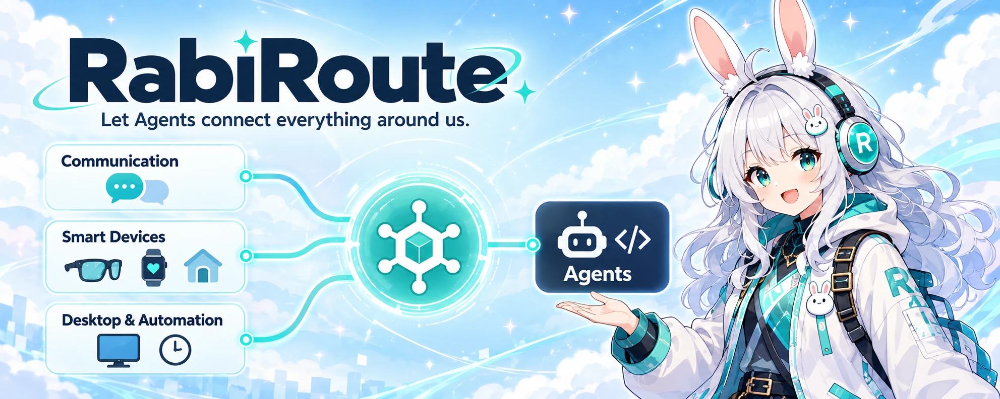
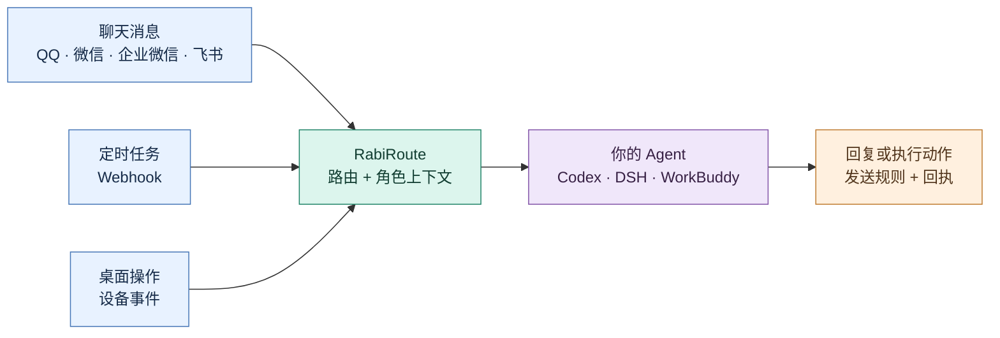
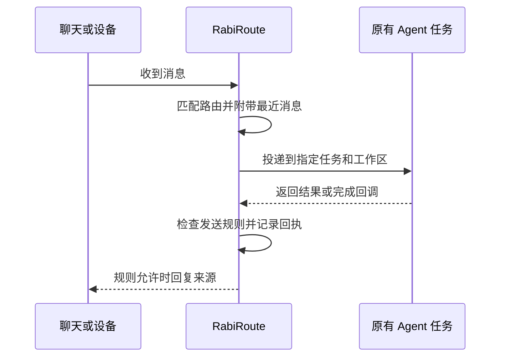
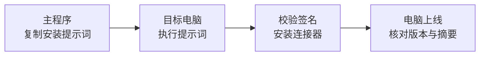
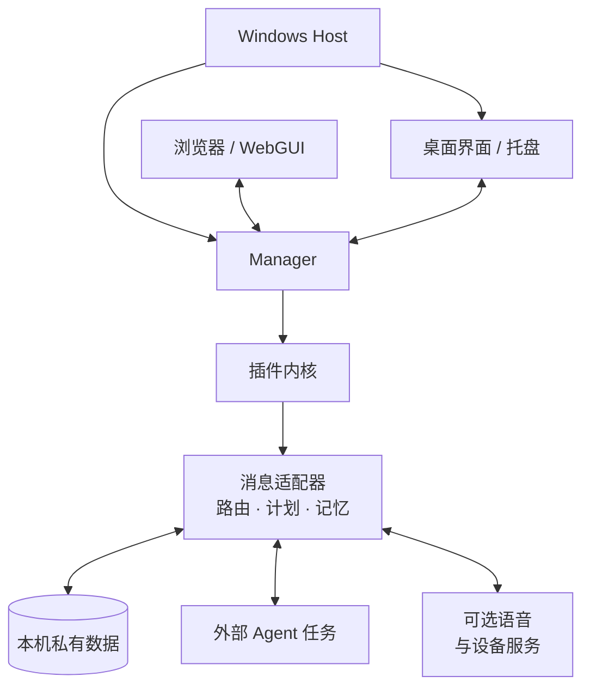
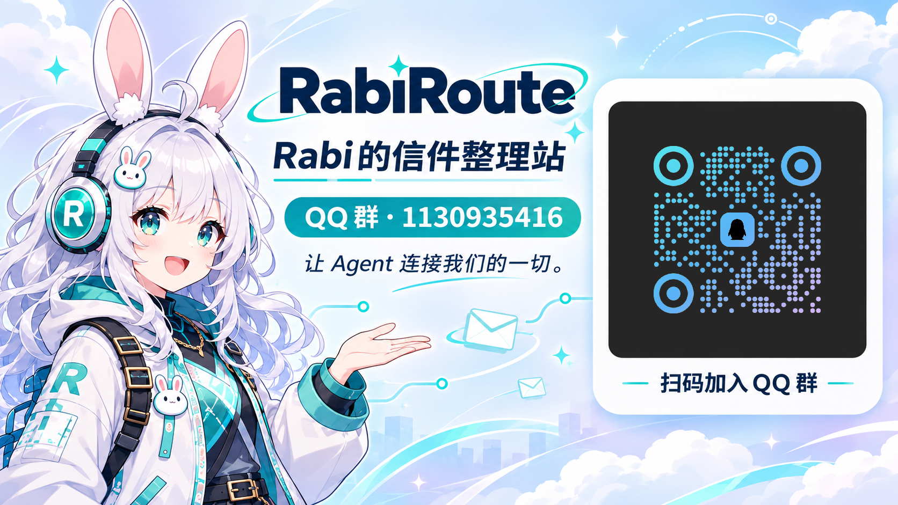

<!-- docs-language-switch -->
<div align="center">
<a href="./README.md">English</a> | 简体中文 | <a href="./README_ja.md">日本語</a>
</div>
<!-- /docs-language-switch -->

# RabiRoute



<h2 align="center">让 Agent 连接我们的一切。</h2>

<p align="center">连接通讯平台、智能设备与桌面工作流，把消息和任务交给合适的 Agent。</p>

<p align="center">
  <a href="https://github.com/vb2250158/RabiRoute/commits/main"></a>
  <a href="https://github.com/vb2250158/RabiRoute/stargazers"></a>
  <a href="./LICENSE"></a>
  
  
  
  <a href="#交流与反馈"></a>
</p>

RabiRoute 是一个**可自托管的 AI Agent 消息网关与策略路由器**。把聊天、桌面和智能设备接到你正在使用的 Agent，统一处理角色上下文、定时任务和执行结果。

**RabiRoute 负责连接和路由；模型、工具与任务执行由你的 Agent 负责。**

[连接总览](#连接总览) · [开始使用](#开始使用) · [运行架构](#运行架构) · [文档入口](#文档入口) · [交流群](#交流与反馈)

## 连接总览



QQ 和 Codex Desktop 的核心路径已经验证。其他接入和真机功能各有成熟度与配置要求，见[接入状态](#接入状态)。

| 你想做什么 | 从这里开始 |
| --- | --- |
| 从 QQ、微信、企业微信或飞书找 Agent 办事 | [选择消息来源](docs/current-capabilities.md#消息入口) |
| 定时或通过 Webhook 触发任务 | [第一条路由](docs/user-guide/first-route.md) |
| 为角色保留上下文、计划、记忆和技能 | [角色与规则](docs/user-guide/personas-and-rules.md) |
| 发送选中文字、截图、语音或设备事件 | [桌面与客户端指南](apps/README.md) |

## 一条消息如何完成任务

每条路由指定角色、Agent 任务、工作区和发送规则。下图以聊天触发为例；定时任务使用其配置的回复目标。对外回复是单独记录回执的动作。



## 开始使用

| 你需要什么 | 入口 |
| --- | --- |
| **主程序**：Manager、WebGUI 和 Windows 桌面界面 | [Windows 安装与构建](docs/windows-launcher-and-packaging.md) · [源码启动](docs/getting-started.md) |
| 让**另一台电脑**接入主程序 | [连接电脑](docs/lan-rabi-agent-bootstrap.md) |
| **Linux 浏览器界面** | [Linux Host](docs/linux-host.md) |

**接入另一台电脑：**在主程序生成安装提示词，交给目标电脑上的 Agent 执行。提示词从当前 Manager 下载并验签安装轻量连接器，无需另找 GitHub 安装包。目标电脑需有 Node.js 22.13+、npm，并能访问 Manager 地址；各平台要求见[电脑接入指南](docs/lan-rabi-agent-bootstrap.md)。



<details>
<summary>历史 Windows 安装包</summary>

[发行记录](https://github.com/vb2250158/RabiRoute/releases)保留旧主程序和独立 Remote Agent 安装包。`RabiRoute-Remote-Agent-…` 不会安装主程序。当前源码采用 Host 管理启动；使用上方源码与构建指南，不要仅凭 GitHub 的“Latest”判断主程序版本。

</details>

1. 启动主程序，从托盘或 Host 返回的地址打开 WebGUI。
2. 选择角色，添加消息路由，绑定 **Agent、原有任务和工作区**。
3. 使用**通道检查 → 投递测试**，确认原 Agent 聊天收到消息，并在投递记录中看到结果。

投递测试会发送真实消息。前置条件和失败处理见[第一条路由指南](docs/user-guide/first-route.md)。

<details>
<summary>从源码运行</summary>

**Windows：**已有 RabiRoute 安装、Node.js/npm 和 .NET 9 SDK 时，运行 `Start-RabiRoute-FromSource.bat`。它通过 Host 构建并切换安装版，保留原数据。首次安装或运行依赖变化时，按[完整包指南](docs/windows-launcher-and-packaging.md)操作。

**Linux：**安装 Node.js 22.13+、npm 和 util-linux `flock`，再运行：

```bash
git clone https://github.com/vb2250158/RabiRoute.git
cd RabiRoute
bash Start-RabiRoute-FromSource.sh
npm run status:linux -- --json
```

打开 Host 返回的实际地址。Linux Host 仍为实验功能，不含 Windows 托盘、截图和全局快捷键；详见[启动与日志](docs/getting-started.md)。

</details>

## 接入状态

仓库当前版本为 `0.7.3`。

| 范围 | 当前状态 |
| --- | --- |
| QQ / NapCat / OneBot 与 Codex Desktop | 核心投递路径已验证 |
| 路由、定时任务、WebGUI、角色计划与记忆 | 核心路径已验证 |
| Windows 桌面 | 核心已实现；系统交互仍需对应设备验收 |
| 个人微信、企业微信、飞书 | 原型或实验功能；真实账号验收各有不同 |
| DSH、WorkBuddy、Grok Bot 与远端电脑客户端 | 实验功能；需逐处理端、逐目标电脑验证 |
| Linux Host、RabiSpeech、手机、眼镜、穿戴设备与 Home Assistant | 实验功能；模型、网络和硬件分别验收 |

[完整能力矩阵](docs/current-capabilities.md) · [版本变化与迁移](版本更新日志.md)

## 运行架构

Windows 安装包由**一个 Host** 管理 Manager 和桌面界面。Manager 拥有路由与业务状态，插件提供适配器和服务；外部 Agent 任务及可选语音、设备服务保留各自的生命周期。



<details>
<summary>数据、执行与隐私边界</summary>

- 角色正文与配置位于 `data/roles/<RoleId>/`，路由配置位于 `data/route/`；可复制的公开示例见 [examples/data](examples/data/)。
- 模型、工具、沙箱和审批由目标 Agent 负责；Codex 消息交给选定的 Desktop 任务 owner。
- 平台凭据、录音、私有消息和运行数据按私有运行资料管理，不进入公开仓库。
- 手机、眼镜、穿戴设备和跨电脑流程需在实际环境验收；机制见[架构说明](docs/architecture.md)与[插件包](docs/plugin-bundles.md)。

</details>

## 文档入口

| 我想…… | 查看 |
| --- | --- |
| 完成第一项任务 | [第一条路由](docs/user-guide/first-route.md) · [用户手册](docs/user-guide/README.md) |
| 查状态或排查故障 | [界面与状态](docs/user-guide/interface-and-status.md) · [运行与排障](docs/user-guide/operations-and-troubleshooting.md) |
| 接入语音、设备或另一台电脑 | [客户端](apps/README.md) · [RabiSpeech](docs/rabispeech-plugin.md) · [家庭设备](docs/user-guide/home-devices.md) · [电脑接入](docs/lan-rabi-agent-bootstrap.md) |
| 接 API 或开发扩展 | [API 发现](docs/api-reference.md) · [架构](docs/architecture.md) · [功能地图](docs/project-function-map.md) |
| 查找完整资料 | [文档索引](docs/README.md) · [配置](docs/configuration.md) |

## 交流与反馈

QQ 交流群 **Rabi的信件整理站**：**1130935416**。欢迎分享用法、反馈问题和交流方案。使用手机 QQ 扫码，或搜索群号加入；点击卡片可打开高清码图。

[](assets/rabiroute-community-qq-qr.png)

## 许可证

采用 [MIT 许可证](LICENSE)。
