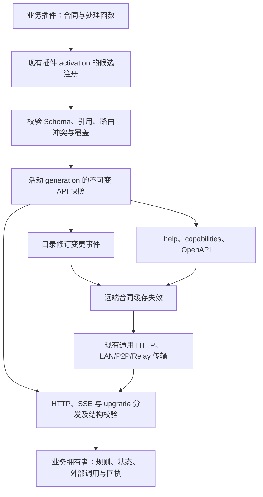
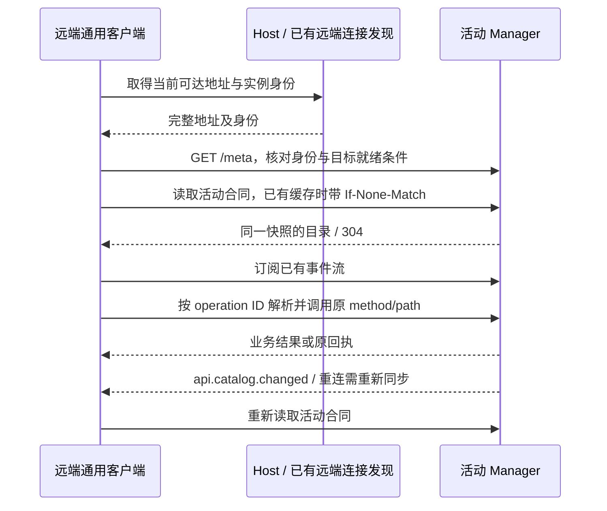

<!-- docs-language-switch -->
<div align="center">
<a href="./api-contract-discovery-target-architecture_en.md">English</a> | 简体中文
</div>
<!-- /docs-language-switch -->

# API 合同自动发现与远端调用目标架构

> 状态：实施中。统一注册与发现基础已进入源码并通过隔离测试；全部公共入口迁移、安装版部署与双机验收尚未完成。
>
> 主要读者：Manager 维护者、插件作者、Agent 与客户端接入开发者。
>
> 设计日期：2026-10-20。

## 1. 目标与范围

新增或更新一个公共 API 时，开发者只维护一份可执行合同。Manager 从同一份合同安装路由、执行结构校验、生成帮助和 OpenAPI；已鉴权远端连接自动发现变化，使用通用传输调用，无需增加逐接口客户端映射或 Relay 转发分支。

“全接口”覆盖当前实际发布的全部公共 Manager API，包括公共管理接口。目录不构成第二层权限白名单；工作区、人格、Route、Skill 和计划绑定不授予或剥夺接口权限。只保留用户明确设置的禁用项，以及现有共享的身份、参数、对象归属、文件根、幂等与资源合同。Host 私有生命周期协议等既有非公共边界保持原定义，不能为减少映射工作把公共接口重新归为私有。

以下三个问题分别处理：

| 问题 | 目标机制 | 不承担的工作 |
| --- | --- | --- |
| Manager 地址或监听端口变化 | 复用 Host/READY 与现有远端连接发现完整 URL，核对 `/meta` | 不扫描端口，不启动第二个 Manager |
| API 新增、替换、卸载 | 从活动路由合同生成可版本化目录，事件通知远端刷新 | 不要求每个客户端编写接口包装器 |
| 某项业务尚未实现 | 所属业务插件实现处理函数，并发布真实合同 | 反射和目录不能生成缺失的业务行为 |

本设计不要求自动下载或执行服务端代码，也不自动升级远端可执行程序。只有传输协议发生不兼容变化时，才按现有签名发布与更新链升级连接器。

### 1.1 关键设计决策

目标是让新增接口只改所属服务端插件，远端沿用同一个通用客户端。自动化建立在可执行合同上：开发者声明一次，注册器派生路由、校验器、目录与类型。

| 决策 | 采用方案 | 选择依据 |
| --- | --- | --- |
| 如何识别接口 | 显式运行时合同与处理函数一起注册 | JavaScript 可以枚举对象与注册表，但函数名和参数名不足以表达 HTTP 合同；TypeScript 类型在运行时不保留 |
| 是否使用反射或装饰器 | 可作为合同的编写语法，最终归一为同一注册定义 | C# / Java 反射也需要路由属性、注解或框架约定才能知道哪些方法是接口；反射不负责实现缺失业务 |
| 如何避免漏映射 | 实际分发和发现目录读取同一活动快照，构建检查追查绕过注册器的入口 | 再维护一份客户端映射表，会重新产生漏项；仅比较目录内部数量也发现不了未登记入口 |
| 如何处理端口变化 | 重新发现完整地址并核对 Manager 身份 | 端口属于服务寻址，接口属于该服务上的路由；两者独立变化 |
| 如何自动更新 | 合同变化刷新目录，插件变化走现有发布机制，协议不兼容才升级连接器 | 将接口发现、服务端代码发布和远端程序升级分开，可以保留各自的校验及恢复方式 |

此处“映射端口”按两层处理：Manager 监听地址由 Host/READY 管理；跨机可达性由现有 LAN/P2P/Relay 连接提供。接口发现不创建 NAT/UPnP 映射、不开放任意本机端口，也不把本机 `127.0.0.1` 地址直接发布成远端访问地址。

## 2. 当前基础与实施边界

本节保留 2026-10-22 的历史验收快照；当前版本变更见[版本更新日志](../版本更新日志.md)。下文架构目标不等于已安装验收。

截至 2026-10-22，0.3.66 候选已完成独立完整构建、六项编译版集成和同实例通用热补丁验收。完整回归与最终包核验继续执行，真实双机连接仍待通过。当前范围如下：

| 层次 | 已有基础 | 剩余工作 |
| --- | --- | --- |
| 服务端 | 可执行合同、运行时校验、活动快照、OpenAPI、条件读取与目录变更事件；HTTP、SSE、有限二进制及 WebSocket 注册 | 迁移全部公共入口，识别绕过注册器的分发，并删除重复声明 |
| 远端客户端 | 同一目录驱动 `invokeOperation()` / `openOperation()`；CLI 支持 HTTP、文件、SSE 与 WebSocket JSONL 帧 | 核验正式安装包、当前运行版本及跨机目录刷新 |
| 隔离验收 | 五种配置分别发布 Gateway 114、required 99、Peer 317、hub 106、independent 485 项，已登记旧路由声明均为 0 | 配置各自统计；范围仍为 `registered-routes`，全项目覆盖为 `not-proven`；最终包与真实双机验收待完成 |
| 业务能力 | 目录描述实际已实现的渠道、目标与 payload 组合 | 缺失业务由原业务模块实现，再从同一合同发布 |

该历史快照当时剩余的 2 处均为人格范围；prefix 范围可能包含多个接口，不按 2 个接口估算当时剩余工作。当前源码已退役这些人格 boolean/prefix 声明；最终验收状态见实施记录。Peer 动态分发、旧语言风格校验、角色面板消息、人格目录、投递/回执、设备配置、手机状态与视频信令声明已删除；原有私有加密 receive 入口采用内部合同，继续不进入公共目录。

最新静态清点覆盖 31 个内置插件文件，旧 exact 方法/路径与 prefix 分发声明均为 0；50 处可执行注册调用不是接口数量。旧工具报告的 22 条未展开记录已确认为 UI routeId。静态清点与运行目录分别核验，未登记入口的全项目覆盖继续保留 `not-proven`。

本轮已尝试查询 Rabi 知识与原计划，分别返回 503、404，未取得可用计划正文。上表基于当前源码和保留的隔离验收记录；附件只提供问题线索。

批次证据、已迁移模块与兼容说明保留在 [实施记录](api-contract-discovery-implementation-progress.md)。后文定义目标设计与验收要求；目标要求本身不标记为已实现。

### 原生兼容与撤权结果

合同必须保留原拥有者已经接受的请求。完全忽略正文的原生接口使用 `body:{kind:"none",allowIgnoredBody:true}`，通用层丢弃字节而不解析、缓冲或等待上传；省略该标记仍拒绝非空正文，WebSocket 升级不能使用它。原来仅部分路径文字段忽略大小写的接口使用 `pathCaseInsensitiveLiterals`，参数 ID 保持原样，其它前缀与写入口不随之放宽。两项规则均进入相同合同和 OpenAPI，路由重叠校验采用同一匹配规则。

原拥有者可返回仅供内部围栏使用的 `mutationOutcome:not_started|unknown`，证据来自实际调用原生传输前的闭包状态，不能从客户端正文或请求头取得。撤权仍剥离所有业务数据和回执，仅在通用失败响应中保留有限执行状态及对应 `uncertain`。没有这项可信证据时继续保守报告不确定，不能把 handler 开始直接解释为写入已发生，也不能把结果不确定当作可自动重试。


### 原生 HTTP 方法与模型原始后缀

现有 HTTP 传输本来可以携带原生方法字符串，但不会自动发现业务 API。可执行合同现支持仅用于 `httpProxy` 的 `method:"*"`，最终 `rawpathRemainder` 可保留 `/api/.../models:suffix` 这类路径的原始片段后缀。固定方法路由优先，fallback 在 405 前匹配；OpenAPI 使用 `x-rabiroute-any-method`。通用客户端 `invokeOperation()` 对这类合同要求显式 `options.method`，不发送 `*`，也不允许覆盖固定方法。 CLI 的 HTTP 调用支持 `--operation <ID> --method PROPFIND`，目录 `?method=PROPFIND` 会返回匹配的 wildcard 合同。CONNECT/TRACE 等仍受既有原生传输边界约束，合同层接受 HTTP token 不表示每种方法都能穿过所有底层传输。

框架和客户端回归已覆盖该机制及业务绑定为空的已鉴权连接。语音 39、家居 53、人格知识/身份/存储/健康、视频 35、角色配置八项、陪伴八项、全天记录 24 项及核心公共服务/插件目录已接线，并纳入本轮完整构建和编译版验收。家居目录参数仍由原生 `capabilities.directoryQuery` 共享元数据发现，operation 的开放 query Schema 未标为精确请求或响应合同。

### 最终静态分发与独立监听

静态发行资源使用同一活动注册器中的显式 `httpProxy.dispatch:"final-fallback"` 合同，在普通操作、原生 wildcard 代理、过渡 owner、升级和已知路径的方法拒绝之后执行。不可变 Web release 仍是普通原生代理合同。API 与 Host 私有路径保持原静态排除边界。旧 controller helper 已退役，原生旧入口收尾与最终编译验收见实施记录。

独立监听保留实际地址、原处理器和原鉴权，通过原可信生命周期/IPC 发布 binding 及其调用边界。当前源码已提供 Manager 原生 HTTP 映射，通用客户端可沿既有 Manager 地址访问已验证的原生 HTTP binding；受控夹具已验证原始 HTTP 字节及真实加密 TunnelSession 链路。原生 WebSocket、需要额外原生鉴权的直连、平台签名 challenge 和 OneBot 反向 WebSocket 仍保留各自协议边界；仅供发现的 binding 不自动成为公共业务调用。安装版与真实双机验收仍未完成。详见[独立监听合同](external-listener-contracts.md)与[平台原生监听](platform-native-listeners.md)。

## 3. 所有权与结构



| 对象 | 唯一拥有者 | 派生消费者 |
| --- | --- | --- |
| API 定义、业务校验、处理函数 | 所属业务插件 | 路由注册入口 |
| 活动路由及合同快照 | 扩展后的 `ManagerPluginRouteRegistry`，受现有插件 generation 发布控制 | HTTP 分发、目录投影、诊断 |
| 连接身份、完整 Manager 地址 | 现有 Host/READY 与已接入的远端连接 | 通用客户端 |
| 目录与 Schema 缓存 | 客户端可重建缓存 | 工具发现、调用准备与显示 |
| 业务状态、凭据、发送记录与回执 | 现有业务模块 | 客户端只保存引用和必要回执 |

不建立与现有路由注册器平行的独立业务目录。目录生成器是快照的只读投影；新增插件不要求修改内核中央枚举、帮助数组或客户端分支。

## 4. 单一可执行合同

以下使用当前源码 SDK 的实际注册形状。业务拥有者提供 Schema、具名业务校验和返回结果 DTO 的处理函数；安装版支持情况仍须读取其活动目录。

```ts
const operations = context.services.require<ManagerApiOperationsService>("host.manager.operations@1");
context.effects.add(async () => {
  const registration = await operations.registerOperationsAsync([{
    contract: {
      operationId: "example.record.read",
      contractVersion: "1.0.0",
      description: "读取指定记录。",
      method: "GET", pathTemplate: "/api/example/records/:recordId",
      exposure: "public", transport: "http",
      request: { path: recordPathSchema, query: recordQuerySchema,
        headers: { type: "object" }, body: { kind: "none" } },
      responses: recordResponseContracts,
      effects: { mode: "read", description: "Read the selected record." },
      recovery: { strategy: "repeatable-read", description: "Retain the same record ID." },
      validators: recordBusinessValidators
    },
    handler: readRecord
  }], context.lifecycle.signal);
  return () => registration.dispose();
});
```

示例用 `registerOperationsAsync()` 传递原生命周期取消；`registerOperations()` 保留为同进程兼容入口。

当前源码提供的实际入口是 `host.manager.operations@1` 服务的 `registerOperationsAsync()`、`registerOperations()`、`registerHttpProxies()` 和 `registerUpgrades()`：插件在 Manifest 的 `requires` 声明该服务，在 `context.effects.add` 内注册，并返回调用 `registration.dispose()` 的释放函数。所属实例从 activation 取得，不接受调用方伪造 owner。SDK 导出由源码生成的 `ManagerApiOperationsService` 等类型；可执行示例见[树外插件测试](../src/manager/apiOutOfTreePlugin.test.ts)。

WebSocket 使用独立的 `ApiUpgradeDefinition` 绑定原生 Socket 拥有者；它与 HTTP 合同共用编译、冲突检查、快照和 OpenAPI。合同的 `websocket` 字段声明协议、帧 Schema、容量与结束语义，OpenAPI 用 `x-rabiroute-websocket` 导出；101 不伪造 HTTP 正文。绑定在写入握手前调用 `prepareHandshake()`，接收后通过 `accept({closed, close})` 交出租约结束与清理承诺，并以 `validateIncoming/validateOutgoing` 校验原生帧。`stopAccepting()` 与 `dispose()` 分别负责停收和最终清理，避免关闭命令回传通道后才排空 HTTP。通用 HTTP `invokeOperation()` 继续拒绝 WebSocket；WebSocket 使用同一目录缓存和路径解析的 `openOperation()`，并交由原生协议拥有者处理鉴权、命令和任务。

每项合同必须提供以下信息：

| 信息 | 规则 |
| --- | --- |
| 稳定身份 | `operationId` 在发布快照中唯一且不依赖显示名；别名显式引用 canonical operation，不复制处理逻辑 |
| 路由 | 明确 method、path template、路径编码、尾斜杠和匹配优先级；冲突使候选发布失败 |
| 请求 | path/query/header/body 的运行时 Schema；区分无 body、JSON、文本、二进制、multipart 和流；标明重复 query、条件必填与互斥字段 |
| 响应与错误 | 按 HTTP 状态与 content type 声明 Schema、响应头、结构化错误、`help/repair` 与回执引用 |
| 副作用 | 明确纯读取、会更新查看状态的读取、写入、外发、长连接等实际效果；不根据 GET/POST 推断 |
| 恢复 | 明确幂等键的位置与作用域、资源/回执查询方式、不确定结果处置及允许重试的条件 |
| 生命周期 | 所属插件、activation、revision 由宿主注入，不允许插件伪造；流须声明关闭和 drain 规则 |
| 成熟度 | 将 Schema 完整度、实现状态、自动化检查与真实环境验收分别记录，不能由“已注册”自动标记 verified |

Schema 与真实结构校验共用运行时定义，生成的 TypeScript 类型与 OpenAPI 都是派生产物。OpenAPI 导出采用正式实现选定并固定的版本；不支持的 Schema 关键字或转换损失必须使候选失败，不能静默降低语义。

结构校验之外，业务拥有者仍执行对象归属、文件完整性、状态转换、限额和来源校验。无法用 Schema 表达的条件，合同引用有稳定 ID 的服务端校验规则并说明错误与修复方式；不把代码序列化给客户端，也不虚构客户端可独立证明全部条件。

二进制与流式接口声明媒体类型、长度/摘要、容量、超时、取消和结束语义。响应校验不得整段缓存大文件或无穷流；JSON 在响应提交前校验，流按元数据、帧和终态合同检查。响应校验失败不撤销已经发生的外部发送，必须保留原回执并返回可追踪的不确定状态。

需要在读正文前核验原设备来源的拥有者，可以提供 `prepare()`。注册器先校验请求路径、查询与合同版本，再调用准备函数；准备函数返回原生拒绝结果，或捕获原请求身份的处理函数。之后才读取和校验正文，再由该处理函数复核原身份并执行业务。准备阶段不执行业务写入，不增加功能许可；其异步工作与后续处理共用原请求预算、快照和排空租约。

HTTP 处理函数的 `signal` 同时反映原请求预算与响应连接寿命。连接关闭后，不再开始尚未执行的业务；已接受的外部动作由原拥有者完成日志、回执与审计，再释放租约。返回前关闭的流也必须调用取消并等待自然 EOF 与清理承诺，不能通过跳过迭代器清理提前退休。执行后发生的响应校验或未知异常按不确定结果处理；断线不会撤销已发生的动作，也不会触发重放。

JSON 合同的 `maxBytes: 0` 明确表示保留原拥有者未设置应用层字节上限的行为；正数仍是实际字节上限。文本、二进制与流的上限继续要求正数。设备 bootstrap 的原 JSON 读取器使用零上限，迁移保留该语义；人格 bootstrap 保留 8192 字节上限。

## 5. 公共接口完整覆盖

所有公共 HTTP 入口最终从同一注册快照分发，包括公共管理、插件、资源、静态页面、二进制、SSE 和 WebSocket upgrade 入口。流与 upgrade 使用类型化 transport binding 接入现有宿主；不能仅因不是 JSON 就漏出目录。静态资源用资源集合模板声明，不把每个 hash 文件计成独立业务 API。

prefix 和 dynamic matcher 可以保留内部调度用途，但不能作为“已覆盖所有接口”的证明。其拥有者必须声明实际 operation 的模板和合同；依赖动态资源的接口声明参数化路径及资源发现入口。一个操作不得要求客户端猜测处理器内部的 suffix、method 或 query。

覆盖检查分为两部分：已注册公共路由与目录投影严格对应；仍绕过注册器的公开分发、upgrade 或独立监听入口通过构建检查、入口审查和行为测试识别。运行时快照只能证明已纳管部分，不能据此声称发现了任意未注册代码。既有独立公共服务应明确其服务拥有者和发现入口，不自动并入 Manager 或额外开监听器。

测试标记、内部函数、Host 私有控制和秘密内容不对外导出。公共/内部边界沿用现有产品合同；任何边界变更必须单独评审，迁移不得改变已鉴权远端的成功调用行为。

## 6. 插件热更新与原子发布

1. 插件在现有 activation 上下文内提交合同与处理函数，形成候选快照；候选不对外可见。
2. 同时校验 Schema、引用、operation ID、路径冲突、覆盖和传输支持，生成目录及 OpenAPI 投影。
3. 通过现有 generation 发布机制一次切换活动快照。路由分发、帮助、Schema 和能力投影只能读取同一快照引用。
4. 提交成功后发布目录变化事件；发布失败保留旧路由与旧目录，不发送成功事件。
5. 新请求使用新快照；已接收请求持有原 activation 租约，按原合同完成并保留原回执。旧资源按现有 effect scope 和 drain 机制释放。

快照身份至少包含 `applicationGenerationId`、`managerInstanceId`、`pluginGenerationId`、`catalogRevision` 和规范化内容的 `catalogDigest`。revision 在同一 Manager 内单调递增；回滚也是一次新发布，revision 递增，内容 digest 可以回到旧值。重启后以新身份开始，不能只按数字比较版本。

合同或能力定义变化时更新目录修订；设备在线状态等短暂运行事实通过各自已有状态事件和能力查询反映，不因每次心跳重建全量合同。处理器实现变化由插件 revision 跟踪，诊断能够把实际执行版本与其合同关联。

不可热迁移的状态或传输边界按现有[源码热补丁](source-hot-patches.md)合同处理，再由 Host 受控切换；不另设更新器，也不因“新增接口”默认重启。

## 7. 目录、能力与远端刷新

保留现有 `GET /api/agent/help`、`GET /api/lan-agent/capabilities` 和 `GET /api/agent/send/capabilities` 入口，改为同一快照的不同投影。目标新增 `GET /api/agent/openapi` 导出机器合同；此路径、下述快照字段与事件已在源码和隔离 Manager 中实现；安装版部署与双机验收仍未完成，不能假定旧安装版本已提供。

目录返回稳定身份、合同版本、当前快照身份、摘要、完整度、Schema 或同快照 Schema 引用。新增 `ETag/If-None-Match` 条件读取；大目录分页必须绑定快照修订，翻页失效时明确要求重取，不能拼接不同快照。`304` 只复用对应缓存，不替代连接身份与健康核验。导出不得包含凭据、带认证 URL、私有路径或真实业务数据。

远端调用流程：

1. 本机用 Host/READY；远端复用已鉴权连接及现有地址发现/通用隧道取得目标。不能把本机 loopback 地址直接当作另一台电脑的访问地址。
2. 核对 `/meta` 的 generation、instance 与既有健康边界；精确诊断和写后核对继续沿用当前合同。
3. 读取目录与所需合同，缓存键包含目标 Manager 身份、目录修订和合同版本；按 operation ID 选取操作。
4. 通过合同声明的传输调用原 method/path：HTTP/SSE 使用 `invokeOperation()`，WebSocket 使用 `openOperation()`；保留原凭据、版本及幂等合同。无需增加绕过正常鉴权和处理器的通用执行入口。
5. 复用现有 Manager 事件传输，事件 `api.catalog.changed` 通知修订变化。事件只使缓存失效，不直接执行业务。
6. 事件断线后重连、游标缺口或 Manager 身份变化时重新读取快照。目录错误或合同不匹配时做一次有界刷新；不增加后台固定间隔全目录轮询。

目录的 `available/unavailable/disabled` 状态区分尚未实现、运行依赖不可用、用户明确禁用与真实鉴权失败，并给出原因和下一步。发现接口本身不授予功能许可。客户端不能把目录暂时缺失、缓存过期或 Schema 无法理解解释为“远端无权调用”；应报告合同或兼容性缺口。

新公共 API 只需服务端插件实现并注册，旧通用客户端在支持其传输和 Schema 版本时即可发现和调用。未知的必需 Schema/传输特性只阻止本次不兼容调用，并报告所需连接器版本；不清除连接、重绑人格或禁用其它接口。

Agent 工具列表是宿主的独立生命周期。通用 API 工具可以动态消费目录；宿主若只在启动时注册工具，应提供显式刷新或使用已有通用调用工具。目录更新不宣称 Desktop 当前轮次已经增加原生工具，也不替换其任务 owner。

### 7.1 自动更新的三条流程

| 触发条件 | 自动处理 | 完成判据 |
| --- | --- | --- |
| Manager 地址或 generation 变化 | 经现有发现链重新取得可达地址；核对 `/meta` 身份；废弃旧身份下的目录缓存并重新订阅事件 | 同一远端连接恢复只读调用，记录新地址及身份；在途写入按原回执核对结果 |
| 插件新增、修改或卸载公共接口 | 候选校验后原子发布路由与合同；提交 `api.catalog.changed`；客户端失效缓存并条件读取新快照 | 不修改客户端代码和 Relay 分支，新接口可按 operation ID 调用；删除的接口不再显示为可用 |
| 合同要求客户端尚不支持的传输特性 | 明确报告兼容性缺口及所需版本；使用现有签名更新机制升级连接器后重新核对身份和目录 | 升级包身份、签名与运行版本均已验证，目标调用成功 |

首次连接、地址变化与断线恢复按以下顺序执行；正常目录变更从“读取活动合同”开始：



读取目录与订阅之间可能发生发布。当前 Manager 事件流没有持久回放游标，订阅建立后须再条件核对一次目录，重连时重新核对当前快照。连接失效只触发重新发现和结果核对，不能触发业务写入重放。

## 8. 发送能力示例与失败恢复

`/api/agent/send` 是公共父接口，目标、payload 与渠道组合仍由实际发送 provider 拥有。provider 发布可序列化的组合合同，并让参数校验、能力输出与执行共用同一份规则；不另建中央渠道/类型对照表。

当前实现应生成“NapCat 群聊支持托管 `fileId`，私聊不支持”的精确组合。未来业务插件完成私聊文件上传、来源校验、大小约束及回执后，更新同一规则即可同步校验器和目录，远端在收到变更后刷新，无需新增私聊专用客户端映射。

| 失败情景 | 必须行为 |
| --- | --- |
| 候选合同有冲突或缺失 Schema | 候选发布失败，旧版本继续服务，诊断定位所属 operation |
| 目录与执行中途切代 | 重新发现身份；读取按操作的重试合同处理，写入保留原请求与幂等键并先查原资源/回执 |
| 超时、5xx、412 或写后身份无法核对 | 按原接口合同报告失败或 uncertain；不自动换目标、换渠道或重放写入 |
| 接口已卸载 | 返回真实资源/接口不存在及目录修订，刷新发现；不猜测替代路径 |
| 事件断线或丢失 | 重连时重取/条件核验目录，不能永久使用旧映射 |
| 结构合法但业务状态不满足 | 所属业务模块返回原错误、可行动修复与回执，不伪装成权限问题 |
| 发布回滚 | 新 revision 表达旧内容，原在途请求与幂等记录继续可查询 |

## 9. 迁移与旧入口退出

| 阶段 | 交付物与验证 | 退出条件 |
| --- | --- | --- |
| A：完整清点 | 调查真实公共分发、插件 exact/prefix/dynamic、资源、upgrade 与独立监听入口；AST 清单只作线索 | 每个公开入口有明确 owner、范围和迁移归属，无静默遗漏 |
| B：一条纵向链路 | 在现有注册器扩展合同，先迁移发送、上传及回执链；生成校验、help 与能力输出 | 同一规则变更可同时影响实际校验和发现，成功与失败均有证据 |
| C：全部公共入口 | 逐业务模块切换到单一声明；迁移中的缺口标记为 incomplete，不降低原可达性 | 无需客户端/Relay 专用分支即可调用新注册接口；完整性检查覆盖全部公共入口 |
| D：热更新与远端刷新 | 同快照发布、条件读取、事件恢复、流取消和双机验证 | 新增、替换、卸载、失败候选与回滚全部通过验收 |
| E：删除旧定义 | 删除手工 operation/help 数组、重复渠道规则、只为远端建立的映射与失效缓存入口 | 源码、构建产物、安装运行实例都无旧定义消费者 |

分阶段迁移只用于开发与可审查提交，不允许永久运行两套真源。每个模块切换时删除其旧定义。确需保留既有公共 URL 的兼容适配时，只投影新快照，不保留独立数组；记录消费者、单一替代路径、退出版本和验收。现有三个发现入口是否保留由真实客户端兼容需求决定，不能为清理内部实现直接破坏公共合同。

## 10. 验收标准

- 注册一个树外插件公共接口，只修改该插件，即可出现在实际路由、help、capabilities 和 OpenAPI；同一已鉴权远端连接成功调用，无额外密钥或逐功能许可。
- 已发布公共 operation 与精确合同投影一致；所有 prefix/dynamic 子操作、流式接口、资源与 upgrade 均可解释覆盖，未纳管部分使“全覆盖”检查失败。
- 同一字段的条件必填、互斥和错误样例，在服务端校验、导出合同及客户端理解中一致；跨字段业务条件仍由原 owner 最终校验。
- 新增、替换、卸载和回滚期间，目录与实际处理器不会出现不同快照；失败候选不污染活动版本。
- 跨机实际改变 Manager 地址后，远端通过既有发现恢复；无固定端口、端口扫描、手改 URL 或额外 Manager 进程。
- 保持同一远端连接和客户端二进制，通过目录变化发现新接口；事件断线、游标缺口和重连后能够恢复，不以轮询弥补。
- 对超时、切代、412 和不确定外发保留原幂等键、目标与回执，不重复发送；卸载后原回执仍按既有保留合同可查询。
- 二进制、SSE 和 WebSocket 的背压、取消、断连、容量限制与在途租约有行为证据；不通过全量缓存伪装流支持。
- 本机与已鉴权远端的成功路径都保留；显式禁用、身份撤销及既有对象合同继续正确生效。
- 完成相关测试及 `npm run build`，按实际热补丁/Host 合同部署并核对健康、活动 generation、候选 hash 和目标行为；源码通过与双机运行验收分开记录。
- 检查旧代码、配置、路由、Bundle 与资源引用，满足阶段 E；生成 Schema 不自动升级能力成熟度。

以上标准仍是完整目标。第 2 节所列源码进展不替代剩余迁移、旧定义清理、安装运行和双机验收。

## 11. 相关现行合同

- [连接与接口使用](connection-access.md)：连接后默认全功能与现有边界。
- [Rabi Agent 接口](rabi-agent-interfaces.md)：当前可调用路径、发送、上传与回执。
- [远端智能体接入与更新](lan-rabi-agent-bootstrap.md)：接入、通用调用和连接器更新。
- [插件平台架构](manager-plugin-implementation-hot-swap.md)：generation、共享 SDK 和 effect scope。
- [源码热补丁](source-hot-patches.md)：实际兼容矩阵、状态与受控切换。
- [代码架构](code-architecture.md)、[项目功能手册](project-function-map.md)：当前模块与功能定位。
