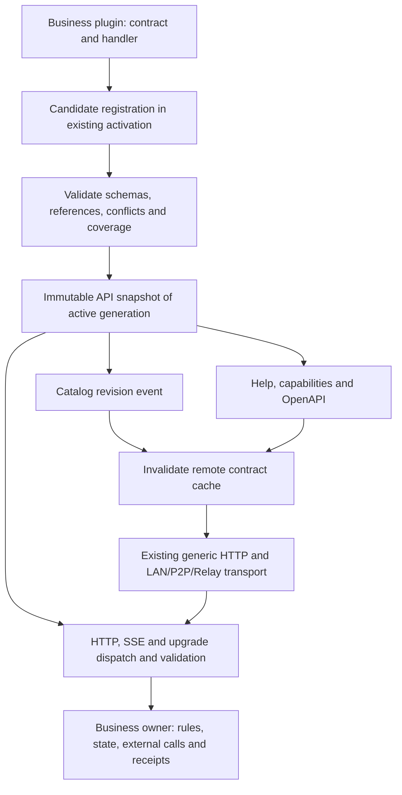
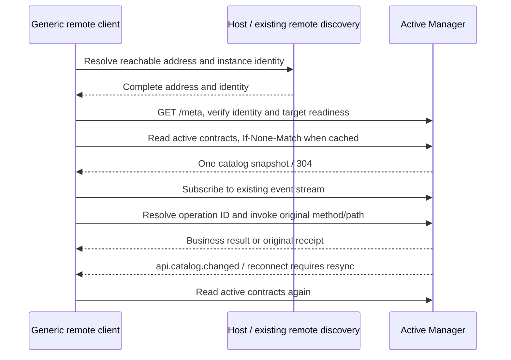

<!-- docs-language-switch -->
<div align="center">
English | <a href="./api-contract-discovery-target-architecture.md">简体中文</a>
</div>
<!-- /docs-language-switch -->

# Target architecture for API contract discovery and remote calls

> Status: implementation in progress. Registration and discovery foundations are implemented and tested in isolation; migration of all public entries, installed deployment, and two-computer acceptance remain incomplete.
>
> Audience: Manager maintainers, plugin authors, and Agent/client integration developers.
>
> Design date: 2026-10-20.

## 1. Goal and scope

When a public API is added or updated, its author maintains one executable contract. Manager uses that contract to install the route, validate structure, and generate help and OpenAPI. Authenticated remote connections discover changes and call through generic transport without a client mapping or Relay branch for every endpoint.

Full coverage means every public Manager API actually published, including public management APIs. The catalog is not a second permission allowlist. Workspace, persona, Route, Skill, and plan bindings neither grant nor remove API access. Explicit user disables and existing shared identity, parameter, ownership, file-root, idempotency, and resource contracts remain effective. Existing non-public boundaries, such as Host-private lifecycle protocols, retain their definitions; public APIs must not be reclassified as private to simplify migration.

Three separate concerns are addressed:

| Concern | Target mechanism | Outside its responsibility |
| --- | --- | --- |
| Manager address or listening port changes | Reuse Host/READY and existing remote connection discovery for the complete URL; verify `/meta` | No port scanning or second Manager |
| API addition, replacement, or removal | Generate a versioned catalog from active route contracts; notify remote consumers | No endpoint-specific client wrappers required |
| Business behavior is missing | Its business plugin implements the handler and publishes a truthful contract | Reflection and catalogs cannot create missing behavior |

This design does not automatically download or execute server code, or upgrade remote executables. Incompatible transport changes use the existing signed connector release and update chain.

### 1.1 Design decisions

Adding an endpoint should require changes only in its owning server plugin, while remote consumers retain one generic client. An executable contract enables this: authors declare it once, and registration derives routes, validators, discovery, and types.

| Decision | Approach | Reason |
| --- | --- | --- |
| Identify endpoints | Register explicit runtime contracts together with handlers | JavaScript can enumerate objects and registries, but function and parameter names do not describe an HTTP contract; TypeScript types are erased at runtime |
| Use reflection or decorators | Allow authoring syntax that normalizes to the same registration definition | C# / Java reflection also needs route attributes, annotations, or framework conventions to identify endpoints; reflection cannot implement missing business behavior |
| Prevent missing mappings | Dispatch and discovery read the same active snapshot; build checks find entries bypassing registration | A separate client mapping table creates omissions again; counting catalog entries alone cannot identify unregistered endpoints |
| Handle port changes | Rediscover the complete address and verify Manager identity | Ports identify service locations; endpoints identify routes on those services, and they change independently |
| Update automatically | Refresh discovery for contract changes, use existing publication for plugin changes, and upgrade connectors for incompatible protocols | Discovery, server deployment, and remote executable upgrades retain their own validation and recovery contracts |

“Port mapping” has two layers here: Host/READY owns the Manager listening address, and the existing LAN/P2P/Relay connection provides cross-computer reachability. API discovery creates no NAT/UPnP mapping, opens no arbitrary local ports, and does not publish a local `127.0.0.1` address as a remote destination.

## 2. Existing foundations and implementation boundaries

This section preserves the 2026-10-22 acceptance snapshot. See the [release notes](../版本更新日志_en.md) for current changes. The architecture objectives below do not imply installed acceptance.

As of 2026-10-22, the 0.3.66 candidate has passed an independent full build, six compiled integrations and generic same-instance hot-patch acceptance. Full regression and final-package verification continue; the actual two-computer connection remains pending. Current scope:

| Layer | Existing foundations | Remaining work |
| --- | --- | --- |
| Server | Executable contracts, runtime validation, active snapshots, OpenAPI, conditional reads, catalog events, and registration for HTTP, SSE, finite binary responses, and WebSocket | Migrate all public entries, identify dispatch bypassing registration, and retire duplicate declarations |
| Remote client | One catalog drives `invokeOperation()` / `openOperation()`; CLI supports HTTP, files, SSE, and WebSocket JSONL frames | Verify formal installation packages, the actual running version, and cross-computer discovery refresh |
| Isolated acceptance | Five profiles publish Gateway 114, required 99, Peer 317, hub 106 and independent 485 operations respectively, each with zero registered legacy route declarations | Profiles are counted separately; scope remains `registered-routes` and global coverage `not-proven`; final-package and physical two-computer acceptance remain pending |
| Business capabilities | Discovery describes implemented channel, target, and payload combinations | The original business module implements missing behavior and publishes it through the same contract |

Both scopes remaining in that historical snapshot belonged to personas. A prefix scope may contain multiple endpoints; this was not an estimate of two remaining APIs. Current source has retired these persona boolean/prefix declarations; see the implementation record for final acceptance status. The dynamic Peer dispatcher, legacy language-style, role-panel message, persona directory, delivery/receipt, device-profile, mobile-state and video-signalling declarations are removed. Existing encrypted private receive now has an internal contract and remains excluded from public discovery.

The latest static inventory covers 31 built-in plugin files and finds zero legacy exact method/path or prefix dispatch declarations. Its 50 executable registration call sites are not an operation count. The earlier 22 unresolved records were identified as UI routeIds. Static inventory and live catalogs are verified separately; global coverage of unregistered entries remains `not-proven`.

This review attempted Rabi knowledge and original-plan queries, which returned 503 and 404 respectively; no usable plan body was obtained. The table uses current source and retained isolated acceptance records. The attachment supplies the problem context only.

Batch evidence, migrated modules, and compatibility notes remain in the [implementation record](api-contract-discovery-implementation-progress_en.md). The following sections define target behavior and acceptance requirements; a target requirement is not automatically an implemented capability.

### Native compatibility and revoked-request outcomes

Contracts retain requests already accepted by native owners. An owner that ignores its entire body declares `body:{kind:"none",allowIgnoredBody:true}`. The generic layer discards bytes without decoding, buffering or waiting for upload. Omitting the flag still rejects nonempty bodies, and WebSocket upgrades cannot use it. Owners with selected case-insensitive literal path segments declare `pathCaseInsensitiveLiterals`; captured IDs remain unchanged, and other prefixes or write paths are not widened. Both policies appear in the same contract and OpenAPI. Route-overlap checks use the same matching rules.

A native owner may return internal `mutationOutcome:not_started|unknown` evidence from its closure around the actual transport-dispatch point. It must never be taken from client bodies or headers. Revocation still strips all business data and receipts; only the finite outcome and corresponding `uncertain` value survive in the generic failure response. Without trusted evidence, uncertainty remains conservative. Entering a handler does not establish that a native write happened, and uncertainty does not authorize automatic replay.


### Native HTTP methods and raw model suffixes

The existing HTTP transport can carry native method strings; it does not discover business APIs. Executable contracts now also support `method:"*"` exclusively for `httpProxy`, with the final `rawpathRemainder` allowed to preserve the original partial-segment suffix in paths such as `/api/.../models:suffix`. Fixed-method routes win before fallback; fallback runs before 405. OpenAPI uses `x-rabiroute-any-method`. The generic client's `invokeOperation()` requires an explicit `options.method` for such a contract, never sends `*`, and rejects overriding a fixed method. CLI supports `--operation <ID> --method PROPFIND` for an HTTP operation; discovery with `?method=PROPFIND` includes wildcard contracts. Native transport restrictions on CONNECT/TRACE still apply; accepting an HTTP token in the contract layer does not guarantee it can cross every native transport.

Framework/client regression covers this mechanism, including authenticated connections with no business bindings. Speech 39, home 53, persona knowledge/identity/storage/health, video 35, eight role-configuration, eight companion, 24 recording and core public-service/plugin-catalog contracts are wired and included in the current full build and compiled acceptance. Home-directory parameters remain discoverable through the native shared `capabilities.directoryQuery` metadata; the operation's open query Schema is not marked as an exact request or response contract.

### Final static dispatch and independent listeners

Static distribution uses an explicit `httpProxy.dispatch:"final-fallback"` contract in the same active registry. It runs after ordinary operations, native wildcard proxies, transitional owners, upgrades and known-path method rejection. Immutable Web releases retain an ordinary native proxy contract. API and Host-private paths keep their original exclusion from static distribution. Controller helpers have been retired; source-level native cleanup and final compiled acceptance are tracked in the implementation record.

Independent listeners keep their actual address, native handler and authentication. Their binding and invocation boundary are published through the original trusted lifecycle/IPC. Current source provides a Manager native HTTP mapping, allowing the generic client to reach verified native HTTP bindings through its existing Manager address. Controlled fixtures verify original HTTP bytes and an actual encrypted TunnelSession path. Native WebSockets, direct connections requiring additional native authentication, platform signature challenges and OneBot reverse WebSocket handshakes retain their own protocol boundaries; discovery-only bindings do not become public business calls. Installed-package and real two-computer acceptance remain incomplete. See [independent listeners](external-listener-contracts_en.md) and [platform-native listeners](platform-native-listeners_en.md).

## 3. Ownership and structure



| Object | Sole owner | Derived consumers |
| --- | --- | --- |
| API definitions, business validation, and handlers | Owning business plugin | Route registration |
| Active routes and contract snapshot | Extended `ManagerPluginRouteRegistry`, published by existing plugin generations | HTTP dispatch, catalog projections, diagnostics |
| Connection identity and complete Manager address | Existing Host/READY and admitted remote connections | Generic client |
| Catalog and schema cache | Rebuildable client cache | Tool discovery, call preparation, presentation |
| Business state, credentials, send records, and receipts | Existing business modules | Clients retain references and necessary receipts |

Do not create a parallel business catalog beside the route registry. Catalog generation is a read-only snapshot projection. A new plugin must not require changes to central kernel enums, help arrays, or client branches.

## 4. One executable contract

The following uses the actual source SDK registration shape. Business owners provide schemas, named business validators and a handler returning a result DTO. Inspect the installed instance's active catalog for deployment support.

```ts
const operations = context.services.require<ManagerApiOperationsService>("host.manager.operations@1");
context.effects.add(async () => {
  const registration = await operations.registerOperationsAsync([{
    contract: {
      operationId: "example.record.read",
      contractVersion: "1.0.0",
      description: "Read the selected record.",
      method: "GET", pathTemplate: "/api/example/records/:recordId",
      exposure: "public", transport: "http",
      request: { path: recordPathSchema, query: recordQuerySchema,
        headers: { type: "object" }, body: { kind: "none" } },
      responses: recordResponseContracts,
      effects: { mode: "read", description: "Read the selected record." },
      recovery: { strategy: "repeatable-read", description: "Retain the same record ID." },
      validators: recordBusinessValidators
    },
    handler: readRecord
  }], context.lifecycle.signal);
  return () => registration.dispose();
});
```

The example uses `registerOperationsAsync()` with original lifecycle cancellation; `registerOperations()` remains an in-process compatibility entry.

The actual source entry points are `registerOperationsAsync()`, `registerOperations()`, `registerHttpProxies()`, and `registerUpgrades()` on `host.manager.operations@1`. Plugins declare this service in Manifest `requires`, register within `context.effects.add`, and return a disposer calling `registration.dispose()`. Instance ownership comes from activation rather than a caller-supplied owner. The SDK exports generated `ManagerApiOperationsService` and related types. See the executable [out-of-tree plugin test](../src/manager/apiOutOfTreePlugin.test.ts).

WebSockets use `ApiUpgradeDefinition` to bind a native socket owner, sharing contract compilation, collision checks, snapshots and OpenAPI with HTTP. The contract's `websocket` descriptor declares protocol, frame schemas, capacities and completion semantics, exported as `x-rabiroute-websocket`; status 101 has no fabricated HTTP body. Before writing the handshake, the binding calls `prepareHandshake()`. After accepting, `accept({closed, close})` supplies actual lease completion and cleanup, while `validateIncoming/validateOutgoing` check native frames. `stopAccepting()` and `dispose()` separate admission shutdown from final cleanup, keeping command-result channels alive while HTTP drains. HTTP `invokeOperation()` still rejects WebSockets. `openOperation()` uses the same discovery cache and path parser for WebSockets, leaving authentication, commands and tasks to the native protocol owner.

Each contract must provide:

| Information | Requirement |
| --- | --- |
| Stable identity | `operationId` is unique in the published snapshot and independent of display names; aliases reference a canonical operation without copying its implementation |
| Routing | Explicit method, path template, encoding, trailing-slash behavior, and precedence; conflicts reject the candidate |
| Request | Runtime schemas for path/query/header/body; distinguish none, JSON, text, binary, multipart, and streams; describe repeated queries, conditional requirements, and mutually exclusive fields |
| Responses and errors | Schemas by HTTP status and content type, response headers, structured errors, `help/repair`, and receipt references |
| Effects | Describe pure reads, reads that persist viewing state, mutations, external sends, and long-lived connections; do not infer effects from GET/POST |
| Recovery | Idempotency key location and scope, resource/receipt lookup, uncertain outcomes, and conditions permitting retries |
| Lifecycle | Host injects plugin, activation, and revision identity; plugins cannot forge it; streams declare close and drain behavior |
| Maturity | Track schema completeness, implementation, automated checks, and real-environment acceptance separately; registration never implies verified behavior |

Schemas and actual structural validation share runtime definitions. TypeScript types and OpenAPI are generated artifacts. Implementation selects and pins its OpenAPI version. Unsupported schema keywords or lossy conversion must reject the candidate rather than silently weaken semantics.

Business owners continue to validate ownership, file integrity, state transitions, limits, and sources. Conditions beyond schemas reference server-side validators with stable IDs and actionable errors. Do not serialize executable validators to clients or claim clients can independently prove every condition.

Binary and stream contracts declare media type, length/digest, capacity, deadlines, cancellation, and completion. Response validation must not buffer complete large files or infinite streams. Validate JSON before committing the response; validate streams through metadata, frames, and terminal contracts. Validation failure cannot undo an external send: retain its original receipt and return a traceable uncertain outcome.

Owners that must verify the original device source before reading a body may provide `prepare()`. Registration validates the path, query, and contract version before preparation. Preparation returns either a native rejection result or a request-bound handler capturing the original admission. Only then is the body read and validated, and that handler rechecks the original identity before executing business behavior. Preparation performs no business write and adds no feature permission. Its asynchronous work shares the original request budget, snapshot, and drain lease.

The HTTP handler `signal` represents both the original request budget and response-connection lifetime. After disconnection, unstarted work must not begin. The original owner settles accepted external actions, logs, receipts and audit before releasing its lease. A stream returned after disconnection must also be cancelled and joined through natural EOF and cleanup completion; retirement must not skip iterator cleanup. Response-validation failures and unknown exceptions after execution are uncertain outcomes. Disconnection neither reverses an accepted effect nor triggers replay.

For JSON contracts, `maxBytes: 0` explicitly preserves an owner's existing absence of an application byte limit; positive values remain actual byte limits. Text, binary, and streaming bodies still require positive limits. Device bootstrap retains its native JSON reader's zero limit, while persona bootstrap retains its 8192-byte limit.

## 5. Complete public API coverage

All public HTTP entry points ultimately dispatch from the same registered snapshot, including public management, plugins, resources, static pages, binary data, SSE, and WebSocket upgrades. Typed transport bindings attach streams and upgrades to existing hosts. Non-JSON interfaces must not disappear from discovery. Declare static assets as resource-set templates rather than counting each hashed file as a business API.

Prefix and dynamic matchers may remain internal dispatch mechanisms but cannot prove complete coverage. Their owners declare actual operation templates and contracts. Dynamic resources expose parameterized paths and resource discovery. Clients must not guess suffixes, methods, or queries hidden inside handlers.

Coverage has two parts: registered public routes correspond exactly to catalog projections; build checks, entry-point review, and behavior tests identify public dispatch, upgrades, and separate listeners that still bypass registration. Runtime snapshots prove only managed coverage, not discovery of arbitrary unregistered code. Existing independent public services retain explicit owners and discovery entry points rather than being silently absorbed into Manager or gaining extra listeners.

Do not export test markers, internal functions, Host-private controls, or secrets. Existing product contracts determine public/internal boundaries. Boundary changes require separate review; migration must preserve successful authenticated remote access.

## 6. Hot updates and atomic publication

1. A plugin submits contracts and handlers within its existing activation context, producing a candidate snapshot invisible to consumers.
2. Validate schemas, references, operation IDs, routing conflicts, coverage, and transport support; generate catalog and OpenAPI projections.
3. Publish through the existing generation mechanism with one active-snapshot switch. Dispatch, help, schemas, and capability projections read the same snapshot reference.
4. Emit a catalog-change event only after commit. Failed candidates preserve previous routing and discovery without emitting success.
5. New requests use the new snapshot. Accepted requests retain their original activation lease, complete under the original contract, and preserve receipts. Existing effect scopes and draining release superseded resources.

Snapshot identity includes at least `applicationGenerationId`, `managerInstanceId`, `pluginGenerationId`, `catalogRevision`, and a canonical-content `catalogDigest`. Revision increases monotonically within a Manager instance. Rollback is another publication: revision increases even if the digest returns to an earlier value. A restarted instance has a new identity; revision numbers alone are insufficient.

Contract or capability-definition changes update catalog revision. Transient facts such as device connectivity use existing state events and capability queries rather than rebuilding every contract on each heartbeat. Plugin revisions track implementation changes; diagnostics correlate executed code with its contract.

Non-migratable state or transport boundaries follow the existing [source hot-patch](source-hot-patches_en.md) contract and controlled Host switching. Do not add another updater or restart merely because an API was added.

## 7. Discovery, capabilities, and remote refresh

Retain `GET /api/agent/help`, `GET /api/lan-agent/capabilities`, and `GET /api/agent/send/capabilities` as projections of the same snapshot. A proposed `GET /api/agent/openapi` exports machine-readable contracts. The source and isolated Manager implement this path, the snapshot fields below, and the event. Installed deployment and two-computer acceptance remain pending; do not assume an older installed release provides them.

Discovery returns stable IDs, contract versions, snapshot identity, digest, completeness, and schemas or references tied to the same snapshot. Add `ETag/If-None-Match` conditional reads. Pagination binds to a snapshot revision and explicitly rejects expired cursors rather than combining generations. `304` reuses only the matching cache and never replaces connection identity or health verification. Exports contain no credentials, authenticated URLs, private paths, or real business data.

Remote call flow:

1. Local consumers use Host/READY. Remote consumers reuse admitted connections and existing discovery/tunnels. A PC's loopback address is not another computer's reachable endpoint.
2. Verify `/meta` generation, instance, and existing health boundaries. Exact diagnostics and post-write checks retain current behavior.
3. Read discovery and required contracts; cache by target Manager identity, catalog revision, and contract version. Select by operation ID.
4. Call the original method/path using the declared transport: `invokeOperation()` for HTTP/SSE or `openOperation()` for WebSockets, retaining authentication, version, and idempotency contracts. No generic execution endpoint that bypasses normal routing or authorization is needed.
5. Reuse existing Manager event transport with event `api.catalog.changed`. Events invalidate caches; they never execute business actions.
6. Re-read snapshots after reconnect, cursor gaps, or identity changes. Catalog errors or contract mismatches allow one bounded refresh. Do not add fixed-interval background catalog polling.

Capability states such as `available/unavailable/disabled` distinguish missing implementation, unavailable runtime dependencies, explicit user disablement, and actual authentication failures, with reasons and next steps. Discovery does not grant permission. A missing entry, expired cache, or unsupported schema is a contract/compatibility problem, not proof that remote access is forbidden.

A new public API requires only server-plugin implementation and registration. Existing generic clients can discover and call it when they support the required transport and schema version. Unknown mandatory features block only the incompatible call and report the required connector version; they do not clear connections, rebind personas, or disable other APIs.

Native Agent tools have a separate host lifecycle. A generic API tool can consume discovery dynamically. Hosts that register tools only at startup need explicit refresh or their existing generic call tool. Catalog refresh does not imply native tools were added to an active Desktop turn and does not replace its task owner.

### 7.1 Three automatic update flows

| Trigger | Automatic handling | Completion evidence |
| --- | --- | --- |
| Manager address or generation changes | Rediscover a reachable address through the existing connection; verify `/meta`; discard contracts cached under the old identity and resubscribe to events | The same remote connection resumes reads with the new address and identity recorded; original receipts reconcile in-flight writes |
| A plugin adds, changes, or removes public endpoints | Validate the candidate, atomically publish routes and contracts, emit `api.catalog.changed`, invalidate client cache, and conditionally read the new snapshot | The new operation is callable by ID without client changes or Relay branches; removed operations no longer appear available |
| A contract requires an unsupported client transport feature | Report the compatibility gap and required version; upgrade through the existing signed connector mechanism, then verify identity and discovery again | Package identity, signature, running version, and the target call have been verified |

Initial connection, address changes, and reconnection follow this sequence. Ordinary catalog updates start at the active-contract read:



A publication may occur between reading discovery and subscribing. The current Manager event stream has no durable replay cursor, so conditionally verify discovery once more after subscription and verify the current snapshot after reconnection. Connection loss triggers rediscovery and result reconciliation, never replay of business writes.

## 8. Send capabilities and failure recovery

`/api/agent/send` is a public parent API. The actual sending provider owns valid combinations of target, payload, and channel. It publishes a serializable combination contract shared by validation, capabilities, and execution. Do not introduce another central channel/type table.

Current implementation must generate the precise rule that managed `fileId` payloads work in NapCat groups but not private messages. Once the business plugin implements private-file upload, source validation, size constraints, and receipts, changing that same rule updates validation and discovery. Remote consumers refresh after notification without a private-file-specific client mapping.

| Failure | Required behavior |
| --- | --- |
| Candidate conflicts or missing schema | Reject publication, preserve the old version, identify the operation in diagnostics |
| Generation changes between discovery and execution | Rediscover identity; reads follow their operation recovery rules; writes preserve the request/key and inspect the original resource/receipt first |
| Timeout, 5xx, 412, or unverifiable post-write identity | Report failure or uncertainty under the original contract; never change target/channel or automatically replay writes |
| Operation unloaded | Return the actual missing-interface/resource result and catalog revision; refresh without guessing another path |
| Event disconnect or loss | Refresh or conditionally verify on reconnect; do not retain stale mappings indefinitely |
| Structurally valid request fails business conditions | Original owner returns actionable errors and receipts; do not mislabel the result as authorization failure |
| Publication rollback | New revision represents previous content; in-flight requests and idempotency records remain queryable |

## 9. Migration and retirement

| Stage | Deliverables and validation | Exit condition |
| --- | --- | --- |
| A: Inventory | Review public dispatch, plugin exact/prefix/dynamic routes, resources, upgrades, and separate listeners; AST output is only a lead | Every public entry has an owner, scope, and migration assignment, with no silent omissions |
| B: One vertical path | Extend existing registration; migrate send, upload, and receipt flow first; generate validation, help, and capabilities | A shared rule changes both actual validation and discovery; success and failure have evidence |
| C: All public entries | Migrate each module to one declaration; label transitional gaps incomplete without reducing reachability | New registered APIs work without client/Relay branches; coverage checks account for every public entry |
| D: Hot updates and remote refresh | Shared-snapshot publication, conditional reads, event recovery, stream cancellation, and two-computer validation | Addition, replacement, removal, failed candidates, and rollback pass acceptance |
| E: Remove old definitions | Delete manual operation/help arrays, duplicate channel rules, remote-only mappings, and obsolete cache entries | Source, build outputs, and installed runtime have no consumers of old definitions |

Stages organize development and reviewable commits, not permanent dual sources. Delete each module's old definitions when it switches. A public URL retained for genuine compatibility projects the new snapshot rather than maintaining independent arrays; record consumers, one migration path, exit release, and validation. Existing discovery URLs remain only where real client compatibility requires them; internal cleanup must not silently break public contracts.

## 10. Acceptance criteria

- Register a public API in an out-of-tree plugin by changing only that plugin. Actual routing, help, capabilities, and OpenAPI include it; the same authenticated remote connection calls it successfully without another key or per-feature permission.
- Published public operations match exact contract projections. Prefix/dynamic children, streams, resources, and upgrades have explicit coverage; unmanaged entries fail full-coverage checks.
- Conditional requirements, mutually exclusive fields, and error examples agree across server validation, exported contracts, and client interpretation. Original owners retain final cross-field business validation.
- Discovery and execution never observe different snapshots during addition, replacement, removal, or rollback. Failed candidates cannot contaminate active state.
- After a real Manager address change across computers, remote clients recover through existing discovery without fixed ports, port scanning, manual URLs, or extra Managers.
- The same remote connection and client binary discover a new API. Disconnects, cursor gaps, and reconnects recover without catalog polling.
- Timeouts, generation changes, 412 responses, and uncertain sends preserve original idempotency keys, targets, and receipts without duplicate delivery. Original receipts remain queryable under existing retention contracts after unloading.
- Binary, SSE, and WebSocket behavior covers backpressure, cancellation, disconnects, capacity, and in-flight leases without whole-stream buffering.
- Preserve both local and authenticated remote success paths. Explicit disables, credential revocation, and existing ownership contracts remain effective.
- Run relevant tests and `npm run build`; deploy through the actual hot-patch/Host contract and verify health, active generation, candidate hash, and target behavior. Record source checks and two-computer runtime acceptance separately.
- Audit old code, configuration, routes, bundles, and resource references and satisfy stage E. Generated schemas do not automatically increase capability maturity.

The criteria above remain the complete objective. Source progress in section 2 does not replace migration, retirement, installed-runtime checks, or two-computer acceptance.

## 11. Related current contracts

- [Connection and API access](connection-access_en.md): default full access after connection and existing boundaries.
- [Rabi Agent interfaces](rabi-agent-interfaces_en.md): current paths, sends, uploads, and receipts.
- [Remote Agent setup and updates](lan-rabi-agent-bootstrap_en.md): admission, generic calls, and connector updates.
- [Plugin platform architecture](manager-plugin-implementation-hot-swap_en.md): generations, shared SDK, and effect scopes.
- [Source hot patches](source-hot-patches_en.md): actual compatibility matrix, state, and controlled switching.
- [Code architecture](code-architecture_en.md) and [project function map](project-function-map_en.md): current modules and feature ownership.
