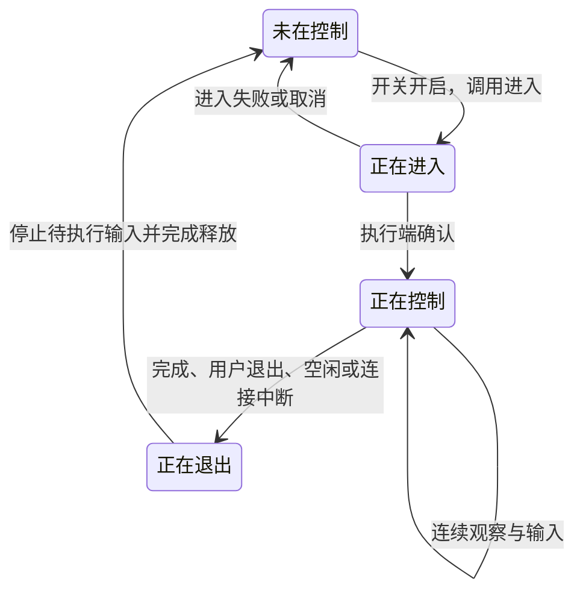

<!-- docs-language-switch -->
<div align="center"><a href="./computer-control-design_en.md">English</a> | 简体中文</div>
<!-- /docs-language-switch -->

# 本机与远端电脑控制方案

状态：设计定稿，功能尚未实施或验收。更新日期：2026-11-10。

本文是本次电脑控制工作的实施合同，供产品、开发和验收人员使用。当前已有能力见[电脑客户端](remote-computer-client.md)。下述要求确定要实现什么；它们不证明当前软件已提供这些功能。

## 0. 执行时先确认

1. 交付范围固定为独立标签页、平级电脑列表、本机与远端统一六项开关、Windows 输入会话、可见提示与退出、静态标注、默认关闭的动态标注、WebGUI 调参及匹配验收。动态标注必须实现，“默认关闭”不表示可以省略该功能。
2. 正文中的“支持”“提供”“默认”均描述交付要求。实施前读取第 12 节源码入口和当前 operation 合同，分别记录已有、待新增和已验证项；不得据本文对运行实例调用尚不存在的工具或 action。
3. 以第 3 节为默认值唯一依据，以第 7 节为待新增 action 命名和语义依据。外部资料及算法比较只解释选择，不覆盖本项目合同。
4. 首版采用第 6.8 节固定的 CPU/KCF 与局部模板匹配路线。其他跟踪器、检测模型、GPU 后端及其他平台的原生输入属于扩展范围，不由执行 Agent 自动增加。
5. 未确定的技术数值只限第 9 节列明的校准项。执行 Agent 在隔离候选中测量、写入共享配置声明和中英文文档，继续原任务；不得编造性能保证、跳过功能或把正常实现选择升级成新的用户审批。
6. 遇到真实版本或依赖差异，先核对实际接口与原 owner，修正这一处合同映射后继续。保留已有鉴权与用户显式关闭项，不增加白名单、逐动作许可、人工解锁或任务之外的权限锁。

## 1. 目标与覆盖范围

RabiLink 增加独立的“电脑控制”选项卡，统一管理本机、已接入的轻量客户端电脑，以及经现有连接访问的完整 Rabi 主机。本机与远端使用同一套总开关、六项功能开关、执行检查和结果回读。第六项“屏幕标注”供 Agent 直接在屏幕覆盖层画图，与模拟鼠标键盘独立。

用户从浏览器打开哪个 Manager，该 Manager 所在电脑就是本机；浏览器所在电脑不自动成为执行目标。本机无需另装自连接客户端，也不要求配置一个主控 Agent。页面汇总可访问的 RabiPC 主机及远端节点，全部作为平级条目；本机用标签标明，节点所属主机作为说明信息，不形成父子目录。

首版输入执行实现 Windows 的鼠标与键盘操作。Mac/Linux 保留其真实支持的终端和文件能力；缺少的平台能力单独标记，功能开关的保存值仍按用户选择保留。

体验目标：默认可用、一次进入后连续操作、目标电脑看得见、用户随时退出。控制状态用于组织一次操作的来源、提示与收尾，沿用已有鉴权和用户设置；不增加应用白名单、逐动作审批、控制密码、默认禁用、人工解锁或退出后的冷却期。终端、文件和单独查看画面无需先进入鼠标键盘控制状态。

交付时同时满足三条底线：Agent 可以用少量连续工具调用完成任务；用户能看清“哪台电脑、谁在做什么、怎样停止”；资源消耗可见、可调，空闲时不持续处理画面，运行时按实测预算收敛。第 6.10 节将三者合并为具体使用路径与验收要求。

## 2. 独立的电脑控制选项卡

RabiLink 顶部导航调整为：

```text
主页    远端智能体    电脑控制    配置
```

“电脑控制”是 RabiLink 下与“主页”“远端智能体”“配置”并列的独立标签页，不嵌套在远端智能体页面，也不是通过主机下拉框进入的附属面板。新增页面路由 `/rabilink?tab=computer`，浏览器 hash 路由按现有模式呈现；当前 tab 解析器尚未接受 `computer`，实施时同时更新解析器、页面与导航测试。页面默认列出全部可访问电脑，目标深链只负责定位、展开对应条目，不把列表裁成某一主机下的节点。

电脑控制页包含：

1. 平级电脑列表：RabiPC 主机、本机及已登记的远端节点全部直接排列，不先选择主机、不按主机分组嵌套。默认包括离线条目，可搜索名称、筛选类型和状态；筛选为可选工具，不作为查看电脑的必经步骤。
2. 行摘要：以“名称｜类型（主机/远端节点）｜在线状态”为主要列。完整 RabiPC 标记“主机”，轻量客户端标记“远端节点”，当前 Manager 所在条目额外标记“本机”。本机/远端是位置关系，不与主机/节点类型混用；在线状态也不等于总开关或功能已启用。
3. 点击展开：默认各行收起，点击名称或展开按钮就在原行下方展开该电脑的操作和详细设置，可同时展开多行。行摘要始终可见，键盘也能展开/收起；展开本身不启动终端、截图、追踪或控制。正在控制时，收起行仍显示控制中和退出入口。
4. 展开内容：显示系统、真实能力及必要的所属主机说明，再显示当前控制来源、任务、最后动作、剩余时间、操作按钮、总开关、六项功能与控制体验参数。常用项直接列出，高级参数按功能展开。离线节点可经在线的配置 owner 保存设置；配置 owner 不可达时明确未保存，不伪称离线保存已生效。

列表摘要布局示例：

```text
电脑控制

[搜索电脑名称] [类型：全部 ▼] [在线状态：全部 ▼] [刷新状态]

电脑名称                  类型          在线状态
▸ 办公电脑 [本机]         主机          在线
▸ 打包电脑                主机          在线
▸ 测试电脑 A              远端节点      在线
▸ 测试电脑 B              远端节点      离线
```

上述各行同级。刷新保持条目顺序、展开状态和未提交草稿，不因在线状态变化让行跳动；目标切换时旧画面和输入不可套用到另一台电脑。收起行或展开另一台电脑不自动中止已受理工作，工作状态仍由原执行端负责。

列表读取复用既有主机目录及各 Manager 的实例目录，独立来源批量查询；一个主机查询失败不阻塞其他条目，受影响条目标记“状态未知/无法读取”并保留最近信息，不把无法查询直接写成离线。条目以稳定主机和实例引用合并，同一完整主机已有可靠相同身份时只展示一次；不凭名称或 IP 猜测合并。列表汇总只读投影，设置与执行仍回到各自原 owner。

### 2.1 展开单台电脑：常用设置与操作

以下为完整字段布局，便于核对入口，因此将分组展开示意。实际页面电脑行及详细分组初始收起，点击展开；动态标注未勾选时，其相关参数灰显但仍可查看说明。此处只有示意，不表示功能已实现。默认数值仍以第 3 节为唯一依据。

```text
办公电脑 · 主机 · 本机 · 在线（已展开）

当前工作：未在控制 / 未在跟踪
运行时显示：来源与任务、最后动作、剩余时间、保存状态
[开始手动控制] [退出控制] [停止跟踪] [清除标注]
（按钮按实际状态启用，不以展开动作开始工作）

启用此电脑                         开

▾ 终端命令                         开
  Shell                           [目标电脑可用 Shell ▼]
  工作目录                        [目标电脑路径]
  会话与尺寸                      [当前会话 ▼] [自动适配 / 自定义]
  [打开终端] [关闭所选终端] [展开当前会话输出]

▾ 文件操作                         开
  本地文件                        [选择文件]
  目标电脑路径                    [绝对路径]
  当前传输                        状态 / 大小 / 已传输 / 校验结果
  [上传] [下载] [查询原传输] [取消传输]

▾ 窗口与截图                       开
  观察来源                        [桌面 / 指定窗口 ▼]
  目标窗口                        [按需查询后选择 ▼]
  截图清晰度                      [最大宽度：默认 / 自定义]
  [未选] 操作后刷新画面（本次手动操作参数）
  [刷新画面] [查看原图] [保存截图]

▾ 智能体任务                       开
  执行程序 / 任务绑定 / 当前状态    按已有配置显示
  [前往此电脑的智能体任务配置] [查看原任务]

▾ 鼠标与键盘                       开
  [勾选] 控制时显示 Agent 指针
  [勾选] 空闲时自动退出             120 秒
  倒计时显示                      最后 [10] 秒
  退出控制快捷键                   Ctrl+Alt+Esc
  快捷键注册状态                  按实际注册结果显示
  [未选] 检测到本机主动操作时退出
  本次输入                        [文字] [快捷键] [点击/滚动/拖拽]
  [执行所选输入] [取消本次输入]
  [展开输入与恢复设置]

▾ 屏幕标注                         开
  静态标注时长                    10 秒 [自定义 / 保留至清除]
  本次标注样式                    [框/圈/箭头/路径/文字/高亮]
  样式细节                        [颜色] [线宽] [文字大小] [透明度]
  [未选] 动态标注（持续跟踪目标）
  持续跟随移动目标，会增加 CPU/GPU 占用；可调更新频率。
  跟踪方式                        [KCF（默认）/ 模板]
  请求更新频率                    10 次/秒 [预设 / 自定义]
  动态任务结束方式                [跟随所属任务 / 指定到期时间]
  当前目标                        来源 / 目标数 / 逐目标状态
  [开始跟踪] [停止跟踪] [清除此图层] [清除全部标注]
  [展开跟踪高级设置]

▾ 性能与资源
  性能模式                        [自动 / 自定义]
  当前生效                        频率 / 分辨率 / 降级原因
  当前测量                        处理延迟 / CPU / 内存（未采集不填 0）
  [展开资源预算] [查看性能监控]

每组：[恢复本组默认]
修改后的反馈：保存中 / 已保存 / 未保存及原因
默认值 / 用户保存值 / 本次任务覆盖 / 当前生效值分开显示
```

### 2.2 高级设置展开示意

以下高级组位于同一电脑行内，不创建额外主机选择层。`后端默认`、`自动`表示取值方式，正式界面必须从共享 schema 加载实际数字、单位和范围；第 9 节尚需校准的值在本文不编造。无对应参数的后端隐藏该项并给出说明，不显示假的统一置信度。

```text
▾ 跟踪高级设置
  搜索范围                        [目标附近 / 自定义区域]
  搜索扩展参数                    [后端默认 / 自定义]
  分析分辨率或缩放                 [自动 / 自定义]
  模板更新策略                    [定位可靠时更新 / 不更新]
  模板匹配阈值                    [后端默认 / 自定义]
  模板核验 / 重新识别间隔           [后端默认 / 自定义]
  丢失判定                        [后端默认 / 自定义]
  预测与平滑                      [后端默认 / 自定义]
  预测持续范围                    [后端默认 / 自定义]
  来源帧缓存                      [后端默认 / 自定义]
  [恢复本组默认]

▾ 资源预算
  跟踪目标数量预算                [自动 / 自定义]
  CPU / 计算时间预算              [自动 / 自定义]
  内存与帧缓冲预算                [自动 / 自定义]
  远端预览与发送预算              [自动 / 自定义]
  当前策略                        按合同依次降频/降分辨率，仍超预算暂停
  执行后端                        CPU（首版只读，无 GPU 选项）
  [恢复本组默认]

▾ 输入与恢复设置
  输入批次上限                    [后端默认 / 自定义]
  原生输入分段预算                [后端默认 / 自定义]
  连接失效回收预算                [现有配置 / 自定义]
  当前状态                        所属请求 / 已执行范围 / 释放状态
  [恢复本组默认]
```

### 2.3 参数入口覆盖清单

实施与验收按此表逐项核对，不能因为简图没有画到某个字段就省略正文要求。常用/高级分组是展示安排，不改变配置 owner、默认值或已确定范围。

| 参数或信息 | 界面位置 | 类型与取值依据 |
| --- | --- | --- |
| 名称搜索、类型/在线状态筛选 | 平级列表上方 | 页面筛选，不改变执行范围与持久开关 |
| 总开关及六项功能开关 | 单电脑行与六个功能标题 | 持久设置，第 3 节默认值 |
| Shell、工作目录、会话与尺寸 | 终端命令组/原终端对话框 | 本次终端参数，沿原终端合同，不新建另一份终端默认库 |
| 文件与目标路径、传输进度/校验 | 文件操作组 | 本次传输参数及只读回执；分块和不覆盖语义保持原文件协议 |
| 观察来源、目标窗口、截图清晰度 | 窗口与截图组 | 来源选择与已实现截图参数；当前协议的 `maxWidth`，沿原默认与范围 |
| 操作后刷新画面 | 窗口与截图组 | 本次手动请求的 `captureAfter`，默认 false，不变成自动后台截图 |
| Agent 执行程序与任务绑定 | 智能体任务组的跳转 | 复用原任务配置；当前页不重建模型/会话配置 |
| 指针、空闲开关/时长/倒计时、退出快捷键、主动操作退出 | 鼠标与键盘组 | 持久体验设置与只读注册结果，第 3 节默认值 |
| 本次文字/快捷键/鼠标动作与取消 | 鼠标与键盘组/操作面板 | 本次操作参数，输入前按原流程进入控制 |
| 静态标注时长、图形与样式 | 屏幕标注组 | 时长按第 3 节；形状/颜色/线宽/字号/透明度为本次对象参数，未覆盖时沿渲染默认，不新增数字默认 |
| 动态复选框、后端、更新频率、任务到期 | 屏幕标注组 | 持久默认与本次任务覆盖分开；按第 3、7 节的 `backend`、`rateHz`、`expiresAt` 规则 |
| 搜索范围/扩展、分析分辨率、模板更新/阈值/核验、重新识别与丢失判定 | 跟踪高级设置 | 对应后端参数，初值与校准过程按第 9 节，不由示意图指定数字 |
| 预测、平滑、预测范围、来源帧缓存 | 跟踪高级设置 | 对应后端及缓存配置；失效与过期处理保持第 6.7 节语义 |
| 性能模式、目标/计算/内存缓冲/发送预算 | 性能与资源/资源预算 | 持久预算与实际降级分开，按第 6.10、9 节；不增加 GPU 实现 |
| 输入批次、原生分段、连接回收预算 | 输入与恢复设置 | 共享执行/原恢复配置中的参数；不存第二份冲突超时值 |
| 来源/任务/逐目标状态、实际频率/分辨率、延迟、资源、降级原因 | 行摘要与对应运行状态区域 | 只读实测；没有数据显示未运行/未采集，不编造值 |
| 恢复默认、保存反馈、用户值/任务覆盖/生效值 | 每组与设置反馈区域 | 通过原 owner 保存回读，打开设置不启动采集 |

任务参数只在明确提交相应操作时使用；终端、文件、图形样式和 `captureAfter` 不因出现在示意图里就成为新的永久开关。协议固定值不伪装成可调项。首版仍无检测模型下载、GPU 后端或每应用权限表。

“远端智能体”保留接入电脑、连接器维护、执行程序、Agent 和任务绑定配置。原页面的电脑总开关、终端、截图按钮迁移到“电脑控制”，不保留第二套独立控制界面；可保留指向指定电脑的跳转链接。“电脑控制”中的“智能体任务”链接打开原任务配置，复用既有 owner 和保存入口。

## 3. 总开关与六项功能开关

总开关命名为“启用此电脑”。它控制 Rabi 针对该执行电脑发起的六类操作，本机与远端含义一致。

| 功能开关 | 界面说明 | 控制范围 |
| --- | --- | --- |
| 终端命令 | 允许运行命令和读取终端输出 | 终端创建、输入、调整尺寸、查询与输出订阅 |
| 文件操作 | 允许查询文件和上传、下载 | 文件元数据、文件读取、上传开始、分块写入与提交 |
| 窗口与截图 | 允许查看窗口和电脑画面 | 窗口列表、桌面截图和指定窗口截图 |
| 智能体任务 | 允许向这台电脑上的智能体分派工作 | 经 Rabi 向该电脑原 Agent owner 发起、续接和补充真实工作，包括路由、自动化和直接任务投递 |
| 鼠标与键盘 | 允许点击、打字、滚动、拖拽和快捷键 | Rabi 原生鼠标、文字、按键及有序输入动作 |
| 屏幕标注 | 允许在画面上画框、圈、箭头和说明文字 | 透明覆盖层的创建、更新与显示；不向目标应用注入输入、不修改原图 |

“屏幕标注”下增加“动态标注（持续跟踪目标）”复选框，默认不勾选，属于标注模式而非第七个权限开关。取消勾选后停止持续采集与跟踪，普通静态标注继续可用。勾选表示此模式可使用，实际后台任务由 Agent 对明确目标调用开始后建立，不因勾选本身永久分析全屏。提示文字不写成“提升电脑/游戏性能”；局部跟踪相对反复全图识别的效率收益与持续处理相对静态标注的新增开销分开说明。

“鼠标与键盘”作为一个开关，覆盖上述全部输入动作，不再拆成“点击”“打字”“拖拽”三个开关。

新电脑总开关及六项子开关默认开启。旧配置缺少子开关字段时解释为开启；原远端总开关为关闭时继续关闭。本机新增相同设置，缺失字段默认开启。

以下是首版固定默认值，实施时写入同一份共享配置声明。用户通过 WebGUI 修改后，以用户保存值为准；执行 Agent 不在实现或发布时自行改成另一套默认值。

| 参数 | 首版默认值 | 生效与调整 |
| --- | --- | --- |
| 总开关、六项功能开关 | 开启 | 立即生效，保留旧配置显式关闭 |
| 控制时显示 Agent 指针 | 开启 | 立即生效，只改变视觉标记 |
| 空闲退出 | 开启，120 秒 | 秒数为正数；开关可关闭；30/60/120/300 秒预设及自定义 |
| 空闲倒计时显示 | 最后 10 秒 | 空闲时长不足 10 秒时显示整个剩余时间，不弹确认框 |
| 退出快捷键 | Ctrl+Alt+Esc | 本机原生注册，显示真实成功/冲突；不替换成裸 Esc |
| 检测到本机主动操作时退出 | 关闭 | 仅开启后对 Agent 输入会话生效 |
| 静态标注显示时长 | 10 秒 | 支持自定义时长或明确保留到清除 |
| 动态标注 | 关闭 | 必须由用户启用，开启本身不创建跟踪任务 |
| 动态更新频率 | 请求上限 10 次/秒 | 5/10/15/30 及自定义；自动模式允许下调并显示实际值 |
| 性能模式 | 自动 | 使用第 6.10 节策略；自定义值与实际值分别显示 |
| 动态任务时长 | 跟随所属任务生命周期，无静态 10 秒到期 | 支持显式到期时间；第 6.7 节定义停止条件 |

关闭总开关后，子开关保持原保存值并禁用编辑，操作按钮显示关闭原因；再次开启总开关后恢复原选择。总开关开启时，可以逐项关闭或开启。保存后回读权威状态再确认成功，失败时显示实际结果，保留未提交草稿供修正。

重新开启任何开关只恢复可用设置，不复活旧输入、旧跟踪或已经清除的图层。实际工作必须按原授权发起新请求；任务临时参数不能覆盖任何用户显式关闭项。

有效能力由四个条件共同决定：总开关开启、对应子开关开启、执行目标在线、平台与当前执行版本支持。能力支持情况与用户设置分开返回；不能把平台不支持写成用户关闭，也不能把默认开启显示成已经实现。

设置变更立即按正式保存事务应用，无需重启。沿现有即时保存入口显示保存中、成功或失败；不依赖 RabiLink“配置”选项卡的顶栏保存来提交另一份副本。

## 4. 配置归属与执行检查

每个设置由执行目标所属 Manager 唯一持有。完整主机自己的设置由自身 Manager 保存；轻量客户端的设置由接入它的 Manager 保存。远端页面经现有连接读写目标 Manager，浏览器只保存编辑草稿。

配置以稳定的主机身份和执行电脑身份定位。本机使用持久身份，客户端使用原 node/instance 身份；不以 IP、显示名称、当前 PID、generation 或临时连接 ID 作为持久配置键。完整主机接入远端后，仍使用其原本机配置，避免出现“本机关闭，换一个远端入口却开启”的两份状态。

在原电脑配置 owner 上增加 `terminal`、`files`、`observation`、`agentTasks`、`input`、`annotation` 六项功能字段和对应体验参数，复用总开关与配置版本。它们是待新增的业务字段；落盘路径和外层结构沿原 owner，不新建平行配置库。更新采用当前版本比较，冲突时重新读取并合并用户明确修改的字段。名称、说明、默认值、范围和动作映射共用声明。

所有本机与远端入口都必须到达原执行 owner 的统一检查，包括 WebGUI、公开 API、CLI/MCP、Peer 转发、ManagerLocalComputer 和轻量客户端派发。已校验且条件不变的同进程调用复用结果；排队输入在实际执行前及动作间检查最新设置，处理用户中途关闭和连接失效。

本机执行路径不得因为“local”而跳过检查。跨主机转发保留目标引用，由目标 Manager 检查其当前配置。设置关闭错误给出具体功能、目标及“RabiLink → 电脑控制”的恢复入口。

总开关关闭后，Manager 的设置页面、连接诊断、健康、知识服务和应用生命周期仍可使用；配置查看、重新开启、原请求状态查询、停止和资源清理仍经原鉴权入口处理。这些能力保证用户可恢复电脑控制，不能借此发起新的电脑业务操作。

## 5. 关闭开关时的在途行为

| 关闭对象 | 生效行为 |
| --- | --- |
| 总开关 | 拒绝新的六类操作，停止待执行输入并清除屏幕标注；各类已受理工作按下列规则处理 |
| 终端命令 | 拒绝创建和新输入，停止新的输出读取和订阅；已有进程不自动强杀，仍可显式关闭所属终端 |
| 文件操作 | 拒绝新读写及后续上传块和提交；已完成写入保留事实，原上传状态与中止清理仍可用 |
| 窗口与截图 | 拒绝新查询和截图，取消尚未发出的刷新；在途返回不再展示，清除页面当前画面，不删除用户已明确保存的文件 |
| 智能体任务 | 拒绝新的工作投递；已接受任务沿原 owner 查询，用户通过原停止入口中断，不宣称自动撤回 |
| 鼠标与键盘 | 取消待执行动作，停止剩余序列，释放本次操作持有的按键和鼠标按钮；已执行动作保留原回执 |
| 屏幕标注 | 拒绝新绘制和更新，清除该电脑的现有 Rabi 标注；原状态与清理入口继续可用 |

关闭后的状态查询只提供恢复所需的状态、偏移、哈希或回执元数据，不通过查询例外继续返回已禁用的文件、终端输出或画面。清理动作使用原资源 ID，不创建新终端、不执行额外脚本、不扩大停止范围。设置写入已确认与执行端停止已确认分别展示；未取得停止回执时保留待确认状态。

## 6. 控制状态与完整操作体验

### 6.1 进入、连续控制与退出

“鼠标与键盘”开启表示允许使用，不表示 Agent 已经在操作。Agent 需要先调用进入控制，目标执行端确认会话已建立后，才能模拟键盘鼠标输入。进入控制是一次普通工具调用，不弹新增审批，不要求用户在目标电脑旁点击允许。



一次进入覆盖同一任务在该电脑上的连续动作，包括切换应用、打开窗口、快捷键、文字和拖拽。读画面、切窗口和后续点击不反复申请进入，也不按窗口建立权限名单。执行身份沿用现有连接与真实任务；控制会话 ID 用于关联和取消，不是另发一套访问凭据。

同一电脑同一时刻有一个明确的控制来源，避免两个 Agent 改变同一前台焦点。只在实际输入短序列内串行动作，不锁住本机人的输入、不冻结系统，也不阻塞终端、文件和画面查询。另一个来源请求控制时返回当前来源和状态，不静默抢占、不无限排队；当前任务主动退出或空闲退出后即可进入，不需人工解锁。

Agent 完成这段界面工作后主动退出，随后仍可用终端、文件或其他工具继续任务。WebGUI 手动操作也通过同一进入/退出流程，来源显示“手动控制”；查看页面和刷新画面不会自动开始控制。用户要求接手时先结束 Agent 的旧会话，再建立手动会话，避免两路输入混合。

### 6.2 目标电脑上的提示与虚拟指针

控制开始后，在**被控制电脑的实际桌面**显示轻量控制条；发起端 WebGUI 同步显示状态。远端控制时，两端都能看见；关闭发起端页面不等于 Agent 已停止，真实状态由执行端提供。

```text
Rabi 正在控制此电脑 · 助手 / 当前任务       [退出控制]
点击与输入中 · 空闲 120 秒自动退出        Ctrl+Alt+Esc 退出
```

控制条不抢焦点，不弹阻塞模态框，沿用 Rabi 深浅色主题，文字与图标共同标记状态。可拖动到不遮挡业务的位置，保持退出按钮可见；多屏在控制所在屏幕展示控制条，其余屏幕保留轻量状态入口。全屏时仍提供可见入口和系统快捷键。进入与退出显示一次简短反馈，不为每次动作弹通知。

新增“控制时显示 Agent 指针”，默认勾选。目标桌面显示带 Agent 标记的高对比指针与短暂点击反馈，发起端画面按执行位置同步标记。键盘输入时状态条显示“正在输入”，不展示完整输入内容。指针大小适配 DPI，反馈遵循减少动态效果设置；关闭指针只关闭视觉标记，控制状态条和退出功能继续保留。

这里的虚拟指针是 Agent 位置和动作的**可视标记**。Windows 首版的输入仍作用于共享的系统鼠标、键盘和前台焦点，不能声称拥有一套独立鼠标、能与人同时无干扰操作。目标桌面标记以实际注入/执行回报为准；远端可即时显示待执行位置，但明确区分它与已执行位置，不能让“指针动了”冒充输入成功。

叠加层除退出按钮与明确可拖动区域外不拦截点击、不覆盖输入目标，也不改业务窗口的层级。截图与指针状态分开传递，避免指针被反复截进画面产生重影或误导 Agent；具体截图排除效果在 Windows 实机验收。指针渲染失败时降级为系统指针和状态提示，并报告降级，不把装饰效果变成控制权限门槛。

### 6.3 空闲退出与连接中断

新增“空闲时自动退出”，初始值和可调整方式以第 3 节为准。空闲时长只控制当前输入会话，不撤销原任务授权。

按目标执行端的单调时钟计算空闲时间。有效活动包括当前控制来源已执行的鼠标键盘动作，以及它为继续当前任务显式发起的画面观察；单纯心跳、状态轮询、网页后台预览刷新和未执行的排队请求不续期。这样“观察 → 思考 → 操作”连续进行时无需反复进入，也不会由浏览器轮询永久占着控制状态。

末尾 10 秒在原状态条内显示剩余时间，不弹确认窗口、不要求用户点“继续”。任何有效活动直接恢复正常剩余时间。用户修改空闲时长后按最新设置重新计算，界面同步显示实际剩余值。

空闲退出只结束当前鼠标键盘会话，不关闭电脑总开关、不登出 Agent、不终止任务或其他工具。后续确有界面操作时，Agent 在原授权下重新调用进入即可。另有连接失效回收，沿现有链路的有界预算执行；它与用户可关闭的空闲退出分开，执行端不会因网络永久断开而一直保留按下状态。

本机和远端均由目标电脑执行端负责退出、取消及按键释放，不能依赖浏览器定时器或远端 Manager 发来最后一条消息。运行重启、桌面锁定或系统挂起恢复后不复活旧输入队列；原任务查询真实状态后按需要重新进入。

### 6.4 用户退出与快捷键

提供三个等价出口：目标桌面控制条“退出控制”、WebGUI“退出控制”、目标电脑的全局退出快捷键。快捷键按第 3 节设置，支持录制修改，页面显示当前绑定及注册结果。裸 Esc 继续交给目标软件，不变为隐含退出条件。

快捷键在**被控制电脑**由原生执行侧监听，网页不在前台、浏览器关掉或网络中断时仍可退出。本机与远端采用相同机制；发起端浏览器的按键只有在焦点位于控制区域且用户明确执行退出命令时才用于退出，不全局劫持浏览器快捷键。快捷键冲突直接显示具体注册失败原因和修改入口，不暗中替换绑定。

退出首先在目标执行端取消旧控制会话和未执行序列、释放本次按住的键，再移除控制提示。清理和停止通道与慢动作分开，不能被截图、卡住的目标窗口或业务线程堵在后面。迟到的旧请求、旧释放回调不能影响新会话；Agent 注入的按键和之前已经按住的物理按键不能误触发新的用户退出。

用户主动退出后，给当前调用方返回“用户已退出控制”，结束这一轮输入意图，不自动重进重试刚才被停止的动作。**不改保存的开关，不设永久禁用、不设冷却期，也不要求重新授权**；之后新的用户指示或独立的已授权任务仍可正常进入。用户退出与正常空闲退出在回执中分别记录。

实现“检测到本机主动操作时退出”，初始值为关闭，避免轻微移动鼠标或处理其他输入就中断 Agent。开启后只对 Agent 控制生效，区分本次注入和人的主动操作并过滤指针抖动；不能把自己的模拟输入识别成人工接管。该项默认关闭不影响交付要求。无论该选项是否开启，都不屏蔽物理输入，显式退出始终可用。

### 6.5 输入面板、坐标与流畅性

“查看画面与操作”提供桌面或窗口选择、截图刷新、单击、双击、右键、滚动、拖拽、文字输入、快捷键、当前来源及退出控制。进入前可以查看，输入控件展示“开始控制”；进入后原位置切为“退出控制”，操作区保持稳定，不频繁展开收起。文件传输入口复用原分块校验与上传 owner。

首版使用截图与操作后的按需刷新，不引入远程视频串流。鼠标预览操作依赖“窗口与截图”及“鼠标与键盘”同时有效；关闭截图时，不显示可点击旧画面。已经进入控制后，输入仍可用于明确目标的文字、快捷键或坐标请求。

采用长驻于控制期间的轻量原生辅助进程，复用现有 Host/连接器生命周期，不为每次移动或按键重新启动 PowerShell、编译组件或发现 Manager。一个常见的“定位 → 点击 → 输入 → 快捷键”序列可以一次提交；需要判断时返回画面，不要求每个鼠标移动都截图或等待模型一轮。停止检查覆盖批次中的动作，移动事件可合并，点击、文字和独立意图不得吞并。

原生输入使用 Windows API，文字采用 Unicode 注入，首版不使用临时剪贴板粘贴；中文、换行、符号及不接受这种输入的应用分别验收。快捷键支持普通跨应用操作；不另造禁止切窗、禁止系统快捷键或固定可控窗口的名单。系统本身不支持或权限不足时报告真实失败和已有修复方式，不把失败伪装成 Rabi 要求用户申请许可。

截图返回原生范围、输出尺寸和画面标识；前端按比例换算，多屏、负坐标及 DPI 由执行端统一处理。复用仍有效的坐标和身份校验，不因画面时间稍旧就一概拒绝。指定窗口操作时核对 `windowId + pid` 和实际前台目标；窗口已移动或布局确实变化时重新定位。Agent 明确切换应用时正常更新目标，不把正常切窗误判成越权。

动作过程在本地即时呈现“已提交/执行中”，执行回执确认“已注入”，后续画面或业务接口确认实际效果；三者不能混为成功。状态与指针事件复用现有事件通道、按需刷新，不新增全局高频磁盘写入或每帧诊断日志。

### 6.6 屏幕标注：Agent 直接画图

屏幕标注用于“把图片里的动物圈出来”“指一下这里”“给这个按钮加箭头”等讲解。Agent 看过画面后提交结构化图形，由目标电脑透明覆盖层直接渲染。它不打开画图软件、不逐笔拖动系统鼠标、不修改应用内容；只有用户要求在真实绘图软件中作画时，才走普通鼠标键盘控制。

新增“屏幕标注”开关，默认开启，独立于“鼠标与键盘”。已鉴权调用在总开关与标注开关有效时即可绘制，不要求先进入控制，不申请新的权限。获取新画面仍由“窗口与截图”控制；已有图片或已知坐标可直接标注。原图改写或导出合成图片是另外明确的文件操作，不能由显示覆盖层隐式触发。

首版图形包括矩形、椭圆/圆圈、箭头、折线/自由曲线、文字及半透明高亮。Agent 一次提交多个对象，带稳定对象 ID、坐标、样式和必要标签；执行端批量显示并按 ID 更新，不闪烁重建整层。文字按纯文本处理。可查询是否显示成功、更新或清除自己提交的图层；成功回执只表示图形已显示，不替代动物识别的正确性。

首版渲染分工固定：完整主机桌面端使用已有 PySide6/Qt 与 QPainter，WebGUI 使用 SVG，Windows 轻量客户端在现有 C# 原生辅助程序内实现 Windows 绘图覆盖层，不额外安装完整 Rabi/Qt。三者共用图形协议与坐标规则，各自渲染；图层状态由目标执行 owner 唯一持有。现有截图标注仅作为复用基础，不能当成 Agent 覆盖层已实现的证据。

每个批次明确目标电脑、屏幕/窗口/图片引用、来源画面 ID、左上角原点、原始宽高及坐标空间。画面像素与实际显示范围通过统一映射换算，覆盖图片留白、缩放、多屏和 DPI，不能把照片中设备屏幕的位置当成游戏客户端真实坐标。图形标注记录为可审查的 JSON；当前图片的动物位置由视觉判断产生，不以颜色轮廓冒充语义识别。

标注动物时，在身体外侧画细框或轮廓，编号和名称尽量放到空白处，用引线关联，避免大色块盖住动物、分数和按钮。物种或遮挡不确定时保留识别置信度和说明。头像、装饰雕塑和正在活动的角色按本次任务范围区分，不凭一个总数混为同类。

覆盖层默认点击穿透、不抢焦点，用户和 Agent 都可继续操作原软件。独立图层可以由不同任务各自维护，不占鼠标键盘控制会话，也不互相清空。状态入口提供“一键清除屏幕标注”；默认展示 10 秒后消失，可按调用或用户设置调整，也支持明确保留至清除。退出控制时清理绑定该控制会话的临时标注，独立标注按自己的到期规则收尾；总开关或标注开关关闭时全部清除，不恢复重启前的临时图层。

静态模式只跟随已知窗口变换；视频播放、滚动或动物自身移动后，静态框不会自动追踪。需要跟随时使用下一节的动态模式；未开启动态模式时，Agent 也可以显式使用新画面更新原对象。两种模式均不能把过期坐标显示成准确追踪。

默认给识别工具返回不含讲解覆盖层的画面，图形与原图分开传递，避免 Agent 把自己画的圈识别成图片物体。用户明确要求“带标注截图”时才合成输出，并沿文件开关与原文件 owner 保存；保持原图可恢复。性能验收覆盖批量对象、连续更新和清理，轻量绘制不加入逐对象审批或鼠标移动等待。

### 6.7 动态标注：游戏中的持续目标跟踪

动态标注属于首版必交付模式，初始值以第 3 节为准；当前没有运行和游戏实测证据。用户自己操作游戏时，Agent 持续指示目标。该模式不进入鼠标键盘控制、不抢输入、不自动点击；需要代操作时另走原输入会话流程。

界面默认只显示复选框与开销说明，展开后显示更新频率、目标数、运行/暂停/丢失状态及“停止跟踪”。频率以第 3 节为准，它是请求上限，不是实际帧率保证。页面显示执行侧测得的实际更新率、采集到显示延迟及可取得的资源占用。

固定执行流程为“原 Agent 首次语义识别 → 目标电脑局部跟踪 → 丢失事件通知原任务重新识别 → 原 ID 更新标注”。请求携带目标描述、初始框、来源画面及时间。持续像素处理在目标 worker 执行；正常跟踪不唤醒模型、不逐帧投递任务。重新识别复用原 Agent/已配置路线，不安装新检测模型、不增加一条备用 Agent Runtime。

Agent 返回初始框时，游戏画面可能已经前进。启动阶段先用原帧中的目标模板在当前来源区域重定位，再以当前帧位置初始化 KCF；不能直接把数秒前的框当成当前位置。无法唯一定位则返回正在重新识别/丢失，不冒认开始跟踪成功。来源帧引用必须能解析到原始像素，缓存有界且按原 owner 管理；引用失效时明确要求新观测，不用另一张同尺寸图片顶替，也不为等待模型无限保存全帧历史。

| 首版场景与方法 | 实施边界 |
| --- | --- |
| 已框选的移动角色：KCF | 默认后端；每个目标独立追踪实例，共享采集与预处理。跟丢报告丢失，不把 KCF 当检测器 |
| 外观稳定图标或明确选择模板方式：局部模板匹配 | 使用第 6.8 节指定算法；相似度不等于身份。只在指定来源和搜索范围内定位 |
| 多个相近角色交叉或长遮挡 | 首版报告身份不确定并由原任务重新识别；不承诺跨遮挡稳定身份，不在首版引入 YOLO/ByteTrack/BoT-SORT |

高级设置只列出本次实际实现的 KCF 与模板方式，普通用户使用默认项即可。后端接口保留可扩展性不表示首版必须实现全部调研算法，也不允许自动启用未实现的后端。性能校准未通过时修复当前路线并复测；若确需换路线，先以实测证据更新本节及对应合同，不静默替换。

跟踪状态区分“已定位 / 跟踪中 / 短时预测 / 目标丢失 / 重新识别 / 已停止”。算法只能给出成功/失败时就报告该事实，不编造统一的置信度分数。短时预测可用虚线和明确状态表示，不能无限用旧位置画实线框；丢失后停止声称确定位置，执行局部重查或按已配置的模型/Agent 路线重新识别。相近角色交叉导致身份不确定时保留歧义，不能悄悄换成另一只还继续沿用确定身份。

跟踪和绘图保持原始画面 ID、时间戳与对象 ID 对应。追踪器只吃不含标注和 Agent 指针的原始帧，绘图叠加在输出层；用户手动全清除、停止或切换目标会使旧更新失效。视频切镜、暂停/恢复、窗口内容换页或来源变更时重新建立对应关系，不把不同图像流的旧追踪状态串过去。

持续处理默认在目标电脑本地进行，复用同一来源的采集帧与 ROI（目标附近区域），合并多个标注任务的共享采集，逐目标保留独立身份。内部连续采集不要求新增远端视频串流服务；避免为每帧启动截图进程、PNG/base64 往返、全屏大模型识别或写磁盘截图。远端优先传框、状态和必要关键帧；重新识别是否使用远端模型沿用户已有配置，不默认逐帧上传。

计算只处理最新可用帧，积压时丢弃旧帧而非排队追赶过去的位置。跟踪更新率、覆盖层绘制率和 Agent 判断频率分开；绘制可以平滑呈现，但预测位置不得冒充新观测。计算超出预算时降低更新率或分析分辨率，并显示实际降级；不静默扩大范围或启动未配置的大模型。需要更快反应的游戏场景，以实测端到端延迟和游戏帧时间决定频率与方法。

动态模式运行条件为总开关、屏幕标注、窗口与截图、动态复选框均开启且来源可采集。不新增账户/应用白名单、每目标审批或输入会话门槛。跟踪 worker 不续期输入控制空闲时间。关闭动态复选框时停止该电脑全部跟踪任务及所属采集，保留最后一帧作为明确标记“已停止跟踪”的静态标注，按静态时长到期；手工“清除标注”则停止所清图层的追踪并立即移除，不保留最后一帧。

关闭屏幕标注或总开关会停止跟踪并清除图层；关闭截图会停止跟踪和预览，不新增观测。来源窗口退出、执行端/原连接失效、用户停止、显式到期或所属业务任务结束同样收尾。仅收起行、关闭一个预览页面或模型当前一轮输出结束不等于业务任务结束，不得据此终止仍有效的 Agent 跟踪任务；浏览器手动任务失去原连接时按原连接回收预算结束。

静态标注的 10 秒默认展示时长不作为动态任务每 10 秒重开的计时器。动态任务由一次调用建立，在关联任务/目标有效期间连续跟踪，直到显式停止、配置的任务到期或上述退出条件；任务状态和停止入口始终可见。其开始/结束复用原任务与资源 owner，无无限自动重启或隐藏常驻追踪。

性能文案同时说明两个基准：相对静态标注，连续采集和跟踪会增加 CPU/GPU、内存或带宽消耗，可能影响游戏帧率；相对反复全图/大模型识别，局部跟踪有机会降低总开销，收益须实测。验收同时记录框的定位误差、身份切换、丢失/重获时长、更新率、端到端延迟、CPU/GPU/内存及游戏帧时间，不用覆盖层动画流畅替代识别可靠和游戏运行表现。

### 6.8 性能优先的算法基线

首版实现固定为 OpenCV 原生 CPU 路线：默认 KCF 持续跟踪；模板方式使用 `matchTemplate(..., TM_CCOEFF_NORMED)`，即去均值归一化互相关。前者维护跨帧状态，后者执行局部固定模板搜索，不混为同一算法。首次定位与丢失后的语义判断由原 Agent 完成。

高频路径限定在上次位置附近的 ROI，搜索范围按运动估计调整；正常跟踪不每帧全屏搜索、穷举大量缩放模板或调用大模型。间歇模板核验及丢失后的逐步扩大范围属于恢复路径，不强制每帧同时运行完整追踪、模板匹配和检测器。模板只在定位可靠时更新，避免遮挡或跟错时把错误对象学成新模板。

复用原始采集缓冲与灰度/特征预处理，多个目标共享同帧转换，像素计算使用 OpenCV 原生实现，不在 Python/JavaScript 中逐像素循环。首版不新增 CUDA/GPU 后端，减少部署依赖与游戏 GPU 竞争；这项范围选择不等于宣称 CPU 在任何硬件上都最快。

验收测量采集、预处理、跟踪、绘制的分项耗时及端到端 P50/P95，并记录多目标时的身份错误和游戏帧时间。MOSSE、CSRT、光流、检测器和 GPU 后端留作扩展调研，不是首版隐含任务。当前没有基准结果，不给出虚构毫秒、CPU 百分比或“无影响游戏”保证。

### 6.9 WebGUI 参数与配置入口

用户可能需要调整的功能参数均在 WebGUI 提供入口，不只藏在源码、环境变量、JSON 或 Agent 提示词中。每台电脑的“电脑控制”页统一管理；展开某个功能组后，常用参数直接显示，算法与性能细节再放入该组的“高级设置”。未展开时采用清楚的默认值，普通用户无需先调参即可开始。第 2.3 节逐项列明入口、参数类型与取值依据，实施不得只照简图做几个开关。

常用项覆盖总开关和六项功能开关、Agent 指针显示、空闲退出开关与秒数、退出快捷键、主动操作退出、静态标注显示时长、动态标注开关、更新频率、任务到期方式和停止入口。显示项按能力分组，相关功能关闭或当前平台不支持时说明原因，不静默丢弃已保存选择。

高级设置覆盖首版已实现的 KCF/模板选择、搜索范围、分析分辨率、模板更新策略、匹配阈值、重新识别/丢失判定、预测/平滑、目标数与资源预算、截图画质及输入批次/恢复预算。只展示对应后端支持的参数；原 Agent 重新识别路线复用已有配置，不出现未实现的检测模型下载或 GPU 后端选项。匹配阈值不是识别正确概率，不制造统一“置信度”滑条。

每项提供自然名称、用途说明、默认值、单位、实际支持范围、性能/效果取舍、当前保存值及必要的当前生效值。上下限和默认值来自统一配置声明，前端不再写一套常量。可选择“自动”时说明自动调整什么，并展示运行中的实际频率、分辨率等结果；预设档位也能查看具体参数。

提供按项、按组恢复默认；保存沿原配置 owner 做版本校验和权威回读，明确即时生效、下一次任务生效或确需重启。运行期间可调整的频率、时长和显示参数直接应用，不要求退出控制或重新授权；需要重建追踪器的参数说明影响，按原对象平稳切换，保留正确的停止和结果状态。

用户设置作为持久默认，Agent 针对本次任务的临时参数作为覆盖，两者分别展示、分别标明来源；Agent 调参不偷偷改用户默认或越过显式关闭项。用户修改运行中参数时，以新版本协调未完成请求，旧结果不得覆盖新设置。没有运行任务时不为展示“实际值”启动采集或跟踪。

首版支持人工调参，不自动制造一套用户必须配置的权限表。后续新增用户可调参数时，同步 WebGUI、共享配置 schema、API help、中英文说明与验证，不遗留只有 Agent 或改配置文件才能使用的入口。

### 6.10 便捷、可理解与性能受控的完整路径

Agent 的工具入口围绕三个真实目的组织，底层复用第 7 节的正式 operation，不另造一套业务状态或备用执行路径：

| 目的 | 连续操作路径 | 用户看到什么 |
| --- | --- | --- |
| 看画面并讲解 | 确认目标 → 按需观察 → 一次显示一组标注 | 目标电脑、讲解标注、到期/清除入口；不显示成正在操控鼠标 |
| 代操作界面 | 进入并取得首帧 → 批量输入与必要观察 → 主动退出 | 实际控制来源、任务、Agent 指针与退出入口 |
| 人玩游戏，Agent 辅助 | 观察并选目标 → 一次开始跟踪 → 必要时重新识别 → 停止 | 正在跟踪的对象、定位/丢失状态、实际更新率和停止入口；用户保留物理输入 |

已有稳定目标引用时直接使用，不每次重新列电脑、扫描 Agent 或核对相同未变化信息。首次或合同版本变化时读取所需能力摘要/操作合同，连接失效时才按原动态发现流程恢复。工具客户端保存会话 ID、请求 ID 和顺序，Agent 不必在自然语言里反复抄写这些维护字段；目标仍须由明确引用确定，不能用“上一次大概那台”猜测。

进入和输入批次均提供 `captureAfter` 参数：调用方请求且截图功能可用时在同次返回中包含画面；不请求就不采集。截图关闭时输入仍可执行，响应单独注明画面不可用，不擅自开启截图。不要求每步截图、每次点击复查全部能力或每帧调用模型。响应紧凑返回实际目标、状态、结果及下一步；用户停止返回真实原因，不包装成自动重试。

用户界面分别表示四类事实：在线/离线/未知是连接状态；总开关/功能开关是可用设置；正在控制/正在跟踪是当前工作；已提交/已注入/已验证是结果进度。不能因为功能默认开启就显示控制中，也不能以连接在线冒认动作成功。

收起的每行保持名称、主机/节点类型、在线状态，并在有工作时显示控制/跟踪摘要及对应停止入口。展开后以“谁在做什么”为主要状态，完整 ID、版本、算法和诊断放入细节；任务名称和说明按用户可理解的文字呈现，不向普通用户倾倒内部协议字段。退出控制、停止跟踪、清除标注分别按名称生效，不顺带终止终端构建或其他 Agent 任务。

提示采用原位状态和必要的开始/结束通知，不用连续弹窗或频繁语音播报每个坐标。保存成功、执行成功和跟踪可靠性各有明确证据；失败在对应电脑/功能内说明原因和可执行的恢复步骤。用户可以不理解算法名称就开始用，也能展开高级设置细调。

平级列表只读取在线状态、能力摘要和当前工作摘要；展开设置也不自动启动截图、终端或追踪。详情按需加载，同一来源的目录读取合并，单源失败局部显示。列表规模增大时保持同级导航并按需渲染/增量加载，不为“全部列出”同时创建所有重型操作面板。刷新不抢焦点、不清草稿，也不在每次展开重扫机器。

每台执行电脑使用共享采集与预处理、按目标独立跟踪状态，活跃视图按需订阅。没有需要画面的任务/订阅时停止该功能的帧采集、编码与追踪计算；标注到期或停止后释放所属缓冲和辅助资源，既有 Host 的必要生命周期不受影响。收起浏览器视图只停止该视图的预览订阅，不能误停明确仍在运行的 Agent 任务。

性能设置提供“自动/自定义”。自动模式在公开预算内依次减少不可见预览的编码/发送、降低实际跟踪频率、降低分析分辨率；分辨率变化同步更新坐标映射和追踪初始化。仍超预算时暂停受影响跟踪并显示原因，不偷偷删除目标。自定义模式遵循用户指定频率/画质和预算，不改持久设置；任何任务临时调整、实际降级与恢复都显示来源。预算管计算/缓冲/目标数和发送开销，不形成额外默认禁用的权限层。

采集、追踪、绘制、远端预览和 Agent 理解各用适合的频率。高频坐标在目标本地和可见覆盖层更新；Agent 主要接收开始、丢失、重获、停止及任务需要的关键观测，不每帧收到一条上下文消息。最新帧覆盖旧帧、载荷合并和有界缓冲控制延迟与内存，停止请求独立于慢画面队列处理。

复用[现有性能监控](performance-monitoring.md)的指标与记录设置，增加相应阶段和资源拥有者的测量，不默认打开重型性能落盘或截图录像。活动任务只用低成本、有界的内存统计提供当前运行反馈；显示性能统计本身不得启动额外全屏采集、每帧系统查询或逐坐标日志。指标未知时如实显示未测，CPU 比例标明进程/系统口径，GPU 或游戏帧时间不可取得时不填虚构值。

性能准入使用同一目标电脑、同一游戏片段/场景与分辨率，对比“无该功能负载、静态标注、单目标动态、多目标动态、同时远端预览”。记录游戏帧时间、CPU/GPU、内存、实际更新率、定位/身份错误和端到端 P50/P95；明确目标硬件与用户可调预算后形成通过门槛。另测长时间运行的内存收敛、停止后的资源释放及本机退出响应。超预算或停止不可靠的候选不能标记性能验收通过；文档设计本身不构成“保证不掉帧”的证据。

## 7. 接口与结果恢复

### 7.1 现有入口与待新增合同

当前源码已有 `POST /api/lan-agent/instances/:instanceId/computer`，其动作是文件/上传、`windows.list`、`screen.capture`；终端另用现有终端入口。下面的控制、输入与标注 action 均尚未实现，必须先实现并注册进统一 operation/schema/help，再供 Agent 调用。action 字符串不是单独的 REST URL，也不是已经安装的 MCP 工具名。

新增 `GET`、`PATCH /api/lan-agent/instances/:instanceId/computer-settings`，由原实例配置 owner 处理。GET 返回配置、默认/支持信息及强 ETag；PATCH 只修改提交字段，携带 `If-Match`，冲突后回读并合并。旧总开关入口与此接口写同一个 owner，不保存两份值。该路径是本方案待实现合同，当前源码没有此路由。

### 7.2 待新增 action 清单

以下 action 全部通过同一个 computer POST 入口发送；字段明细落入共享 `interactive-protocol.mjs` 及 operation schema。该表固定动作名称与职责，实施时同步完整请求/响应类型，不用模型猜测字段。

| action | 主要请求/返回与执行规则 |
| --- | --- |
| `control.begin` | 请求 `requestId`、`captureAfter`；返回实际状态、`controlSessionId`、目标、提示/快捷键可用情况、空闲剩余时间。同请求同内容返回原状态，不重复进入 |
| `control.status` | 查询指定会话或该电脑当前会话；返回真实 owner、状态和剩余时间，不续期、不输入 |
| `control.end` | 结束指定会话，取消剩余输入、释放本次按键并返回完成/待确认状态；不终止其他业务任务 |
| `input.execute` | 请求 `requestId`、当前 `controlSessionId`、有序 `actions`、坐标来源、`captureAfter`；返回逐动作进度及已注入/失败/待确认结果 |
| `input.status` | 按原 `requestId` 查询结果和进度，不重放输入 |
| `input.cancel` | 按原 `requestId` 取消未执行动作并返回已执行范围与释放状态，不撤销已注入事件 |
| `annotation.show` | 请求 `requestId`、目标来源、`layerId`、图形对象、显示时长；返回实际显示状态 |
| `annotation.update` | 按原图层/版本更新对象与来源，不重复创建；旧版本更新不得覆盖新对象或用户清除 |
| `annotation.status` | 返回图层、到期及跟踪关联状态，不创建图层或采集画面 |
| `annotation.clear` | 清除指定图层并停止其附属追踪；用户清除全部时处理全部 Rabi 图层，迟到更新失效 |
| `annotation.track.start` | 请求 `requestId`、来源帧、目标初始框/描述、`backend`、`rateHz`、任务引用和可空的 `expiresAt`；返回 `trackingId`、逐目标状态和实际频率 |
| `annotation.track.status` | 按原 `trackingId` 返回源帧时间、实际频率及后端真实质量信息，不续期输入会话 |
| `annotation.track.stop` | 停止指定追踪并释放所属采集/计算；最后一帧按第 6.7 节处理，不结束其他图层/输入任务 |

`captureAfter` 默认 false，仅 true 且截图功能有效时采集；截图不可用时返回单独的画面状态，不将已经执行的输入改记为失败。`backend` 首版仅 `kcf`、`template`，默认 `kcf`；`rateHz` 是请求上限，实际值独立返回；`expiresAt` 为 UTC 时间或 null，null 表示依所属业务任务生命周期结束。标注动作无需 controlSessionId，只有随控制退出清理的图层才关联该 ID。

首版输入 `actions` 只包含移动、单击/双击/右键、滚动、完整拖拽、Unicode 文字和组合键；原生执行器分段注入并在段间检查停止，不暴露跨请求永久保持按下的键。图形类型固定为矩形、椭圆、箭头、路径、纯文本和高亮。来源必须包含目标与坐标空间；追踪必须引用原始来源帧，`screen.capture` 新增来源帧标识时同步其响应 schema，不假定当前响应已经有该字段。

### 7.3 结果、错误和恢复

执行 owner 唯一持有会话、图层、追踪和有界回执，Manager 只投影状态。保持现有鉴权；真实来源身份来自原连接/宿主，不信任正文里自报的人格或 owner。相同 requestId 不同内容拒绝，同内容返回原结果；结束、清理、取消及状态查询沿原身份执行，不因功能已关闭而失去恢复入口。

新增 action 的错误同时给出既有响应外层、稳定 `errorCode`、目标、原因和下一步；实现与 help 必须一致。至少区分用户关闭功能、未进入控制、其他来源控制中、目标/能力不可用、来源帧不匹配、结果待确认。状态查询是业务只读，不得因它使用 POST 就标成发生了不确定写入；既有文件/终端响应保持兼容，不据本文猜测当前已经返回这些字段。

已提交、已注入、应用结果已验证分别记录。系统已接收的输入不能撤回；取消只说明阻止了哪些后续动作。发生崩溃、网络断开或切代时，重新发现身份后查询原 ID；注入与回执之间的未知状态标记 uncertain，不重发点击、文字、快捷键或整个批次，不承诺恰好一次系统输入。

用户退出取消本次输入意图，旧请求/迟到释放不能命中新会话。清理未确认时显示正在退出/待确认并由原 owner 恢复，不伪称空闲；不新增永久权限锁，不全局释放他人的按键或终止无关进程。

### 7.4 CLI、MCP 自动接入

本次新增电脑设置及 computer action 必须接入现有可执行合同注册体系：插件维护处理函数、请求/响应 schema、副作用/恢复语义及 discovery 分类/关键词，活动注册目录同时驱动分发和发现。机制是注册目录自描述，不扫描普通函数签名或仅凭按钮自动生成公共接口。

CLI 与 MCP 共用当前发布线的 operation SDK。CLI 通过 categories/list/search/describe/call 发现并调用；MCP 复用 `rabi_categories`、`rabi_list`、`rabi_search`、`rabi_describe`、`rabi_call`、`rabi_session` 六个通用工具。新增已注册公共 HTTP 能力进入目录后，由通用入口自动消费，不为本次 13 个 action 分别新增 MCP 工具或 CLI 业务分支。

`operationId` 标识公开 operation，`control.begin` 等标识其请求体中的 `action`，二者不可互换。Agent 先搜索/描述真实 operation，再按当前 schema 提交目标和 action；不得直接把表中的 action 名当作 `rabi_call.operation`。新增 action 必须进入 computer operation 的请求 schema，并同步说明、分类、关键词及目标参数来源，保证搜索“电脑控制”“屏幕标注”“动态跟踪”能定位到正确合同。

插件发布/合同变更后的目录更新与客户端缓存失效沿既有目录机制执行；发布前的源码改动不等于运行目录已更新。客户端不支持的新传输不能靠目录描述凭空获得实现；本次复用已有 HTTP/事件/流式能力，仍须通过真实 CLI/MCP 验证。接口是否可用继续取决于目标实际能力和用户设置，自动发现不改变这些条件。

验收在同一已激活候选上比较 WebGUI、CLI 和官方 MCP：名称/分类搜索能发现，describe 参数一致，调用到同一目标/执行 owner，新增 action 成功/关闭/停止/不确定回执均一致；新增目录后无需修改 CLI/MCP 业务清单即可发现和调用。以上只定义交付检查，不把其他任务的源码或报告替代本次电脑控制的实际结果。

## 8. 功能开关的边界

这些开关控制 Rabi 的对应功能入口。终端脚本和目标 Agent 自身仍可能拥有读写文件、截图及鼠标键盘工具；Rabi 无法凭关闭一个原生输入接口就撤销进程的操作系统能力。

电脑设置中就地说明：“终端和智能体也可能通过各自工具操作文件或鼠标键盘。”保留终端或智能体任务开启时，不声称其他开关提供系统级隔离。Rabi 之外手工运行的程序也不受这些设置控制。本方案不新增操作系统沙箱或提示词级权限替代。

“窗口与截图”只控制本文的电脑窗口/截图接口；桌宠陪伴、系统截图快捷键等独立服务继续使用其原设置。本方案不把这些来源的状态与电脑截图开关混为一项，后续需要统一时另行明确迁移范围。

## 9. 实施顺序与受影响入口

1. 配置与检查：扩展稳定电脑配置、实例投影、公共合同及所有对应执行入口，覆盖本机与远端，保护现有显式关闭状态。
2. 页面：在 `RabiLinkPage.vue` 增加独立选项卡和电脑控制组件，从 `LanAgentsPage.vue` 移出电脑操作；复用终端、文件和任务入口，支持目标深链。
3. 输入、标注与反馈：完成共享执行实现、Windows 原生组件、控制会话、指针与状态条、静态标注、动态跟踪、回执、快捷键和资源收尾。动态开关默认关闭，但动态实现与停止测试是必交付项；同步能力归一化、上报、路由映射及 schema，避免新能力被原来只接受 files/windows/screenshots 的归一化逻辑丢弃。
4. 验收与交付：隔离候选验证后，经正式生命周期发布并回读目标行为；同步中英文使用文档、API help、能力目录和版本日志。

主要入口包括 `src/shared/agentInstance.ts`、原实例配置/authority owner、`src/manager/lanAgentRegistry.ts`、`managerLocalComputer.ts`、终端和电脑 operations、Peer/任务投递拥有者、`apps/rabi-agent/lib/computer-service.mjs`、`interactive-protocol.mjs`、`desktop/computer.ps1` 及 WebGUI。实施前再核对当前版本和并发差异，沿现有开发线推进。

首版可由 Manager 拦截旧客户端已支持的功能；输入功能只向实际声明支持的新执行端派发。需要执行中撤销或释放的新协议必须取得目标支持与回执，不能把旧客户端的连接在线当作已完成支持。完整包包含当前原生组件及签名校验资源，本次交付不能只做 Web 构建。

实施顺序为合同/schema与配置 owner → 本机共享执行和 Windows 原生组件 → 轻量客户端能力与执行 → 独立页面/平级列表 → 本机与真实双机验收。每步使用同一源码线及原任务，冻结候选输入后再做最终构建，不额外派生第二套实现。文档审校本身不启动这些实施、发布或安装步骤。

只有以下技术项需要在实施阶段测量或核验，不能留成执行 Agent 随意选择的产品行为：

| 技术项 | 取证与收敛方式 | 未收敛时的状态 |
| --- | --- | --- |
| 原生覆盖层、截图排除、退出快捷键与物理输入区分 | 在本机和目标 Windows 客户端分别验证；记录快捷键注册结果、DPI/多屏坐标及按键释放。指针故障按既定系统指针降级，快捷键冲突原位显示，不暗改默认值 | 对应场景未通过，不冒认整体完成；其他独立功能继续 |
| KCF/模板的搜索范围、阈值、来源帧缓存和丢失判定 | 从实际依赖版本取得初值，记录版本/值；验证模型响应延迟后的启动重定位、相似目标歧义与有界缓存，校准后写回共享 schema/WebGUI。没有质量分数的后端保持成功/失败语义 | 先实现固定路线并测量，不编造统一置信度，不增加其他算法 |
| 计算/内存/目标数预算与候选通过门槛 | 在候选性能比较前记录目标硬件、基线、用户预算和判据，之后按同输入对照测量；帧队列只保留最新待处理帧。默认自动模式先受第 3 节请求频率约束，不能伪造 CPU/GPU 上限已达标 | 性能待验收；调整执行参数并复测，不通过改阈值掩盖失败 |
| 完整 API 字段与错误码 | 按第 7 节动作语义补齐共享类型、operation/schema/help，检查当前调用者兼容；先在隔离候选完成真实成功/失败回读，再开放调用 | 该 action 未交付，调用方不得靠名称推测可用；其他已实现动作照常验证 |

上述结果由实施 Agent 自主取证、同步文档并继续，不需为既有范围重复申请许可。只有改变用户目标或真实业务取舍时才提出具体问题；不能以测量未完成为由停下仍可执行的本地实现和隔离验证。

## 10. 验收清单

以下均为待执行验收，文档形成不表示功能已实现。

- 页面：RabiLink 下独立“电脑控制”标签可直达；全部主机/远端节点平级排列，名称/类型/在线状态清楚，本机有独立标记；默认收起、逐行及多行展开、键盘操作、深链定位和搜索筛选正确，展开不触发执行，收起保留真实运行与退出入口。
- 列表汇总：离线节点可见、单来源故障不阻塞其他电脑，查询失败显示未知而非伪造离线；稳定身份不重复、不同同名电脑不误合并，刷新保留顺序/展开/草稿；不再要求选择主机才能看其下节点，目标间画面和输入不串用。
- 默认与迁移：本机、新远端、旧缺省字段均默认开启；旧远端显式关闭仍关闭；重启、断连重连和名称/IP 变化后设置不丢失。
- 本机：逐项关闭后，WebGUI 与直接 API/本机服务均按范围拒绝；本机总开关关闭后六类新操作均被拦截；设置和恢复入口仍可用。
- 远端：轻量客户端及完整主机各验证一组；从其他主机调用也受目标同一配置约束，不出现本机/远端两份值。
- 调用链：覆盖终端、文件、窗口、截图、直接 Agent 投递、路由/自动化投递、CLI/MCP 和 Peer 转发；正常独立功能不受另一项关闭影响。
- 关闭中途：验证终端输出订阅停止、上传阻止后续块及提交、截图不再展示、输入停止排队及释放、Agent 已接受任务保持真实状态与原停止入口。
- 输入：Windows 本机与真实远端双机均验证点击、双击、右键、滚动、拖拽、中文/换行/符号和快捷键；检查实际目标应用结果。
- 坐标与环境：多屏、负坐标、DPI、缩放截图、窗口移动、句柄变化、前台切换、锁屏和权限不足给出真实结果，不误点另一个窗口。
- 并发与恢复：两来源序列不交叉；相同 ID 不重复注入；断线、超时、崩溃和版本切换保留原执行状态，uncertain 不重放。
- 控制生命周期：未进入时原生输入被明确拒绝；一次进入可连续截图、切窗和输入；正常退出与空闲退出后可沿原授权再次进入，没有额外确认或人工解锁。
- 可见反馈：目标桌面与发起端同时可见来源、任务及状态；指针开关只影响标记；不抢焦点、不挡业务点击、不截图重影，全屏、多屏和减少动态效果均覆盖。
- 空闲语义：默认 120 秒、修改及关闭生效；当前任务显式观察/已执行输入续期，心跳/后台预览/状态查询/独立跟踪不续期；思考超过时长正常退出并给出 idle 原因，后续需要输入时在原授权下重新进入。
- 用户退出：本机按钮、远端 WebGUI 及目标原生快捷键可用；裸 Esc 正常交给应用；快捷键冲突可见；用户退出不被自动重进覆盖，也不留下永久禁用、失效权限或冷却锁。
- 故障退出：网络断开、网页关闭、目标窗口无响应、原生辅助进程异常和 Manager 切代逐项验证；旧按键释放不影响新会话，退出通道不被慢操作排队阻塞。
- 流畅性：测量进入、连续动作、指针反馈和用户退出的真实延迟，记录输入到执行及退出到停止的分位数；不逐动作拉起进程/编译/鉴权/截图，不以虚拟指针动画冒充执行成功。
- 屏幕标注：本机与远端显示框、圈、箭头、曲线、文字和高亮；未进入鼠标控制时可独立绘制，标注不移动鼠标、不挡点击、不抢焦点、不修改原图。
- 标注定位与清理：核对框/外置标签、DPI/缩放、批量更新、静态到期及清除；清除图层停止附属追踪，迟到更新不重画。静态模式不冒充动态跟踪，原始识别帧不包含讲解覆盖层。
- 动态模式：复选框默认不勾，父开关关系、开销文案、频率、停止与显式关闭持久化正确；用户自己玩游戏时标注可跟随且不抢输入，关闭后持续采集/计算结束。
- 游戏跟踪：覆盖同类角色交叉、快速移动、姿态/尺度变化、遮挡后重现、镜头滚动/切镜和暂停恢复；分别记录误跟、身份切换、丢失重获、框误差及新旧帧延迟，比较静态、局部跟踪和重复全图识别对游戏帧时间的影响。
- 启动时效：在 Agent 判断期间继续播放游戏，验证旧帧初始框会先在当前帧重定位；缓存失效、画面已切换或相似目标不唯一时明确失败/丢失，不直接用旧坐标宣称已跟上。
- 参数入口：用户可调项有 WebGUI 入口、说明/单位/默认/支持范围和恢复默认；常用/高级分组、算法条件显示、自动与实际值、持久默认与任务覆盖均可辨认。验证保存回读、重启保持、运行中调整及旧请求不覆盖新设置，不为读设置启动采集。
- 示意覆盖：按第 2.3 节核对常用设置、跟踪高级、资源预算、输入恢复及原有终端/文件/Agent 跳转入口；每项能定位到控件或明确的原页面，不把请求参数改成永久开关，不把状态伪装成可调参数，也不遗漏未填写数字的校准项。
- 完整体验：按“观察讲解、代操作、人玩游戏时辅助”分别验证最少必要工具调用和用户可见状态，不逐帧唤醒 Agent，不把退出控制变成终止其他任务；无需新增白名单或逐动作许可即可连续完成。
- CLI/MCP 对等：按第 7.4 节验证目录自动接入、分类/关键词/参数来源、真实 operationId 与 body.action 区分、同目标调用和回执；不为新增 action 复制一套 CLI/MCP 实现或声称普通函数已自动公开。
- 资源准入：多电脑列表只取摘要，展开不自动采集；多任务共享采集，按可见订阅减少预览负载；验证自动预算/实际降级、游戏对照场景、长时间内存收敛、停止后资源释放及退出响应，记录实际证据再标记性能通过。
- 平台与交付：Mac/Linux 显示真实支持范围；匹配自动化测试、后端/原生/前端构建、安装候选及真实双机行为分别记录证据，不以编译或连接状态代替操作验收。

## 11. 外部调研与本项目选择

调研日期：2026-11-10。下列来源均为官方文档；产品事实仅用于对比，本文的默认值、会话语义和交互安排是 Rabi 的设计选择，不声称已完成实测。

| 官方资料与观察 | 本方案采用的做法 |
| --- | --- |
| [OpenAI Computer Use](https://learn.chatgpt.com/docs/computer-use)：Windows 在活动桌面使用前台输入，用户可以停止或接手 | 明确共享系统焦点，提供可见状态和退出；不把虚拟指针宣传成后台独立输入。其应用审批机制不移植为 Rabi 的额外许可层 |
| [Microsoft Quick Assist](https://support.microsoft.com/en-us/windows/apps/solve-pc-problems-remotely-using-quick-assist)：查看、请求控制、取消控制与离开分开 | 只看画面不进入控制；退出输入不关闭连接、任务及其他工具，不复制陌生人协助场景的逐次许可步骤 |
| [RustDesk 高级设置](https://rustdesk.com/docs/en/self-host/client-configuration/advanced-settings/)：远端指针显示和跟随是独立选项 | 指针是可配置视觉层，设置不混入控制权限；保持目标和来源清楚 |
| [AnyDesk 空闲断开](https://support.anydesk.com/status-desk-rt-auto-disconnect)：空闲时间可调整，也可关闭自动断开 | 使用可见且可关闭的空闲退出设置；仅退出 Rabi 输入会话，按任务主动活动计时，不断开整个 Rabi |
| [Claude Computer Use](https://platform.claude.com/docs/en/agents-and-tools/tool-use/computer-use-tool)：通过动作与结果循环操作，文档提示坐标可靠性和交互延迟问题 | 复用执行进程、批量常见动作、必要时观察验证；不为每个移动加入模型往返和审批 |
| [Windows SendInput](https://learn.microsoft.com/en-us/windows/win32/api/winuser/nf-winuser-sendinput)：向系统输入流注入事件，受系统完整性级别约束，返回成功插入数量 | 核对实际注入结果，诚实报告系统限制，退出时清理本次持有按键；不额外制造 Rabi 权限锁 |
| [Qt QPainter](https://doc.qt.io/qtforpython-6/PySide6/QtGui/QPainter.html) 与 [Qt 窗口属性](https://doc.qt.io/qt-6/qt.html)：提供图形绘制与窗口输入行为配置 | 复用已有桌面绘图基础，增加点击穿透的屏幕标注层；绘图与鼠标模拟输入分开，实际全屏/多屏行为另验收 |
| [OpenCV 模板匹配](https://docs.opencv.org/4.x/d4/dc6/tutorial_py_template_matching.html)、[KCF](https://docs.opencv.org/4.x/d2/dff/classcv_1_1TrackerKCF.html)、[CSRT](https://docs.opencv.org/4.x/d2/da2/classcv_1_1TrackerCSRT.html)：固定模板搜索和已知框连续更新 | 首版固定 KCF 与局部模板；CSRT 只保留为扩展研究，模板相似不等于身份可靠 |
| [Ultralytics 多目标跟踪](https://docs.ultralytics.com/modes/track/)：检测结果跨帧关联，提供 ByteTrack、BoT-SORT 等后端 | 扩展研究：检测器与身份关联不能仅靠几个初始框自动具备，首版不引入 |
| [OpenCV MOSSE](https://docs.opencv.org/4.x/d0/d20/classcv_1_1legacy_1_1TrackerMOSSE.html)：自适应灰度相关滤波 | 扩展研究，不触发首版实现或依赖安装，不以算法名代替本机实测 |

本节是选型依据，不是第二套执行方案。首版行为与默认值以第 0、3、6.8 节为准；MOSSE、CSRT、YOLO/ByteTrack/BoT-SORT 和 GPU 信息只用于说明扩展方向，不触发安装、实现或自动切换。

## 12. 当前源码依据

- [主机与远端电脑客户端](remote-computer-client.md)：现有终端、文件、窗口与截图合同及历史验证范围。
- [已连接主机架构](connected-host-agent-architecture.md)：完整主机、本机执行、轻量客户端及跨主机的 owner 边界。
- `ribiwebgui/src/pages/RabiLinkPage.vue`、`LanAgentsPage.vue`：现有 RabiLink 选项卡和远端实例开关/操作入口。
- `ribiwebgui/src/rabiLinkPresentation.ts`：当前仅接受 home/agents/config，需按本文增加 computer，而非假定标签已可访问。
- `src/manager/managerLocalComputer.ts`、`lanAgentComputerRoutes.ts` 和 `apps/rabi-agent/desktop/computer.ps1`：现有共享执行实现及 Windows 画面路径。
- `apps/rabi-agent/lib/interactive-protocol.mjs`、`src/manager/lanAgentRegistry.ts`：现有动作 schema 与能力归一化，实施时同步扩展。

本次交付是审校后的设计合同及索引。当前没有本文新增功能的实现、安装或性能验收证据；后续实施逐项补充真实证据，不以文档定稿替代运行完成。
