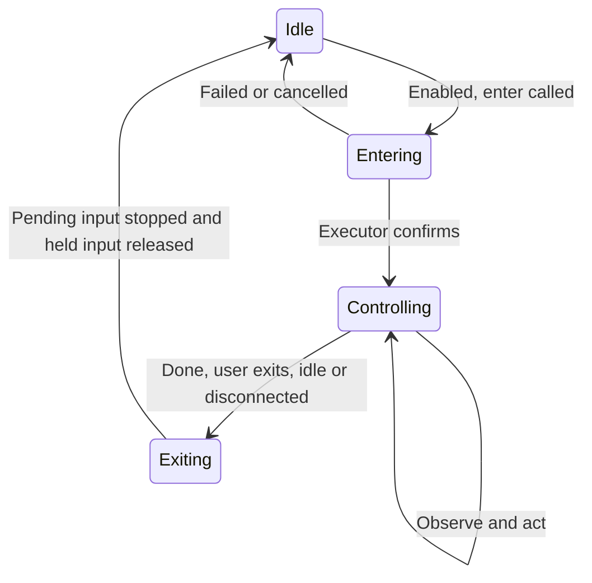

<!-- docs-language-switch -->
<div align="center">English | <a href="./computer-control-design.md">简体中文</a></div>
<!-- /docs-language-switch -->

# Local and remote computer control design

Status: finalized design; features are not implemented or accepted. Updated: 2026-11-10.

This document is the implementation contract for this computer-control work. Existing behavior is documented in [Computer client](remote-computer-client_en.md). Requirements below define the deliverable, not capabilities already present in the running application.

## 0. Read before execution

1. Required scope is the dedicated tab, flat directory, shared local/remote six-feature settings, Windows input sessions, visible feedback/exit, static annotation, default-off dynamic annotation, WebGUI tuning and matching acceptance. Default-off does not make tracking optional to implement.
2. Support/provide/default statements describe required delivered behavior. Inspect section 12's current source and the live operation contract; distinguish existing, new and verified items. Do not invoke absent tools/actions merely because they appear here.
3. Section 3 is authoritative for defaults; section 7 fixes new action names/semantics. External references and algorithm comparisons explain choices without overriding this contract.
4. The first implementation uses section 6.8's CPU/KCF and local-template paths. Other trackers, detection models, GPU backends and native input on other platforms are extension scope, not automatic Agent additions.
5. Unfixed technical values are limited to section 9's calibration items. Measure in an isolated candidate, write shared configuration declarations and bilingual documentation, and continue the original task. Do not invent performance guarantees, omit features or turn routine implementation choices into new approval gates.
6. Resolve real version/dependency differences at their owning interface, update the affected mapping and continue. Preserve existing authentication and explicit off without extra allowlists, per-action grants, manual unlocks or unrelated permission locks.

## 1. Goal and scope

Add a separate **Computer control** tab under RabiLink. It covers the current Manager's computer, enrolled lightweight clients, and complete Rabi hosts reached through existing connections. Local and remote execution use the same master switch, six feature switches, enforcement and result readback. The sixth feature, Screen annotation, lets Agents draw overlays independently of simulated input.

Local means the computer running the Manager opened in the browser, not necessarily the browser's computer. A complete host needs neither a self-connecting client nor a controlling Agent. Aggregate accessible RabiPC hosts and remote nodes as peer rows; mark Local with a badge and show node ownership as supporting information rather than a parent/child directory.

The first input implementation targets Windows. Mac/Linux retain their actual terminal and file capabilities. Platform support is reported separately from saved switch values.

The experience should be available by default, continuous after one entry, visible on the target, and interruptible by the user. Control state organizes source, feedback and cleanup under existing authentication/settings. It adds no app allowlist, per-action approval, control password, default denial, manual unlock or cooldown. Terminals, files and standalone observation do not require an input-control session.

Delivery must satisfy three conditions together: Agents complete work with a few continuous tool calls; users understand which computer, who is doing what and how to stop; resource use is visible/adjustable, with no idle frame processing and measured runtime budgets. Section 6.10 connects these conditions to complete workflows and acceptance.

## 2. A dedicated tab

RabiLink navigation becomes:

```text
Home    Remote Agent    Computer control    Configuration
```

Computer control is a dedicated RabiLink tab alongside Home, Remote Agent and Configuration, not a nested page or host-selector panel. Add `/rabilink?tab=computer` using existing hash routing. The current tab parser does not yet accept `computer`; update parser, page and navigation tests together. List all accessible computers by default; deep links locate/expand a row without filtering to that host's clients.

The page includes:

1. Flat directory: all RabiPC hosts, the local computer and enrolled remote nodes directly listed without a host-selection prerequisite or nested host groups. Include offline rows. Optional name search/type/status filters do not gate access to the list.
2. Row summary: Name | Type (Host/Remote node) | Online status. Complete RabiPC installations are Hosts; lightweight clients are Remote nodes. The current Manager row also carries Local. Location is separate from type; online state is separate from feature/master enablement.
3. Expand in place: rows start collapsed; clicking the name/expand control opens operations/settings below that row. Multiple rows can be open, summaries remain visible, and keyboard expansion/collapse works. Expanding never starts terminals/capture/tracking/control. Collapsed active rows retain controlling status and an exit action.
4. Details: platform, actual capabilities, ownership where needed, control source/task/last action/time remaining, operation buttons, master/six features and experience parameters. Show common settings directly and expand advanced groups. Offline nodes can save through an online configuration owner; an unreachable owner is an unsaved result rather than a false offline-save confirmation.

Example directory:

```text
Computer control

[Search computer name] [Type: All] [Status: All] [Refresh status]

Computer name             Type          Status
▸ Office PC [Local]       Host          Online
▸ Build PC                Host          Online
▸ Test PC A               Remote node   Online
▸ Test PC B               Remote node   Offline
```

All rows are peers. Refresh preserves ordering, expansion and drafts rather than moving rows as online state changes. Never apply one target's image/input to another. Collapsing or opening another row does not cancel admitted work; the original executor still owns its state.

Aggregate the existing host directory and each Manager's instance directory with batched independent reads. A failed source does not block healthy rows; show Unknown/unreadable with last-known information rather than inventing Offline. Deduplicate complete hosts only through reliable stable host/instance identity, never by name/IP. This is a read projection; configuration and execution retain their original owners.

### 2.1 Expanded computer: common settings and actions

This complete field layout expands groups for review. Actual computer rows/detail groups start collapsed and open on click. Dynamic-mode fields are disabled while unchecked, with explanations still readable. This is a schematic, not implemented UI; section 3 remains the only source of numeric defaults.

```text
Office PC · Host · Local · Online (expanded)

Work: not controlling / not tracking
When active: source/task, last action, time remaining, save state
[Start manual control] [Exit control] [Stop tracking] [Clear annotations]
(Enabled by actual state; expansion does not start work)

Enable this computer                 On

▾ Terminal commands                  On
  Shell                              [Available target shells]
  Working directory                  [Target-computer path]
  Session and size                   [Current session] [Fit / Custom]
  [Open terminal] [Close selected] [Expand session output]

▾ File operations                    On
  Local file                         [Choose file]
  Target-computer path               [Absolute path]
  Current transfer                   State / Size / Progress / Checksum
  [Upload] [Download] [Original transfer status] [Cancel transfer]

▾ Windows and screenshots            On
  Observation source                 [Desktop / Specific window]
  Window                             [Query on demand, then select]
  Capture clarity                    [Maximum width: Default / Custom]
  [Off] Refresh after action (this manual request)
  [Refresh image] [View original] [Save capture]

▾ Agent tasks                        On
  Program / Binding / Current state  From existing configuration
  [Open this computer's Agent task settings] [View original task]

▾ Mouse and keyboard                 On
  [On] Show Agent pointer
  [On] Exit when idle                120 seconds
  Countdown                          Final [10] seconds
  Exit shortcut                      Ctrl+Alt+Esc
  Shortcut registration              Actual registration result
  [Off] Exit on deliberate local input
  Input for this request             [Text] [Shortcut] [Mouse actions]
  [Execute selected input] [Cancel input]
  [Expand input/recovery settings]

▾ Screen annotation                  On
  Static lifetime                    10 seconds [Custom / Until cleared]
  Shapes for this request            [Box/Circle/Arrow/Path/Text/Highlight]
  Object style                       [Color] [Stroke] [Text size] [Opacity]
  [Off] Dynamic annotation (track moving targets)
  Continuous tracking uses more CPU/GPU; update rate is adjustable.
  Backend                            [KCF (default) / Template]
  Requested rate                     10 updates/second [Preset / Custom]
  Task end                           [Owning task / Explicit deadline]
  Current targets                    Source / Count / Per-target state
  [Start tracking] [Stop tracking] [Clear layer] [Clear all]
  [Expand advanced tracking]

▾ Performance and resources
  Mode                               [Auto / Custom]
  Effective state                    Rate / Resolution / Degradation reason
  Measurements                       Delay / CPU / Memory (not fake zero)
  [Expand resource budgets] [Performance monitor]

Each group: [Reset group defaults]
Save feedback: Saving / Saved / Unsaved with reason
Show defaults / saved choices / task overrides / effective values separately
```

### 2.2 Expanded advanced settings

These groups stay within the same computer row, without another host-selection layer. Backend default/Auto indicate value sources; real UI loads actual numbers, units and ranges from the shared schema. Do not invent section 9's uncalibrated values. Hide unsupported backend fields with an explanation rather than a fake universal confidence score.

```text
▾ Advanced tracking
  Search area                        [Near target / Custom region]
  Search expansion                   [Backend default / Custom]
  Analysis resolution/scale          [Auto / Custom]
  Template updates                   [When reliably located / Never]
  Template match threshold           [Backend default / Custom]
  Template check / Re-identification [Backend default / Custom interval]
  Loss criteria                      [Backend default / Custom]
  Prediction and smoothing           [Backend default / Custom]
  Prediction extent                  [Backend default / Custom]
  Source-frame cache                 [Backend default / Custom]
  [Reset group defaults]

▾ Resource budgets
  Target-count budget                [Auto / Custom]
  CPU / Compute-time budget          [Auto / Custom]
  Memory / Frame-buffer budget       [Auto / Custom]
  Preview / Transmission budget      [Auto / Custom]
  Policy                             Contract reduction order, then pause
  Execution backend                  CPU (read-only, no first-release GPU)
  [Reset group defaults]

▾ Input and recovery
  Input-batch limit                  [Backend default / Custom]
  Native segment budget              [Backend default / Custom]
  Connection-loss cleanup budget     [Existing configuration / Custom]
  State                              Request / Executed extent / Release
  [Reset group defaults]
```

### 2.3 Parameter-entry coverage

Implementation/acceptance checks each row below. A compact drawing cannot excuse omitted requirements. Grouping does not change configuration ownership, defaults or fixed scope.

| Parameter/information | UI location | Kind and authority |
| --- | --- | --- |
| Name/type/connectivity filters | Above peer directory | View filters, not execution scope or saved feature settings |
| Master and six features | Computer row / feature headers | Persistent settings, section 3 defaults |
| Shell/cwd/session/size | Terminal group / original terminal dialog | Per-terminal parameters using original contracts, no parallel default store |
| Files/target path/progress/checksum | File group | Per-transfer inputs/read-only receipts; original chunk/no-overwrite semantics |
| Observation source/window/clarity | Windows and screenshots | Implemented capture fields including existing `maxWidth` defaults/ranges |
| Refresh after action | Windows and screenshots | Per-manual-request `captureAfter`, default false, not background capture |
| Agent program/task binding | Agent-task group link | Existing settings; no rebuilt model/session configuration |
| Pointer/idle/countdown/shortcut/local-input exit | Mouse and keyboard | Persistent experience settings/read-only registration, section 3 defaults |
| Text/keys/mouse input/cancel | Mouse and keyboard / operation panel | Per-request input following original control entry |
| Static lifetime/shapes/style | Screen annotation | Section 3 lifetime; per-object color/stroke/font/opacity with renderer defaults, no invented numeric defaults |
| Dynamic checkbox/backend/rate/expiry | Screen annotation | Persistent defaults separate from task overrides; section 3/7 `backend`, `rateHz`, `expiresAt` |
| Search/expansion/resolution/template updates/threshold/checks/re-identification/loss | Advanced tracking | Backend parameters and section 9 calibration, no numbers invented by drawings |
| Prediction/smoothing/extent/source-frame cache | Advanced tracking | Backend/cache settings, preserving section 6.7 expiry behavior |
| Performance mode/target/compute/memory/transmission budgets | Performance/resources | Saved budgets versus effective degradation, sections 6.10/9; no added GPU implementation |
| Input-batch/segment/connection cleanup budgets | Input and recovery | Shared execution/original recovery parameters, not conflicting duplicate timeouts |
| Source/task/target states/effective rate/resolution/delay/resources/degradation | Row summary and relevant runtime areas | Read-only measurements; show inactive/unmeasured rather than invented values |
| Reset/save feedback/defaults/overrides/effective values | Each group/settings feedback | Original-owner save/readback, no capture on opening settings |

Task parameters apply only on explicit submission. Terminal/file/object-style/`captureAfter` fields do not become permanent switches merely by appearing in a schematic. Fixed protocol facts are not editable parameters. No first-release detector downloads, GPU backend or per-app permission matrix.

Remote Agent retains onboarding, connector maintenance, execution programs, Agent configuration and task bindings. Move the computer master switch, terminal and screenshot controls to Computer control; do not maintain duplicate control panels. Targeted links may remain. Agent tasks links reuse the existing task configuration owner and save path.

## 3. Switch semantics

The master switch is **Enable this computer**. It controls Rabi's six operation groups for the selected computer, with identical local and remote semantics.

| Feature | User explanation | Controlled operations |
| --- | --- | --- |
| Terminal commands | Run commands and read terminal output | Open, input, resize, query and subscribe to terminal output |
| File operations | Inspect, upload and download files | File metadata/read, upload begin/write/commit |
| Windows and screenshots | View windows and the computer screen | Window list, desktop and window capture |
| Agent tasks | Assign work to Agents on this computer | New work, continuation and additional work sent through Rabi to the original Agent owner, including routes, automation and direct delivery |
| Mouse and keyboard | Click, type, scroll, drag and use shortcuts | Rabi-native mouse, text, key and ordered input actions |
| Screen annotation | Draw boxes, circles, arrows and explanation text | Create/update/display transparent overlays without injecting input or modifying the original image |

Add Dynamic annotation (track moving targets) below Screen annotation, unchecked by default. It is an annotation mode, not a seventh permission. Unchecking stops continuous capture/tracking while static annotation remains available. Checking enables use of the mode; a target-specific Agent start call creates actual work, rather than permanently analyzing the screen. Do not claim improved computer/game performance: distinguish potential efficiency versus repeated full-frame recognition from added cost versus static drawing.

Mouse and keyboard is a single switch covering all these input actions.

New computers default the master and all six features to on. Missing feature fields in existing configurations mean on. Preserve any explicitly disabled remote master switch. Local settings follow the same defaults.

These first-release defaults are fixed in one shared declaration. Saved user values override defaults; implementation/publication must not silently choose different defaults.

| Parameter | First-release default | Application and adjustment |
| --- | --- | --- |
| Master and six features | On | Immediate; preserve existing explicit off |
| Agent pointer | On | Immediate visual preference |
| Idle exit | On, 120 seconds | Positive seconds; can turn off; 30/60/120/300 presets and custom |
| Idle countdown | Final 10 seconds | For shorter timeouts show the remaining interval; no confirmation dialog |
| Exit shortcut | Ctrl+Alt+Esc | Native registration with real success/conflict; no bare-Esc substitution |
| Exit on deliberate local input | Off | Applies to Agent input sessions only when enabled |
| Static annotation lifetime | 10 seconds | Custom lifetime or explicit keep until cleared |
| Dynamic annotation | Off | User must enable it; checking alone starts no worker |
| Dynamic update rate | Requested maximum 10 updates/second | 5/10/15/30 and custom; Auto may reduce and reports effective rate |
| Performance mode | Auto | Section 6.10 policy; configured and effective values remain distinct |
| Dynamic task duration | Owning-task lifecycle, not static 10-second expiry | Explicit deadline supported; section 6.7 defines termination |

Turning the master off disables feature editing and action controls while retaining feature values. Turning it on restores the saved choices. With the master on, features can be changed independently. Confirm saves through authoritative readback; retain an unsubmitted draft and show the actual failure when saving fails.

Reenabling a switch restores availability only, not old input, tracking or cleared layers. Start actual work with a new request under existing authority. Per-task parameters never override an explicit user off.

Effective availability requires the master and feature to be on, an online target, and support in its platform/executor version. Return support and saved preference separately: unsupported does not mean disabled, and a default-on preference does not establish implementation.

Apply settings through the formal save transaction without restart. Reuse immediate saving with pending/success/failure feedback; do not maintain another copy waiting for the Configuration tab's global Save button.

## 4. Ownership and enforcement

The executing computer's owning Manager is the sole settings owner. A complete host stores its own policy; an enrolled client is governed by its enrolling Manager. Remote pages read/write the target Manager through the existing connection; the browser holds only a draft.

Use stable host and execution-computer identities. Local policy must survive restarts; clients retain their original node/instance identity. Do not key policy by IP, display name, PID, generation or connection ID. Accessing a complete host remotely must use its original local policy, avoiding independent local and remote values.

Extend the original computer configuration owner with `terminal`, `files`, `observation`, `agentTasks`, `input`, `annotation` and experience settings, retaining the master/revision. These are new business fields; reuse the owner's storage/outer structure rather than a parallel configuration store. Compare revisions, reread conflicts and merge explicitly changed fields. Share labels, descriptions, defaults, ranges and action mappings.

WebGUI, public API, CLI/MCP, Peer forwarding, ManagerLocalComputer and lightweight-client dispatch must reach the original executor's shared admission check. Reuse checks within a process while their conditions remain valid. Queued input rechecks current policy before execution and between actions to handle revocation and connection loss.

Local execution must not skip policy because it is local. Cross-host forwarding retains the target reference and is checked by the target Manager. Disabled-operation errors identify the feature, computer and recovery path: RabiLink → Computer control.

The master switch leaves Manager settings, connection diagnostics, health, knowledge services and application lifecycle available. Authenticated policy read/update, original-request status, stopping and resource cleanup remain available for recovery, without admitting new computer work.

## 5. In-flight work when disabled

| Disabled setting | Behavior |
| --- | --- |
| Master | Reject new work in all six groups; stop pending input and clear screen annotations; apply the rules below to admitted work |
| Terminal commands | Reject new terminals and input, end new output reads/subscriptions; do not automatically kill existing processes; allow explicit closure of the owned terminal |
| File operations | Reject new reads/writes and subsequent upload chunks/commit; preserve completed writes; allow original upload status and abort cleanup |
| Windows and screenshots | Reject new queries/captures and unsent refreshes; suppress in-flight preview results and clear the displayed image; preserve explicitly saved files |
| Agent tasks | Reject new work delivery; query accepted work through its original owner and use its original stop action; do not claim automatic withdrawal |
| Mouse and keyboard | Cancel queued actions, stop the remaining sequence and release keys/buttons held by this operation; preserve receipts for executed actions |
| Screen annotation | Reject new drawing/updates and clear existing Rabi annotations on the computer; retain status/cleanup paths |

Recovery queries expose only needed status, offsets, hashes or receipt metadata, not disabled file contents, terminal output or images. Cleanup uses original resource IDs without new terminals, scripts or broader termination. Distinguish saved policy from confirmed executor stop; retain uncertainty until a stop receipt is available.

## 6. Control state and the complete interaction

### 6.1 Enter, work continuously, exit

Mouse and keyboard being on means the capability is available, not that an Agent is currently using it. The Agent calls enter control and waits for the target executor's confirmation before injecting input. This is one normal tool invocation without another approval dialog or someone clicking Allow on the target.



One entry covers continuous work for the same task on the computer: changing apps/windows, shortcuts, text and drag. Observations and later clicks do not repeatedly request entry or app-specific grants. Existing authenticated connection/task identity remains authoritative; a controlSessionId correlates work and cancellation rather than creating another credential.

There is one identifiable control source per computer to prevent competing foreground changes. Serialize only actual short input sequences; never block physical input, freeze the OS or block terminal/file/observation work. Another source receives the current owner/state instead of silent takeover or indefinite queuing. Normal completion/idle release makes the computer immediately available without manual unlocking.

Agents explicitly exit after their GUI work and may continue using other tools. WebGUI manual control follows the same lifecycle with a Manual control source. Opening the page or refreshing images does not enter control. A user taking over ends the Agent session before establishing a manual session, avoiding mixed input.

### 6.2 Target-side status and the virtual pointer

Show a compact native control bar on the **controlled computer's real desktop**, plus corresponding source WebGUI state. Both ends can see remote control. Closing the source page does not establish that an Agent stopped; state comes from the executor.

```text
Rabi is controlling this computer · Assistant / Task       [Exit control]
Clicking and typing · Exit after 120 seconds idle          Ctrl+Alt+Esc
```

The bar is non-activating and nonmodal, uses Rabi themes, and conveys state with text/icons as well as color. It can be moved away from business controls while retaining a visible exit. On multiple displays, show the bar on the active display and a compact status access point elsewhere. Full-screen work retains a visible exit and native shortcut. Notify once on entry/exit, not on every action.

Show Agent pointer while controlling defaults on. Render a high-contrast Agent-marked pointer and brief click feedback on the target; project execution position into the source preview. Keyboard work shows Typing without exposing the full text. Adapt to DPI and reduced motion. Turning the pointer off leaves the control bar and exit controls available.

The virtual pointer is an **action/position indicator**. Windows native input still shares the OS pointer, keyboard and foreground focus; do not claim independent simultaneous human/Agent input. Target indicators use actual executor feedback. A source may display a pending position immediately, but must distinguish it from executed position; animation is not proof of successful input.

Except for explicit exit/drag areas, overlays do not intercept clicks or change business-window stacking. Transport pointer state separately from captures to avoid repeated cursor images misleading the Agent; verify capture exclusion on real Windows. Pointer rendering failure degrades to OS pointer/status feedback and reports the degradation, without making a decorative effect an access requirement.

### 6.3 Idle exit and connection loss

Implement Exit when idle with section 3's initial value and adjustment behavior. It ends the current input session without revoking the original task authority.

Use the target executor's monotonic clock. Activity includes executed input and explicit observations requested by the active source to continue its task. Heartbeats, status polling, background preview refreshes and unexecuted queued requests do not renew activity. This supports observe → reason → act without repeated entry, while browser polling cannot keep control forever.

Show the final 10-second countdown within the existing bar without a modal or a Continue requirement. Effective activity resets it immediately. Apply changed timeouts using the latest settings and show actual remaining time.

Idle exit ends only the current input session: it does not disable the computer, log out the Agent, cancel its task or interrupt other tools. Subsequent GUI work may call enter again under the original authority. Separate connection-loss cleanup follows the existing bounded transport budget and remains effective when idle exit is disabled; a lost network cannot leave held input indefinitely.

Cleanup belongs to the target executor on both local/remote computers, not a browser timer or a final network message. Restarts, desktop locking and suspend/resume do not revive old input queues. The task checks actual state before entering again if needed.

### 6.4 User exit and shortcuts

Provide equivalent exits in the target native bar, WebGUI and a target-global shortcut. Use section 3's binding with shortcut recording and visible registration state. Bare Esc remains an application key rather than an implicit exit condition.

The target executor listens natively so exit works without browser focus, with the browser closed, or after network loss. Local and remote targets use the same mechanism. Source-browser keys exit only through an explicit command while the control region has focus; do not globally hijack browser keys. Report conflicts with a direct editing path instead of silently changing the shortcut.

Exit cancels the original control session and pending actions, releases its held input, then removes feedback. The stop/cleanup path is separate from slow capture, unresponsive applications and normal action work. Late requests/releases cannot affect a newer session. Injected Agent events and physical keys already held before entry must not be mistaken for a new user-exit press.

Explicit user exit returns User exited control and ends the current input intent. Do not automatically re-enter to retry what the user just stopped. **Do not change saved switches, install a persistent denial/cooldown or request new authorization**. Later user directions and independent authorized tasks can enter normally. Receipts distinguish user exit from normal idle expiry.

Implement Exit on deliberate local input with an initial off value, avoiding interruption from minor motion/unrelated input. When enabled, apply it to Agent sessions, distinguish injected events from human activity and filter jitter. Default-off does not remove it from delivery scope. Never identify the executor's own input as human takeover. Physical input remains available and explicit exit always works.

### 6.5 Input panel, coordinates and responsiveness

Screen and input provides target selection, refresh, mouse/text/shortcut actions, source identity and exit. Observation is available before entry; Start control becomes Exit control in place when active without collapsing/rebuilding the workspace. File transfer keeps its original chunk verification and upload owner.

Use screenshots and on-demand post-action refresh in the first release rather than video streaming. Preview-based input requires observation and input; disabling observation removes the clickable old preview. An active session can still execute explicit text, shortcuts or known-coordinate requests.

Reuse a lightweight native helper throughout control under the existing Host/connector lifecycle. Do not start PowerShell, compile assets or rediscover Manager per movement/key. Common move → click → type → shortcut sequences can be submitted once and return an image at a decision point. Do not require a model round trip or screenshot per pointer move. Check cancellation within batches; coalesce movement only where semantics allow, preserving clicks, text and independent intents.

Use Windows native input with Unicode text rather than temporary clipboard paste in the first release. Test Chinese/newlines/symbols and apps that reject this method separately. Support ordinary cross-app shortcuts without additional Rabi app lists or restrictions against switching windows/system shortcuts. Report real OS unsupported/privilege failures and existing repair options instead of disguising them as another permission request.

Convert image coordinates using native bounds/dimensions and a frame reference; share multi-display, negative-coordinate and DPI handling. Reuse valid mapping/identity checks rather than rejecting every slightly older image. Window-scoped operations validate `windowId + pid` and the actual foreground target; changed geometry/layout requires repositioning. Deliberate Agent app switching updates the target normally rather than becoming a policy violation.

Show Submitted/executing immediately, Injected only after the executor receipt, and application success after observation/business verification. Reuse existing events for pointer/status updates and refresh on demand; avoid global high-frequency disk writes and per-frame diagnostic logging.

### 6.6 Screen annotation: direct Agent drawing

Screen annotation supports explanations such as circling animals in an image or pointing at a button. After observing the source, the Agent submits structured shapes and the target renders a transparent overlay. It neither opens a paint app, drags the OS mouse stroke by stroke nor modifies application content. Drawing inside an actual paint application remains ordinary mouse/keyboard control when requested.

Screen annotation defaults on independently of Mouse and keyboard. Existing authenticated callers can draw when the master/annotation switches are effective, without entering control or requesting another grant. New capture remains governed by observation; an existing image/known coordinates can be annotated directly. Editing the original or exporting a composited image is a separate explicit file operation, not a side effect of display.

Initial primitives are rectangles, ellipses/circles, arrows, polylines/freehand paths, text and translucent highlights. Submit multiple stable-ID objects with coordinates/styles/labels in one batch. Display/update by ID without rebuilding a flickering layer; render text as plain text. Status confirms display rather than the correctness of animal identification.

Fix first-release rendering ownership: existing PySide6/Qt with QPainter on complete hosts, SVG in WebGUI, and a Windows drawing overlay inside the existing C# native helper on lightweight Windows clients, without installing a full Rabi/Qt stack. Share the shape protocol/coordinates; the target executor uniquely owns layer state. Existing screenshot annotation is reuse material, not evidence of an Agent overlay already implemented.

Each batch identifies computer, display/window/image, source frame, top-left origin, original dimensions and coordinate space. Map source pixels to actual display bounds, handling image letterboxing, scale, multiple displays and DPI. A device screen photographed inside an image is not the real game client's coordinate system. Store reviewable JSON; semantic animal locations come from visual judgment, not color contours presented as recognition.

For animals, use thin outlines around bodies and place numbers/names in unused space with leader lines, keeping animals, scores and buttons visible. Preserve uncertainty/confidence for ambiguous or occluded objects. Distinguish avatars, decorative statues and active characters according to task scope rather than mixing them into one count.

Overlays are click-through and non-activating; humans and Agents can continue using the underlying app. Tasks own independent layers without occupying an input session or clearing each other's work. Provide Clear screen annotations. Default lifetime is 10 seconds, adjustable per request/user preference, with explicit keep-until-cleared support. Input exit clears annotations tied to that session; independent layers follow their own expiry. Master/annotation off clears all layers. Do not restore temporary layers after restart.

Static mode follows known window transforms only; it does not track video, scrolling or moving animals. Use the dynamic mode below for continuous tracking. Without dynamic mode, Agents can still explicitly update objects from fresh observations. Neither mode may present stale coordinates as confirmed tracking.

Recognition receives the unannotated source by default, with shapes transported separately, avoiding self-generated circles being mistaken for objects. Composite/export only when explicitly requested, through file policy and the original file owner, preserving the original. Verify batches, repeated updates and cleanup without per-object approvals or mouse-movement delays.

### 6.7 Dynamic annotation: continuous game-target tracking

Dynamic annotation is required first-release scope, using section 3's initial setting; runtime/game acceptance evidence is still absent. It indicates targets while a human plays without entering input control, seizing input or clicking. Delegated input uses the separate original session flow.

Show the checkbox/cost explanation; details expose update rate, target count, running/paused/lost state and Stop tracking. Section 3's rate is a requested ceiling, not guaranteed FPS. Report executor-measured rate, capture-to-display delay and available resource metrics.

The fixed flow is original-Agent recognition → target-local tracking → loss event to original task for re-identification → stable-ID overlay updates. Seed description, boxes, source frame/time. Normal tracking does not wake a model or create per-frame turns. Re-identification reuses the original Agent/configured route without installing another detector or execution Runtime.

Gameplay may advance while the Agent decides. At startup, use the seed-frame target template to relocate within the current source area, then initialize KCF at the current-frame position. Never treat a seconds-old box as current. Ambiguous relocation reports re-identification/loss rather than successful tracking. Frame references resolve to original pixels in an owner-managed bounded cache; expired references require a new observation, not a same-size substitute or unlimited frame-history retention while waiting for the model.

| First-release scenario/method | Implementation boundary |
| --- | --- |
| Seeded moving characters: KCF | Default backend, independent trackers with shared capture/preprocessing; report loss, never treat KCF as a detector |
| Stable icons or explicit template selection: local matching | Section 6.8's algorithm within the selected source/search area; similarity is not identity |
| Similar-character crossings/long occlusion | Report ambiguity and ask the original task to re-identify; no guaranteed identity through occlusion and no first-release YOLO/ByteTrack/BoT-SORT |

Advanced settings list only the implemented KCF/template methods; ordinary use takes the default. Extensibility does not require all researched algorithms or allow activation of nonexistent backends. Failed calibration means repair/retest the current path. A necessary algorithm change requires measured evidence and an explicit update to this contract, not silent substitution.

Distinguish located, tracking, short-term prediction, lost, re-identifying and stopped. Report actual success/failure when a backend has no meaningful confidence score. Predictions may use dashed boxes and explicit status, never indefinite solid boxes from stale positions. On loss, perform local search or re-identify through the configured model/Agent path. Preserve uncertainty when similar characters cross; do not silently replace the target while claiming a certain identity.

Keep source frame ID/time and object ID aligned. Track raw frames without overlays/pointers; render separately. User clear/stop/target switching invalidates old updates. Cuts, pause/resume, content changes and source changes require renewed correspondence, without carrying unrelated-stream state over.

Process locally by default, sharing source capture/ROIs across tasks while retaining independent identities. Internal frame capture does not require a new remote video-streaming service. Avoid per-frame process launch, PNG/base64 round trips, full-screen large-model recognition and screenshot disk writes. Send remote boxes/status and needed keyframes; remote re-identification follows existing configuration rather than uploading every frame by default.

Consume the latest available frame and drop stale backlog. Separate tracking, rendering and Agent reasoning rates. Smooth rendering must not present predicted positions as new observations. If computation exceeds budget, reduce update rate/resolution and show degradation instead of silently expanding capture or launching an unconfigured model. Choose rates/methods from measured end-to-end delay and game frame time.

Dynamic tracking requires master, annotation, observation and dynamic preference on, with a capturable source. Add no account/app lists, per-target approval or input-session gate. Tracking does not renew input idle time. Unchecking stops all tracking on that computer and its capture subscriptions, retaining the final frame as explicitly stopped static annotation for the static lifetime. Clear annotation instead stops its attached tracker and removes the layer immediately.

Annotation/master off stops tracking and clears layers; observation off stops tracking/preview without new observations. Source-window exit, executor/original-connection failure, user stop, explicit expiry or owning business-task completion also terminate work. Collapsing rows, closing a preview or ending one model turn does not end a still-valid Agent business task. Browser-owned manual work ends through original-connection cleanup when its connection disappears.

Static annotation's 10-second default is not a timer that restarts a dynamic task every ten seconds. One start runs while its task/target is valid until explicit stop, configured task expiry or the exit conditions above, with visible status/stop controls. Reuse original task/resource owners without unlimited auto-restart or hidden background tracking.

Performance copy states both baselines: continuous capture/tracking costs CPU/GPU, memory or bandwidth versus static drawing and may affect game FPS; ROI tracking may reduce cost versus repeated full-frame/large-model recognition, subject to measurement. Acceptance records localization error, ID switches, loss/reacquisition, update rate, end-to-end delay, CPU/GPU/memory and game frame time. Smooth box animation is not evidence of accurate tracking or unaffected gameplay.

### 6.8 Performance-first algorithm baseline

The first implementation is native OpenCV on CPU: default KCF for continuous tracking and `matchTemplate(..., TM_CCOEFF_NORMED)` (zero-mean normalized cross-correlation) for template mode. Stateful tracking and local fixed-template search are distinct. Initial localization and semantic re-identification belong to the original Agent.

Restrict frequent work to an adaptive ROI near the previous position. Normal tracking does not search the whole screen, exhaustively test many scales or call a large model every frame. Occasional template checks and progressively wider search after loss are recovery paths, not a requirement to run tracking, matching and detection together on every frame. Update templates only from reliable localization, avoiding contaminated templates after occlusion or a false match.

Reuse capture buffers and grayscale/features across targets. Use native OpenCV pixel processing rather than Python/JavaScript pixel loops. Add no CUDA/GPU backend in the first release, limiting deployment dependencies/game-GPU competition; this scope decision does not claim CPU is fastest on all hardware.

Measure capture/preprocessing/tracking/rendering and end-to-end P50/P95, plus identity errors and game frame time with multiple targets. MOSSE, CSRT, optical flow, detectors and GPU backends are extension research, not hidden first-release work. No benchmarks exist yet; do not invent milliseconds, CPU percentages or unaffected-gameplay guarantees.

### 6.9 WebGUI parameters and configuration access

Expose parameters users may reasonably adjust in WebGUI, rather than only source constants, environment variables, JSON or Agent prompts. Manage them on each computer's Computer control page. Expand a feature group to see common settings, with algorithm/performance details in that group's Advanced settings. Clear defaults allow use without tuning. Section 2.3 maps each entry/type/value authority; implementation must not reduce the design to a few switches from a compact drawing.

Common settings include the master/six features, Agent pointer, idle exit and seconds, exit shortcut, local-input exit, static annotation lifetime, dynamic mode, update rate, task expiry and stop controls. Group by function and explain disabled/unsupported states without discarding saved choices.

Advanced settings cover implemented KCF/template selection, search area/resolution, template updates, matching/loss/re-identification, prediction/smoothing, target/resource budgets, capture quality and batch/recovery budgets. Show only applicable backend parameters. Re-identification reuses existing Agent configuration; do not expose nonexistent detector downloads or GPU backends. Matching scores are not correctness probabilities or a universal confidence slider.

Each setting provides a natural label, purpose, default, unit, supported range, performance/quality tradeoff, saved value and effective value where needed. Defaults/bounds come from the shared configuration declaration instead of frontend constants. Explain what Auto adjusts and display actual runtime rate/resolution. Presets expose their underlying values.

Support per-setting/group reset to defaults. Save through the original owner with revision checks and authoritative readback, explaining immediate, next-task or necessary restart effects. Apply runtime-adjustable rate/time/display changes without leaving control or requesting new authorization. Explain tracker-rebuild effects and transition through the existing object owner while retaining correct cancellation/results.

Keep persistent user defaults separate from Agent per-task overrides, showing their values/sources. Agent tuning must not silently rewrite defaults or bypass explicit off. Coordinate live user edits by revision so late results cannot replace newer settings. Do not start capture/tracking merely to populate an effective-value field when no task is running.

Initial tuning is user-adjustable without a mandatory permission matrix. New user-adjustable parameters must update WebGUI, shared schema, API help, bilingual guidance and verification rather than remaining accessible only to Agents or file editors.

### 6.10 Convenient tools, clear feedback and bounded resource use

Organize Agent entry points around three purposes, reusing section 7's formal operations without another state store or execution path:

| Purpose | Continuous workflow | User feedback |
| --- | --- | --- |
| Observe and explain | Confirm target → observe on demand → show a batch of annotations | Computer, explanation overlays and expiry/clear controls; no false input-control status |
| Operate a GUI | Enter with first frame → batch input/necessary observations → exit | Actual source, task, Agent pointer and exit |
| Assist a human playing | Observe/select targets → start tracking once → re-identify when needed → stop | Objects, located/lost state, actual update rate and stop; physical input remains available |

Reuse a known stable target instead of repeatedly listing computers, scanning Agents or checking unchanged information. Read required capability/operation summaries initially or when contract versions change; use existing dynamic discovery when connection identity becomes invalid. The client manages session/request IDs and ordering rather than making the Agent repeatedly transcribe maintenance fields. Always retain an explicit target reference.

Entry and input batches expose `captureAfter`: when requested and observation is available, return an image in the same response; otherwise do not capture. Disabled observation does not block valid input; report image unavailability separately without enabling it. No screenshot per step, repeated full checks per click or per-frame model call. Compact responses identify actual target/state/result/recovery; cancellation is not a retry.

Keep four facts distinct: online/offline/unknown is connectivity; master/features are saved availability; controlling/tracking is active work; submitted/injected/verified is progress. Default-on does not mean currently controlling, and connected does not mean successful execution.

Collapsed rows retain name, host/node type and connectivity plus active-work summaries and the corresponding stop action. Details prioritize who is doing what; IDs, versions, algorithms and diagnostics are secondary. Use task names users understand. Exit control, Stop tracking and Clear annotations each do what their names say without terminating terminal builds or unrelated Agent tasks.

Use inline state and necessary entry/exit notifications rather than repeated modals or spoken coordinate updates. Saved configuration, execution success and tracking reliability each have separate evidence. Show actionable failures at the affected computer/feature. Defaults permit use without algorithm expertise, while advanced settings remain available.

Flat-list reads contain connectivity, capability and active-work summaries only. Expanding settings does not start capture, terminals or tracking. Load details on demand, coalesce source reads and isolate source failures. As the list grows, preserve peer navigation with incremental loading/visible-row rendering rather than creating all heavy panels. Refresh preserves focus/drafts and does not rescan machines on expansion.

Share capture/preprocessing per execution computer with independent target state and demand-driven active subscriptions. When no task/subscription needs frames, stop this feature's capture/encoding/tracking. Expiry/stop releases owned buffers/helpers without disturbing the Host lifecycle. Collapsing a browser view ends only its preview subscription, not an explicitly active Agent task.

Offer Auto/Custom settings. Within visible budgets, Auto first reduces hidden-preview encoding/transmission, then effective tracking rate, then analysis resolution, updating coordinate mapping/tracker initialization when resolution changes. If still over budget, pause affected tracking with a reason rather than silently dropping targets. Custom follows user rate/quality/budget without rewriting persistent choices. Show the source of task overrides, degradation and recovery. Compute/buffer/target/transmission budgets add no default-deny access layer.

Capture, tracking, drawing, preview and Agent reasoning use separate appropriate rates. High-frequency coordinates remain target-local/visible-overlay updates; Agents receive starts, loss, reacquisition, stops and task-relevant observations rather than a context message per frame. Latest-frame replacement, merged payloads and bounded buffers control latency/memory, while stop handling remains outside slow image queues.

Reuse [existing performance monitoring](performance-monitoring_en.md), including its recording settings, for stage/resource-owner metrics. Do not enable expensive disk traces or screen recording by default. Active tasks expose inexpensive bounded memory statistics; reporting them must not trigger additional full-screen capture, per-frame system queries or coordinate logs. Mark unavailable metrics honestly, label CPU accounting, and never invent GPU/game-frame-time values.

Admission compares the same target computer, game scene/clip and resolution under no feature load, static annotation, single-target tracking, multiple targets and simultaneous remote preview. Record game frame time, CPU/GPU, memory, update rate, localization/identity errors and end-to-end P50/P95. Establish pass criteria against specified hardware and adjustable budgets. Also test sustained memory convergence, post-stop resource release and local exit latency. Over-budget or unreliable-stop candidates cannot pass performance acceptance; this design is not evidence of zero game-FPS impact.

## 7. APIs and recovery

### 7.1 Existing entry points and new contracts

Current source already provides `POST /api/lan-agent/instances/:instanceId/computer` for file/upload, `windows.list` and `screen.capture`; terminals retain their separate existing endpoint. Control/input/annotation actions below are not implemented. Implement and register them in operation/schema/help before invoking them. Action strings are neither separate REST URLs nor already installed MCP tool names.

Add `GET`/`PATCH /api/lan-agent/instances/:instanceId/computer-settings` under the existing instance configuration owner. GET returns settings, defaults/support and a strong ETag. PATCH changes submitted fields with `If-Match`; reread/merge conflicts. The legacy master switch and this endpoint use one owner/value. This is a new contract, not a route currently in source.

### 7.2 Required new actions

All actions use the same computer POST. Define complete fields in shared `interactive-protocol.mjs` and the operation schema. This table fixes action names/responsibilities; synchronize actual request/response types rather than guessing fields.

| action | Principal fields and behavior |
| --- | --- |
| `control.begin` | `requestId`, `captureAfter`; returns actual state, `controlSessionId`, target, feedback/shortcut availability and idle time. Same request/content returns original state |
| `control.status` | Query a session or the computer's current one; real owner/state/time, no renewal or input |
| `control.end` | Cancel remaining input, release owned keys and return complete/unconfirmed cleanup; leave unrelated tasks running |
| `input.execute` | `requestId`, current `controlSessionId`, ordered `actions`, coordinate source, `captureAfter`; per-action progress and injected/failed/uncertain results |
| `input.status` | Original-request progress/result without replay |
| `input.cancel` | Cancel unexecuted work; report executed extent/release state, never reverse injected events |
| `annotation.show` | `requestId`, source, `layerId`, shapes, lifetime; actual display state |
| `annotation.update` | Versioned original-layer updates, no duplicate creation or overwrite after newer updates/user clear |
| `annotation.status` | Layer, expiry and tracking association without creating/capturing |
| `annotation.clear` | Clear selected layers and stop attached tracking; user Clear all handles all Rabi layers and invalidates late updates |
| `annotation.track.start` | `requestId`, source frame, seed boxes/descriptions, `backend`, `rateHz`, task reference, nullable `expiresAt`; returns `trackingId`, per-target state/effective rate |
| `annotation.track.status` | Original tracking source time/rate/real quality metrics without input-idle renewal |
| `annotation.track.stop` | Release the selected tracker/capture/compute; last-frame behavior follows section 6.7, leaving unrelated layers/input tasks alone |

`captureAfter` defaults false and captures only when true and observation is available. Image unavailability is separate from an already executed input result. First-release `backend` is `kcf` or `template`, default `kcf`; `rateHz` is a ceiling, not the effective rate. `expiresAt` is UTC or null; null follows the business-task lifecycle. Annotation needs no controlSessionId except an optional cleanup association.

First-release input contains move, click/double/right-click, scroll, complete drag, Unicode text and key combinations. Inject in cancellable segments, without cross-request permanently held keys. Shapes are rectangle, ellipse, arrow, path, plain text and highlight. Sources identify computer/coordinate space; tracking references the original frame. Adding source-frame identity to `screen.capture` also updates its response schema; do not assume current responses contain it.

### 7.3 Results, errors and recovery

The executor uniquely owns sessions, layers, trackers and bounded receipts; Manager projects them. Preserve existing authentication and derive source identity from the original connection/host, not self-declared persona/owner fields. Same requestId with different content is rejected; same content returns the original result. Original-identity status/end/cancel/cleanup remain available after feature disablement.

New-action errors retain the existing envelope plus a stable `errorCode`, target, reason and next action, synchronized with help. Distinguish disabled feature, inactive control, another control source, unavailable target/capability, source-frame mismatch and uncertain result. Status is semantically read-only even over POST; do not mislabel it an uncertain write. Preserve legacy file/terminal compatibility and do not assume these new fields already exist.

Record submitted, injected and application-verified states separately. OS-accepted input cannot be withdrawn; cancellation reports prevented later work. After crashes, disconnects or generation changes, verify identity and query the original ID. Injection/receipt uncertainty remains uncertain without replaying clicks/text/shortcuts/batches or claiming exactly-once OS input.

User exit cancels the current intent; late requests/releases cannot affect a newer session. Unconfirmed cleanup stays Exiting/uncertain for original-owner recovery rather than falsely Idle. Add no persistent permission lock, global release of others' keys or unrelated process termination.

### 7.4 Automatic CLI/MCP integration

New computer settings/actions must use the existing executable-contract registry. Plugins declare handlers, request/response schemas, effects/recovery and discovery categories/keywords. The active registry drives dispatch and discovery. This is registry self-description, not scanning ordinary function signatures or exposing functions just because a button exists.

CLI/MCP share the current release line's operation SDK. CLI uses categories/list/search/describe/call. MCP retains six generic tools: `rabi_categories`, `rabi_list`, `rabi_search`, `rabi_describe`, `rabi_call`, `rabi_session`. Generic clients consume newly registered public HTTP operations without adding thirteen dedicated tools or CLI business branches for these actions.

`operationId` identifies a public operation; `control.begin` and similar names are request-body `action` values, not interchangeable IDs. Search/describe the actual operation, then submit its target/action using the current schema. Never pass an action name directly as `rabi_call.operation`. Extend the computer request schema and its explanations/categories/keywords/target parameter sources so computer control, screen annotation and tracking searches locate the right contract.

Reuse existing catalog publication/cache invalidation. Source edits before activation do not update the running catalog. Descriptions alone do not implement an unsupported client transport. Reuse existing HTTP/events/streams for this work and verify real CLI/MCP behavior. Discovery does not change target capability or saved user settings.

On the same active candidate, compare WebGUI/CLI/official MCP discovery, categories, descriptions/inputs, target/owner and success/disabled/stop/uncertain receipts. New catalog content must be discoverable/callable without client-side business-list edits. Other tasks' source or reports do not substitute for this feature's own acceptance evidence.

## 8. Scope of the restrictions

These settings control Rabi's corresponding interfaces. Terminal scripts and target Agent tools may independently read/write files, capture screens or generate input. Disabling one Rabi-native interface does not revoke a process's OS capabilities.

Show this explanation beside the settings: “Terminals and Agents may also operate files, mouse and keyboard through their own tools.” Do not describe feature switches as OS isolation while terminal or Agent execution remains enabled. Programs operated outside Rabi are also outside these settings. This design adds neither an OS sandbox nor prompt-based permission enforcement.

Windows and screenshots covers the computer APIs in this design. Separate services such as companion observation and the system screenshot shortcut retain their existing settings; any later unification requires an explicit migration scope.

## 9. Implementation and delivery

1. Policy: extend stable computer configuration, projections, public contracts and all relevant execution paths, preserving local/remote explicit choices.
2. UI: add the tab and computer-control component in RabiLinkPage.vue; move controls out of LanAgentsPage.vue; reuse terminal/file/task paths and target links.
3. Input/annotation/feedback: implement shared execution, Windows native assets, sessions, pointer/bar, static/dynamic annotation, receipts, shortcuts and cleanup. Tracking implementation/stop tests are required despite default-off. Update capability normalization/reporting, dispatch and schema so the old files/windows/screenshots normalization does not drop new capabilities.
4. Acceptance: verify an isolated candidate, publish through the formal lifecycle and read back behavior; synchronize bilingual guides, API help, capability catalog and release notes.

Affected paths include `src/shared/agentInstance.ts`, the existing instance configuration/authority owner, `src/manager/lanAgentRegistry.ts`, `managerLocalComputer.ts`, terminal/computer operations, Peer/task delivery owners, `apps/rabi-agent/lib/computer-service.mjs`, `interactive-protocol.mjs`, `desktop/computer.ps1`, and WebGUI. Recheck current revisions and concurrent changes before implementation and continue the existing development line.

Manager can enforce admission for existing operations on old clients. Input is dispatched only to executors that declare support. In-flight revocation/release requires protocol support and an executor receipt; an online old connector is insufficient evidence. This delivery requires a matching full build, native assets and signed resources, not only a Web build.

Implement contracts/schema/configuration owner → local shared execution/Windows native helpers → lightweight-client capabilities/execution → dedicated page/flat directory → local and real two-computer acceptance. Keep the original task and single source line; freeze candidate inputs before final builds. This document review does not start implementation, publication or installation.

Only these technical items remain to measure/verify, rather than leaving product behavior to arbitrary Agent choices:

| Item | Evidence and resolution | Until resolved |
| --- | --- | --- |
| Native overlay, capture exclusion, shortcut and physical/injected input distinction | Verify local/target Windows, shortcut registration, DPI/multiple displays and release. Use the defined system-pointer fallback; show shortcut conflicts without changing defaults | Affected cases are unverified; continue independent work |
| KCF/template search/thresholds, source-frame cache and loss | Obtain actual-version defaults, record values, test delayed startup relocation/look-alike ambiguity/bounded caches, then calibrate schema/WebGUI. Preserve success/failure without invented scores | Implement/test the fixed route without adding algorithms |
| Compute/memory/target budgets and candidate pass criteria | Record hardware, baseline, user budget and criteria before candidate comparison; use latest-frame-only pending work. Auto initially obeys section 3's rate ceiling; do not invent compliant CPU/GPU results | Performance pending; tune/retest without changing thresholds to hide failure |
| Full API fields/error codes | Complete shared types/operation/schema/help from section 7's semantics, preserve callers, verify real success/failure in isolation before exposing calls | Action not delivered; clients must not infer availability from its name; validate independent implemented work |

The implementation Agent gathers evidence, updates the documents and continues within existing authority. Ask only for actual changed goals/business choices; unfinished measurements do not block executable local implementation or isolated verification.

## 10. Acceptance checklist

All checks below remain pending; this document is not implementation or QA evidence.

- Navigation: dedicated RabiLink Computer control tab; peer host/node rows with name/type/status and a Local badge; collapsed defaults, single/multiple-row expansion, keyboard access, deep links and optional filtering; opening does not execute, collapsing retains actual work/exit controls.
- Aggregation: offline rows remain visible, source failures do not block healthy computers, unreadable status is Unknown; stable identity avoids duplicates without merging same-name computers; refresh preserves order/expansion/drafts, no host-selection prerequisite or cross-target image/input reuse.
- Defaults/migration: new local/remote and missing fields default on; preserve explicit off; retain settings across restart, reconnection and name/IP changes.
- Local: each disabled feature rejects WebGUI, direct API and local-service calls; master off rejects all new computer work while policy/recovery remain accessible.
- Remote: test both lightweight client and complete host; access from another host uses the target's same policy.
- Callers: terminal, files, windows/capture, direct Agent, route/automation, CLI/MCP and Peer forwarding are covered; independent enabled features continue working.
- In-flight: output subscriptions stop, uploads cannot continue/commit, disabled captures are suppressed, input stops/releases, accepted Agent tasks retain original status/stop ownership.
- Input: real local Windows and a real remote Windows machine; click, double-click, right-click, scroll, drag, Chinese/newlines/symbols and shortcuts; inspect the actual application outcome.
- Coordinates/environment: multiple displays, negative coordinates, DPI, scaled previews, moved/replaced windows, foreground changes, lock screen and insufficient privileges report correctly without clicking another window.
- Concurrency/recovery: sources do not interleave, duplicate IDs do not reinject, disconnect/timeouts/crashes/version changes retain original status, uncertain input is not replayed.
- Lifecycle: no injection before entry; one entry supports repeated observation, app switching and input; completion/idle expiry allows re-entry under existing authority without another confirmation or manual unlock.
- Feedback: target/source show owner/task/state; pointer preference affects only the visual marker; no focus theft, blocked business clicks or capture ghosts; cover full-screen, multiple displays and reduced motion.
- Idle semantics: default 120 seconds and custom/off work; explicit task observations/executed input renew activity, heartbeats/background previews/status/independent tracking do not. Reasoning beyond the timeout exits with an idle reason; later input re-enters under existing authority.
- User exit: local bar, remote WebGUI and target-native shortcut work; bare Esc reaches apps, registration conflicts are visible, stopped work does not auto-reenter, no persistent denial/cooldown remains.
- Failure exit: network loss, closed page, unresponsive app, native-helper failure and Manager generation changes; old releases do not affect new sessions and slow work cannot queue ahead of stop.
- Responsiveness: measure real entry, action, pointer and stop latency with percentiles; no per-action process launch/compile/auth/capture, no pointer animation reported as successful execution.
- Annotation: local/remote boxes, circles, arrows, paths, text and highlights; drawing works without input-control entry and does not move the pointer, intercept clicks, steal focus or alter the source image.
- Annotation mapping/cleanup: outlines/external labels, DPI/scaling, batch updates, static expiry and clear. Clearing stops attached tracking; late updates do not redraw. Static mode does not claim dynamic tracking; recognition frames exclude overlays.
- Dynamic mode: default unchecked, parent settings/cost copy/rate/stop and explicit-off persistence; track while the human plays without input takeover, stopping continuous capture/compute when disabled.
- Game tracking: similar-character crossings, fast motion, pose/scale changes, occlusion/reappearance, scrolling/cuts and pause/resume; measure ID swaps, false matches, reacquisition, box error, frame age and game-frame-time impact versus static and repeated full-frame recognition.
- Startup freshness: keep gameplay moving during Agent reasoning; relocate old seed boxes against the current frame. Expired cache, changed scenes and ambiguous look-alikes report failure/loss rather than successful tracking at stale coordinates.
- Parameter access: WebGUI entry, help/units/defaults/ranges/reset for adjustable settings; common/advanced grouping, backend-specific fields, auto/effective values and persistent defaults/task overrides remain clear. Verify readback, persistence, live edits and rejection of stale overwrites without starting capture to read settings.
- Schematic coverage: verify every section 2.3 common/tracking/resource/input-recovery/original terminal/file/Agent entry against a control or explicit existing-page link. Do not turn request fields into permanent switches or read-only state into editable settings, and retain unfilled calibration fields as real implementation work.
- Complete experience: verify observation/explanation, delegated GUI operation and game assistance with minimal necessary calls and visible state; no per-frame Agent wakeup, unrelated task cancellation, added allowlists or per-action grants.
- CLI/MCP parity: section 7.4 automatic discovery, categories/keywords/parameter sources, real operationId versus body.action, same target/receipts; no duplicate business implementation or claim that ordinary functions become public automatically.
- Resource admission: summaries-only multi-computer directory, no capture on expansion, shared capture and demand-driven preview, auto budgets/effective degradation, game comparisons, sustained memory convergence, post-stop cleanup and exit latency; acceptance requires actual evidence.
- Platforms/delivery: Mac/Linux show actual support; record automated checks, backend/native/frontend builds, installed-candidate behavior and real two-computer acceptance separately.

## 11. External research and Rabi decisions

Researched on 2026-11-10 using official documentation. The sources establish comparison facts; Rabi defaults and interaction semantics below remain design choices, not acceptance evidence.

| Official observation | Rabi decision |
| --- | --- |
| [OpenAI Computer Use](https://learn.chatgpt.com/docs/computer-use): Windows uses active-desktop foreground input; users can stop/take over | Explain shared focus and provide visible state/exit, without claiming an independent background pointer or copying its app approval layer |
| [Microsoft Quick Assist](https://support.microsoft.com/en-us/windows/apps/solve-pc-problems-remotely-using-quick-assist): viewing, requesting control, cancelling control and leaving are separate | Observe without entry; exit input without closing connectivity/tasks/tools; do not copy stranger-assistance per-session approvals |
| [RustDesk advanced settings](https://rustdesk.com/docs/en/self-host/client-configuration/advanced-settings/): cursor display and following are separate preferences | Keep pointer visualization separate from control access and clearly show source/target |
| [AnyDesk idle disconnection](https://support.anydesk.com/status-desk-rt-auto-disconnect): configurable timeout with an off option | Offer a visible, optional idle input-session exit, based on task activity, without disconnecting Rabi |
| [Claude Computer Use](https://platform.claude.com/docs/en/agents-and-tools/tool-use/computer-use-tool): action/result loops with coordinate reliability and latency limitations | Reuse execution processes, batch common actions and observe at decision points instead of adding model/approval round trips per movement |
| [Windows SendInput](https://learn.microsoft.com/en-us/windows/win32/api/winuser/nf-winuser-sendinput): input-stream injection with integrity-level restrictions and an inserted-event count | Check actual injection, report OS limits and clean up owned held keys without another Rabi permission lock |
| [Qt QPainter](https://doc.qt.io/qtforpython-6/PySide6/QtGui/QPainter.html) and [Qt window attributes](https://doc.qt.io/qt-6/qt.html): drawing primitives and configurable window-input behavior | Reuse desktop drawing for a click-through annotation layer separate from input injection; verify real full-screen/multi-display behavior |
| [OpenCV template matching](https://docs.opencv.org/4.x/d4/dc6/tutorial_py_template_matching.html), [KCF](https://docs.opencv.org/4.x/d2/dff/classcv_1_1TrackerKCF.html) and [CSRT](https://docs.opencv.org/4.x/d2/da2/classcv_1_1TrackerCSRT.html): template search and seeded tracking | First release fixes KCF/local templates; CSRT is extension research, pattern similarity does not establish identity |
| [Ultralytics multi-object tracking](https://docs.ultralytics.com/modes/track/): detection association with ByteTrack/BoT-SORT | Extension research; seeded boxes do not automatically supply a detector/identity system; excluded from the first release |
| [OpenCV MOSSE](https://docs.opencv.org/4.x/d0/d20/classcv_1_1legacy_1_1TrackerMOSSE.html): adaptive grayscale correlation filters | Extension research only, no first-release dependency/install instruction or substitute for measurement |

This section explains choices rather than defining another implementation. Sections 0/3/6.8 govern first-release behavior/defaults. MOSSE, CSRT, YOLO/ByteTrack/BoT-SORT and GPU references are extension research, not instructions to install, implement or switch automatically.

## 12. Current source references

- [Computer client](remote-computer-client_en.md): existing operation contracts and historical verification scope.
- [Connected-host architecture](connected-host-agent-architecture_en.md): host/local executor/client/cross-host ownership.
- `ribiwebgui/src/pages/RabiLinkPage.vue` and `LanAgentsPage.vue`: current tabs and remote-instance controls.
- `ribiwebgui/src/rabiLinkPresentation.ts`: currently accepts only home/agents/config; add computer rather than assuming it is already reachable.
- `src/manager/managerLocalComputer.ts`, `lanAgentComputerRoutes.ts` and `apps/rabi-agent/desktop/computer.ps1`: shared execution and Windows capture.
- `apps/rabi-agent/lib/interactive-protocol.mjs` and `src/manager/lanAgentRegistry.ts`: current action schemas/capability normalization requiring synchronized extension.

This delivery is the reviewed design contract/index. There is no implementation, installation or performance-acceptance evidence for its new features. Subsequent execution must add actual evidence rather than equating finalized documentation with running software.
