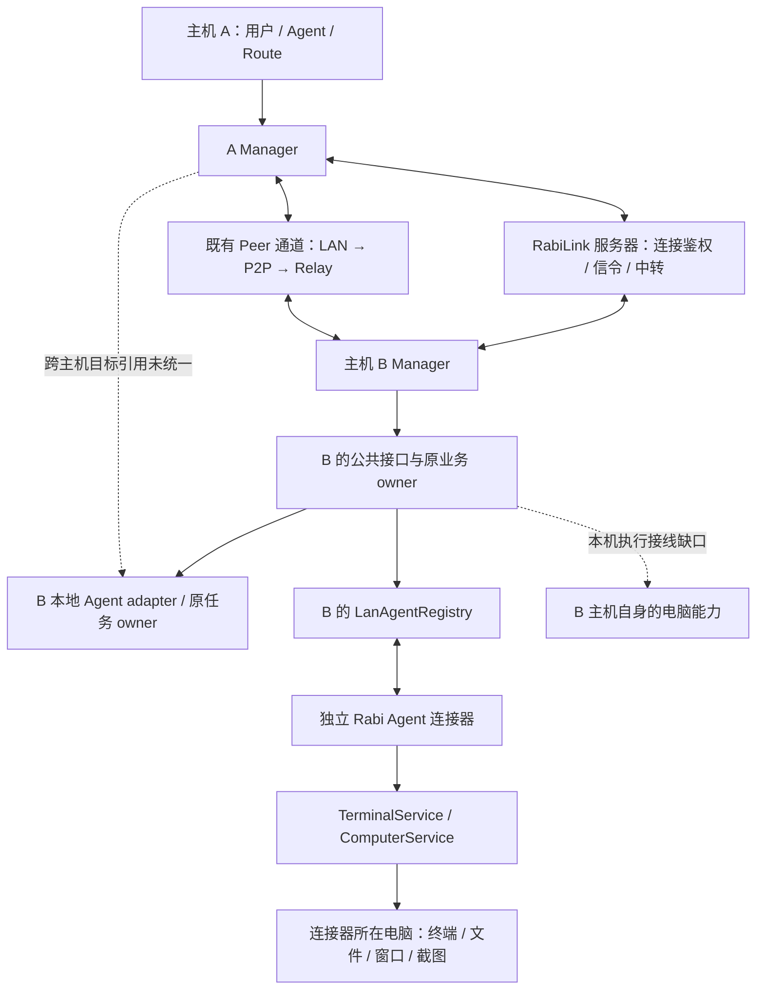
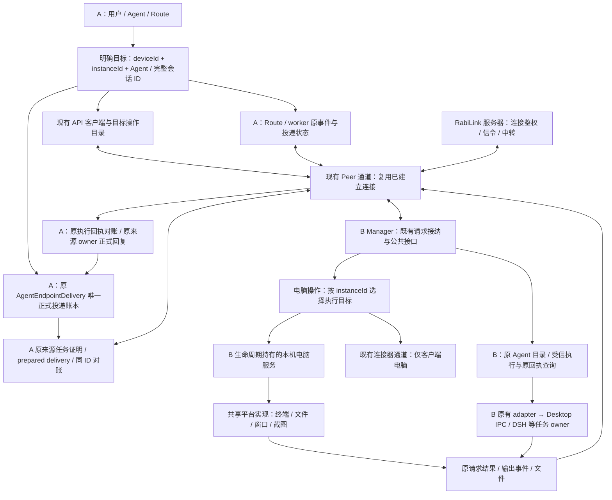

<!-- docs-language-switch -->

简体中文 | <a href="./connected-host-agent-architecture_en.md">English</a>

<!-- /docs-language-switch -->

# 已连接主机的远端 Agent 架构

目标：两台运行 Rabi 的电脑通过 RabiLink 建立连接后，互为完整远端 Agent。调用方可以直接使用目标电脑的终端、文件、窗口、截图、Agent 消息投递与结果查询，无需再给完整主机安装一套自连接的连接器。后续公共功能沿同一连接使用。

本文保留整理前基线，说明本轮源码接线与目标验收架构。它不是安装版或真实双机验收记录。操作参数仍以[公共接口](rabi-agent-interfaces.md)、[通用隧道](rabilink-peer-tunnel.md)和[电脑能力](remote-computer-client.md)为准。

## 整理前架构（调查基线）

实线表示已有机制；虚线表示目标缺口。连接器可以位于第三台电脑，不等同于 B 主机。Relay 设备上线记录、实际 Peer 会话、目标接口是否可用分别由原 owner 报告；本文讨论连接建立后的功能，不把设备目录出现当作已连接成功。

## 当前源码接线

| 边界 | 当前实现与判断 |
| --- | --- |
| 主机连接 | `src/peerTunnel/` 已承担应用握手、公钥、连接复用和 HTTP / SSE / WebSocket / 二进制。业务走目标 `manager` 服务，无需新增 Relay 业务分发表。 |
| 组合与生命周期 | `src/manager/managerPeerRuntime.ts` 组合现有信令、隧道、bootstrap、LAN 元数据和 operation；控制面仍拥有当前 active 指针、配置及发布入口。 |
| 主机本机实例 | `LanAgentRegistry` 持有一个 `ManagerLocalComputer`，本机实例直接上报真实终端与电脑能力；无需连接器节点或非空 Agent 列表。 |
| 终端 | 本机与连接器共用原终端 operation、`LanAgentTerminals` 输出事件、SSE 和重放游标；本机执行直接进入共享 `TerminalService`。 |
| 文件、窗口、截图 | `lanAgentComputerRoutes.ts` 查询目标实例实际能力，Registry 将本机调用交给共享 `ComputerService`，连接器继续沿原管理通道执行。 |
| 实际电脑执行 | `apps/rabi-agent/lib/terminal-service.mjs`、`computer-service.mjs` 由 Manager 本机 owner 与轻量连接器分别持有同一执行实现。Windows 提供 CMD/PowerShell、文件、窗口及截图；Mac/Linux 提供实际可用的 POSIX Shell 和文件，窗口及截图尚未实现。 |
| 消息投递 | 目标引用保留外层设备与内层实例/会话。`peerAgentEndpointBridge.ts`、`peerAgentOperations.ts` 复用原 prepared delivery、执行回执与正式回复边界，A 的原 `AgentEndpointDelivery` 保持唯一正式意图。 |

本轮复用既有连接层补齐主机电脑执行 owner 和跨主机投递边界；平台执行、业务数据及正式投递账本保持原拥有者。源码接线、隔离运行、安装版和真实双机分别记录证据。

## 当前源码与目标验收架构

A 和 B 对称。完整 Rabi 主机直接提供本机能力；轻量连接器继续服务不运行 Manager 的电脑。两种部署复用平台执行实现、公开合同和投递机制，不建立第二套 Manager、业务数据或消息回执账本。

本轮跨 PC 正式投递的目标是完整主机 B 的本机 Agent；B 接入的轻量客户端仍可通过 B 原接口进行电脑操作和设置，第三层客户端的跨 PC 正式投递不在本轮实现范围。

“完整功能”由目标当前注册的公共 operation 和平台能力决定，不增加封闭功能白名单。平台尚未实现的能力要在目录中如实标记缺失，不能宣称所有系统已支持截图。

## 职责与不变量

| 事实或动作 | 唯一拥有者与边界 |
| --- | --- |
| 应用设备身份与上线 | 现有 RabiLink 连接配置与 Relay；设备名/IP 只用于显示。 |
| Peer 会话与线路 | `PeerTunnelRuntime` / `PeerConnections`；会话通过握手和连通检查后才报告成功，按现有空闲策略释放。 |
| 稳定目标 | 外层 `deviceId` 选择 Manager，内层 `instanceId` 选择该 Manager 的执行实例；Agent 和会话 ID 保持原作用域。generation/instance 身份用于本次运行核对，不替代稳定引用。 |
| 可用操作 | 目标 Manager 的活动 operation 目录和平台注册能力；不把展示缓存当作权限或正式连接状态。 |
| 本机电脑进程 | Manager 正式生命周期中的一个本机执行 owner；直接调用共享服务，持有终端、辅助进程和输出订阅。停止等待终端创建准入、已接纳 I/O、子进程及历史/临时文件清理；未确认清理时保留原 ID 并报告失败。 |
| 连接器电脑进程 | 原 Rabi Agent 客户端；继续使用其原连接、任务及生命周期。 |
| Agent 推理与工具 | 目标原 Agent 宿主；正文走原投递入口，不经终端拼命令或启动备用 Runtime。 |
| 普通业务写入 | 目标已有业务 owner；保留原 request/幂等 ID，超时或断线先查询原回执，不自动改线路重放写入。 |
| 跨 PC Agent 投递 | 发起主机 A 的既有 `AgentEndpointDelivery / AgentRequestStore` 拥有唯一正式意图、投递和回复状态；B 通过原 `PreparedEndpointDelivery / EndpointTransportReceipts` 或宿主回执记录执行事实。沿同一 deliveryId 执行/对账，不在 B 再建立一份正式发送意图。 |
| 业务数据 | 目标 Manager 的原业务 owner；访问角色、计划、记忆和 Skill 使用引用，不同步第二份正式数据。 |
| 普通 Route / worker 投递 | A 保留原事件、消息池或会话投递状态；B 的 `peerRouteDeliveryOperations.ts` 接收原消息包并记录执行回执。共享 `executeNativeOwnerDelivery`，不伪造 Agent 来源或再建正式 Agent 意图。 |

已建立并通过鉴权的连接默认可使用目标公共接口。保留用户明确配置的禁用项和业务本身的版本、幂等、文件及权限条件，不增加逐功能授权或第二个管理密码。来源身份由现有可信传输生成；异步操作继续使用原请求 guard，不把失效远端请求降级成本机请求。

现有连接确定来源电脑，类型和完整会话 ID 定位原宿主任务；已连接电脑上的 Agent 可主动发起新消息，不需要先有一条历史请求。正式回复按原账本地址回到原任务。A 经既有 Peer 通道调用 B 的 `/api/agent/prepared-deliveries` 及 `/reconcile`，B 只保留执行回执。普通应用连接继续使用原生任务解析，不再被误当成排他的设备任务源。

普通 Route 和后台 worker 使用 `/api/agent/route-deliveries` 及 `/reconcile`，原始用户或系统来源保持原样。B 在实际任务上下文中提供来源 A 的 API 前缀，角色、计划与渠道回传仍归 A。历史回执查询不要求任务当前未归档；明确未发送可以按原 ID 恢复，未知状态只对账。详见[接口合同](rabi-agent-interfaces.md#已连接主机的原生投递源码已接入)。

Route 对每个 Peer 目标分别保存原会话 ID、名称和工作目录；没有 B Route 时，从原 provider 目录与会话接口选择即可，不借用 A 的 provider 默认任务。

实现时直接复用现有已核验来源快照、请求 guard 和回执，补齐跨 PC 的 owner 引用即可；不另建身份协议、逐消息签名或重复校验。新增检查只处理本次跨主机转换实际引入的约束，局部失败由对应 owner 处理。

## 本轮实施与验收

本次提取 `managerPeerRuntime.ts`，将准备候选、operation 组合、发布/回滚、停止接纳和资源回收移出控制面大文件。`createPeerRuntimeOwner` 仍负责原生命周期语义；配置、活动实例指针和业务实现不复制到新模块。现有接口、服务与连接策略保持原行为。

| 顺序 | 本轮源码实施 | 验收要求 |
| --- | --- | --- |
| 1 | 在电脑操作边界注入本机/连接器执行目标，Manager 生命周期挂载共享 TerminalService / ComputerService。保留原 operation、终端事件和文件协议。 | 空 Agent 列表下仍可运行终端、文件往返和支持平台的截图；停止后所属子进程、订阅和临时上传均释放。 |
| 2 | 增加外层设备引用和源 PC 原任务证明；A 原账本经现有 `manager` 通道调用 B 的 prepared-delivery 执行/同 ID reconcile，结果回到 A 原来源 owner。 | 两台已连接主机互投准确会话，保留 workspace、原任务 owner 和回执；同一来源、同一 deliveryId 仅一个正式意图。无主 Agent/Route 绑定不额外拒绝电脑操作。 |
| 3 | 页面和上下文读取统一目标投影，保留设备在线、通道与操作的实际状态。 | 显示的目标、实际执行电脑与回执一致；一个离线目标不阻断其余目标。 |
| 4 | 复用既有原生资源构建与安装合同，再进行隔离运行和真实双机验收。 | 实际经 RabiLink 服务器连接后双向执行，验证断线、撤销、忙碌会话和未知写入结果；不以源测试或构建代替。 |

本轮直接复用现有平台服务；根依赖保留可选 `node-pty`，Windows 完整包复制已有 `dist/native` 原生资源。确需移动共享包时一并迁移 `terminal/`、`desktop/`、`dist/native` 的定位、构建和签名发布；不能只移动 JavaScript 文件。连接器保留条件是仍支持轻量客户端，退出条件由真实迁移和引用情况决定。

## 验证与证据范围

- Peer 组合整理：隔离候选准备、发布/回滚、替换后旧候选退役及失败清理；复用 `src/peerTunnel/pluginRuntime.test.ts` 和匹配传输测试。
- 本机能力验收：终端就绪与输出游标、取消/退出、跨块文件校验、桌面/窗口 PNG、助手进程清理、平台不支持的准确反馈。
- 投递验收：A→B 与 B→A 的原任务、可信源任务证明、准确目标、唯一正式意图、幂等重复、接受与完成分离、正式回复。B 已接受而 A 断线后只对账原执行回执，不重发；一个坏目标不阻断其他目标。
- 完整构建与本机隔离测试只能证明对应候选；安装版、真实公网/双机和各系统真机仍分别验收。

历史来源：`04f09b73` 已统一应用内服务鉴权；`880657cb` 保留模块隔离与候选发布边界。它们支持复用已有传输和生命周期，不证明本机能力接线已完成。此次统一完整主机的要求是现有“Manager + 独立电脑客户端”设计的演进。
