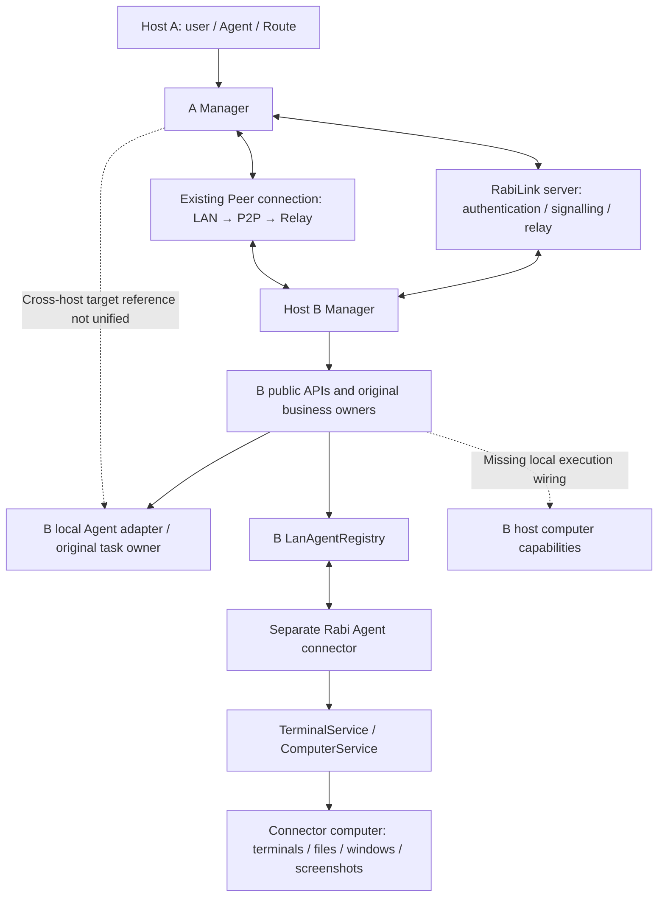
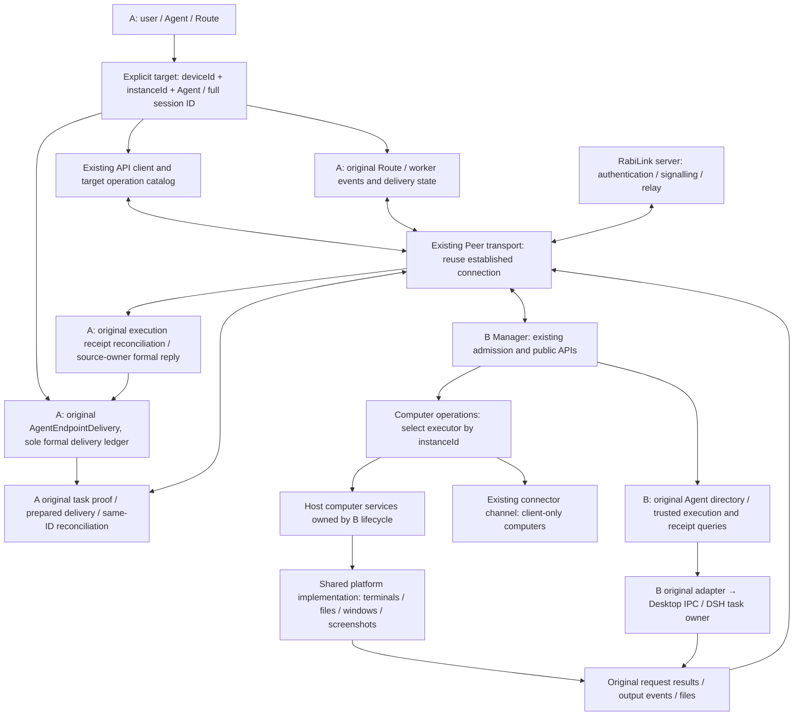

<!-- docs-language-switch -->

English | <a href="./connected-host-agent-architecture.md">简体中文</a>

<!-- /docs-language-switch -->

# Remote Agent architecture for connected hosts

Goal: once two computers running Rabi connect through RabiLink, each is a complete remote Agent target. Callers can use the target computer's terminals, files, windows, screenshots, Agent message delivery and result queries without installing a second, self-connected connector on a full host. Future public capabilities use the same connection.

This document retains the pre-change baseline and describes implemented source wiring and its acceptance target. It is not installed-runtime or physical two-computer acceptance evidence. Parameters remain defined by the [public APIs](rabi-agent-interfaces_en.md), [generic tunnel](rabilink-peer-tunnel_en.md) and [computer capabilities](remote-computer-client_en.md).

## Architecture before this change

Solid edges represent existing mechanisms; dotted edges represent gaps. A connector can run on a third computer and does not imply host B. Relay presence, the actual Peer session and target operation availability are reported by their existing owners. This design addresses capabilities after connection, not mere appearance in a directory.

## Current source wiring

| Boundary | Existing implementation and finding |
| --- | --- |
| Host connection | `src/peerTunnel/` already owns application bootstrap, keys, connection reuse, HTTP / SSE / WebSocket and binary traffic. Business calls use the target `manager` service; no new Relay business dispatcher is needed. |
| Composition and lifecycle | `src/manager/managerPeerRuntime.ts` composes existing signalling, tunnels, bootstrap, LAN metadata and operations. The control plane retains active pointers, configuration and publication. |
| Local host instance | `LanAgentRegistry` owns one `ManagerLocalComputer`; its host instance advertises actual terminal and computer capabilities without a connector node or a nonempty Agent list. |
| Terminals | Hosts and connectors share terminal operations, `LanAgentTerminals` events, SSE and replay cursors. Host execution calls the shared `TerminalService` directly. |
| Files, windows and screenshots | `lanAgentComputerRoutes.ts` checks target instance capabilities. The Registry calls shared `ComputerService` for the host, retaining the original management transport for connectors. |
| Computer execution | `apps/rabi-agent/lib/terminal-service.mjs` and `computer-service.mjs` provide shared execution owned by Manager for full hosts and by the connector for lightweight clients. Windows provides CMD/PowerShell, files, windows and screenshots. Mac/Linux provide available POSIX shells and files; windows/screenshots remain unsupported. |
| Message delivery | Targets retain outer device and inner instance/session identities. `peerAgentEndpointBridge.ts` and `peerAgentOperations.ts` reuse original prepared delivery, execution receipts and formal replies. A retains the sole formal intent in `AgentEndpointDelivery`. |

This source change adds a host execution owner and cross-host delivery boundary over the existing transport, retaining original platform, data and delivery owners. Source wiring, isolated execution, installed packages and physical two-computer acceptance are reported separately.

## Current source and acceptance target architecture

A and B are symmetric. Full hosts directly provide local capabilities; lightweight connectors continue serving computers without Manager. Both deployments reuse platform execution, public contracts and delivery mechanisms, without a second Manager, business-data replica or message-receipt ledger.

This change targets native Agents on full host B for formal cross-PC delivery. Lightweight clients enrolled on B retain computer operations and settings through B’s existing APIs; formal cross-PC delivery to those third-level clients is outside this implementation.

“Complete capabilities” means the target's currently registered public operations and actual platform capabilities, not a closed feature allowlist. Unsupported platform features must be reported accurately; this design does not claim screenshots work on every OS.

## Ownership and invariants

| Fact or action | Sole owner and boundary |
| --- | --- |
| Application identity and presence | Existing RabiLink connection configuration and Relay; names and IP addresses are display values. |
| Peer session and transport | `PeerTunnelRuntime` / `PeerConnections`; report connected only after handshake and liveness checks, retaining existing idle release. |
| Stable target | Outer `deviceId` selects Manager; inner `instanceId` selects an execution instance within it. Agent/session IDs keep their scopes. Generation/instance identity validates a running incarnation rather than replacing stable references. |
| Available operations | Target Manager's active operation catalog and platform capabilities; presentation caches establish neither permission nor connection truth. |
| Host computer processes | One local execution owner in the formal Manager lifecycle, directly using shared services. Stop awaits pending terminal admission, admitted I/O, child/helper exit and history/temporary-file cleanup. Unconfirmed cleanup retains original IDs and reports failure. |
| Connector processes | Original Rabi Agent client, retaining its connection, tasks and lifecycle. |
| Agent reasoning and tools | Original target Agent host; prompts use original delivery APIs rather than terminal command construction or a fallback Runtime. |
| Ordinary business writes | Existing target business owner; retain original request/idempotency IDs, query original receipts after timeout/disconnection, and never automatically replay writes on another transport. |
| Cross-PC Agent delivery | Initiating host A's existing `AgentEndpointDelivery / AgentRequestStore` owns the sole formal intent, delivery and reply state. B records execution through original `PreparedEndpointDelivery / EndpointTransportReceipts` or host receipts. Execute/reconcile the same deliveryId; do not create another formal send intent on B. |
| Business data | Original target Manager business owners; roles, plans, memory and Skills are accessed by reference without a second authoritative copy. |
| Ordinary Route / worker delivery | A retains its original event, pool or session-delivery state. B's `peerRouteDeliveryOperations.ts` accepts the original packet and records execution receipts. Both use `executeNativeOwnerDelivery`, without fabricated Agent sources or another formal Agent intent. |

Authenticated established connections can use public target APIs by default. Retain explicit user disable settings and normal business version, idempotency, file and permission conditions. Do not add per-feature grants or another management password. Existing trusted transports establish source identity; asynchronous work keeps its original request guard and never downgrades a revoked remote call to local access.

The existing connection identifies the source PC; provider and full session ID locate its original task. An Agent on a connected PC can initiate a new message without a previous request. Formal replies return through the original ledger address. A uses B's `/api/agent/prepared-deliveries` and `/reconcile`; B retains execution receipts only. Ordinary application connections retain native-task resolution instead of being misclassified as exclusive device-task sources.

Ordinary Routes and workers use `/api/agent/route-deliveries` and `/reconcile`, preserving user/system sources. B supplies the source-A API prefix in the actual task context; personas, plans and channel replies remain owned by A. Historical receipt queries do not require an unarchived task. Proven not-sent deliveries can recover with the original ID; unknown outcomes only reconcile. See the [API contract](rabi-agent-interfaces_en.md#connected-host-native-delivery-source-connected).

A Route saves the original session ID, name and working directory separately for each Peer target. Without a B Route, select through existing provider/session APIs; never borrow A's provider-default task.

Implementation reuses validated source snapshots, request guards and receipts, extending cross-PC owner references without a separate identity protocol, per-message signatures or repeated validation. Add checks only for constraints actually introduced by cross-host conversion; the responsible owner handles local failures.

## Implementation and acceptance

This change extracts `managerPeerRuntime.ts`: candidate preparation, operation composition, publication/rollback, admission shutdown and cleanup leave the large control-plane file. `createPeerRuntimeOwner` retains lifecycle semantics. Configuration, active-instance pointers and business implementations are not duplicated. Existing APIs, services and transport selection retain their behavior.

| Order | Source implementation | Acceptance requirement |
| --- | --- | --- |
| 1 | Inject host/connector execution targets at the computer-operation boundary; mount shared TerminalService / ComputerService in the Manager lifecycle. Preserve operations, terminal events and file protocol. | An empty Agent list still allows terminals, file round trips and supported screenshots; stop releases children, subscriptions and temporary uploads. |
| 2 | Add outer device references and source-PC original-task proof. A's original ledger uses existing `manager` transport for B's prepared execution/same-ID reconciliation and returns results to A's source owner. | Both hosts reach exact sessions with original workspace, owner and receipts; one source/deliveryId has one formal intent. Computer operations do not require a primary Agent/Route binding. |
| 3 | Let UI and context consume the unified target projection while preserving actual device, session and operation states. | Displayed target, execution computer and receipt agree. One unavailable target does not block others. |
| 4 | Reuse native-resource build/installation contracts, then validate isolated running candidates and physical computers. | Real bidirectional execution after connecting through the RabiLink server, including disconnects, revocation, busy sessions and uncertain writes. Source tests/builds do not replace this. |

The implementation reuses existing platform services directly. Root optional dependencies include `node-pty`; the Windows package includes existing `dist/native` assets. If moving them to a shared package becomes necessary, migrate `terminal/`, `desktop/`, `dist/native` resolution, builds and signed publication together rather than moving JavaScript alone. Connectors remain while lightweight clients are supported; retirement requires actual migration and reference evidence.

## Validation and evidence limits

- Peer composition cleanup: isolated preparation, publication/rollback, retiring an old candidate after replacement, and failure cleanup; reuse `src/peerTunnel/pluginRuntime.test.ts` and matching transport tests.
- Host-service acceptance: terminal readiness/cursors, cancellation/exit, chunked file integrity, desktop/window PNG, helper cleanup and accurate unsupported-platform responses.
- Delivery acceptance: A→B and B→A exact original tasks, trusted source proof, exact targets, one formal intent, idempotent duplicates, acceptance versus completion and formal replies. After B accepts and A disconnects, reconcile the original execution receipt without resending. Isolate per-target failures.
- Full builds and local fixtures establish only their candidates; installed versions, real public-network/two-computer use and each OS need separate acceptance.

History: `04f09b73` unified application service authentication; `880657cb` retained module isolation and candidate publication boundaries. These support reusing transport/lifecycle and do not prove local computer wiring exists. Unifying full hosts evolves the previous Manager-plus-separate-client design.
