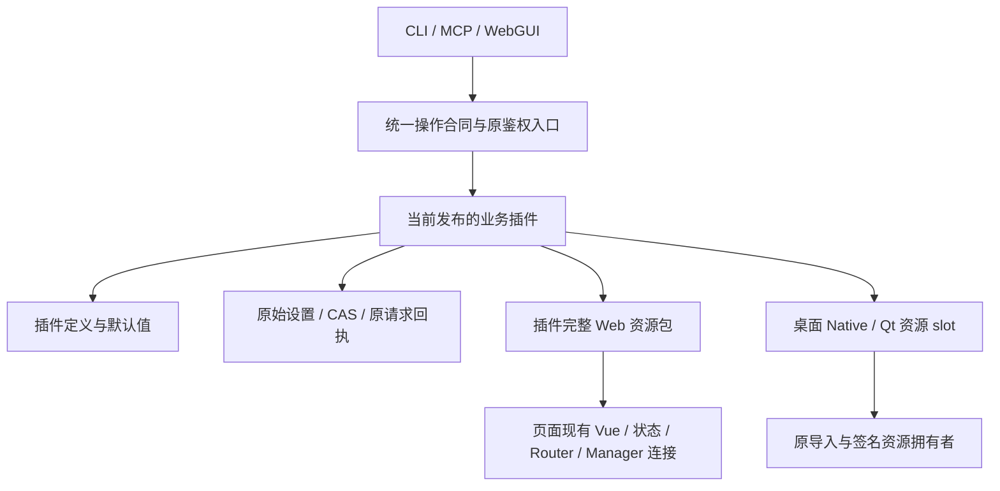

# 宿主与插件边界

[English](host-plugin-boundaries_en.md)

宿主负责连接、插件装配、原始设置存储、事务、资源拥有关系和共享界面。业务插件负责自己的定义、默认值、操作、界面和资源。CLI、MCP 与 WebGUI 使用同一操作合同；分类与目录帮助发现功能，不增加调用许可。

## 定义与设置

电脑功能的可编辑定义位于 Core 插件的 `assets/computer-settings.json`。schema、动作元数据和功能说明在此维护；默认值从 schema 派生。官方生成器为 SDK 生成启动快照，禁止手改派生文件。单独升级业务定义时，由当前插件发布的 definition provider 提供有效值，宿主不重置连接或重建业务对象。

原始用户设置与有效设置分开。已有文件中的值一律保留为显式值，不根据它是否等于旧默认值删除。PATCH 只修改用户提交的原始字段；恢复默认需要明确删除相应覆盖字段。有效设置缓存按原始修订与实际 definition 身份失效。ETag 用于这次真实修改，查询不会把默认值写回文件。

按功能读取实际所需设置。坏跟踪参数只影响使用它的跟踪操作，不能阻断文件、终端、Agent 任务或原回执。新操作仍遵守用户显式关闭的功能开关。原请求先读取同 ID 回执；关闭功能不取消已经发生的事实。

## 插件 Web 资源

插件完整 Web 包保存入口、延迟加载模块、CSS、Worker、字体、图片及资源 MIME 数据。资源沿原 pluginId/version/revision 路由读取，不依赖当前全局 `/assets` 恰好存在同名文件。页面共享已加载的 Vue、Pinia、Router、翻译与 Manager 连接，插件不另开第二套页面状态。

官方选包构建消费原 native package 证据与共享 runtime 清单，再封完整资源闭包。全量构建仅生成共享页面壳，由同一选包 producer 为目录中每个 Web 插件生成完整资源包。旧 wrapper 的生成逻辑已经退役。原已安装包和仍挂载的页面通过原版本资源读取兼容，随引用及必要回退版本退出后移除。SDK Web builder 与项目命令复用一份实现。

新候选只核对自己使用的 runtime 导出。所需导出缺失时保留原已验证页面并说明该候选的依赖，不拒绝无关页面或公共 CLI/MCP 接口。候选的 CSS 和异步初始化归自己的生命周期；取消后清理自身资源，迟到结果不能注册回旧页面。内容 hash 用于完整性，不能充当调用方资格。

## 计划业务执行器

Persona 的 `worker/plan-update.mjs` 拥有计划更新的准备、历史投影和结果投影。Host 保留原写队列、租约、CAS、WAL、回执和缓存发布。当前拆分覆盖 `plan_update`，其他领域继续由原拥有者维护。

请求受理时固定插件包身份。新请求使用当前发布版本；已有请求按原回执记录的包版本继续。已经冻结的 WAL 先沿原事务恢复，已完成回执直接返回原事实。插件版本信息保存在原回执的审计字段，不进入业务请求摘要。

提交后的展示读取与投影在写队列外完成。投影失败返回已提交事实和局部错误，其他计划与记忆继续写入。已配置执行器暂时不可用时，仅依赖它的新计划更新失败；原回执查询继续。已退役版本需要恢复时，由原不可变包存储按精确身份打开，复用原校验结果。

## 桌面资源换版

内部服务 `host.manager.desktop-native@1` 提供 `status`、`prepare`、`activate` 和 `discard`。它消费原 release store 已导入的 digest，不接受任意执行路径。准备阶段验证目标 worker 的实际 protocol 2；正式替换只收尾该电脑的桌面通道。

文件、终端、上传、控制服务与 WAL 保持原拥有者。旧桌面请求与队列退出、按键释放、图层与 tracker 定时器清理、Native 和 Qt 进程实际退出后，才发布新 worker。关闭期间的旧画面不能再次启动 Qt。候选和当前进程由同一个 slot 清理，通用资源退出逻辑不重复 kill 它们。

选版保存在原 release store 下的桌面专用引用，带本 slot 的 revision 与 digest，不修改 common 或节点 SDK selection。重启后按该引用延迟恢复并核对实际能力。Qt 使用原插件包导入拥有者提供的 desktop 声明资源 Pin，官方 producer 从已验 desktop-runtime 封完整依赖和许可闭包。缺少独立 Qt 引用时继续使用 Host 内置资源。缺失或损坏的已选 Qt 资源只报告展示依赖问题，Native 输入与窗口查询继续。

提交响应丢失时读取原选版。确认已提交才报告采用；确认未提交才恢复旧 worker；读回仍未知时保留原候选及事实，只影响该桌面通道。原回执和无依赖功能继续可用。回退创建原资源的新 worker，不重置已经关闭的对象。

## 最小失败范围

| 问题 | 处理范围 | 保持可用 |
| --- | --- | --- |
| 无关配置保存失败 | 该次保存 | 原连接与原有效设置 |
| 角色或 Route 目录字段错误 | 该目录 owner 与诊断 | Manager、设置修复入口和无依赖功能 |
| 一个插件包根无法读取 | 该根的 partial 诊断 | 其他正常安装选项 |
| 坏记忆或聊天索引条目 | 对应条目；索引按原账本单行修复 | 正常条目、真实游标和原始聊天数据 |
| 角色列表分页失败 | 本次刷新 | 同来源已加载列表与已选角色 |
| 一个界面或资源候选失败 | 该插件的新候选 | 原页面与其他插件 |
| 桌面资源关闭或采用待确认 | 该电脑的桌面通道 | 文件、终端、上传、Agent 任务及原回执 |

鉴权、目标正确性、真实写入 CAS 和进程退出检查由原边界负责。事务必须整体提交时只拒绝该事务，不回滚无关成功操作。没有配置的限制不默认拒绝；不增加来源名单、逐功能许可、全局锁或确认轮次。

## 旧逻辑收尾与验收

删除已被新拥有者替代的重复定义、默认值回写、全量前置校验和全局资源重绑。仍在使用的旧 Web 包保留最小兼容入口，待旧包、页面引用与必要回退全部退出后删除；兼容层不维护第二套业务规则。

验证分别覆盖源码、正式构建、隔离候选与实际采用。源码测试或发布输入冻结不代表安装成功。每次交付记录实际 Host、插件与资源版本；没有变化的组件沿用有效证据，只有相关输入变化或具体失败才重跑。
