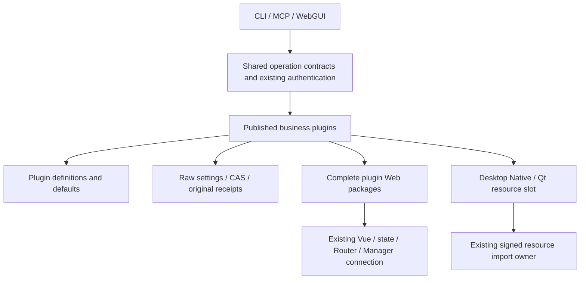

# Host and plugin boundaries

[简体中文](host-plugin-boundaries.md)

The Host owns connections, plugin composition, raw settings storage, transactions, resource ownership and the shared UI. Business plugins own their definitions, defaults, operations, UI and resources. CLI, MCP and WebGUI use the same operation contracts. Categories and catalogs support discovery; they do not add permission requirements.

## Definitions and settings

Core owns the editable computer definition in `assets/computer-settings.json`: schema, action metadata and feature descriptions. Defaults derive from the schema. The official generator produces the SDK bootstrap snapshot; generated files are not edited manually. An independently updated definition is supplied by the currently published plugin provider, without resetting connections or recreating business objects.

Raw overrides and effective settings are separate. Every value in an existing file remains explicit; matching an old default is not a reason to remove it. PATCH modifies only submitted raw fields. Restoring a default explicitly removes the corresponding override. Effective caches follow the raw revision and actual definition identity. ETags protect the actual modification; reads never persist defaults.

Read settings required by the requested feature. Invalid tracking settings cannot block files, terminals, Agent tasks or original receipts. New work still respects explicit user switches. Look up the original request ID first; disabling a feature does not erase an accepted result.

## Plugin Web resources

A complete plugin Web package contains its entry, lazy modules, CSS, workers, fonts, images and MIME metadata. Resources use the existing pluginId/version/revision route and do not depend on matching files in the current global `/assets`. Plugins share the page's loaded Vue, Pinia, Router, translations and Manager connection.

The official selected-package producer consumes the native package evidence and shared runtime catalog before finalizing the full resource closure. Full builds produce the shared shell and use that same producer for every cataloged Web plugin. Legacy wrapper generation is retired. Installed packages and mounted pages retain versioned resource reads until their references and required rollback versions retire. The SDK Web builder and project command share one implementation.

A candidate checks only runtime exports it actually uses. Missing exports preserve the verified page and explain that candidate's dependency; they do not disable unrelated pages or public CLI/MCP operations. CSS and asynchronous initialization belong to the candidate lifecycle. Cancellation cleans up its resources, and late results cannot register on a retired page. Content hashes establish integrity, not caller eligibility.

## Plan domain executor

Persona owns plan-update preparation, history projection and result projection in `worker/plan-update.mjs`. The Host retains the existing write queue, leases, CAS, WAL, receipts and cache publication. This extraction covers `plan_update`. Other domains retain their existing owners.

Admission pins the plugin package identity. New requests use the published version, while existing requests continue with the version recorded in their receipt. Frozen WAL recovers through the original transaction path, and completed receipts return their original facts. Package identity is stored in receipt audit metadata outside the business request digest.

Post-commit reads and projection run outside the write queue. A projection failure reports the committed state and a local error while independent plan and memory writes continue. An unavailable configured executor affects new plan updates that depend on it. Receipt queries continue. The original immutable package store restores retired versions by exact identity and reuses its verification result.

## Desktop resource adoption

The internal `host.manager.desktop-native@1` service provides `status`, `prepare`, `activate` and `discard`. It consumes a digest already imported by the original release store, rather than arbitrary executable paths. Preparation checks the actual worker protocol 2. Adoption retires only that computer's desktop channel.

Files, terminals, uploads, the control service and WAL retain their owners. Retire old desktop requests and queues, release keys, clear layers and tracker timers, and join actual Native/Qt exit before publishing the new worker. Late presentation frames cannot restart Qt. One slot owns both current and candidate processes; generic resource cleanup does not kill them again.

A desktop-only reference in the original release store persists the slot revision and digest without modifying common or node SDK selection. Startup restores it lazily and checks actual capabilities. Qt uses a declarative desktop resource Pin imported by the original plugin package owner. The official producer packages the verified desktop-runtime with its dependency and notice closure. An absent Qt reference uses the packaged Host resources. A missing or damaged selected Qt package reports a presentation dependency issue while Native input and window queries remain available.

A lost commit acknowledgement is reconciled from the original selection. Report adoption only when committed; restore the old worker only when not committed. Unknown readback retains the original candidate and facts, affecting only the desktop channel. Receipts and independent functions remain available. Rollback constructs a new worker from the old resource instead of resetting a closed instance.

## Smallest failure scope

| Problem | Affected scope | Still available |
| --- | --- | --- |
| Unrelated settings save fails | That save | Existing connections and effective settings |
| Invalid roles or Route directory field | That directory owner and diagnostics | Manager, configuration repair and independent functions |
| One unreadable package root | Partial diagnostics for that root | Other installation choices |
| Invalid memory or history projection row | That row; point repair from the original ledger | Healthy rows, true cursors and raw chat data |
| Role pagination fails | That refresh | Loaded same-source roles and selection |
| A UI or resource candidate fails | That new plugin candidate | The verified page and other plugins |
| Desktop cleanup/adoption is unconfirmed | That computer's desktop channel | Files, terminals, uploads, Agent tasks and original receipts |

Existing boundaries retain authentication, target correctness, write CAS and process-exit checks. An atomic operation may reject its own transaction without undoing unrelated successes. Unconfigured restrictions do not imply denial. No source lists, per-function grants, global locks or extra confirmation rounds are introduced.

## Retirement and verification

Remove replaced duplicate definitions, default writeback, broad preflight validation and global resource rebinding. Keep a minimal compatibility path for active legacy Web packages until their package/page references and required rollback versions retire. Compatibility does not retain a second business implementation.

Source, official build, isolated candidate and installed adoption are separate verification states. Tests or frozen inputs do not mean installation succeeded. Record actual Host, plugin and resource versions. Reuse evidence for unchanged components and repeat checks only for affected inputs or a concrete failure.
