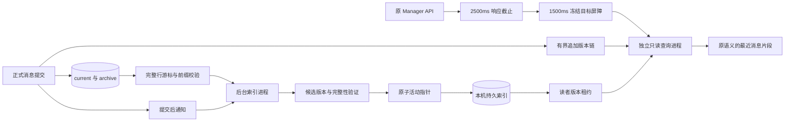

[English](message-history-search_en.md) | 简体中文

# 消息历史持久检索

状态：源码实现；安装版与目标规模性能以本次运行验收记录为准。

源码已实现版本化索引发布、损坏隔离重建、读者租约、高频词查询规划和冻结来源目标。下方保留重构前正式编译模块在十万及百万条合成数据上的持续并发验收记录；安装版本、扩展容量与具体硬件的支持范围分别记录，不能相互替代。

`message-endpoint-history` 使用本机 SQLite FTS5 派生索引查询，不在 HTTP 请求内扫描原始消息文件。正式消息仍由原消息存储模块拥有；索引删除或损坏不删除消息。

## 架构

索引存于主机本地缓存目录，按正式数据目录身份隔离。Windows 使用 `%LOCALAPPDATA%/RabiRoute/Cache/message-search`，其他系统使用用户 `.cache/RabiRoute/Cache/message-search`。不把 WAL 数据库放到 NAS；共享来源的每台主机建立自己的派生索引。

派生数据库使用 WAL 与 `synchronous=NORMAL`，正式消息的持久化方式不变。SQLite 的该模式在断电后可能回退最近的派生提交；来源指纹与事务内检查点会触发重放，不把索引当正式数据。首次候选发布仍经过完整性验证与 WAL 检查点。[SQLite 同步模式说明](https://www.sqlite.org/pragma.html#pragma_synchronous)

## 查询与预算

- 客户端总预算默认 3000ms，包含必要的身份发现与响应读取；Manager 未收到显式预算时默认等待 2500ms，包含排队。这些默认值可在 WebGUI 超时设置中调整：脚本使用 `scripts.history.query`，Manager 使用 `history.request`，中继与点对点传输使用 `history.transport`，独立 Relay 服务使用 `relay.history.query`。查询池最多两个进程、16 个排队请求；排队默认 500ms（`history.queue`），单次查询执行默认 1800ms（`history.execution`），仍受原请求剩余时间及全局读进程上限约束。
- 可用 `budgetMs=1..2147483647` 传入客户端剩余毫秒；显式预算优先于默认值，不再被固定的 2500ms 或 3000ms 上限截断。逐跳传递剩余时间，不重置已开始的截止时间；独立配置的排队、执行和可见性阶段预算仍生效。非法预算返回 400 `MESSAGE_HISTORY_BUDGET_INVALID`。
- 成功响应附带 `requestId` 和 `coverage.indexVersion/sourceVersion/indexedAt/sourceSnapshotIndexed`，分别标识请求、索引版本及来源快照；已有有限片段和完整性字段保持不变。
- 单条完整坏记录只影响自身，其他消息继续索引和查询，原文件保持不变。`coverage.indexCoverage=partial`、`sourceSnapshotIndexed=false` 表示来源覆盖不完整；`sourceRecordsSkipped` 与 `sourceRecordIssues` 分别给出跳过总数和 `malformed/oversized/unrecognized` 分类。即使返回零条，也不能据此判断全部历史都没有匹配。
- 派生索引每条 JSONL 记录的工作预算是 8 MiB（`maxIndexedRecordBytes=8388608`，含行分隔符），跨读取块累计到此预算后停止保留该行正文，继续处理下一行。超预算记录计入 `oversized`；这不是消息写入或原始正文读取上限，也不会截短、删除原消息。未完成的末行单列为 `pendingRecordBytes`，待后续写入完成后重新读取；无换行且超预算的末行也保持待续，不假定它已完整。旧游标会重新核对一次来源，以建立真实计数。沿用旧格式来源时 `legacyCoverageUnknown=true`，不能把旧格式读取器未报告的坏行算作不存在。
- 未建立索引返回 503 `MESSAGE_HISTORY_INDEX_NOT_READY` 并启动后台构建；来源已变化返回 503 `MESSAGE_HISTORY_INDEX_LAGGING` 并安排刷新。不能把第一次 503 当作空结果，也不要连续重启同一查询。
- 已有索引落后时，按 `history.visibility` 等待来源可见性屏障，默认 1500ms。本进程正常提交优先固定请求开始时拥有者已确认的提交；其他来源由第一个只读进程捕获快照。后续追加不推进目标。可见性阶段从首次确认落后时开始，不重置原服务端截止；无法在该窗口确认覆盖时返回延迟错误。
- 截止到期返回 503 `SEARCH_DEADLINE_EXCEEDED`。响应截止与子进程退出确认分离；未确认退出的资源仍被隔离。客户端断连只取消查询，不取消独立索引构建。
- 没有扫描回退。初次构建在后台完成，后续查询验证来源指纹与持久快照；源文件内容不在在线查询时读取。

在源码仓库中，本地脚本可复用 `scripts/lib/query-message-history.mjs` 的 `queryMessageHistory({ roleId, query, budgetMs: 3000, signal })`。该入口通过 Host 动态发现并核对 `/meta`，把发现、身份验证、HTTP 查询和响应解析纳入同一个截止时间，将剩余毫秒传入 `budgetMs`，不自动重试。未知查询参数会被拒绝，响应正文仅返回给调用者。

Relay 对此 GET 请求使用同一剩余预算，排队到期返回结构化截止错误；领取后不重放，迟到结果不能恢复已到期请求。PC 转发保留鉴权身份、只执行一次，并把正文读取和回传包含在截止内。Peer HTTP 通道同样限制整个响应读取。此规则不改变其他 API 的默认超时、权限或重试合同。Relay 诊断只记路由模板与状态，不复制角色标识、关键词、请求头或正文。客户端仍须约束到 Relay 的网络传输；服务端不能承诺任意网络条件下必定成功。

可见性等待由后台每次提交完成唤醒。本进程正在构建时等待该次进度通知；没有本进程构建时，以最多50ms间隔兜底观察外部更新。可见性阶段使用配置的预算，仍受原请求截止约束。重复探测复用已有构建，不把探测当成新的来源提交。常驻读进程复用仍有效的版本租约，同时重新核对活动指针、路径和隔离状态，避免每次探测创建并删除租约文件。

## 匹配和兼容

索引器将现有规范化检索串转换为一元、二元和三元 UTF-16 gram，并以固定长度十六进制 ASCII token 写入 FTS5。同一记录中的 gram 去重，使用 `detail=column` 保存词项和列归属；查询按词长选择 gram 列与词项交集，再用原匹配器核验候选正文，保留字面子串语义。这样避免重复文本产生大量位置数据，也兼容短词、Unicode 和字面符号。保留原来的大小写归一化、多词 any/all、数字子串、字段过滤和字符预算。

保留每个来源中的副本，在选定归档范围内以首次写入确认去重胜者，再匹配关键词。所有记录统一按归档目录顺序和文件内位置形成的稳定写入顺序查询，不再混用序号与时间比较；旧记录只建立派生顺序，不改写原文件。`limit`、首条可超字符预算和跳过过长后续记录的规则保持不变。

接口继续返回有限片段，没有 cursor/offset；`count` 不表示总数。旧 `limitReducesArchiveScan=false` 字段保留兼容，不再表示本查询实际扫描了原文件。

## 更新与恢复

索引构建与查询使用不同进程池。未改变的归档不会重新解析。当前文件使用持久字节游标，只解析新增记录；后台最多为16个当前文件复用已验证的 SHA-256 计算状态，改变的 current 快照发布前仍完整校验捕获的字节前缀。缓存丢失、淘汰或进程重启时，按持久检查点重新核对；校验不一致会丢弃内存状态并重读。截断、替换或前缀改写生成新的来源 epoch 并重建该来源。尚未组成合法 JSON 的尾部留到下次处理；已换行的坏 JSON 逐条跳过，仍发布可查询的 partial 快照，并报告遗漏数量；不把来源覆盖标为完整。当前文件和归档最后一条完整合法记录即使没有换行也会收录，后续改动会重建该来源。游标、规范化记录和倒排项在同一事务内提交；大文件每5000条记录提交字节检查点并标记尚未发布，当前文件和归档都能在进程终止后从已确认位置继续。复用散列状态省去重复的前缀散列，发布前的完整校验保留；旧 JSON 不重复解析或更新旧倒排项。提交通知只负责唤醒，来源指纹检测可以发现漏通知、改写、替换和轮转。

归档清单缺失时，旧格式回读沿用原读取器的有效记录判定；current 仅有空白或无效行时仍可读取旧记录。流式探测遇到首条有效记录即结束。普通增量更新最多每30秒触发一次版本目录回收；版本发布和显式清理立即执行。所有清理继续在写锁内核对代际路径、损坏状态与活跃租约。

来源连续变化造成快照捕获失败时，后台让出25ms后继续，不进入故障退避。后台任务遇到进程截止、繁忙或异常退出时，按 2 秒起、最多 30 秒的退避重新消费持久检查点，不依赖下一次用户查询唤醒；停止服务会取消待重试任务。该后台恢复不延长任何在线请求的截止时间。

已查询过的人格每 60 秒由独立索引进程核对来源，以发现遗漏通知；未变化时复用持久检查点，不重新计数或解析正文。正常本进程写入由消息拥有者立即提供有界追加链并唤醒后台任务：当前文件与目录版本、已完成提交窗口、来源布局及规范化行数。跨进程查询使用这份短期证据确认索引已覆盖冻结目标，并按目标行位置排除后来提交；证据过期、轮转或改写时保守返回延迟，不仅凭最大序号声称覆盖。该追加链只用于派生数据正确性，不改变接口权限。分钟级兜底按[事件驱动红线](code-architecture.md#事件驱动红线)登记，停止服务时取消。

每个查询在同一 SQLite 只读事务内读取索引快照，开始读取时校验来源指纹；已提交的单来源检查点与全局快照标签不一致时禁止查询。已经核对的快照不会因查询期间的新提交而失效，新提交由后续请求查询。后台可在确认原字节前缀仍完整、归档布局未变化后发布该前缀，避免持续追加使构建永远不能完成。索引首次构建期间不能查询半建数据。游标、终止恢复、冻结目标、持续追加和代际回退已有隔离测试；下方历史容量测试不替代当前 schema 7 的容量复验或安装版验收。

索引版本位于 `<cache>.state/versions/<generation>/index.sqlite`。后台重建使用 `building.json` 保留检查点，通过 SQLite/FTS 完整性与来源归属验证后原子更新 `active.json`。旧读者在打开数据库前取得文件租约并复核活动指针；切换不会覆盖其正在读取的文件。每个查询工作进程最多复用4个只读连接，每连接设置16MiB的 SQLite 页缓存目标；每个请求结束自己的读事务，连接被淘汰或进程退出时释放租约；这也避免每次连接关闭引起 WAL 反复清理。`previous.json` 保留健康的回退版本，损坏数据库和坏指针保留隔离证据，正式消息不被修改。后台清理保留活动、回退、当前构建、最近两个损坏版本及所有活跃租约；已退出进程的孤立租约可安全回收。

查询使用稳定写入顺序索引流式遍历；有关键词时由全文索引约束候选，再按稳定顺序核对正文。选择性查询的排序使用 SQLite 有界缓存和磁盘临时空间。去重副本只在候选进入结果处理时查询，不在所有待排序候选上预先计数。空的倒排交集可在同一读事务内提前返回空结果。schema 7 接续格式4/5/6的派生数据，补充来源顺序和对应索引，保留旧版本删除 `term_counts` 的迁移；正式来源不改写。物理记录计数与来源检查点同一事务递增/递减，正常更新不再对全库计数。查询内部统计候选数、策略和耗时，并接入现有性能记录入口，默认不记录关键词或正文。内部状态函数仅返回构建次数、耗时、计数和分类错误，不返回正文、关键词或来源路径。

维护模块的 `rollbackMessageIndex(indexPath, expectedGeneration)` 在单写者锁内核对当前 generation，验证健康回退数据库后切换指针；并发版本不符时拒绝操作。回退不豁免来源新鲜度校验，旧快照仍会返回延迟错误，需重新索引后再查询。它仅操作派生缓存，不修改正式消息，也未新增公开管理接口。

查询在读取结果投影时核对 JSON、消息标识、序号、时间、去重身份和字符成本；无法解析或与派生行元数据不符时，持有租约的读取者仅写入该代的隔离标记，不修改 SQLite 或活动指针。随后沿用 `NOT_READY` 路径，由后台单写入者从正式来源重建；损坏代际保留为证据。解析错误不记录正文片段。这不是任意有效内容篡改的密码学检测。

## 诊断指标

诊断分组 `message-search` 中，`message_history_query` 与 `message_history_response` 使用响应中的同一个 `requestId`，进入读服务后失败的查询也返回该标识。查询记录包含版本、候选数、返回数、投影字节、排队到分派、工作进程、快照检查、候选检索、投影及可见性阶段耗时；响应记录补充 JSON 序列化与发送耗时、JSON 字节数和状态码。可见性耗时包含该阶段的重试排队，与总排队指标有重叠，不能将所有字段简单相加。默认不记录查询词、正文或来源路径。

每代数据库同目录的 `index-progress.json` 记录已提交来源数、物理记录数、阶段和更新时间。历史文件批次立即更新，正常追加的就绪快照最多每5秒更新一次；它描述该代最近的索引快照，不表示来源之后没有新提交。内部 `messageHistorySearchStatus(directory)` 同时提供构建/重试状态、分类失败、WAL字节和有有效拥有者证据时的消息积压数，证据不足时不伪造零积压。

`index-progress.json` 是节流后的检查点采样，不是查询就绪信号；最后一次来源提交可能没有立即刷新此文件。来源写入完成后，候选仍须通过 SQLite 与 FTS 完整性校验。活动指针发布与服务状态用于判断是否已投入查询，成功响应中的 `coverage.sourceSnapshotIndexed` 用于确认本次请求目标的覆盖。

新增模块、导出、提交监听及持久生命周期需要通过原生热补丁兼容性判定；不兼容时由 Host 受控切换，不能直接启动第二个 Manager。

旧的历史查询 IPC 类型已删除；查询统一使用带覆盖信息的索引探测。旧平面缓存仅供旧整包回退保留，新查询不会打开。新版本完成运行验收、旧整包不再作为回退目标后，可清理这份派生缓存；正式消息不属于此清理范围。

## 验证

以下为稳定写入顺序重构前的历史基准，保留成功与失败的完整结果。当前 schema 7 已有排序、坏记录隔离与查询回归测试；这些历史数字不直接构成 0.4.0 的容量承诺。

实测环境为 Windows x64、原生 Node v22.17.1、SQLite 3.50.0（FTS5）、Unicode 16.0、Intel Core i7-10700F（16 个逻辑 CPU）、约 64GiB 内存及 ZHITAI TiPlus7100 4TB NVMe SSD。合成来源与派生索引均位于本机 C 盘。其它操作系统、硬件和词项分布不据此获得相同容量结论。

查询阶段观测（P99，毫秒）：

| 指标 | 十万条 | 百万条 |
| --- | ---: | ---: |
| 排队（各探针累计） | 43.5 | 372.3 |
| 工作进程（累计） | 55.9 | 271.3 |
| 来源可见性阶段 | 398.0 | 493.2 |
| 快照核对 | 44.8 | 45.9 |
| 候选检索 | 19.8 | 245.5 |
| 结果投影 | 0.8 | 2.3 |

以上按主档 10,000 次请求的 requestId 对应，排除预热探测。排队耗时累加多个读探针，每次入队仍最多 500ms；可见性阶段包含其内部重试排队，因此阶段及各自分位数不能相加。候选与投影仅统计成功查询（百万档 9,997 次、十万档 10,000 次）；失败仍计入主档成功率和端到端耗时。查询可见性等待与每条消息提交到可检索的延迟分开度量。

本轮正式编译模块、原生 Node 22 的隔离 HTTP 验收：4 个逻辑客户端、10 查询/秒、来源每秒提交 100 条合成记录，每档 10,000 次查询。十万条成功 10,000 次，P95 271ms、P99 446ms、最大 1,265ms；百万条成功 9,997 次，P95 410ms、P99 716ms、最大 1,592ms，3 次 `SEARCH_BUSY` 计入失败。百万条新进程及索引文件数据冷缓存测试 100/100 成功，P99 619ms、最大 643ms。冷缓存使用保留原数据库布局的一致快照与无缓冲新文件身份，范围仅为索引文件数据缓存。该结果不构成千万条或生产网络的容量承诺。

百万条负载上探保持每秒 100 条来源提交、4 个逻辑客户端，每档 10,000 次查询：

| 查询/秒 | 成功数 | P95 / P99 / 最大值（ms） | 结论 |
| --- | --- | --- | --- |
| 15 | 10,000 | 216 / 346 / 764 | 通过 |
| 20 | 10,000 | 171 / 305 / 731 | 通过 |
| 40 | 10,000 | 132 / 283 / 749 | 通过 |
| 80 | 2,606 | 3,009 / 3,013 / 3,017 | 过载，不支持 |

80 查询/秒保留全部失败：5,529 次 `SEARCH_BUSY`、1,828 次客户端截止、10 次索引不可用、27 次索引落后。按首次失败即停，未执行 100 查询/秒。已测通过的上界为 40，首次不达标为 80；未测区间不插值。各档缓存和系统状态不同，耗时下降不能解释为负载提升带来的加速。客户端截止为 3000ms，过载时仍观察到最多约 17ms 的计时器/调度延迟，不能作操作系统级硬实时承诺。

另测 60 秒的提交可见性：557 批、5,989 条新增消息均被已发布索引观察到，按消息数加权 P99 128ms、最大 188ms，无遗漏尾部或观察错误。起点设在来源写入前，结果为包含写入工作和最多 50ms 观察间隔的保守上界；这一指标与查询内部的可见性等待分开统计。

千万条静态扩展已完成：构建及候选完整性校验耗时 146.2 分钟；合成来源 5.44GiB，派生文件 18.37GiB，峰值进程 RSS 约 428MiB，累计 CPU 时间 13.7 分钟。7 类查询各做 100 次串行直接索引调用，其中中文两字词 P95 1261ms、P99 2092ms，超过 500ms/1500ms 热查询目标。

千万条真实 HTTP 扩展也已完成：4 个逻辑客户端、10 查询/秒、约 100 条来源提交/秒，10,000 次请求成功 8,733 次（87.33%），P95 1894ms、P99 2216ms、最大 2938ms。失败包括 878 次 `SEARCH_BUSY`、383 次索引落后和 6 次服务端截止；全部保留在总账。来源快照已恢复，76 个编译模块保持不变。该档未通过成功率及延迟门禁，不能公布千万条的三秒支持承诺；该历史版本在上述硬件和负载下通过了百万条档；当前 schema 7 的容量仍需重新验收。扩展测试完成与扩展容量达标是不同结论。

运行 `src/messageHistorySearchIndex.test.ts`、`src/manager/messageEndpointHistoryResponsiveness.test.ts` 及相关存储/读池测试，对照原始查询 oracle 验证子串、短词、Unicode、副本冲突、范围与字符预算，并验证查询不读取源文件、更新失效、HTTP 截止和取消。

正式构建必须再验证自动代码包装下的工作进程、实际 HTTP 查询、健康和 generation/hash。源码微基准不能代表安装版或百万条容量已经验收。

`scripts/benchmark-message-history-http.mjs` 使用显式指定、带所有权标记的合成来源与派生索引，启动隔离 HTTP 测试夹具并加载正式构建的路由、服务及工作进程。它不启动 Manager，也不使用真实人格消息。开放环请求包含4个逻辑客户端；100条/秒写入档模拟已提交来源批次，不代表正式消息写入 API 的吞吐量。报告保留全部成功和失败、调度延迟及来源恢复结果；10000次查询、成功率和延迟目标未全部通过时不标记该档验收通过。该夹具不替代安装版、远端鉴权或受控操作系统冷缓存验收。

## 稳定写入顺序

消息查询统一使用归档目录顺序与文件内记录位置形成的稳定写入顺序。平台时间与旧记录可缺省的 sequence 继续作为筛选字段，不再混合参与排序；同一身份以作用域内首次写入为准，先去重再筛选。schema 7 为旧索引增加派生 sourceOrder 和顺序索引，后台升级不改写原消息文件。普通查询按索引流式取所需窗口；选择性全文检索由 SQLite 在有界缓存与磁盘临时空间中排序，不在 JavaScript 中全量物化候选。
