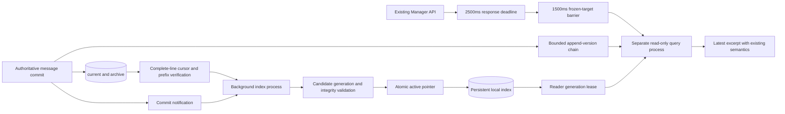

English | [简体中文](message-history-search.md)

# Persistent message-history search

Status: implemented in source. Installed-runtime and capacity claims require the corresponding acceptance evidence.

Source implements versioned publication, corruption recovery, reader leases, common-term query planning and frozen source targets. The historical measurements below record sustained concurrency acceptance of pre-refactor production-compiled modules with 100,000 and one million synthetic records. Installed-runtime, extension-capacity and hardware support evidence are recorded separately and do not substitute for each other.

`message-endpoint-history` queries a local derived SQLite FTS5 index instead of scanning message files inside HTTP requests. The existing message storage remains authoritative; losing an index does not delete messages.

## Architecture

Indexes reside in the host-local cache, isolated by authoritative data-directory identity: `%LOCALAPPDATA%/RabiRoute/Cache/message-search` on Windows, or the user's `.cache/RabiRoute/Cache/message-search` elsewhere. Keep WAL databases off NAS/network shares; each host builds its own derived index.

The derived database uses WAL with `synchronous=NORMAL`; authoritative message persistence is unchanged. SQLite may roll back recent derived commits after a power loss in this mode. Source fingerprints and transactional checkpoints trigger replay, so the index never becomes authoritative data. Initial candidate publication still validates integrity and checkpoints WAL. [SQLite synchronous modes](https://www.sqlite.org/pragma.html#pragma_synchronous)

## Queries and deadlines

- The client budget defaults to 3000ms, including necessary identity discovery and response reading. Without an explicit budget, the Manager defaults to 2500ms including queueing. Adjust these defaults in WebGUI timeout settings: `scripts.history.query` for scripts, `history.request` for the Manager, `history.transport` for Manager Relay and peer transport, and `relay.history.query` for the separate Relay service. The query pool has two processes and at most 16 queued requests. Queueing defaults to 500ms (`history.queue`), and query execution defaults to 1800ms (`history.execution`), within the remaining request budget and existing global process limit.
- Supply `budgetMs=1..2147483647` to propagate the client's remaining milliseconds. An explicit budget takes precedence over defaults and is no longer clipped by a fixed 2500ms or 3000ms limit. Each hop preserves the remaining time rather than restarting the deadline; separately configured queue, execution and visibility budgets still apply. Invalid values return 400 `MESSAGE_HISTORY_BUDGET_INVALID`.
- Successful responses include `requestId` and `coverage.indexVersion/sourceVersion/indexedAt/sourceSnapshotIndexed`. These identify the request, index and source snapshot without changing bounded-excerpt completeness semantics.
- A complete damaged record affects only itself: other messages remain searchable and source files remain unchanged. `coverage.indexCoverage=partial` and `sourceSnapshotIndexed=false` report incomplete source coverage. `sourceRecordsSkipped` gives the count, while `sourceRecordIssues` separates `malformed/oversized/unrecognized` records. An empty result with partial coverage does not prove that the full history has no match.
- The derived index has an 8 MiB work budget per JSONL record (`maxIndexedRecordBytes=8388608`, including its line separator). It stops retaining a line's body once the accumulated chunks exceed that budget, then continues at the next line. Such records count as `oversized`; this does not limit message writes or original body reads, truncate messages, or delete source data. An unfinished final line is reported separately as `pendingRecordBytes` and reread after further writes; an oversized final line without a newline also remains pending because completeness is unproven. Old cursors recheck their source once to establish accurate counts. Legacy fallback reports `legacyCoverageUnknown=true`; missing damage diagnostics from the legacy reader are not evidence that no damage exists.
- A missing index returns 503 `MESSAGE_HISTORY_INDEX_NOT_READY` and starts background indexing. Changed sources return 503 `MESSAGE_HISTORY_INDEX_LAGGING` and schedule refresh. Neither error is an empty result; avoid immediately restarting the same request repeatedly.
- An existing lagging index uses the `history.visibility` budget, which defaults to 1500ms. Normal local commits use the owner's confirmed request-start target; other sources use the first read worker's captured snapshot. Later appends never move that target. The visibility stage starts when lag is first confirmed and never resets the original server deadline. Failure to confirm coverage in time returns an explicit lag error.
- Deadline expiry returns 503 `SEARCH_DEADLINE_EXCEEDED`. Sending the error does not wait for child exit; unconfirmed resources remain quarantined. Disconnecting a query does not cancel the separate index build.
- There is no file-scan fallback. Initial indexing runs in the background. Online queries validate source fingerprints and the persistent snapshot without reading source bodies.

Within a source checkout, local scripts can reuse `queryMessageHistory({ roleId, query, budgetMs: 3000, signal })` from `scripts/lib/query-message-history.mjs`. It discovers the Host-published address and verifies `/meta`, includes discovery, identity verification, HTTP search and response parsing in one deadline, and propagates the remaining milliseconds as `budgetMs`. It does not retry automatically. Unknown query parameters are rejected and response bodies are returned only to the caller.

Relay applies the same remaining budget to this GET, expires queued requests with a structured deadline error, never replays a claimed search and never revives an expired request with a late response. PC forwarding preserves authenticated identity, makes one attempt and includes response-body reading and acknowledgement in the deadline. Peer HTTP also limits the complete response read. Other APIs retain their timeout, permission and retry contracts. Relay diagnostics record a route template and status without role IDs, keywords, request headers or bodies. Clients must still bound network transport to Relay; the service cannot guarantee success under arbitrary network conditions.

Each completed background batch wakes visibility waiters. An in-flight local build is observed through its progress notification; without a local build, a fallback checks external updates at intervals of at most 50ms. Visibility waits use the configured budget and remain bounded by the original request deadline. Repeated probes reuse an in-flight build instead of marking another source commit. Resident readers reuse a live generation lease while revalidating the active pointer, path and quarantine status, avoiding a new lease-file write and deletion per probe.

## Matching compatibility

The analyzer encodes overlapping UTF-16 unigrams, bigrams and trigrams as fixed-width hexadecimal ASCII tokens in FTS5. Grams are deduplicated within each record and stored with `detail=column`. Queries intersect the appropriate gram column and verify candidate bodies with the original matcher, preserving literal substring semantics. Repetitive text therefore avoids redundant position data while short terms, Unicode and literal symbols remain supported. Existing normalization, any/all, numeric substrings, field filters and character budgets remain intact.

Source variants are retained. The first write within the eligible archive scope owns an identity before text filtering. All records use one stable order derived from archive catalog order and physical record positions, without mixing sequence and timestamp comparisons. Legacy data gains derived order without rewriting source files. Limits, the oversized-first-record rule and skipping oversized later records remain compatible.

This endpoint still returns a bounded excerpt without cursor/offset; `count` is not a total. The legacy `limitReducesArchiveScan=false` field remains for compatibility and no longer implies that this request scanned files.

## Updates and recovery

Index construction and querying use separate process pools. Unchanged archives are not reparsed. Durable current-file byte cursors parse newly appended records. The background process retains verified SHA-256 computation state for at most 16 current files, while still checking the complete captured byte prefix before publishing a changed-current snapshot. A lost or evicted cache, or a process restart, falls back to the durable checkpoint; a failed verification discards the in-memory state and rereads the source. Truncation, replacement or prefix edits create a new source epoch and rebuild that source. Incomplete JSON tails wait for another pass; malformed complete JSON lines are skipped individually while a queryable partial snapshot is published with skipped-record counts; source coverage is not marked complete. A complete valid final record in either a current file or archive is included without a newline; a subsequent change rebuilds that source. Cursors, normalized records and postings commit in one transaction. Large files commit an unpublished byte checkpoint every 5000 records, allowing both current files and archives to resume after process termination. Hash-state reuse removes a duplicate prefix-hashing pass while retaining full verification before publication; old JSON is not reparsed and unchanged postings are not rewritten. Commit events are wake-up hints; fingerprints detect missed notifications, edits, replacements and rotations.

Without an archive catalog, legacy selection retains the original normalized-record test: whitespace-only or invalid current rows still allow legacy records. Streaming detection stops at the first valid record. Ordinary incremental refreshes trigger generation cleanup at most once per 30 seconds; publication and explicit cleanup run immediately. Cleanup continues to validate generation paths, quarantine state and live leases under the writer lock.

A snapshot capture interrupted by ordinary source changes resumes after a 25ms yield without fault backoff. After a process deadline, busy lane or abnormal worker exit, background indexing retries from durable checkpoints with backoff starting at 2 seconds and capped at 30 seconds. It does not require another user query to wake it. Stopping the service cancels scheduled retries. Background recovery never extends an online request deadline.

Previously queried roles reconcile sources every 60 seconds in the separate index process to detect missed notifications. Unchanged sources reuse durable checkpoints without recounting or parsing bodies. Normal local commits immediately wake background work and publish a bounded append chain containing physical current/catalog versions, completed commit windows, source layout and normalized row counts. Read workers use this short-lived evidence to confirm frozen-target coverage and exclude later commits by source position. Expired evidence, rotation or edits conservatively return lag rather than claiming coverage from a maximum sequence alone. This chain affects derived-data correctness, never API permissions. The minute-level fallback is registered under the [event-driven rules](code-architecture_en.md) and stops with the service.

A query uses one read-only SQLite transaction and validates source fingerprints when reading begins. A committed source checkpoint that disagrees with the global snapshot tag cannot be queried. Once verified, the snapshot remains valid when new commits arrive; later requests query those commits. Background indexing may publish a captured prefix after confirming its bytes and unchanged archive layout, so continuing appends do not indefinitely prevent publication. Partially built indexes are not queryable. Cursors, process-termination recovery, frozen targets, continuing appends and generation rollback have isolated tests. The historical capacity measurements below do not replace capacity revalidation of schema 7 or installed-runtime acceptance.

Managed generations reside at `<cache>.state/versions/<generation>/index.sqlite`. Background rebuilding records its checkpoint in `building.json` and atomically replaces `active.json` only after SQLite/FTS integrity and source-ownership validation. Readers acquire a file lease before opening SQLite and recheck the active pointer, so publication never overwrites an open database. Each query worker reuses at most four read-only connections with a 16 MiB SQLite page-cache target per connection. It ends the read transaction after every request, and releases leases on eviction or process exit. This avoids repeated last-connection WAL cleanup. `previous.json` retains a healthy rollback version. Damaged databases and pointers remain quarantined; authoritative messages are unchanged. Collection retains active, previous and building generations, the two newest damaged generations and all live leases. Leases belonging to exited processes can be reclaimed.

Queries stream through the stable write-order index. Text queries constrain candidates through the full-text index before matching bodies in stable order; selective sorts use SQLite bounded caches and disk temporary storage. Duplicate variants are fetched when a candidate is processed, rather than counted for every row before sorting. An empty postings intersection can return immediately within the same read transaction. Schema 7 carries forward derived data from formats 4/5/6, adding source order and its index while retaining the migration that removes `term_counts`; authoritative source files remain unchanged. Physical record counts advance with transactional source checkpoints instead of recounting the corpus on ordinary updates. Candidate counts, strategy and timings feed existing performance instrumentation without search text or message bodies. The internal status helper returns build counters, timings and classified errors, never bodies, terms or source paths.

The maintenance module's `rollbackMessageIndex(indexPath, expectedGeneration)` checks the active generation under the writer lock, validates the healthy previous database and then switches the pointer. A concurrent generation change rejects the operation. Rollback does not bypass source-freshness checks: stale snapshots still return an explicit lag error until refreshed. This operates only on derived caches, leaves authoritative messages unchanged and adds no public administration endpoint.

Queries validate projection JSON, message identity, sequence, time, deduplication key and character cost. An unparseable projection or mismatch with derived row metadata causes the leased reader to write only a generation quarantine marker, without modifying SQLite or the active pointer. The existing `NOT_READY` path wakes the single background writer to rebuild from authoritative sources while retaining damaged evidence. Parser errors never log body excerpts. This is not cryptographic detection of arbitrary valid-content tampering.

## Diagnostics

The `message-search` diagnostic group correlates `message_history_query` and `message_history_response` with the response's `requestId`, including queries that fail after entering the read service. Query records contain versions, candidates, returned records, projected bytes, queue-to-dispatch time, worker time, snapshot checks, candidate retrieval, projection and visibility-stage timing. Response records add JSON serialization/write duration, JSON bytes and status. Visibility timing includes retry queueing and overlaps aggregate queue time; the fields are not an additive breakdown. Search text, message bodies and source paths are not recorded.

The generation-local `index-progress.json` records committed sources, physical records, phase and update time. Historical batches update immediately; ordinary ready snapshots update at most once every 5 seconds. It describes that generation's recent snapshot, not an assertion that no newer source commits exist. The internal `messageHistorySearchStatus(directory)` helper reports build/retry state, classified failures, WAL bytes and message backlog where valid owner evidence exists. Insufficient evidence does not become a false zero backlog.

`index-progress.json` is a throttled checkpoint sample, not a query-readiness signal. The last source commit may not immediately refresh this file. A candidate still needs SQLite and FTS integrity validation after source indexing completes. Confirm serving publication through the active pointer and service state, and verify the request target through `coverage.sourceSnapshotIndexed` in a successful response.

New exports, commit subscriptions and persistent lifecycle changes require native hot-patch compatibility assessment. Incompatible changes use a Host-controlled generation switch, never a second Manager.

The legacy history IPC task is removed; queries use the coverage-aware index probe. Old flat caches remain solely for rollback to the previous complete package and are never opened by new queries. These derived caches may be removed after installed-runtime acceptance when the old package is no longer a rollback target; authoritative messages are outside that cleanup.

## Validation

The following historical benchmarks predate the stable write-order refactor and retain both successful and failed results. Schema 7 has ordering, damaged-record isolation and query regression tests; these historical numbers do not directly establish capacity for 0.4.0.

The measured environment is Windows x64, native Node v22.17.1, SQLite 3.50.0 with FTS5, Unicode 16.0, Intel Core i7-10700F (16 logical CPUs), approximately 64GiB RAM and a ZHITAI TiPlus7100 4TB NVMe SSD. Synthetic sources and derived indexes reside on the local C drive. These results do not establish equivalent capacity on other operating systems, hardware or query distributions.

Query phase observations (P99, milliseconds):

| Metric | 100,000 records | 1,000,000 records |
| --- | ---: | ---: |
| Queue across probes | 43.5 | 372.3 |
| Worker execution across probes | 55.9 | 271.3 |
| Source visibility phase | 398.0 | 493.2 |
| Snapshot verification | 44.8 | 45.9 |
| Candidate retrieval | 19.8 | 245.5 |
| Result projection | 0.8 | 2.3 |

These observations match the 10,000 principal requests by requestId and exclude startup probes. Queue time accumulates across probes; each enqueue remains capped at 500ms. Visibility includes its retry queueing, so overlapping phases and their percentiles must not be added. Candidate and projection metrics cover successful queries only (9,997 at one million records, 10,000 at 100,000); failures remain included in principal success-rate and end-to-end latency accounting. Visibility waiting is separate from per-message source-commit-to-index-visible latency.

The production-compiled, native Node 22 isolated HTTP gates used four logical clients, 10 queries/second and 100 committed synthetic source records/second, with 10,000 queries per tier. At 100,000 records, all 10,000 succeeded: P95 271ms, P99 446ms, maximum 1,265ms. At one million records, 9,997 succeeded: P95 410ms, P99 716ms, maximum 1,592ms; three `SEARCH_BUSY` responses remain counted as failures. One hundred fresh-process, cold-index-file-data queries all succeeded: P99 619ms, maximum 643ms. Cold controls use a consistent database-layout-preserving snapshot and an unbuffered new file identity, and cover index-file data cache only. These results do not establish ten-million-record or production-network capacity.

The one-million-record load ramp retained 100 source records per second and four logical clients, with 10,000 queries per tier:

| Queries/second | Successful | P95 / P99 / maximum (ms) | Result |
| --- | --- | --- | --- |
| 15 | 10,000 | 216 / 346 / 764 | Passed |
| 20 | 10,000 | 171 / 305 / 731 | Passed |
| 40 | 10,000 | 132 / 283 / 749 | Passed |
| 80 | 2,606 | 3,009 / 3,013 / 3,017 | Overloaded; unsupported |

All failures at 80 queries/second remain in the results: 5,529 `SEARCH_BUSY`, 1,828 client deadlines, 10 index-unavailable and 27 index-lagging responses. The ramp stopped at the first failed tier; 100 queries/second was not run. The highest tested passing tier is 40 and the first failing tier is 80; untested rates are not interpolated. Cache and system conditions differ between tiers, so lower latency does not establish that increased load speeds up queries. The client deadline is 3000ms; overload still produced approximately 17ms of timer/scheduling delay, so this is not an operating-system hard-real-time guarantee.

A separate 60-second visibility measurement observed all 557 batches and 5,989 new messages in published indexes. Message-weighted P99 was 128ms and maximum latency was 188ms, with no censored tail or observer errors. Timing starts before the source write and therefore conservatively includes commit work and up to one 50ms observation interval. This metric is separate from visibility waits inside queries.

The ten-million-record static extension completed construction and candidate integrity validation in 146.2 minutes, with 5.44GiB of synthetic sources, 18.37GiB of derived files, approximately 428MiB peak process RSS and 13.7 CPU minutes. Seven categories each ran 100 serial direct-index queries. The two-character Chinese category recorded P95 1261ms and P99 2092ms, above the 500ms/1500ms hot-query targets.

The ten-million-record real HTTP extension also completed: four logical clients, 10 queries/second and approximately 100 source commits/second. Of 10,000 requests, 8,733 succeeded (87.33%); P95 was 1894ms, P99 2216ms and maximum latency 2938ms. All failures remain in the totals: 878 `SEARCH_BUSY`, 383 index-lagging and six server-deadline responses. Source snapshots were restored and all 76 compiled modules remained unchanged. This tier failed the success-rate and latency gates and has no three-second capacity claim. That historical version passed the one-million-record tier on the stated hardware and workload; schema 7 still requires capacity revalidation. Completing an extension test does not establish that its capacity target passed.

Run `src/messageHistorySearchIndex.test.ts`, `src/manager/messageEndpointHistoryResponsiveness.test.ts`, and related storage/pool tests. Compare indexed results with the existing storage oracle for short terms, Unicode, conflicts, ranges and character budgets; verify source-body isolation, invalidation, HTTP deadlines and cancellation.

Production acceptance must include automatically wrapped worker code, actual HTTP queries, health and generation/hash verification. Source microbenchmarks do not establish installed-runtime or million-record capacity acceptance.

`scripts/benchmark-message-history-http.mjs` requires explicitly selected, ownership-marked synthetic sources and derived indexes. It starts an isolated HTTP fixture using production-built routes, services and workers, never a Manager or real persona messages. The open-loop workload has four logical clients. The 100-messages/second tier models committed source batches, not business append-API throughput. Reports retain every success/failure, scheduling delay and source-restoration result. A tier cannot pass without 10000 queries and the required success/latency thresholds. This fixture does not replace installed-runtime, remote-authentication or controlled OS-cold-cache acceptance.

## Stable write order

Queries use archive catalog order and physical record positions as one stable write order. Platform time and optional historical sequence values remain filters, not competing sort keys. The first write owns an identity within the selected source scope; deduplication precedes filtering. Schema 7 adds derived sourceOrder metadata and a write-order index without rewriting authoritative message files. Ordinary queries stream the requested window; selective posting sorts use SQLite page caches and disk temporary storage instead of materializing the corpus in JavaScript.
