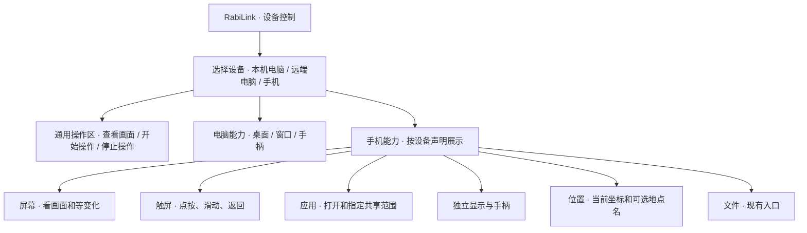
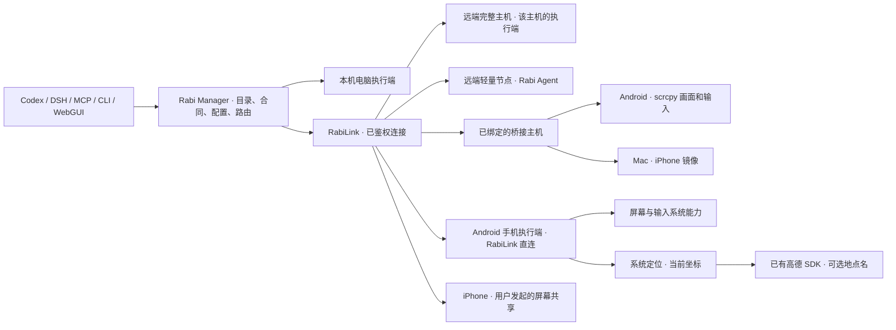
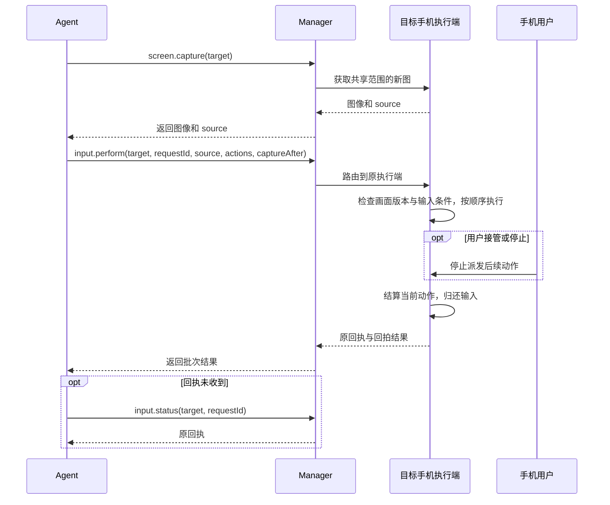
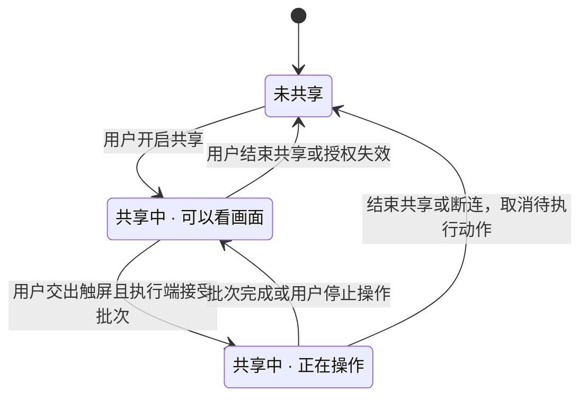
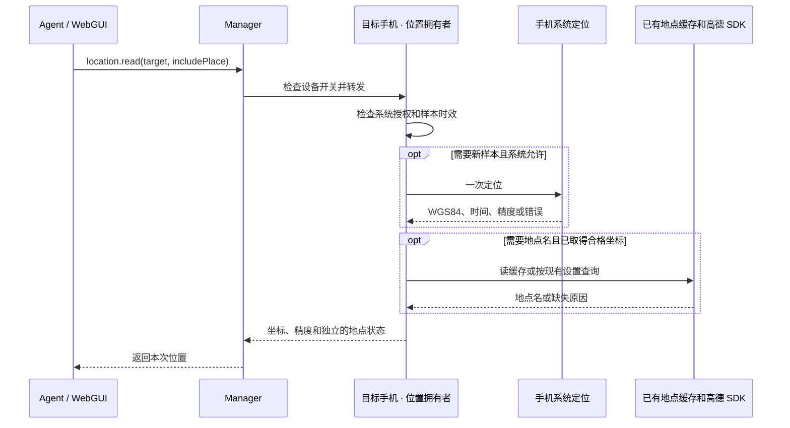

<!-- docs-language-switch -->
简体中文 | [English](mobile-device-control_en.md)
<!-- /docs-language-switch -->

# Rabi 手机控制与定位访问

状态：实施方案。RabiLink 已接入设备目录、手机文件和 Android 本地位置记录。手机控制及 Agent 定位访问按本文新增。

## 1. 产品入口

**设备控制是同一个功能。** 本机电脑、远端完整主机、远端轻量节点和手机列在同一个设备列表。用户选设备后，使用同一套「看画面 → 开始操作 → 停止操作」流程。查看画面可以单独使用。设备行显示可用动作、当前状态，以及需要在目标设备完成的系统授权。

Agent 从 Rabi 搜索发现同一份调用合同，从目录取得 `target`，再调用截图、输入、应用切换或定位。Codex、DSH、MCP 和 CLI 共用目标参数及动作定义。Manager 按目标选择本机执行端、远端节点或手机桥接。

| 设备下的分组 | 能力 | 状态由谁决定 |
| --- | --- | --- |
| 屏幕 | 截图、等待画面变化、查看共享范围 | 手机系统及当前屏幕共享会话 |
| 触屏 | 点按、长按、滑动、返回 | 目标执行端、手机输入权限及本次控制归属 |
| 应用 | 打开支持的应用、查看指定应用的共享画面 | 手机系统、共享范围及应用实际状态 |
| 独立显示与手柄 | Android 虚拟显示、独立手柄 | 手机、桥接执行端和游戏能力，逐项真机验收 |
| 位置 | 读取一次当前坐标，按需附带地点名称 | 手机定位权限、系统位置服务、高德地点查询设置 |
| 文件 | 继续使用现有手机文件操作 | 现有手机文件权限及执行端 |

设备总开关和各功能开关使用缺省开启的配置，保留已保存的选择。设备在线、平台支持、配置启用和系统授权分别显示。WebGUI 可以管理开关并发出操作请求，手机上的录屏和定位系统授权仍由用户在目标手机上完成。

## 2. 整体架构

- **Manager** 按目录返回的 `target` 找到设备和执行端，转发到原连接。手机通过电脑桥接时，目录仍展示手机身份。按配对记录绑定手机与桥接主机，设备名只用于显示。
- **执行端** 持有屏幕会话、图像帧、短时输入归属和原始回执。断连重查走原目标和原 `requestId`。现有电脑 API 和手机文件 API 保留原合同。
- **能力发现** 在统一接口说明写入「手机控制、手机截图、触屏、定位、当前位置、高德」等检索词。目录分别提供 `capabilities`、`available` 和不可用原因。搜索只返回设备与合同元数据。

### 操作提示显示在哪

| 场景 | 用户在哪里看见提示 |
| --- | --- |
| 看电脑屏幕 | **目标电脑的桌面**显示「〈会话名〉正在看你的屏幕」。本机和远端使用同一文案，截图结束后自动收起 |
| 操作电脑 | **目标电脑的桌面**显示「〈会话名〉正在操作你的电脑」和停止入口，批次完成或退出时自动收起 |
| 看或操作手机 | **目标手机**用同一套状态和文案，设备称呼改为手机。桥接方式若只能在桥接电脑显示提示，WebGUI 明确标记显示位置 |
| 从 WebGUI 发起 | **所选设备行**显示设备名、发起会话、查看或操作状态，以及对应停止入口 |

Manager 沿已鉴权的执行连接传递来源会话。跨完整主机的设备控制请求使用来源设备与会话共同标识输入，给同一来源设备的两个会话分别显示状态和指针。目标执行端显示提示并报告实际状态，缺少会话名时显示可识别的连接来源。远端验收在目标端分别观察截图提示和控制提示，核对会话名、停止行为和自动清除。 [现有电脑提示规范](computer-control-visual-workflow.md#操作提示)

### 多个 Agent 同时访问

| 场景 | 并发规则 |
| --- | --- |
| 操作不同设备 | 各自执行，各设备只提示与自己相关的会话 |
| 同一设备，一方看画面、一方操作 | 可以并行。看到的画面会随实际操作变化，准备输入前重新确认目标 |
| 同一设备，操作独立资源 | 执行端明确支持时可并行，例如不同窗口各走后台输入，或真人用触屏、Agent 用游戏识别的独立手柄 |
| 争用同一个前台桌面、触屏或手柄 | 同时只允许一个来源输入。后来的请求返回占用状态，轮到它时重新看画面再提交输入 |

每台设备显示一个状态条。多个会话各占一行，分别写明会话名、正在查看或操作、操作范围。控制行提供停止该会话的入口，观察行按请求完成收起。一个 Agent 操作期间附带的回拍归入原操作行。停止一个会话只清除它自己的状态，其他会话继续。WebGUI 使用同样的分组。

并发验收覆盖两个 Agent 操作不同设备、同一设备一看一控、同一输入资源争用，以及停止一个会话后另一行继续显示。独立资源在目标端验证隔离通过后再开放并行。

### Agent 光标和会话名

Windows 前台电脑控制默认显示 Agent 指针。沿用已有指针，把原来的「Rabi」固定标签改为会话名，并按会话分别维护位置和清除。

- 同一画面可以显示多个 Agent 的虚拟光标。每个光标旁跟随显示自己的会话名，使用不同颜色辅助辨认。位置重合时避让文字标签，保留各自的真实落点。虚拟光标只作展示，鼠标键盘的输入冲突仍由执行端处理。
- 光标画在该会话实际操作的画面上。电脑显示指针，手机显示触点和滑动轨迹。后台或最小化窗口的光标显示在对应窗口的预览里。仅查看画面或发送无坐标的手柄输入时，状态条显示会话，画面不出现光标。
- 标签复用状态条的可信会话名。光标层允许用户点击穿透，标记叠在预览显示层，供 Agent 判断动作的原始截图保持干净。会话停止或断开后，只清除自己的光标和标签。验收检查两个会话同屏时都能读到名字，以及停止一个后另一光标仍继续更新。

Windows 执行端按原请求维护独立的观察和后台操作状态，WebGUI 可在设备的状态区显示会话名并停止指定的后台输入。前台和当前可见的后台窗口使用桌面坐标绘制。后台截图保留完整窗口画面，通过已确认的客户区偏移和尺寸，把对应会话的落点叠到缩放后的预览上。窗口最小化后，尺寸和 DPI 仍吻合时可沿用此前测得的位置。无法确认客户区时只显示操作状态和可用的截图。后台输入成功投递后，落点会按提示时长自动清除。

Android 开发版在手势交给系统后，在目标手机上显示带会话名的触点或滑动轨迹。手势标记允许用户点击穿透，批次停止、投屏结束或旋转时清除。普通手势结束后短暂保留标记供用户辨认。截屏暂时移开标记层并等待新的原始画面，截图和画面变化判断都使用干净的画面。

展开手机设备行后，WebGUI 分别显示查看者和当前操作会话，并可停止原操作批次。预览按手机返回的画面版本定位触点和轨迹。手机旋转后旧截图不再接收落点，合上设备行或切走浏览器标签页时停止刷新状态。

## 3. Agent 调用和输入时序

拟新增统一操作 `manager.device-control.execute`。既有电脑动作由 Manager 转给原电脑执行端，手机动作转给手机或该手机已绑定的桥接主机。

| 动作 | 请求要点 | 回执要点 |
| --- | --- | --- |
| `screen.capture` | `target`，可选屏幕范围或 `maxWidth` | 图像、尺寸和 `source` |
| `screen.status` | Android 手机的 `target` | `sharing` 或 `consent-required` |
| `screen.wait` | `target`、上一帧 `source`、`waitMs` | `changed` 和新图，或 `unchanged`、`target-changed`、`cancelled` |
| `input.perform` | `target`、`requestId`、`source`、`actions`、可选 `captureAfter` | 已完成动作数、实际输入状态、回拍状态 |
| `input.status` / `input.cancel` | 原 `target` 与原 `requestId` | 原批次状态或停止回执 |
| `apps.list` | 公布 `phone-apps-v1` 的 `target` | 可启动的应用及 `appId` |
| `apps.open` | `target`、`apps.list` 返回的 `appId`、`requestId`，可选 `source` 和 `captureAfter` | 启动请求回执和可选回拍 |
| `location.read` | `target`，可选 `maxAgeMs`、`waitMs`、`includePlace` | 本次位置样本及可选地点状态 |

电脑和手机的点按都使用 `{"type":"click","x":120,"y":342}`。手机增加 `longPress`、`swipe`、`back` 动作，由目标能力列表公布。输入后用 `captureAfter: {"waitMs":800}` 等变化并回拍，复杂界面只批量执行从当前画面已经确定的动作。坐标以 Agent 实际看到的图像为准，执行端通过 `source` 还原裁剪和缩放。转屏、切换应用或共享范围变化后，旧图坐标返回 `target-changed`。

Android 直连已接入 `screen.status`、`screen.capture` 和 `screen.wait`。手机用户在 RabiLink 设置开启「共享手机屏幕」，确认系统提示后，Agent 和 WebGUI 都可经 `/api/device-control/execute` 截图或等待变化。等待沿用原图 `source` 和输出尺寸，时限为 100 到 5,000 毫秒。变化返回新 PNG，超时返回 `unchanged`，共享结束、范围改变或原帧过期时返回 `target-changed`。截图和等待期间会在手机通知里列出正在查看的会话，完成后短暂保留提示。用户可从该通知停止共享，停止后新的截图请求返回 `PHONE_SCREEN_CONSENT_REQUIRED`。 [Android 屏幕共享授权](https://developer.android.com/media/grow/media-projection#user-consent)

Android 调试版另公布 `phone-input-v1`。手机用户在 Android 无障碍设置启用「RabiLink 手机触屏」并开启屏幕共享后，Agent 可用 `input.perform` 点按、长按、滑动或返回，WebGUI 可在预览上点按和返回。输入沿用原截图 `source`，共享范围或前台窗口变化后需要重新截图。手机显示「会话名 正在操作你的手机」和停止按钮。停止会拦住尚未派发的动作，正在派发的手势由 Android 结算。`input.status` 和 `input.cancel` 使用原 `requestId`。同一批次重发只读原回执。Android 的手势接口会取消已有触屏手势，手机上的真人和 Agent 使用轮流操作。Play 发行版只公布屏幕与定位能力。 [Android 手势派发](https://developer.android.com/reference/android/accessibilityservice/AccessibilityService#dispatchGesture(android.accessibilityservice.GestureDescription,%20android.accessibilityservice.AccessibilityService.GestureResultCallback,%20android.os.Handler)) · [Google Play 无障碍 API 指南](https://support.google.com/googleplay/android-developer/answer/10964491?hl=en)

Android 的 `input.perform` 支持一次调用回拍。`captureAfter: true` 读取操作完成时投影里最新可用的画面。`captureAfter: {"waitMs":800}` 比较原图，画面变化时回新 PNG，超时保留原图并返回 `unchanged`。应用区域内的操作比较应用画面，触及 Android 系统栏时比较整屏，两种情况都回传完整画面。输入完成后先保存动作回执，再读画面。用原 `requestId` 重查时会读到回拍状态和帧编号，原图像只随首次调用返回。

Android 调试版的 `phone-apps-v1` 复用同一屏幕共享和触屏授权。`apps.list` 返回 Android 启动器中可打开的应用。`apps.open` 按所选 `appId` 请求打开应用，手机端会重新确认该入口仍可用。`launchState: "requested"` 表示启动请求已发给系统。需要确认前台效果时，带原截图 `source` 和 `captureAfter: {"waitMs":1600}`，再检查回拍。用 `input.status` 查询原 `requestId`，重复提交沿用原回执。 [Android 应用可见性](https://developer.android.com/training/package-visibility/declaring)

手机分别提示「〈会话名〉正在看你的手机屏幕」和「〈会话名〉正在操作你的手机」。输入提示随批次结束自动收起，查看提示随请求或共享会话结束。手机端提供「停止操作」和「结束共享」，系统结束共享、锁屏导致共享失效或连接断开时停止后续输入。同一块触屏按批次交接，Android 注入手势可能取消用户进行中的触摸。独立显示与手柄各自验收。 [Android 手势接口](https://developer.android.com/reference/android/accessibilityservice/AccessibilityService#dispatchGesture(android.accessibilityservice.GestureDescription,%20android.accessibilityservice.AccessibilityService.GestureResultCallback,%20android.os.Handler))

## 4. 定位访问和高德复用

Android 已有「位置记录」。手机系统提供 WGS84 坐标，`LocationController` 管理采样，`LocationRepository` 保存手机本地轨迹和地点缓存，`AmapLocationLookup` 使用已有的高德 Android SDK 为附近坐标补地点名。高德查询已有手机端隐私同意、Android Key、缓存、限频、月额度和坐标邻近检查。目前位置记录留在手机，现有运行目录也未公布 Agent 定位动作。 [手机位置记录](mobile-location-recording.md) · [已有高德实现](../apps/rabi-mobile-android/app/src/main/java/com/rabi/link/location/AmapLocationLookup.kt)

首版新增「读一次当前位置」。优先用位置拥有者内存里的最近有效样本，初始默认最多 30 秒。样本太旧时，系统条件允许才发起一次有超时的采样。读取本身不启动轨迹记录，也不会把手机已有轨迹上传。重复读取可合并同一次在途采样。

| 返回值 | 约定 |
| --- | --- |
| `latitude`、`longitude`、`coordinateSystem` | 系统坐标使用 `WGS84`，保留原始坐标 |
| `observedAt`、`accuracyMeters`、`precision`、`provider` | 原采样时间、精度、近似或精确授权，以及系统来源 |
| `place`、`placeState` | 请求 `includePlace` 时返回可匹配的地点名，或具体缺失原因 |
| `state` | `ok`、`feature-disabled`、`permission-required`、`permission-changed`、`location-disabled`、`foreground-required`、`timeout` 或 `offline` |

可选地点名先走现有地点缓存，确需联网时由手机复用原高德 Key 和同一配额。高德缺 Key、被限频、坐标不匹配或超时，照样返回有效的系统坐标。保持近似定位的精度，不附带细于系统授权的地址。位置权限已授权但手机当前不允许采样时，明确提示打开手机端。WebGUI 的「定位访问」与「位置记录」分别管理。诊断记录请求 ID、时间和状态，坐标只通过已鉴权的定位结果返回。iOS 直连实现时使用 Core Location 的单次定位和系统授权。 [Android 定位权限](https://developer.android.com/develop/sensors-and-location/location/permissions) · [Apple 单次定位](https://developer.apple.com/documentation/corelocation/cllocationmanager/requestlocation())

## 5. 平台实现与验收

Android 独立屏通过已授权的 ADB 设备创建额外屏幕。设备控制页会显示已配置的桥接设备，开启后可单独启动应用、取画面、点按和滑动。Agent 从统一设备目录选择桥接目标，调用 `display.open`，随后使用它返回的目标，结束时调用 `display.close`。每块屏幕有独立画面版本和输入回执。Android 12 模拟器已验证主屏与独立屏互不影响，以及两块独立屏可以同时取帧并分别关闭。

Android 15 起，系统确认手柄绑定到某块独立屏后，设备目录才为该目标公布 `input.gamepad`。它沿用电脑端的按键、摇杆和扳机格式，单批最多持续 8 秒。批次结束或取消时会松开按键并让摇杆归中。用原 `requestId` 查询 `input.status` 或提交 `input.cancel`。`input.gamepad.close` 释放本屏的手柄，屏幕可以继续使用。

在 Android 15 模拟器中，两块独立屏分别收到了自己的按键和摇杆事件，主屏同时能继续点按。两台隔离 Manager 经 Rabi 隧道转发时也保留了目标、会话名和原输入回执。Android 12 模拟器确认原有截图和触屏可用。USB 真机、正式运行环境和游戏识别多玩家的情况待验收。

在桥接主机上配置 `RABI_ANDROID_DISPLAY_BRIDGES`，其 JSON 数组中每项填入 `id`、`name`、已授权的 ADB `serial` 和 scrcpy 4.0 服务端文件的绝对路径 `serverPath`。可选 `adb`、`ffmpeg` 接受绝对路径，`width`、`height`、`dpi` 用于设置独立屏。桥接主机重启后重新开启需要的独立屏。

同一授权连接上的其他 Rabi 主机也能选择远端桥接设备。设备行显示桥接主机名，接口返回的 `target` 包含 `ownerDeviceId`。保留它，截图、输入和关闭会回到连接手机的主机。输入状态仍使用原 `requestId` 查询。

手机的屏幕、定位和文件通道分别注册。客户端在事件订阅中使用 `phoneChannels=declared`。Relay 确认会话有效后，用响应头 `x-rabilink-phone-channels: declared` 确认支持声明模式，并公布相应能力。只支持看屏幕和定位的设备可以只声明这两项。已有 Android 客户端继续使用原文件会话合同。

iPhone 的屏幕查看计划用用户在手机上启动的 ReplayKit 广播。控制由兼容 Mac 使用 Apple 的 iPhone 镜像。屏幕客户端、Mac 桥接及其真机验收仍待完成。 [ReplayKit 广播](https://developer.apple.com/documentation/replaykit/rpbroadcastsamplehandler) · [iPhone 镜像](https://support.apple.com/en-us/120421)

| 阶段 | 工作 | 通过标准 |
| --- | --- | --- |
| 1. 统一合同与 Android 桥接 | 扩充设备目录、统一动作和 WebGUI 手机行。用已授权 USB 调试的 Android 真机接 scrcpy | 同一 Agent 换目标参数，分别在 Windows 和 Android 完成截图、点按、等待变化、回拍。在另一台 Rabi 设备上重复验证路由 |
| 2. Android 定位访问 | 复用位置拥有者、SDK 和配额，接入 `location.read` | 抽测未授权、近似、新鲜样本、过期样本、断连、没配高德 Key、限频和拒绝授权。地名查询失败时系统坐标仍可读 |
| 3. Android 直连 | RabiLink 承接用户发起的 `MediaProjection`。先验全屏坐标，单应用范围单独验证。开发机验证触屏执行 | 转屏后旧帧被拒绝，批次停止后余下动作取消，幂等重查无重复触屏。Google Play 发行只公布符合其政策的能力 |
| 4. 独立操作与 iPhone | Android 虚拟显示和手柄分开测试。iPhone 验共享画面及 Core Location，控制走兼容 Mac 的 iPhone 镜像 | 手机主屏和虚拟显示可分别操作。只有游戏认作第二玩家才验收同场并行。iPhone 镜像须实测画面和输入 |

Android 屏幕共享由系统按会话确认。Google Play 对通用 Agent 使用无障碍 API 自主规划和执行操作有限制。Apple 的 iPhone 镜像要求兼容 Mac、同一 Apple 账户和近距离连接，镜像时手机锁屏。 [Android 屏幕共享](https://developer.android.com/media/grow/media-projection) · [Google Play 政策](https://support.google.com/googleplay/android-developer/answer/10964491?hl=en) · [scrcpy 虚拟显示](https://github.com/Genymobile/scrcpy/blob/v4.0/doc/device.md#virtual-display) · [scrcpy 手柄](https://github.com/Genymobile/scrcpy/blob/master/doc/gamepad.md) · [Apple iPhone 镜像](https://support.apple.com/en-us/120421) · [ReplayKit](https://developer.apple.com/documentation/replaykit)

验收分别记录目标端输入、应用状态变化、图像送达的耗时。定位分别记录样本年龄、采样与地点查询耗时。在真实设备和对应运行版本上核对能力回读，再对该设备公布支持。
