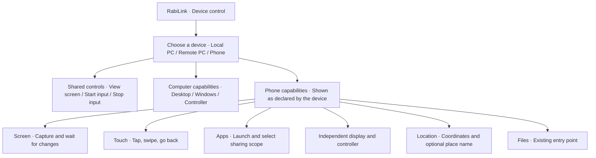
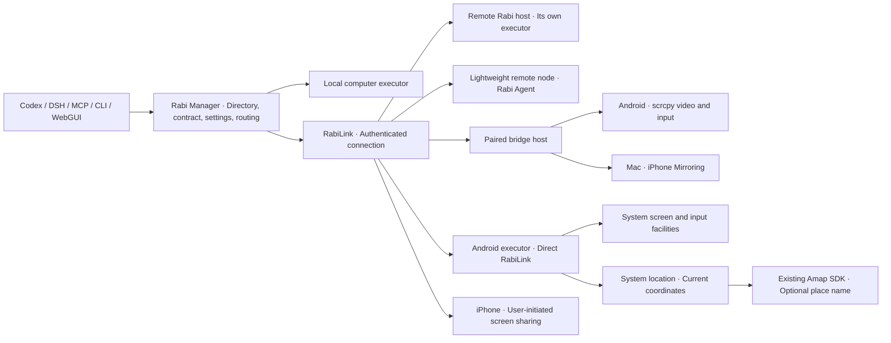
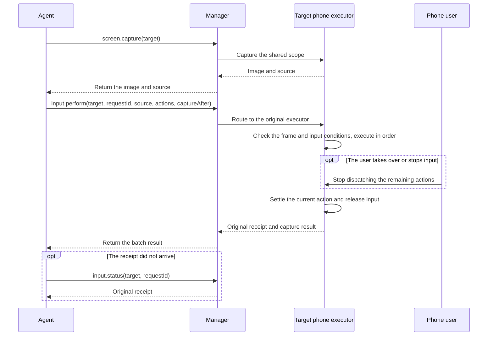
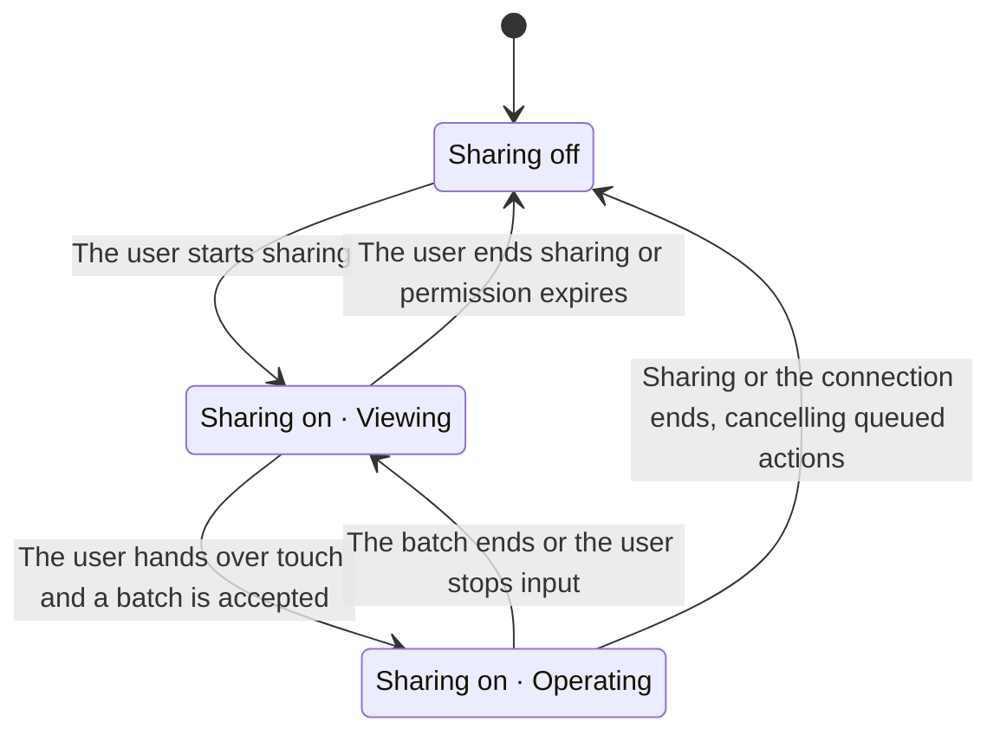
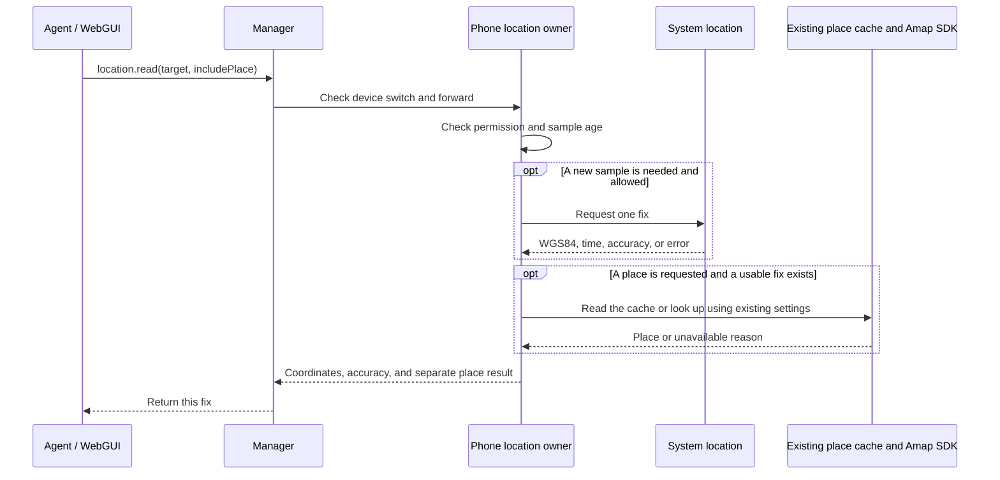

<!-- docs-language-switch -->
[简体中文](mobile-device-control.md) | English
<!-- /docs-language-switch -->

# Rabi phone control and location access

Status: implementation proposal. RabiLink already provides a device directory, phone file operations, and local Android location recording. This proposal adds phone control and Agent access to the current location.

## 1. The device control page

**Device control is one feature.** Local computers, remote Rabi hosts, lightweight remote nodes, and phones appear in the same list. Select a device and use the same workflow to view its screen, start input, and stop input. Viewing can run on its own. The selected device shows available actions, current status, and any permissions that require the user's attention on that device.

Agents discover the same contract in Rabi search, take a `target` from the directory, and request a capture, input, app launch, or location. Codex, DSH, MCP, and CLI use the same target parameter and action definitions. Manager selects the local executor, remote node, or phone bridge for that target.

| Phone capability | Operations | What determines availability |
| --- | --- | --- |
| Screen | Capture, wait for a change, see the sharing scope | The phone OS and active screen-sharing session |
| Touch | Tap, long press, swipe, go back | The executor, system permissions, and the current input owner |
| Apps | Open a supported app, view the shared app | OS support, sharing scope, and current app state |
| Independent displays and gamepads | Android virtual display and separate controller | The phone, bridge, and game. Verify each feature on a device |
| Location | Read the current coordinates with an optional place name | Phone location permissions, system location service, and Amap settings |
| Files | Existing phone file operations | The existing phone file permissions and executor |

The master and feature switches default to enabled when unset. Saved choices take precedence. The UI distinguishes connection state, platform support, configuration, and permission. WebGUI manages switches and submits requests. The phone user grants screen sharing and location permissions on the device.

## 2. Architecture

- **Manager** resolves the directory's `target` and routes the request to its executor. A bridged phone retains its phone identity. The pairing binds the bridge and the phone, with names used for display.
- **Executors** own screen sessions, observed frames, input ownership, and original receipts. After reconnecting, status reads use the original target and `requestId`. The existing computer and phone file API contracts remain valid.
- **Discovery** indexes the shared operation with keywords such as *phone control*, *phone screenshot*, *touch*, *current location*, and *Amap*. The directory reports `capabilities`, `available`, and reasons for unavailability. Search returns device and contract metadata.

### Where notices appear

| Activity | What the user sees |
| --- | --- |
| View a computer | **The target desktop** shows “〈session〉 is viewing your screen.” Local and remote computers use the same message. It clears after the capture |
| Operate a computer | **The target desktop** shows “〈session〉 is operating your computer” with a stop control. It clears when the batch or control session ends |
| View or operate a phone | **The target phone** uses the same states and wording with its device type. If a bridge can display the notice only on the bridge computer, WebGUI identifies that location |
| Start from WebGUI | **The selected device row** displays the device, source session, viewing or input state, and the corresponding stop control |

Manager forwards the source session through the authenticated executor connection. Across full hosts, the device control request identifies input by both the source device and the session, so two sessions on the same host can display separate notices and pointers. The target executor presents the notice and reports its actual status. Use the identifiable connection source when there is no session name. Remote acceptance checks both viewing and input notices on the target, including session identity, stop behavior, and automatic dismissal. [Existing computer notice design](computer-control-visual-workflow_en.md#operation-feedback)

### Concurrent Agent access

| Scenario | Concurrency rule |
| --- | --- |
| Different devices | Run independently, with each device showing only its own sessions |
| One device with a viewer and an operator | Allow both. The observed screen can change during input, so confirm the target again before acting |
| Independent resources on the same device | Allow parallel input when verified on that executor, such as background input to separate windows or a person using touch while an Agent uses a separate game-recognized controller |
| The same foreground desktop, touch surface, or controller | One source can send input at a time. A competing request reports that the resource is in use. Observe again when it becomes available before submitting input |

Show one status bar per device, with a row for each session. Each row shows the session name, viewing or input state, and scope. Input rows can stop their own sessions. Viewing rows clear when their requests end. Capture after input belongs to the original input row. Stopping a session clears that session's status while other sessions continue. WebGUI uses the same grouping.

Verify two Agents on different devices, one viewer alongside one operator on the same device, contention for one input resource, and stopping one session while the other row stays visible. Enable parallel use of independent resources after the target executor proves isolation.

### Agent pointers and session names

Windows foreground control shows an Agent pointer by default. Reuse the existing pointer, replace its fixed “Rabi” label with the session name, and track its position and cleanup per session.

- One view can show several virtual Agent pointers. Place each session name beside its pointer and use color as a secondary identifier. When positions overlap, offset the labels and preserve the actual input points. Virtual pointers are presentation. The executor still arbitrates keyboard and mouse input.
- Draw each pointer on its actual input surface. Show pointers on computers and touch points or swipe paths on phones. A background or minimized window shows its pointer in that window's preview. Viewing alone and controller input without coordinates appear in the status bar only.
- Reuse the trusted session name from the status bar. The pointer layer lets clicks through and sits above the preview, keeping the source image used for Agent decisions clean. Stopping or disconnecting clears only that session's pointer and label. Verify two legible names on the same view and continued updates for the other pointer when one session stops.

The Windows executor tracks observation and background input by their original requests. WebGUI lists session names in the device status area and can stop a specific background input. Foreground input and currently visible background windows use desktop coordinates. Background capture keeps the full window image and uses the verified client offset and dimensions to place each session's pointer on the scaled preview. A minimized window can reuse the previous measurement while its frame size and DPI still match. When the client area is unknown, WebGUI shows the activity and any available screenshot. After successful background delivery, its pointer clears automatically after the configured notice duration.

The Android development build shows a touch point or a swipe trail with the session name after Android accepts a gesture. The overlay lets touches through and clears when the batch is stopped, sharing ends, or the display rotates. A completed gesture leaves a brief marker for the user. Capture briefly hides the overlay and waits for a fresh frame. Screenshots and frame comparisons use the clean image.

The expanded phone row in WebGUI lists viewers and the current operator separately and offers a stop action for the original input batch. The preview places touch points and trails on the layout reported by the phone. A rotated display invalidates the old preview's pointer. Status refresh stops when the device row is collapsed or the browser tab is hidden.

## 3. Agent actions and input sequence

The proposed shared operation is `manager.device-control.execute`. Manager routes computer actions to their existing executor and phone actions to the phone or its registered bridge.

| Action | Request | Result |
| --- | --- | --- |
| `screen.capture` | `target`, optional scope or `maxWidth` | Image, dimensions, and `source` |
| `screen.status` | The Android phone's `target` | `sharing` or `consent-required` |
| `screen.wait` | `target`, previous `source`, and `waitMs` | `changed` with a new frame, `unchanged`, `target-changed`, or `cancelled` |
| `input.perform` | `target`, `requestId`, `source`, `actions`, optional `captureAfter` | Completed action count, input status, and capture status |
| `input.status` / `input.cancel` | Original `target` and `requestId` | Original batch status or cancellation receipt |
| `apps.list` | A `target` that advertises `phone-apps-v1` | Launchable apps and their `appId` values |
| `apps.open` | `target`, `appId` from `apps.list`, `requestId`, and optional `source` and `captureAfter` | Launch request receipt and optional readback |
| `location.read` | `target` and optional `maxAgeMs`, `waitMs`, and `includePlace` | One location fix with optional place lookup status |

A click uses `{"type":"click","x":120,"y":342}` on either device. A supported phone also advertises `longPress`, `swipe`, and `back`. Use `captureAfter: {"waitMs":800}` to wait for the result and capture it. Coordinates refer to the actual image shown to the Agent. The executor uses `source` to restore the original crop and scale. A rotation, app switch, or sharing scope change invalidates the old frame for input and returns `target-changed`.

Direct Android control supports `screen.status`, `screen.capture`, and `screen.wait`. The phone user enables **Share phone screen** in RabiLink settings and approves the system prompt. The Agent and WebGUI can then take a screenshot or wait for change at `/api/device-control/execute`. A wait reuses the previous `source` and output size and lasts 100 to 5,000 milliseconds. It returns a new PNG on change, `unchanged` at the deadline, or `target-changed` when sharing ends, the capture area changes, or the previous frame expires. The phone notification lists the sessions taking a screenshot or waiting, with a short notice after completion. Stopping from that notification causes subsequent capture requests to return `PHONE_SCREEN_CONSENT_REQUIRED`. [Android screen capture consent](https://developer.android.com/media/grow/media-projection#user-consent)

Android debug builds advertise `phone-input-v1`. The phone user enables **RabiLink Phone Touch** in Android accessibility settings and starts screen sharing. The Agent can tap, long-press, swipe, or go back using `input.perform`. WebGUI supports tapping in the preview and going back. Input uses the original screenshot `source`. Capture again after the shared area or foreground window changes. The phone shows the operator's session name and a stop button. Stop prevents dispatch of the remaining actions while Android settles the current gesture. `input.status` and `input.cancel` use the original `requestId`. A repeated batch returns its original receipt. An Android gesture dispatch cancels existing gestures, so the user and Agent take turns on the touch screen. Play builds advertise screen and location capabilities. [Android gesture dispatch](https://developer.android.com/reference/android/accessibilityservice/AccessibilityService#dispatchGesture(android.accessibilityservice.GestureDescription,%20android.accessibilityservice.AccessibilityService.GestureResultCallback,%20android.os.Handler)) · [Google Play AccessibilityService guidance](https://support.google.com/googleplay/android-developer/answer/10964491?hl=en)

Android `input.perform` can include readback in the same call. `captureAfter: true` reads the latest available projection frame after input completes. `captureAfter: {"waitMs":800}` compares the original frame and returns a new PNG on change or `unchanged` at the deadline. Gestures inside the app compare app content. Gestures that touch the Android system bars compare the whole screen. A changed result always carries the full frame. The device saves the input receipt before reading the screen. Checking the original `requestId` returns the readback status and frame ID. Image bytes are returned with the initial call only.

Android debug builds advertise `phone-apps-v1` using the same screen-sharing and touch permissions. `apps.list` returns apps with launchable Android entries. `apps.open` rechecks the selected `appId` before requesting a launch. `launchState: "requested"` records the request sent to Android. To confirm which app is visible, pass the original `source` with `captureAfter: {"waitMs":1600}` and inspect the returned image. `input.status` reads the original `requestId`, and retries return its original receipt. [Android package visibility](https://developer.android.com/training/package-visibility/declaring)

The phone shows either “〈session〉 is viewing your phone screen” or “〈session〉 is operating your phone.” The input notice ends with the batch. The viewing notice ends with the request or sharing session. The phone offers **Stop input** and **End sharing**. System revocation, screen lock that ends sharing, or disconnection stops further input. A single touch surface is shared in turns because Android gesture dispatch can cancel an in-progress gesture. Validate separate displays and controllers independently. [Android gesture API](https://developer.android.com/reference/android/accessibilityservice/AccessibilityService#dispatchGesture(android.accessibilityservice.GestureDescription,%20android.accessibilityservice.AccessibilityService.GestureResultCallback,%20android.os.Handler))

## 4. Location access and Amap

Android already has a local location recorder. The system returns WGS84 coordinates. `LocationController` owns sampling, `LocationRepository` stores on-device points and place caches, and `AmapLocationLookup` uses the existing Android SDK to add a place name. The existing integration already handles privacy consent, the Android Key, caching, minimum intervals, a monthly limit, and checks that the place matches the original coordinates. Tracks stay on the phone, and the live directory currently has no Agent location operation. [Phone location recording](mobile-location-recording_en.md) · [Existing Amap integration](../apps/rabi-mobile-android/app/src/main/java/com/rabi/link/location/AmapLocationLookup.kt)

The first version returns a single current fix. Reuse the location owner's most recent valid in-memory fix, using a proposed default maximum age of 30 seconds. If it is stale, request one bounded sample while permitted by the OS. A read leaves track recording as configured and carries no historical track data. Concurrent reads can share the same in-flight sample.

| Response fields | Contract |
| --- | --- |
| `latitude`, `longitude`, `coordinateSystem` | Preserve the original system coordinates with `WGS84` |
| `observedAt`, `accuracyMeters`, `precision`, `provider` | Actual sample time, accuracy, approximate or precise permission, and system source |
| `place`, `placeState` | Matching place name on request, or the reason it is unavailable |
| `state` | `ok`, `feature-disabled`, `permission-required`, `permission-changed`, `location-disabled`, `foreground-required`, `timeout`, or `offline` |

The phone checks its existing place cache first. Network lookups use the same on-device Amap Key and quota. A missing key, rate limit, coordinate mismatch, or timeout leaves valid system coordinates available. Keep approximate permission at its actual granularity. If system conditions prevent a new reading, direct the user to the phone app. WebGUI manages **Location access** separately from **Location recording**. Diagnostics record request ID, time, and status. Coordinates are returned through the authenticated operation. For direct iOS access, use a single Core Location fix with system permission. [Android location permissions](https://developer.android.com/develop/sensors-and-location/location/permissions) · [Apple single location request](https://developer.apple.com/documentation/corelocation/cllocationmanager/requestlocation())

## 5. Implementation and acceptance

Android virtual displays use an authorized ADB device to open an additional screen. The device control page lists configured bridges and lets you launch an app, capture the display, and target taps and swipes after opening it. An Agent selects a bridge from the unified device directory, calls `display.open`, then uses the returned target through `display.close`. Each display has a separate frame layout and input receipts. An Android 12 emulator verified isolation from the main screen and that two virtual displays could report frames and close independently.

On Android 15 and later, the directory advertises `input.gamepad` once Android confirms the controller is bound to that display. It uses the same button, stick, and trigger format as desktop controllers. A batch can run for up to eight seconds. Buttons release and sticks recenter when the batch ends or is cancelled. Reuse the original `requestId` with `input.status` or `input.cancel`. `input.gamepad.close` releases that display's controller while the display remains open.

On an Android 15 emulator, two virtual displays received their own button and stick events while the main screen received touch input. Two isolated Managers preserved the target, session name, and original input receipt across a Rabi tunnel. Existing capture and touch passed on an Android 12 emulator. Physical USB devices, the installed runtime, and multiplayer game recognition still require validation.

Set `RABI_ANDROID_DISPLAY_BRIDGES` on the bridge host to a JSON array with `id`, `name`, the authorized ADB `serial`, and an absolute `serverPath` for the scrcpy 4.0 server file. Optional `adb` and `ffmpeg` values are absolute paths. Set `width`, `height`, and `dpi` if the virtual display needs a specific size. Open a new display after the bridge host restarts.

Other Rabi hosts on the same authorized connection can select a remote bridge. The device row shows the bridge host name, and the `target` contains its `ownerDeviceId`. Keep that target intact so capture, input, and closure reach the host connected to the phone. Use the original `requestId` to look up an input receipt.

Phones register screen, location, and file channels independently. A client requests `phoneChannels=declared` on its event subscription. The Relay confirms support with the `x-rabilink-phone-channels: declared` response header and advertises the capabilities for the authenticated session. A phone can declare just viewing and location. Existing Android clients keep their original file session contract.

iPhone viewing is planned through a user-initiated ReplayKit broadcast on the phone. Control uses Apple's iPhone Mirroring on a compatible Mac. The screen client, Mac bridge, and related device tests are pending. [ReplayKit broadcasting](https://developer.apple.com/documentation/replaykit/rpbroadcastsamplehandler) · [iPhone Mirroring](https://support.apple.com/en-us/120421)

| Phase | Work | Pass condition |
| --- | --- | --- |
| 1. Shared contract and Android bridge | Extend the directory, shared actions, and WebGUI phone row. Connect an authorized Android test phone to scrcpy over USB | The same Agent captures, taps, waits, and reads back on Windows and Android by changing the target. Repeat from a separate Rabi device |
| 2. Android location access | Expose `location.read` through the existing location owner, SDK, and quota | Verify absent permission, approximate permission, fresh and stale samples, disconnection, missing Amap key, rate limiting, and denied permission. Place lookup failures preserve valid coordinates |
| 3. Direct Android | Use RabiLink to manage a user-initiated `MediaProjection` session. Validate full-screen input first and single-app geometry separately. Test touch on development devices | Rotation rejects the old frame, stop cancels later actions, and a receipt replay issues no extra tap. The Play build advertises capabilities permitted by its policy |
| 4. Independent input and iPhone | Validate Android virtual displays and gamepads separately. On iPhone, validate screen sharing, Core Location, and control through a compatible Mac | The Android main screen and virtual display work independently. In-game co-play requires a recognized second player. Verify both capture and input in iPhone Mirroring |

Android handles consent for each screen-sharing session. Google Play restricts autonomous planning and execution through the Accessibility API for general-purpose Agents. Apple iPhone Mirroring requires a compatible nearby Mac and iPhone on the same Apple Account, with the iPhone locked. [Android screen sharing](https://developer.android.com/media/grow/media-projection) · [Google Play policy](https://support.google.com/googleplay/android-developer/answer/10964491?hl=en) · [scrcpy virtual display](https://github.com/Genymobile/scrcpy/blob/v4.0/doc/device.md#virtual-display) · [scrcpy gamepad](https://github.com/Genymobile/scrcpy/blob/master/doc/gamepad.md) · [Apple iPhone Mirroring](https://support.apple.com/en-us/120421) · [ReplayKit](https://developer.apple.com/documentation/replaykit)

Measure executor input, app state changes, and frame delivery separately. For location, measure the sample's age, fix time, and place lookup time. Verify reported availability on the actual device and running version before advertising a capability.
