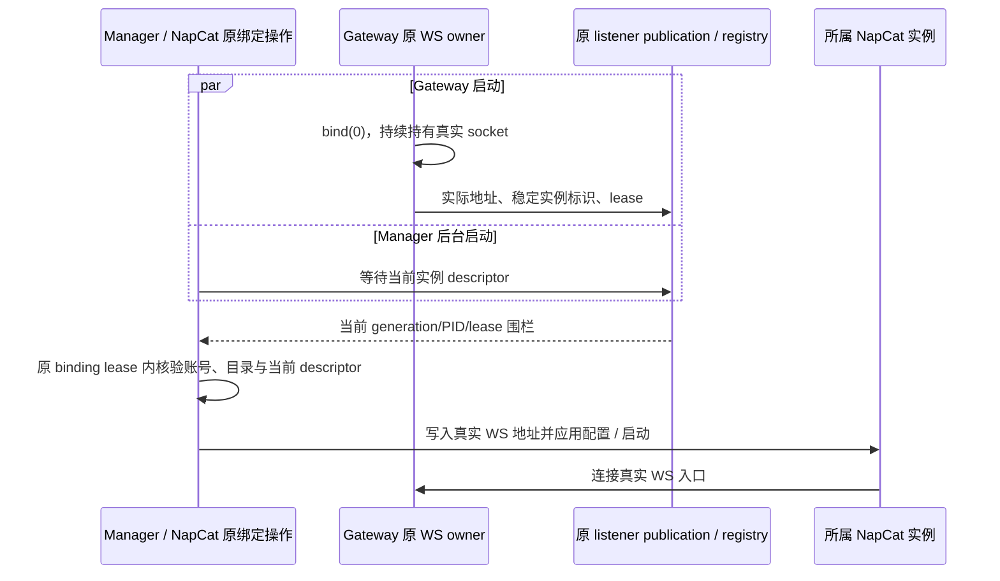

[English](napcat-dynamic-ws_en.md) | 简体中文

# NapCat 动态 WS 入口

NapCat 插件要求 `host.message-endpoints@3`。Host 保留 `@1`、`@2` 兼容服务；旧 Host 缺少 `@3` 时拒绝激活新插件，避免配置已变成自动端口而启动合同仍旧。

`gatewayPort=0` 表示由原 Gateway WS owner 绑定系统分配的端口。配置继续保存 `0`；实际地址来自同一子进程、同一 generation 的 listener publication，不能靠先扫描再关闭探测 socket 获得。

Manager 的等待不阻塞 Gateway 启动。Gateway 先绑定 WS，再异步观察 NapCat HTTP 状态；Manager 的自动登录与 guardian 在后台运行。配置、WebUI 应用和真实 spawn 前重新核对 descriptor。等待失败时不写 OneBot 地址、不启动 NapCat；运行代或 listener lease 变化时原操作不能改用另一个地址继续。

实际端口只存在于原运行 owner、listener registry 和派生状态中。配置不被实际端口覆盖；显式非零 WS 端口保持原绑定合同。停用与替换仍由原进程 owner 撤销入口、等待真实 socket 和在途回调结束，不能把超时当作已释放。

## 外部 HTTP / WebUI

外部 NapCat 的 HTTP 与 WebUI 地址保留明确配置，不使用上述 WS 自动端口值。所核查的[官方 WebUI 实现](https://github.com/NapNeko/NapCatQQ/blob/98d781d19815d1625b24d717ce280ecf0a4f6d0c/packages/napcat-webui-backend/index.ts#L149-L153)在端口为 `0` 时停止启动；[HTTP 实现](https://github.com/NapNeko/NapCatQQ/blob/98d781d19815d1625b24d717ce280ecf0a4f6d0c/packages/napcat-onebot/network/http-server.ts#L114-L116)直接使用配置端口监听和记录地址。这些启动入口没有向 Rabi 提供真实系统分配端口的回执。

本机受管 bundled 实例遇到外部 HTTP / WebUI 端口冲突时，由原配置和进程 owner 恢复：先证明原实例已真实停止，再保留账号、token 和目录，选择系统提供的正数候选，最多尝试三次。候选探测不算就绪；实际启动仍归原进程 owner，确认监听 PID、启动时间及可执行路径后才向该地址发送鉴权请求。配置 owner 在原 WS 操作排空后保存已验证的 HTTP / WebUI 地址，WS 配置继续保留 `0`。

只有明确属于其他程序的端口冲突可以换候选重试；进程身份不明、原实例仍存活、鉴权失败或结果不确定时保留原归属记录，不停止其他程序、不轮换凭据、不盲目重放。外部自行部署或无法证明归属的启动器保留显式配置。新进程 owner 方法需要受控代切换，不能把旧 owner 实例上的普通插件热换当作迁移完成。

## 验证边界

相关回归覆盖真实自动 WS 握手、配置 `0` 保留、实际端口发布、未获得 descriptor 时拒写拒启动，以及旧 generation 失效。测试中的受控实例与临时目录不代表真实 QQ 登录、所有设备或安装版已验收；发布需核对当前安装代和实际业务链路。
