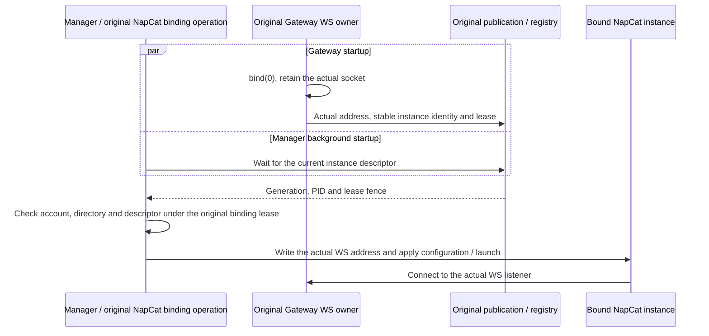

English | [简体中文](napcat-dynamic-ws.md)

# Dynamic NapCat WS ingress

The NapCat package requires `host.message-endpoints@3`. The Host retains `@1` and `@2` aliases. An older Host lacking `@3` rejects activation rather than running an automatic-port configuration with an older startup contract.

`gatewayPort=0` asks the original Gateway WS owner to bind an operating-system-assigned port and retain the socket. The saved preference remains `0`. The actual address comes from the original child's generation and listener publication, never a probe that closes before the real bind.

The Manager wait does not block Gateway startup. The Gateway binds WS before observing NapCat HTTP asynchronously; auto-login and the guardian run in the background. Configuration writes, WebUI application and the actual spawn recheck the original descriptor. A failed wait performs no OneBot address write or launch. A retired generation or listener lease cannot be replaced inside the original operation.

The actual port belongs to the native runtime owner, registry and derived status. It does not overwrite the saved preference. Explicit nonzero WS ports retain their binding contract. Retirement remains with the original process owner and joins real socket closure and accepted callbacks; a timeout is not release evidence.

## External HTTP / WebUI

NapCat HTTP and WebUI endpoints retain their explicit configuration. The inspected [official WebUI startup](https://github.com/NapNeko/NapCatQQ/blob/98d781d19815d1625b24d717ce280ecf0a4f6d0c/packages/napcat-webui-backend/index.ts#L149-L153) does not start when its port is `0`. Its [HTTP startup](https://github.com/NapNeko/NapCatQQ/blob/98d781d19815d1625b24d717ce280ecf0a4f6d0c/packages/napcat-onebot/network/http-server.ts#L114-L116) listens and reports using the configured port. These startup paths provide no actual OS-assigned endpoint receipt to this Rabi integration.

For a locally managed bundled instance with conflicting external HTTP / WebUI ports, the original configuration and process owners perform recovery. They prove the original instance has actually stopped, retain its account, token and directory, and try at most three positive candidates supplied by the OS. A candidate probe is not readiness. The original process owner performs the launch and verifies the listener PID, start time and executable path before any authentication request is sent. After the original WS operation drains, the configuration owner saves the verified HTTP / WebUI addresses; saved WS port `0` is retained.

Only a classified foreign bind conflict permits another candidate. Unknown process identity, a live original instance, failed authorization or an uncertain outcome preserves ownership records without stopping unrelated applications, rotating credentials or blindly replaying. Independently deployed or unverified launchers retain explicit configuration. The new process-owner methods require a controlled generation transition; an ordinary plugin hot replacement on an old owner instance is not a completed migration.

## Validation scope

Matching regressions cover actual automatic WS handshakes, preservation of saved `0`, actual endpoint publication, refusal to write or launch without a descriptor, and generation retirement. Controlled fixtures and temporary directories do not prove real QQ login or installed-runtime acceptance; deployment must verify the installed generation and actual business path.
