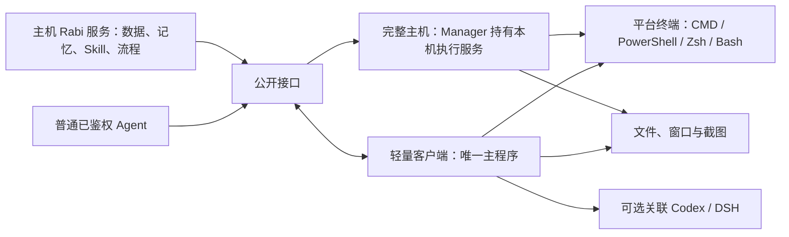

<!-- docs-language-switch -->

<a href="./remote-computer-client_en.md">English</a> | 简体中文

<!-- /docs-language-switch -->

# 主机与远端电脑客户端

完整 Rabi 主机通过 RabiLink 连接后直接提供自身电脑能力，无需再安装一个自连接的客户端。当前源码在 **RabiLink → 电脑控制** 独立标签页平级列出本机、完整主机与轻量节点，设置和执行保持在各自原 Manager；轻量客户端只用于未运行完整主机的电脑。使用方法见[电脑控制](user-guide/computer-control.md)，安装版与真实双机仍按实际版本和证据验收，见[架构与验收范围](connected-host-agent-architecture.md)。

已配置且鉴权的电脑连接默认可调用 Manager 的全部公开接口，无需逐 Agent／会话登记或另加逐接口资格。电脑控制使用一个总开关及终端命令、文件操作、窗口与截图、智能体任务、鼠标与键盘、屏幕标注六项开关；缺省开启，保留已有显式关闭值。这些用户可见设置控制对应电脑的新工作，电脑操作的原结果查询与停止、取消、清理入口保留，配置与其他无依赖服务继续可用。来源任务存在时记录真实来源；没有任务上下文的连接不必虚构 Agent 或会话。

主机电脑上的 Rabi 服务统一保存角色、计划、记忆、Skill、消息记录和调度流程，承担常驻管理职责，不需要另设主控 Agent。完整主机由 Manager 持有本机电脑服务，轻量电脑运行 Rabi Agent 客户端；两者复用该平台支持的执行实现。普通已鉴权 Agent 均可查询计划、记忆和 Skill，也可按接口合同调用电脑能力；是否为主角色不构成额外许可。

客户端不运行另一套 Manager，也不建立角色、记忆或 Skill 数据副本。客户端自身保留连接配置、执行程序设置、任务回执和有界传输状态；远端文件仍属于远端电脑的文件系统。关联 Agent 的任务执行沿用原任务 owner，不启动备用 Agent Runtime。客户端、主控和网络连接必须在线。

## 接入与使用

完整主机沿用当前 RabiLink 连接；未运行完整主机的电脑按[远端客户端接入步骤](lan-rabi-agent-bootstrap.md)安装，每台轻量电脑保持一个主程序。连接器、托盘、终端宿主和截图辅助程序均为其子程序。关联 Agent 可以稍后启动；私有配置 `agents: []` 也能建立电脑连接。

接入页面先选择 Windows、Mac（macOS）或 Linux，仅安装电脑客户端；安装关联智能体的勾选已移除。首次不提供 `RABI_AGENT_TYPE` 或会话变量时，`--bootstrap` 保存空 Agent 列表。普通电脑接口不要求来源 Agent／会话登记；向智能体投递工作时，明确指定目标处理端类型和完整会话 ID。

Mac 使用当前用户 LaunchAgent，支持文件互传与连接器 0.2.4 的 Zsh/Bash/sh 终端。终端依赖 node-pty；Mac 原生编译可能需要 Xcode Command Line Tools。窗口查询和截图仍仅支持 Windows。Mac 原生终端与 Desktop IPC 仍待在线真机验收。

当前源码的主机 WebGUI 在 **RabiLink → 电脑控制 → 展开电脑** 提供终端、文件、窗口与画面入口；终端沿用原面板查询和操作目标实际支持的 Shell。“远端智能体”保留接入电脑、连接器维护和原智能体任务配置，不保留第二套电脑控制。鼠标键盘、静态标注和动态跟踪需目标执行端实际声明支持；旧节点继续使用原有真实能力，在线不代表已经升级。沿用已鉴权连接和用户可见设置，不增加功能白名单或管理密码；执行使用目标系统用户权限。上述新页面与功能的正式安装、真实桌面和双机行为仍需匹配运行版本验收。

首次连接或 Manager 变化时，从当前 Host 状态取得完整 `managerBaseUrl` 并核对 `/meta`。通过 `GET /api/computers` 读取平级电脑列表，通过目标 Manager 的 `/api/lan-agent/instances` 取得执行实例与能力；已有稳定目标和原连接时直接复用。CLI、MCP 与其他客户端查询同一运行目录：搜索“电脑控制”或读取 `manager.lan-agent.computer.execute` 的当前合同，新增动作通过其 `body.action` 调用，不把动作名当作 operation ID。见[统一接口](unified-agent-api.md)与[电脑控制](user-guide/computer-control.md)。

| 接口 | 用途 |
| --- | --- |
| `GET /api/computers` | 本机、完整主机与轻量节点的平级目录；单来源失败局部标记未知 |
| `GET /api/lan-agent/instances/:instanceId/computer-settings` | 读取原 owner 设置、默认值、schema、能力与强 ETag |
| `PATCH /api/lan-agent/instances/:instanceId/computer-settings` | 携带原 `If-Match` 局部修改；保存与执行应用分别回报 |
| `GET /api/lan-agent/instances/:instanceId/terminals` | 查询真实终端列表 |
| `POST /api/lan-agent/instances/:instanceId/terminals` | `open / list / get / input / resize / close` |
| `GET /api/lan-agent/instances/:instanceId/terminals/:terminalId?after=0&waitMs=25000` | 返回终端状态和输出；没有新输出时等待事件，最长 25 秒 |
| `GET /api/lan-agent/instances/:instanceId/terminals/:terminalId/events?after=0` | 实时 SSE 输出 |
| `POST /api/lan-agent/instances/:instanceId/computer` | 通过 `body.action` 调用文件、窗口、截图及目标支持的控制、输入和标注动作；原状态与清理使用原 ID |

终端使用稳定 UUID `terminalId`；Windows 的 `shell` 为 `cmd` 或 `powershell`，Mac/Linux 为电脑实际提供的 `zsh`、`bash` 或 `sh`。输入使用递增 `sequence`，命令以 `\r` 结尾。JSON 输出字段为 `terminal`、`outputEvents`、`nextOutputSequence`、`truncated`；下一次以 `nextOutputSequence` 作为 `after`。关闭网页保留终端，退出终端结束所属子程序；Manager 短暂断连保留原连接器进程内的终端、ID 和输入回执，新连接仍须鉴权；远端主程序退出或连接器停止才结束全部终端。 断连期间新增输出没有 SDK 回放缓存，可能存在缺口。Host 切代后查询同一 terminalId，并使用新 Manager 返回的游标，不重放输入；业务已重定向到文件的输出按原文件读取。超时查询原会话，不自动重建或重发输入。

新终端收到真实 Shell 提示符后才接受输入，启动最多等待 30 秒；桌面辅助操作也有 30 秒期限，主控转发等待最多 45 秒。机器繁忙或刚登录时允许启动过程完成，不以创建了进程代替 Shell 就绪。

Windows 构建通过 `scripts/build-agent-native-assets.mjs` 将托盘、终端和截图的同一份 C# 源码预编译为 `dist/native/<模块>-<源码SHA256>.dll`，签名发布清单包含这些文件。辅助程序按当前源码 hash 加载对应程序集；未匹配时只编译当前签名源码，不使用旧程序集。运行语义、进程归属和退出路径相同；原生缓存不保存业务数据。

## 文件互传

所有操作提交到 `computer`，`path` 使用远端绝对路径。数据按最多 64 KiB 分块传输，每块携带 SHA-256，二进制使用 base64，不经过终端文本。

下载依次调用 `file.stat(path)` 和 `file.read(path,version,offset)`。`file.stat` 返回 `size`、`version`、`chunkBytes`；`file.read` 返回 `data`、`sha256`、`nextOffset`、`eof`。主机解码并校验每块后写文件，使用 `nextOffset` 读取下一块。远端文件变化时拒绝继续旧版本下载。

上传预先保存 UUID `uploadId` 和整文件 SHA-256：

1. `upload.begin(uploadId,path,size,sha256)` 创建同目录临时文件。
2. `upload.write(uploadId,offset,data,sha256)` 顺序传块；相同块回执不重复写入，冲突拒绝。
3. `upload.status(uploadId)` 查询远端已接收的 `offset` 和 `state`。
4. `upload.commit(uploadId)` 校验完整内容并原子提交；不覆盖已存在的目标文件。
5. 放弃时调用 `upload.abort(uploadId)`，释放临时文件。

找不到原上传记录时，`upload.status` 返回 `{uploadId,state:"absent"}`；新版连接器对未知 ID 的 `upload.abort` 也返回 absent，表示没有可关闭的当前 owner，不伪称历史上传已取消。普通 `file.stat/read` 和状态查询错误不再标记为不确定写入。Manager 同时兼容旧连接器的 not-found 异常。

`begin` 只独占预留同目录临时文件，可以沿**原 ID、原路径、大小和哈希**继续：已有 owner 返回当前偏移，容量释放或目录准备后可正常受理，不把暂时失败保存成永久拒绝。不需要换 ID 或人工解锁。若孤立临时文件或目标已存在，继续报告具体冲突并保留文件；absent 不会绕过这些检查，也不能证明旧历史从未执行。写入或提交结果未知时仍先核对原状态、目标文件和哈希，不自动重放业务操作。

单次上传默认不另设大小上限，字节数必须为 JavaScript 可精确表示的非负整数。这与主控 `agentUploads.maxFileMiB` 是不同的文件服务。以下设置由用户在**远端 Rabi Agent 启动环境**配置，重启该 Agent 后生效；超限错误给出当前值和调整入口。

| 环境变量 | 默认值 | 含义 |
| --- | --- | --- |
| `RABI_AGENT_COMPUTER_MAX_UPLOAD_BYTES` | 不另设额度 | 单文件字节数；`0` 仅允许空文件 |
| `RABI_AGENT_COMPUTER_MAX_CONCURRENT_IO` | `0`（不另设额度） | 同时处理的电脑 I/O 操作数；`0` 取消额度 |
| `RABI_AGENT_COMPUTER_MAX_ACTIVE_UPLOADS` | `0`（不另设额度） | 活动上传数；`0` 取消额度 |
| `RABI_AGENT_COMPUTER_MAX_UPLOAD_RECORDS` | `64` | 当前进程保留的上传记录数；`0` 取消额度 |

所有值须为可精确表示的非负整数。最近 256 块支持回执核验。正常停止清理未提交文件；进程意外终止可能留下 `.rabi-upload-<UUID>.tmp`，新客户端不会自动续传旧记录。结果不确定时先查原 ID，不自动换 ID 或覆盖目标。

## 查询窗口与获取画面

`windows.list` 可传 `query`（标题筛选）及 `limit`（1..200，默认 100），返回 `windows` 和 `truncated`。每个窗口包含 `windowId`、`pid`、`title`、`minimized`、`bounds`。

`screen.capture` 不传窗口时获取当前虚拟桌面；指定窗口时同时传查询得到的 `windowId` 和 `pid`，防止句柄复用。`maxWidth` 为 320..3840，默认 1920。结果包含 `mimeType: "image/png"`、base64 `data`、`width`、`height`、`bounds`、`capturedAt`，主机可直接显示或保存 PNG。

截图需要交互式 Windows 桌面，最多 32 百万原始像素及 8 MiB PNG；最小化、受保护或不支持 `PrintWindow` 的窗口可能失败或返回无效画面。电脑操控也可以通过终端运行系统命令与脚本；文件和图片优先使用上述接口。

## 验证状态

客户端 0.2.2 源码已验证原生 CMD/PowerShell、中文、Ctrl+C、子程序清理、文件分块及整文件校验、窗口查询、桌面和窗口截图。隔离 HTTP/WebSocket 测试使用真实客户端、空 Agent 列表和阻塞的 Agent 队列，主机已鉴权接口仍可调用电脑能力。

另已通过真实首次兑换票据 → 无 Agent 配置加载 → 独立命令行子程序 → 已鉴权 WebSocket 的电脑操作验证，覆盖 CMD 输出、跨 64 KiB 文件块及 PNG 截图。

本机安装验收已通过：从隔离测试主控下载并核验签名发布清单中的 44 个文件，安装客户端 0.2.2 及依赖，以普通 `--run` 启动。空 Agent 列表下，CMD 和 PowerShell 的新增、即时输入、查询、调整尺寸和退出可用；131,077 字节二进制文件经三个数据块上传、下载并完整比对；桌面与指定测试窗口返回有效 PNG。状态回读确认一个主程序及其连接器、托盘子程序；主程序正常退出和异常终止测试均确认所属子程序清理。高负载首次回归出现启动超时，失败项已逐项复测；嵌套 Shell 测试只延长准备期限，退出清理仍限 15 秒。

上述安装与主控在同一台 Windows 电脑的隔离目录运行，测试完成后均已停止。正式主控部署、真实双机与长期运行验收仍待完成。
