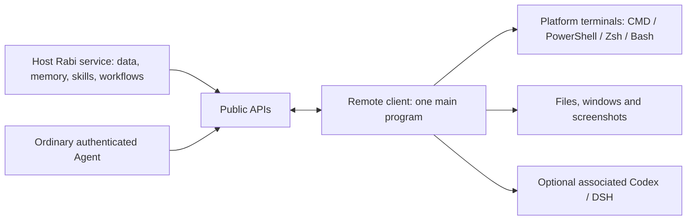

<!-- docs-language-switch -->

English | <a href="./remote-computer-client.md">简体中文</a>

<!-- /docs-language-switch -->

# Host and remote computer clients

An enrolled remote instance has one switch, enabled by default. While enabled, it uses all public host APIs with its existing computer credential, without browser login, saved Agent/session registration or per-feature grants. Every Agent invocation supplies its actual type and complete session ID.

The host computer's Rabi service owns personas, plans, memory, skills, message history and persistent orchestration without a separate controlling Agent. Each remote computer runs a Rabi Agent client exposing its platform's computer capabilities. Ordinary authenticated Agents can query plans, memory and skills and use computer APIs under the same contracts without a primary-persona role.

The client does not run another Manager or replicate persona, memory or skill stores. It retains connection configuration, execution bindings, task receipts and bounded transport state; remote files belong to the remote filesystem. Agent tasks retain their original task owner without a fallback Agent runtime. The client, controller and network connection must remain online.

## Setup and use

Follow [remote client enrollment](lan-rabi-agent-bootstrap_en.md) and keep one main program on each computer. The connector, tray, terminal host and capture helper are child programs. Associated Agents can start later; a private configuration with `agents: []` can also establish a computer connection.

Select Windows, Mac (macOS) or Linux before installing only the computer client. The installation-time Agent association checkbox has been removed. Omitting `RABI_AGENT_TYPE` and session variables on first enrollment makes `--bootstrap` save an empty Agent catalog. Later Agent registration preserves computer identity; each delivery supplies an explicit provider and full session ID.

Mac uses a current-user LaunchAgent and supports file transfer plus Zsh/Bash/sh terminals in connector 0.2.4. Terminals require node-pty; native Mac compilation may need Xcode Command Line Tools. Window queries and screenshots remain Windows-only. Native Mac terminals and Desktop IPC still require online-device acceptance.

The host WebGUI provides creation, querying, switching, input and exit for the computer's available shells under **RabiLink → Remote Agents → online computer → remote terminal**. Agents use the public APIs below for files and images. These operations reuse the authenticated connection without additional capability grants or management passwords and run with the remote client's operating-system user permissions.

Discover the complete `managerBaseUrl` from the current Host status, verify `/meta` identity and readiness, then query `/api/lan-agent/instances` and confirm the target name and `instanceId`. Read the `remote-terminal` and `remote-computer` groups in `/api/lan-agent/capabilities` for current contracts.

| Endpoint | Purpose |
| --- | --- |
| `GET /api/lan-agent/instances/:instanceId/terminals` | Query live terminal sessions |
| `POST /api/lan-agent/instances/:instanceId/terminals` | `open / list / get / input / resize / close` |
| `GET /api/lan-agent/instances/:instanceId/terminals/:terminalId?after=0&waitMs=25000` | Return session state and output; wait for events up to 25 seconds when no new output exists |
| `GET /api/lan-agent/instances/:instanceId/terminals/:terminalId/events?after=0` | Live SSE output |
| `POST /api/lan-agent/instances/:instanceId/computer` | File transfer, window queries and captures |

Terminals use a stable UUID `terminalId`. Windows supports `cmd` or `powershell`; Mac/Linux advertise the available `zsh`, `bash` or `sh` shells. Input uses increasing `sequence` numbers; commands end with `\r`. JSON reads return `terminal`, `outputEvents`, `nextOutputSequence` and `truncated`; pass the last `nextOutputSequence` as the next `after` cursor. Closing the view retains the terminal; exiting terminates its children. Connection loss or main-program exit closes terminals. After a timeout, query the original session instead of recreating it or replaying input.

A new terminal admits input only after receiving the actual shell prompt, with a 30-second startup deadline. Desktop helpers also have a 30-second deadline; controller forwarding waits up to 45 seconds. This permits initialization on a busy or freshly logged-in machine without treating process creation as shell readiness.

Windows builds use `scripts/build-agent-native-assets.mjs` to precompile the same tray, terminal and capture C# sources into `dist/native/<module>-<sourceSHA256>.dll`, included in the signed release manifest. Helpers load the assembly matching their current source hash; without a match they compile the current signed source instead of using an old assembly. Behavior, process ownership and exit paths are identical. Native caches contain no business data.

## File transfer

Submit operations to `computer` using an absolute remote `path`. Transfer up to 64 KiB per chunk with SHA-256. Binary data uses base64 instead of terminal text.

Download with `file.stat(path)` followed by `file.read(path,version,offset)`. The stat response contains `size`, `version` and `chunkBytes`; reads return `data`, `sha256`, `nextOffset` and `eof`. Decode and verify each chunk before writing on the host, then continue from `nextOffset`. A changed remote file invalidates the original version.

For uploads, retain a UUID `uploadId` and the whole-file SHA-256 before starting:

1. `upload.begin(uploadId,path,size,sha256)` creates a temporary file in the destination directory.
2. `upload.write(uploadId,offset,data,sha256)` writes chunks in order. Identical chunk receipts do not write again; conflicts fail.
3. `upload.status(uploadId)` returns the received `offset` and `state`.
4. `upload.commit(uploadId)` verifies the full content and commits atomically without overwriting an existing destination.
5. `upload.abort(uploadId)` discards an unfinished upload.

Uploads have no additional size ceiling by default; byte counts must be non-negative JavaScript safe integers. This file service is separate from the controller's `agentUploads.maxFileMiB`. Users configure the following settings in the **remote Rabi Agent launch environment** and restart that Agent to apply them. Exceeded limits report their current values and configuration entry.

| Environment variable | Default | Meaning |
| --- | --- | --- |
| `RABI_AGENT_COMPUTER_MAX_UPLOAD_BYTES` | No additional quota | Bytes per file; `0` permits only empty files |
| `RABI_AGENT_COMPUTER_MAX_CONCURRENT_IO` | `4` | Concurrent computer I/O operations; `0` removes the quota |
| `RABI_AGENT_COMPUTER_MAX_ACTIVE_UPLOADS` | `4` | Active uploads; `0` removes the quota |
| `RABI_AGENT_COMPUTER_MAX_UPLOAD_RECORDS` | `64` | Upload records retained by this process; `0` removes the quota |

All values must be non-negative safe integers. The latest 256 chunk receipts remain available for verification. Normal shutdown removes unfinished files; abrupt process death may leave `.rabi-upload-<UUID>.tmp`. A new client does not resume old records automatically. Query the original ID after an uncertain result; do not switch IDs or overwrite a destination automatically.

## Windows and images

`windows.list` accepts an optional title `query` and `limit` (1..200, default 100), returning `windows` and `truncated`. Window entries contain `windowId`, `pid`, `title`, `minimized` and `bounds`.

`screen.capture` captures the virtual desktop when no window is specified. For a window, pass both the queried `windowId` and `pid` to detect handle reuse. `maxWidth` is 320..3840, default 1920. Results contain `mimeType: "image/png"`, base64 `data`, `width`, `height`, `bounds` and `capturedAt`; the host can display or save the PNG directly.

Captures require an interactive Windows desktop and are limited to 32 million source pixels and 8 MiB PNG output. Minimized, protected or unsupported `PrintWindow` windows may fail or produce invalid images. System commands and scripts can also control the computer through terminals; use these APIs for files and image bytes.

## Verification

Client 0.2.2 source has been verified for native CMD/PowerShell, Unicode, Ctrl+C, child cleanup, chunk and whole-file integrity, window queries, desktop and window captures. Isolated HTTP/WebSocket tests use the real client with an empty Agent list and a blocked Agent queue; authenticated host requests still operate the computer.

Real first-ticket exchange, configuration loading without an Agent and an independent CLI child have also been verified over an authenticated WebSocket, covering CMD output, file transfer across the 64 KiB boundary and PNG capture.

Local installation acceptance has passed: all 44 signed release files were downloaded and verified from an isolated test controller, client 0.2.2 and its dependencies were installed, and the normal `--run` entry was used. With an empty Agent list, CMD and PowerShell supported creation, immediate input, query, resizing and exit. A 131,077-byte binary file was uploaded and downloaded in three chunks and compared in full. Desktop and designated test-window captures returned valid PNG images. Status readback confirmed one main program with connector and tray children; normal main-program exit and abrupt termination tests confirmed child cleanup. The initial regression under heavy load encountered startup timeouts; each failed case was rerun. Only the nested-shell fixture preparation deadline was extended; post-exit cleanup remains limited to 15 seconds.

The installed client and controller ran in isolated directories on the same Windows computer and were stopped after testing. Production-controller deployment, real two-computer and long-running acceptance remain pending.
