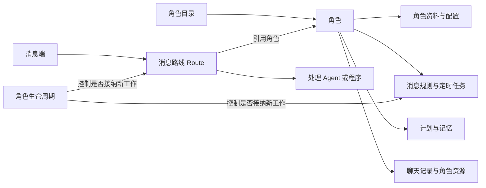
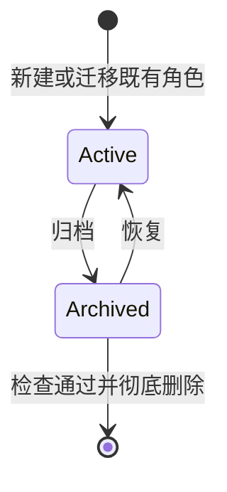

<!-- docs-language-switch -->
<div align="center">
<a href="./role-centric-architecture_en.md">English</a> | 简体中文
</div>
<!-- /docs-language-switch -->

# 以角色为主的配置架构

状态：0.3.63 收集既有实现并进行隔离验证；本变更未安装或激活。面向产品与工程维护者。2026-10-20。

## 1. 目标与设计结论

角色成为独立管理对象。用户先选择角色，再查看其配置、消息规则、计划与记忆；消息路线（Route）负责连接消息端与处理 Agent，并引用角色。角色可以没有路由，一名角色可以被多条路由使用。

本次需求确定的行为：

- 产品中原称“人格”的地方统一称“角色”。
- 左侧前三项依次为 **角色配置、计划与记忆、路由配置**；路由配置承接原“消息适配器”的全部设置。
- 角色下拉框展示全部未归档角色，不以是否配置路由、路由是否启用或运行成功为筛选条件。
- 角色新增归档状态；设置页新增 **已归档角色** 按钮，进入归档列表后可以彻底删除角色。

本轮实现独立角色目录、配置保存、归档、恢复和受检查的彻底删除。验证使用隔离角色，现有用户角色未执行归档或删除。

## 2. 现状与改造原因

| 当前源码证据 | 当前关系 | 必须改变的内容 |
| --- | --- | --- |
| `ribiwebgui/src/App.vue` 的 `routeOptions` 来自 `store.gateways` | 顶栏看起来在选角色，实际选择路由 | 角色选择与路由选择分离 |
| `ribiwebgui/src/routeScopedNavigation.ts` 将角色页、知识页放在 `/routes/:id/…` 下 | 两页依赖路由地址 | 增加按角色寻址的正式页面 |
| `ribiwebgui/src/pages/PersonaTemplatePage.vue` 从 `store.selectedGateway` 获取角色和编辑对象 | 角色配置依附路由草稿 | 直接按角色读取和保存 |
| `ribiwebgui/src/pages/RoleKnowledgePage.vue` 从当前路由取得 `roleId` | 无路由角色缺少独立知识入口 | 计划与记忆直接使用选中的角色 |
| `src/manager/personaCatalog.ts` 枚举角色目录，并缓存目录摘要 | 已有独立目录发现能力；该条目类型没有归档字段 | 复用目录发现，补生命周期与缓存失效 |
| `src/manager/configRepository.ts` 分别读取 `adapterConfig.json` 和 `personaConfig.json` | 文件归属已分开，但会合成为路由视图 | 保留文件归属，拆开编辑和写入合同 |
| `ribiwebgui/src/bundles/builtinWebContributions.ts`、`pluginNavigation.ts` | 页面和导航经插件注册 | 同步贡献声明与页面注册，沿用现有插件机制 |

旧[角色路由工作台计划](persona-route-workbench-plan.md)按“当前路由指向的角色”组织页面。本设计替代其中的页面归属与选择模型，规则执行仍沿用现行 `automationRules`。历史 `notificationRules` 不作为新设计依据。

## 3. 对象与数据归属



| 对象 | 唯一真源 | 管理入口 |
| --- | --- | --- |
| 角色身份 | 既有角色目录 ID；远端附带来源设备 ID | 角色目录服务 |
| 角色正文、表达、形象、关系、规则和上下文配置 | 既有角色文件、`personaConfig.json` 与所属专题数据 | 角色配置 |
| 计划与记忆 | 角色目录内既有知识存储 | 计划与记忆及现有知识接口 |
| 角色归档状态 | 建议新增角色目录内 `roleMetadata.json` | 角色生命周期命令 |
| 消息端、Agent、模型覆盖、工作目录、会话、输出策略和角色引用 | `data/route/<configName>/adapterConfig.json` | 路由配置 |
| 浏览中的角色或路由、展开状态、未保存草稿 | 浏览器页面状态 | 客户端；不冒充正式配置 |

角色信息不能再通过保存整份路由配置间接修改。修改一个角色的规则后，所有引用该角色的路由读取同一份规则；不得各自保存可编辑副本。

浏览角色不改变任何 `agentRoleId`。路由绑定只在路由配置页显式编辑、保存；运行时继续固定引用，不增加按消息内容自动选择角色的机制。

## 4. 导航与选择

| 入口 | 顶栏选择器 | 页面内容与主要操作 |
| --- | --- | --- |
| 角色配置 | 全部未归档角色 | 新建角色、角色资料、消息上下文、自动化、聊天记录、归档角色；关联路由仅展示与跳转 |
| 计划与记忆 | 同一角色选择器 | 所选角色的计划、近期记忆与沉淀记忆 |
| 路由配置 | 独立路由选择器；可按角色筛选 | 原消息适配器的消息端、处理 Agent、连接、输出策略等设置；编辑所引用的角色 |
| 设置 → 已归档角色 | 归档列表内选择 | 查看资料、恢复角色、彻底删除 |

角色页与知识页之间切换保留同一角色。路由页默认可查看全部路由；角色筛选提供“全部角色”和“未绑定角色”，避免角色未选中时路由无法维护。路由选择显示路由名称，角色名称作为辅助信息；同角色的多条路由须可区分。

角色配置页移除“指向角色”控件，改为展示当前角色本身。“新增路由”移到路由配置页；角色页主要创建操作为“新建角色”。路由页可以显式选“无角色”，与角色浏览器的空状态区分。

保留现有角色子页能力；消息规则与定时任务继续共享自动化类型导航。切换角色时保留当前子页类型；新建消息规则后直接进入编辑器。未保存修改使用现有离开确认/保存机制，不在切换时自动保存或丢弃。

### 角色列表规则

1. 目录来自角色存储，不从路由反推，也不按启用状态、规则数、计划数或运行健康过滤。名称缺失时展示角色 ID，同名角色补 ID。
2. 一个角色关联多条路由，只显示一次。没有路由的角色仍可编辑配置、计划和记忆；执行型操作缺少目标时给出具体提示。
3. 已归档角色不进入任何新选择候选。旧路由已保存的归档引用保留并显示“已归档”，不能通过补候选重新变成可选角色。
4. 列表读取失败与空列表分开。元数据损坏或读取状态未知时显示异常，不把角色当作“未归档”或“已删除”。正文缺失只标记资料错误，不因无路由或正文不可读静默隐藏已确认未归档角色。
5. 列表支持搜索、稳定排序和分页/虚拟展示，所有未归档角色都能查到。摘要不附带全文、聊天、计划或记忆；选中后按需读取详情。
6. 当前范围默认本机角色；延续已有来源 PC 选择。远端按来源设备查询其完整角色目录，不复制远端资料。身份键包含来源设备与角色 ID；离线显示明确状态。归档与删除由来源 PC 执行，不把离线当成已归档。

### 正式页面地址建议

- `/roles/:roleId/config`：角色配置。
- `/roles/:roleId/knowledge`：计划与记忆；保留现有计划详情标识和查询条件。
- `/routes/:routeId/adapters`：路由配置，沿用现有可用地址。
- `/settings/archived-roles`：已归档角色。

远端来源作为显式地址参数，刷新、分享和前进/后退均须恢复同一来源与角色。不要把显示名当地址身份。

旧 `/routes/:id/persona`、`/routes/:id/knowledge` 和旧角色正文链接从指定路由解析真实角色后重定向；不得把旧地址里的路由 ID 当成角色 ID。路由不存在、未绑定或引用已归档角色时给出对应状态和去向，不静默打开其他角色。

## 5. 角色生命周期



“未归档”仅说明角色可被选择；路由是否启用、Agent 是否在线和配置是否完整仍各自判断。

### 存储建议

在角色目录内新增 `roleMetadata.json`，与正文、自动化配置一起迁移和备份：

```json
{
  "schemaVersion": 1,
  "revision": 1,
  "archivedAt": null
}
```

`archivedAt` 为 `null` 时未归档，为合法 UTC 时间时已归档；不再保存另一份 `archived` 布尔值。`revision` 用于并发写入校验，不是另一份身份。缺少该文件的既有目录按未归档解释，读取时不批量生成或改写文件；只有真实修改才持久化。格式错误、权限错误、NAS 超时不得解释为文件缺失。

选择独立元数据文件，是为了让角色生命周期独立于当前 `writePersonaConfig` 的自动化字段白名单；角色正文、配置缺失或规则损坏时仍可识别与管理该角色。旧写入器不能覆盖归档状态。

### 归档

- 在角色配置页提供“归档角色”；操作前列出关联路由、定时任务与运行任务影响。
- 归档保留目录、计划、记忆、聊天记录、资源和路由引用，不移动到 `old/`，不修改计划本身的状态或记忆整理规则。
- 生命周期拥有者持久化归档后，不再接纳该角色的新自动触发、手动投递、跨角色新投递或脚本任务。所有执行入口都复核当前生命周期，不能仅依赖前端过滤。
- 尚未开始的队列工作暂停并记录原因。归档前已经交给 Agent 的工作允许收尾、写原操作的回执与结果；不强杀 Agent 或删除外部会话，也不派生新的后续工作。界面显示剩余运行数，未清零前禁止彻底删除。
- 路由保留原 enabled 和角色引用，由角色状态暂时阻止执行；不得清空引用后按“无角色”继续投递，也不得自动切换到别的角色。
- 归档完成后刷新角色候选、知识入口和关联路由。当前角色页进入“已归档”状态并提供归档列表入口，不自动切换后让用户误改其他角色。
- 保存过程中再次归档，旧角色草稿保存应返回冲突，不得把角色自动恢复。多入口共享同一持久化命令与审计。

### 已归档角色与恢复

设置页的 **已归档角色** 按钮进入可搜索、分页的列表，展示名称、ID、来源 PC、归档时间、关联路由数、剩余运行数，以及“查看”“恢复”“彻底删除”。无条目时显示“暂无已归档角色”。

归档资料默认只读。恢复保留原身份，重新进入全部角色候选；保留原有路由开关和规则设置，恢复前说明哪些原本启用的触发会重新生效。归档期间错过的定时任务和暂停队列不自动补发，由用户另行处理。

### 彻底删除

彻底删除是不可撤销的数据操作，只能从已归档角色入口发起。服务端再次检查归档 revision、资料范围、全部已保存的本机引用（包括停用路由和其他角色的自动化引用）、排队与运行任务、正在写入者，以及索引是否已完整加载。

存在引用时列出对象和编辑入口，先解除引用再删除；不能顺带删除路由、其他角色的规则、共享资源或 Agent 会话。索引加载不完整、来源 PC 不可用或任务状态未知时保持原数据并拒绝删除。

删除确认展示角色名、ID 和范围：角色目录中的正文、配置、计划、记忆、聊天记录、专属附件与备份都会删除。用户输入角色 ID 后提交。共享目录、角色目录外资源、外部会话及外部备份不在删除范围，不宣称外部副本已经擦除。

同一角色的生命周期变更、引用创建和删除必须串行校验。删除期间禁止新引用和新工作；验证规范化路径及真实目标始终位于受管角色根目录内，拒绝根目录、路径穿越和指向边界外的链接。不能跟随链接递归删除共享资料。

文件删除不假装拥有文件系统事务：先持久化删除操作记录并隔离目录访问，再执行有界删除与索引清理；中断可按原操作 ID 继续，残留显示“删除未完成”。只有数据删除、派生索引失效和独立读回均完成后返回完成回执。可保留不含正文的最小删除标记，阻止同 ID 自动重建与迟到写入。

远端离线客户端可能保留旧引用；来源 PC 删除后按该标记拒绝，客户端重连时展示“角色已删除”，不得自动创建同 ID 或替换目标。本机不能证明其他电脑和外部备份均无副本。

## 6. 后端与客户端合同

复用 Manager 配置仓库、角色目录、Role Knowledge、持久化审计与插件生命周期。在角色所属模块补角色目录查询、独立配置读写和生命周期命令；不要在 WebGUI 建第二份正式角色清单，也不新增独立服务进程。

接口由 `roleConfigurationRoutes.ts` 注册在原角色插件中，复用既有 Manager 连接：

| 操作 | 合同 |
| --- | --- |
| 查询角色摘要 | `GET /api/roles?scope=active|archived&cursor=…&limit=…&query=…`；返回稳定身份、名称、归档时间、revision、异常和分页状态 |
| 查询/保存角色配置 | 按角色 ID 读取、局部修改正文或所属配置；与路由保存解耦；未绑定路由也可保存 |
| 查询引用与影响 | 返回路由、规则、运行工作、目录可用性及可执行操作；执行时仍重新验证 |
| 归档/恢复 | 以明确动作提交，带预期 revision 与幂等键；返回正式状态和操作回执 |
| 彻底删除 | 仅归档对象，携带确认 ID、预期 revision、幂等键；返回完成、拒绝或仍待处理的真实结果 |

归档状态由生命周期拥有者解释；WebGUI 使用服务端给出的可执行操作与阻碍，不自行复制删除规则。新增生命周期接口沿用已鉴权连接，不增加逐角色或逐功能许可。

配置、生命周期与目录变化由拥有者发出事件，角色摘要、关联路由和各选择器按来源与角色 ID 失效缓存。断线后按 revision 补读；迟到响应校验角色、来源与请求版本，避免将上一角色资料写到当前页面。不要增加全目录定时扫描或全文轮询。

NAS 目录分批加载、逐项超时、可报告部分成功；对外返回目录是否完整及失败条目。部分摘要不阻断已就绪角色的查看；引用完整性未知时阻止删除。摘要缓存只为加速，角色元数据与配置仍是正式来源。

## 7. 命名与迁移

“人格 → 角色”覆盖所有现行产品表面：导航、标题、字段、按钮、弹窗、空状态、错误、工具提示、语音与桌面、手机/眼镜、接入引导、Agent 提示模板、现行中英文文档及示例说明。英文用户术语统一为 **Role**。

机器合同第一阶段保留 `persona.md`、`personaConfig.json`、`personaId`、`agentRoleId`、既有 API、事件名和插件 ID。它们是兼容标识，不在全局文本替换中改名；新领域能力使用 Role 命名。后续如需改协议，必须单独设计版本与迁移，不能同时写 `roleConfig.json` 和 `personaConfig.json` 两份真源。

用户私有正文、聊天历史、记忆、已有计划和角色自述不做机械替换；历史设计、历史版本记录与引用保留当时词义。现行文档的迁移说明可提及旧词，不能把方案提前写成现行能力。

实施顺序：

1. 扩展角色目录与生命周期拥有者，支持未绑定角色；先验证目录、旧数据默认状态、revision、缓存与真实写入。
2. 加入按角色读写合同与执行前生命周期复核；覆盖触发、队列、跨角色投递、迟到结果与引用创建。
3. 拆开客户端 `selectedRoleRef` 和 `selectedRouteId`、角色草稿和路由草稿，迁移角色/知识地址与旧书签。共享角色规则写后刷新所有引用路由。
4. 更新插件导航贡献、页面注册与命令出现范围，按顺序显示三个标签；完成归档列表、恢复和删除交互。
5. 同步现行产品文案、文档及客户端选择器。退役路由驱动角色编辑的内部入口；旧地址只留一个重定向适配层，其保留原因是既有书签，待产品明确结束书签兼容并核验所有内置调用迁移后删除。
6. 在本机磁盘构建与测试，再按热补丁支持矩阵安装；不可热迁移时由 Host 受控切代。核对真实 Manager 身份、页面资源 hash、刷新与重启后的持久化。

旧 `persona-route-workbench-plan.md` 的历史说明应在实现时补充指向本设计的替代关系；`routing-and-personas`、用户手册、配置文档、代码架构和功能地图在行为落地时同步更新。设计阶段仅增加方案与索引，不提前替换当前使用说明。

## 8. 验收条件

| 场景 | 必须观察到的结果 |
| --- | --- |
| 未绑定路由的角色 | 出现在角色选择器，可保存配置并查看计划与记忆 |
| 同角色两条路由、两角色同名 | 角色不重复；按稳定 ID 隔离编辑，路由名称可区分 |
| 在角色配置与计划页切换角色 | 两页保持角色一致；保存不会修改路由绑定或另一角色 |
| 在路由页重绑角色 | 只修改明确选择的路由，保存后由新角色配置生效 |
| 归档与刷新/重启 | 所有普通候选均移除；设置中可见；独立 Manager 读回仍已归档 |
| 已保存路由引用归档角色 | 显示原引用与暂停原因，不投递、不回退无角色、不替换目标 |
| 归档时有排队/运行工作 | 未执行项暂停，已执行项按原回执收尾，新工作被拒绝；运行未清零无法删除 |
| 恢复 | 回到候选，原配置保留，错过的任务与队列不自动重放 |
| 删除仍被停用路由或其他规则引用的角色 | 返回引用清单，原文件完整保留 |
| 删除合法归档角色 | 刷新与重启后目录、索引和候选一致；外部共享资源未删；迟到写入不能复活 |
| 并发归档、保存、重绑和删除 | revision 冲突可见；无丢失更新、悬空新引用或重复删除 |
| 元数据损坏、NAS 超时、部分目录、远端离线 | 显示具体错误与可恢复状态，未知状态不被当作空数据 |
| 深链接与离开草稿 | 旧书签解析到原绑定角色；来源、计划详情不丢失；无自动保存或草稿丢失 |
| 产品命名 | 所有现行产品表面使用“角色 / Role”，兼容机器标识和私有内容保持可用 |

实施证据来自源码检查、本地构建以及隔离 HTTP、文件夹与浏览器夹具；正式安装验收单独记录。

## 9. 实现与验证边界（2026-10-19）

- `roleConfigurationRoutes.ts` 和 `roleLifecycle.ts` 拥有角色目录、独立配置命令、归档状态、工作租约、删除标记及幂等操作回执。路由保存不再写角色配置。
- `roleStore.ts` 拥有独立角色选择与草稿，正式页面使用 `/roles/:roleId/config|knowledge`；旧路由书签经原路由解析后跳转。`RoleBindingEditor.vue` 仅在路由页修改角色引用。
- `ArchivedRoles.vue` 提供设置中的归档列表、检查、恢复和删除确认。新任务入口（路由投递、脚本、远端执行上下文及 Codex Hook）复核归档状态。
- 摘要每页最多 25 项、每次最多检查 200 个目录，客户端逐页加载。当前文件系统操作依赖系统返回；逐项超时与中断后锁/工作租约的自动恢复尚未实现，残留会阻止删除，需要先核对原进程及操作。不能把未知任务当作已经退出。
- 单元与 HTTP/文件夹夹具覆盖无路由角色、保存隔离、清空配置、revision 冲突、归档持久化、工作准入、停用路由引用拦截及中断重试。构建、隔离页面和正式安装的证据分别记录，不将构建通过视为正式运行验收。
