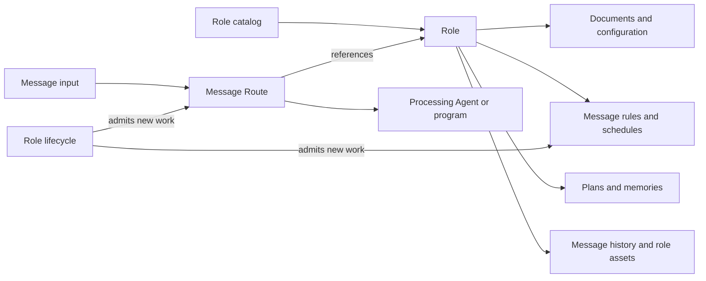
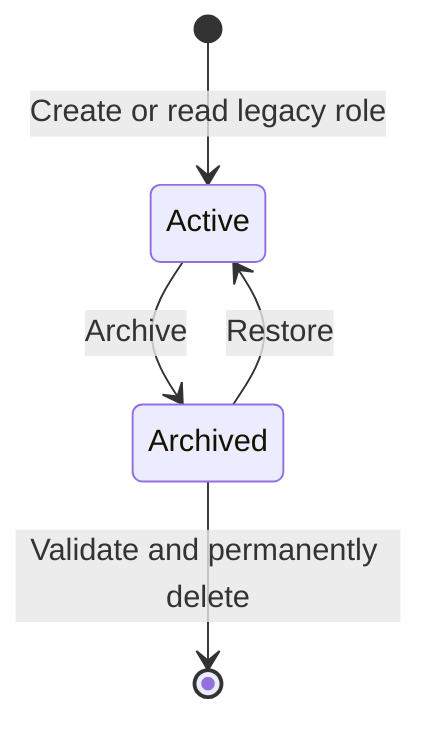

<!-- docs-language-switch -->
<div align="center">
English | <a href="./role-centric-architecture.md">简体中文</a>
</div>
<!-- /docs-language-switch -->

# Role-centric configuration architecture

Status: 0.3.63 collects the existing implementation for isolated validation; this change does not install or activate it. Audience: product and engineering maintainers. 2026-10-20.

## 1. Target behavior

A role becomes an independently managed object. Users select a role to edit its configuration and message rules or inspect its plans and memories. A message Route connects inputs to a processing Agent and references a role. A role can exist without a Route, and multiple Routes can reference one role.

The requested behavior is:

- Replace the product term “Persona” with “Role” (角色 → 角色 in Chinese).
- Order the first three sidebar entries as **Role configuration, Plans and memories, Route configuration**. Route configuration takes over all settings from Message adapters.
- Include every unarchived role in role selectors, regardless of Route bindings, enablement or runtime health.
- Add role archival and an **Archived roles** button in Settings. The resulting list supports permanent deletion.

The core implementation includes independent role configuration, archival, restoration and checked deletion. Validation uses disposable fixtures; no existing user role was archived or deleted.

## 2. Current evidence

| Source | Observed relationship | Required change |
| --- | --- | --- |
| `ribiwebgui/src/App.vue` | `routeOptions` comes from `store.gateways`; the apparent role selector selects a Route | Separate role and Route selection |
| `ribiwebgui/src/routeScopedNavigation.ts` | Role and knowledge pages live below `/routes/:id/…` | Introduce canonical role-scoped pages |
| `ribiwebgui/src/pages/PersonaTemplatePage.vue` | Role configuration derives from `store.selectedGateway` | Read and save by role identity |
| `ribiwebgui/src/pages/RoleKnowledgePage.vue` | `roleId` derives from the selected Route | Select knowledge independently of Routes |
| `src/manager/personaCatalog.ts` | Enumerates role directories and caches summaries; entries have no archival field | Reuse discovery and add lifecycle-aware invalidation |
| `src/manager/configRepository.ts` | Separate adapter and role files are composed into a Route view | Keep storage ownership; separate editing and writes |
| `bundles/builtinWebContributions.ts` and `pluginNavigation.ts` | Plugins register pages and navigation | Update contributions and registrations through the existing mechanism |

This design supersedes the page ownership and selection model in the historical [role Route workbench plan](persona-route-workbench-plan_en.md). Rules continue using current `automationRules`; historical `notificationRules` is not the new design model.

## 3. Ownership



| Fact | Authoritative source | Editing surface |
| --- | --- | --- |
| Identity | Existing directory ID, plus source device ID for remote roles | Role catalog |
| Documents, expression, appearance, relationships, rules and context | Existing role files, `personaConfig.json` and topic-owned data | Role configuration |
| Plans and memories | Existing role knowledge storage | Plans and memories and existing APIs |
| Archival | Proposed role-local `roleMetadata.json` | Lifecycle commands |
| Inputs, Agent, model overrides, workspace, session, output policy and role reference | `data/route/<configName>/adapterConfig.json` | Route configuration |
| Browsing selection, expansion and unsaved drafts | Client presentation state | Browser; never authoritative configuration |

Saving a role must not require saving a complete Route. Every Route referencing the role consumes the same role-owned rules without independently editable copies. Browsing a role never changes `agentRoleId`; only an explicit Route edit changes its binding. Routing remains a fixed reference, without content-based role selection.

## 4. Navigation and selectors

| Surface | Top selector | Content and actions |
| --- | --- | --- |
| Role configuration | All unarchived roles | Create role, documents, context, automation, history and archive; linked Routes are summaries with edit links |
| Plans and memories | The same role selector | Selected role's plans and recent/consolidated memories |
| Route configuration | Independent Route selector, optional role filter | Existing input, processing Agent, connection and output settings; explicit role binding |
| Settings → Archived roles | Selection within the archive list | Inspect, restore and permanently delete |

Switching between role configuration and knowledge preserves the role. Route configuration can list all Routes and offers All roles and Unbound filters. Route names identify Routes; role names provide secondary information, so two Routes for one role remain distinguishable.

Remove the binding control from the role page. Create role is its main creation action; Add Route belongs on Route configuration. A Route's explicit No role choice is separate from an empty role browser.

Preserve existing role subpages. Message rules and schedules retain their shared automation-type navigation; new rules open directly in the editor. Preserve the subpage when switching roles. Use existing unsaved-change handling without implicit save or discard.

Catalog rules:

1. Query role storage, not the set of Routes. Do not filter by enablement, rule/plan count or runtime health. Missing names fall back to IDs; duplicate names show IDs.
2. Deduplicate roles referenced by several Routes. Unbound roles remain editable; execution actions report a missing target where necessary.
3. Exclude archived roles from every new selection. Existing archived references remain visible as unavailable saved values, never selectable fallback options.
4. Distinguish errors from empty results. Invalid or unreadable metadata means unknown lifecycle, not active or deleted. A missing document is a visible content error, not a reason to hide a confirmed unarchived role.
5. Search and stable pagination/virtualization must reach every unarchived role. Summaries omit document bodies, history, plans and memories; load details on demand.
6. Default to local roles and retain explicit source-PC selection. Query complete remote catalogs on their owning PC without copying data. Identity includes device and role ID; offline state remains explicit. Lifecycle mutations execute on the owning PC.

Proposed canonical addresses:

- `/roles/:roleId/config`
- `/roles/:roleId/knowledge`, preserving existing plan-detail identity and query conditions
- `/routes/:routeId/adapters`, retaining the existing working address
- `/settings/archived-roles`

Represent remote source explicitly in the address so reload, sharing and browser history preserve identity. Display names are not identity.

Legacy `/routes/:id/persona`, `/routes/:id/knowledge` and document links resolve the referenced Route to its actual role before redirecting. Never interpret the legacy Route ID as a role ID. Missing, unbound or archived targets show their actual state rather than silently selecting another role.

## 5. Lifecycle



Unarchived means selectable. Route enablement, Agent presence and configuration readiness remain separate facts.

### Storage

Proposed role-local `roleMetadata.json`:

```json
{
  "schemaVersion": 1,
  "revision": 1,
  "archivedAt": null
}
```

`archivedAt: null` means unarchived; a valid UTC timestamp means archived. Do not persist a duplicate boolean. `revision` supports concurrency checks, not identity. Missing legacy metadata defaults to unarchived without bulk writes during reads. Persist metadata only on a real mutation; invalid JSON, denied access and NAS timeouts are not missing files.

A separate metadata file keeps lifecycle independent of `writePersonaConfig`'s automation-field whitelist. A role remains manageable when its document/configuration is missing or corrupt, and old configuration writers cannot overwrite archival state.

### Archive

- Offer Archive role on role configuration, with a review of linked Routes, schedules and running work.
- Retain the directory, knowledge, history, assets and references. Do not move it to `old/`, change plan status or alter memory consolidation.
- Once archival is persisted, reject new automatic triggers, manual deliveries, cross-role deliveries and script work. Every execution entry checks lifecycle, beyond UI filtering.
- Pause queued work that has not started and record why. Work already delivered to an Agent may finish and record the original operation's receipts/results, without spawning follow-up work. Do not kill the Agent or delete its external session. Show remaining work and block deletion until it drains.
- Preserve Route enablement and role references, using lifecycle to suspend execution. Never clear the reference and continue without a role or substitute another role.
- Invalidate selectors, knowledge entry points and linked Route views. The currently archived role shows its state and archive-list link rather than silently selecting another role.
- A stale configuration save after archival returns a conflict and never restores the role. All entry points share persistence and audit.

### Archive list and restore

Settings → Archived roles opens a searchable, paginated list with name, ID, source PC, archival time, reference count, running-work count, Inspect, Restore and Permanently delete. Empty state: No archived roles.

Archived data is read-only by default. Restoration preserves identity and configuration and returns the role to selectors. Explain which previously enabled triggers will resume. Preserve existing switches; do not automatically replay missed schedules or paused queue items.

### Permanent deletion

Permanent deletion is irreversible and starts only from Archived roles. Recheck archival revision, data scope, all persisted local references (including disabled Routes and other roles' automation), queued/running work, active writers and index completeness.

References block deletion and provide edit links. Do not cascade-delete Routes, other roles' rules, shared assets or Agent sessions. Incomplete indexes, unavailable owning PCs and unknown task state retain data and block deletion.

Confirmation shows name, ID and scope: the role directory's documents, configuration, plans, memories, history, dedicated attachments and backups will be removed. Require the role ID as confirmation. Shared or external resources, external sessions and external backups remain outside scope; do not claim they were erased.

Serialize lifecycle mutations, reference creation and deletion for the role. Reject new references and work during deletion. Validate normalized and actual paths inside the managed roles root; reject the root itself, traversal and links outside the boundary. Never follow links to delete shared data.

Filesystem deletion is not a transaction: persist a deletion-operation record, isolate directory access, perform bounded deletion and invalidate indexes. Resume interruptions with the same operation ID and report incomplete deletion while remnants exist. Confirm completion only after deletion, derived-index invalidation and independent readback. A minimal content-free deletion marker may prevent automatic ID reuse and late writes.

Offline remote clients can retain stale references. The owning PC rejects them after deletion; reconnecting clients show Role deleted without recreating the same ID or substituting a target. Local deletion cannot prove all external copies are absent.

## 6. Service contracts

Extend the role-owning module using the existing Manager configuration repository, catalog, Role Knowledge, mutation audit and plugin lifecycle. Add catalog queries, independent configuration writes and lifecycle commands. Do not add a separate service process or a second authoritative browser catalog.

The existing role plugin registers these APIs through `roleConfigurationRoutes.ts`:

| Operation | Contract |
| --- | --- |
| Summaries | `GET /api/roles?scope=active|archived&cursor=…&limit=…&query=…`; stable identity, name, archival timestamp, revision, errors and page status |
| Role configuration | Read and patch role-owned documents/configuration by role ID, independently of Route saving; support unbound roles |
| References and impact | Routes, rules, running work, storage readiness and available actions; mutation still revalidates |
| Archive/restore | Explicit action, expected revision and idempotency key; authoritative state and operation receipt |
| Delete | Archived target only, confirmation ID, expected revision and idempotency key; actual completion, rejection or pending result |

The lifecycle owner defines allowed actions and blockers. Clients display them instead of duplicating deletion rules. Use existing authenticated connections without introducing per-role or per-feature permissions.

Owners emit catalog/configuration/lifecycle events. Invalidate summaries, Route views and selectors by source and role identity; reconcile revisions after disconnection. Guard late responses by source, role and request version. Do not add timed full-directory scans or document polling.

Load NAS catalogs in bounded batches with per-item timeouts and partial-success reporting, including completeness and failed items. Ready roles remain readable; unknown reference completeness blocks deletion. Caches accelerate reads, while metadata and configuration remain authoritative.

## 7. Terminology and migration

Apply Role across current navigation, titles, fields, buttons, dialogs, empty/error states, tooltips, speech/desktop/mobile/glasses surfaces, onboarding, Agent prompt templates, current bilingual documentation and example explanations.

Initially retain machine contracts: `persona.md`, `personaConfig.json`, `personaId`, `agentRoleId`, existing APIs, events and plugin IDs. They are compatibility identifiers, excluded from blind replacement. New domain capabilities use Role terminology. Any protocol rename requires its own versioned migration; never maintain both `roleConfig.json` and `personaConfig.json` as authoritative copies.

Do not mechanically rewrite private documents, message history, memories, existing plans or role self-descriptions. Historical designs, releases and quotations preserve their original terms. Current migration explanations may mention the previous term; do not present this proposal as shipped capability.

Implementation order:

1. Extend catalog/lifecycle ownership for unbound roles; verify legacy defaults, revisions, invalidation and real writes.
2. Add independent role configuration and lifecycle admission checks across triggers, queues, cross-role delivery, late results and reference creation.
3. Separate `selectedRoleRef` from `selectedRouteId`, role drafts from Route drafts, and migrate role/knowledge links. Refresh all linked Routes after shared-rule writes.
4. Update plugin navigation contributions, registrations and command scopes; implement the archive list, restoration and deletion.
5. Update current terminology and selectors across clients. Remove Route-driven role editing internally. Keep one legacy bookmark redirect only, until product ends bookmark compatibility and all built-in callers are verified migrated.
6. Build/test on local disk, install through the supported hot-patch matrix, or use Host-controlled generation switching for incompatible state transitions. Verify Manager identity, actual resource hashes and persistence through refresh/restart.

On implementation, link the historical workbench plan to this replacement and update routing/role guides, configuration docs, code architecture and function maps to match shipped behavior. Implementation locations and verification boundaries are recorded in section 9.

## 8. Acceptance

| Scenario | Required observation |
| --- | --- |
| Role without a Route | Selectable; configuration saves and knowledge opens |
| Several Routes per role or duplicate role names | No duplicate role entries; ID-isolated edits and distinguishable Route names |
| Role/configuration/knowledge navigation | Same role across pages; saves never change bindings or another role |
| Explicit Route rebinding | Only the selected Route changes and consumes the new role configuration |
| Archive, refresh and restart | Role leaves normal selectors, appears in Settings, and remains archived on independent Manager readback |
| Saved archived reference | Original reference and suspension reason remain visible; no delivery, no role-less fallback or substitution |
| Queued/running work during archive | Queued work pauses, admitted work finishes under original receipts, new work rejects, deletion waits |
| Restore | Selectable with original configuration; no automatic missed-work replay |
| Delete referenced role | Disabled-Route and cross-rule references are reported; files remain intact |
| Delete eligible archived role | Directory/index/selectors agree after refresh/restart; shared resources survive; late writes cannot resurrect it |
| Concurrent archive/save/rebind/delete | Visible revision conflicts, no lost updates, dangling new references or duplicate deletion |
| Corrupt metadata, NAS timeout, partial catalog or offline PC | Specific recoverable errors; unknown state never becomes empty data |
| Deep links and unsaved drafts | Original role/source/plan detail preserved; no implicit save or discard |
| Terminology | Current product surfaces say Role; machine compatibility and private content remain usable |

Implementation evidence comes from source checks, local builds and disposable HTTP/filesystem/browser fixtures. Installed-runtime acceptance remains separate.

## 9. Implementation and verification boundary (2026-10-19)

- `roleConfigurationRoutes.ts` and `roleLifecycle.ts` own independent role configuration, metadata, work leases, deletion markers and idempotent receipts. Route saves no longer write role configuration.
- `roleStore.ts` owns role selection and drafts under `/roles/:roleId/config|knowledge`. Legacy links resolve the original Route before redirecting. `RoleBindingEditor.vue` changes references only on the Route page.
- `ArchivedRoles.vue` provides inspection, restoration and deletion confirmation. Routing, scripts, remote execution context and Codex Hook admission check archival state.
- Summary pages return at most 25 items and examine at most 200 directories. Per-item filesystem timeouts and automatic recovery of interrupted lock/work leases remain follow-up work. Residual leases block deletion until the original process and operation are reconciled.
- HTTP/filesystem fixtures cover unbound roles, isolated saves and clearing, revision conflicts, persisted archival, admission, disabled-Route deletion blockers and interrupted-operation retries. Build, isolated-browser and installed-runtime acceptance remain separate evidence.
