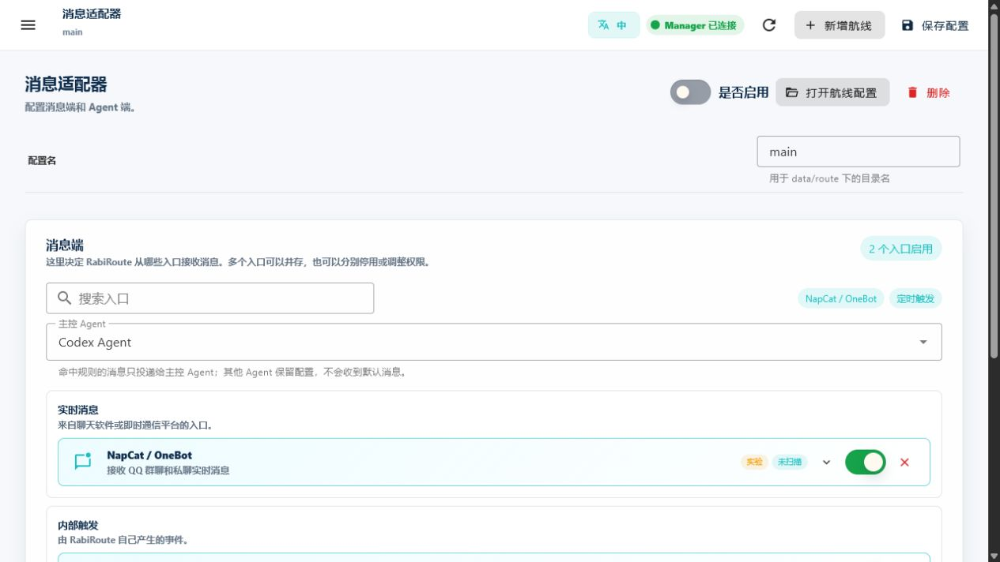
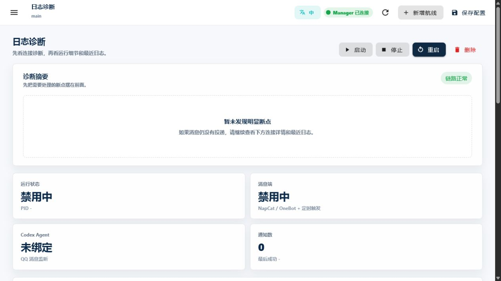

<!-- docs-language-switch -->
<div align="center">
<a href="./first-route_en.md">English</a> | 简体中文 | <a href="./first-route_ja.md">日本語</a>
</div>
<!-- /docs-language-switch -->

# 跑通第一条 Route

这篇教程用“定时触发 + Codex”完成最短闭环。它不依赖 QQ 登录，适合第一次确认 RabiRoute、RibiWebGUI 和处理端能否正常协作。

> 完成标准：当前路由保存成功，投递测试返回编号，所选 Codex/ChatGPT Desktop 任务收到对应消息；定时规则另外验证。

## 开始前准备

- RabiRoute 已安装并构建，Manager 可以启动。
- Codex/ChatGPT Desktop 已打开。
- 你知道目标任务所在的项目目录。
- 目标任务可以正常进入，不处于已删除或不可访问状态。

Windows 安装版从开始菜单启动 RabiRoute Host，再从托盘打开 WebGUI。从源码运行时，在项目目录运行：

```powershell
npm run start:manager
```

然后打开 Manager 标准输出中的 `<managerBaseUrl>`。这条地址由操作系统动态分配，不使用固定端口。

## 第 1 步：创建角色

点击左下角“新建角色”，填写“角色名称”，确认用于目录与引用的“角色 ID”，点击“创建”。也可以在顶部选择已有角色。本教程使用本机角色；创建前确认来源 PC 是当前电脑。

创建成功后进入“角色配置”。打开第二个标签“消息适配器”，点击“新增消息路由”。路由会关联当前角色，之后仍可为同一角色添加其他路由。

## 第 2 步：添加消息端

在“消息端”卡片点击“添加消息端”，选择“定时触发”。这是内部消息来源，不需要 QQ 登录。定时规则稍后在角色的“自动化 → 消息规则”中配置。



截图用于识别消息端和 Agent 参数；当前入口以“角色配置 → 消息适配器”为准。

## 第 3 步：绑定 Codex 任务并保存

在同一页的“Agent 端”卡片点击“添加 Agent”，选择 Codex，并在“主控 Agent”中选中它。展开参数后：

1. 在“工作目录”填写目标项目的绝对路径。
2. 在“会话名 + 最后会话时间”选择已有任务；选择后会采用该任务的工作目录，再核对是否正确。
3. 如需新任务，输入新名称；名称没有匹配时，保存才会创建空任务并绑定。首次验收也可直接选择已经打开的任务。

RabiRoute 保存完整任务 ID。只要原 ID 有效，改显示名或完成任务目标不会让它自动创建替代任务。实际消息由 Codex/ChatGPT Desktop 的原任务执行，投递期间保持 Desktop 打开。

确认路由的“是否启用”开关，然后点击顶栏“保存”。等待“有未保存的修改”消失；若显示“保存结果待确认”，先核对原保存结果，不重新创建角色或路由。

## 第 4 步：执行一次投递测试

在当前消息路由点击“通道检查”。检查消息端与 Agent 状态，在 Codex 节点点击“投递测试”。该操作会发送一条带测试编号的真实消息。

确认页面显示“目标 Agent 已收到测试消息”，并到 Desktop 中核对同一任务实际收到了对应测试消息。配置保存和通道状态读取本身不能证明投递。

## 第 5 步：验证实际触发规则

投递测试确认的是当前路由到 Agent 的路径。需要定时运行时，在“角色配置 → 自动化 → 消息规则”配置并保存定时规则。打开“日志诊断”，对已有 `heartbeat` 或 `manual_trigger` 规则使用“手动触发”，再核对原 Desktop 任务收到消息。



截图使用未启动、未绑定真实任务的文档示例；实际状态以当前路由为准。规则列表为空时先配置规则，投递测试通过不代表定时规则已经运行。

## 如何判断成功

1. 当前路由配置已保存，通道检查显示所选 Codex 任务。
2. 投递测试返回测试编号，Desktop 中同一任务收到对应消息。
3. 如已配置定时规则，再确认一次手动触发和原任务收件。

## 第一次失败时看哪里

| 现象 | 先检查 |
| --- | --- |
| 顶栏显示服务未连接 | 安装版检查 Host `status --json` 的 generation/instance/URL；源码模式检查本次标准输出 URL |
| Route 已启用但未运行 | 日志诊断中的启动按钮和最近日志 |
| 没有可触发规则 | 角色页是否有 `heartbeat` 或 `manual_trigger` 规则 |
| Codex 显示未绑定 | 工作目录、任务选择和重新扫描结果 |
| 出现 `no-client-found` | Desktop 是否已启动并能加载目标任务 |
| 触发成功但任务没消息 | 最后投递协议、任务 ID、工作目录和最近日志 |

详细判断顺序见[运行、日志与排障](operations-and-troubleshooting.md)。

## 下一步

- 接入 QQ：阅读 [Route 与消息端](routes-and-adapters.md)。
- 让消息进入固定项目任务：阅读 [Agent、项目与任务](agents-and-sessions.md)。
- 设置群消息、私聊或定时规则：阅读 [角色与消息规则](personas-and-rules.md)。
