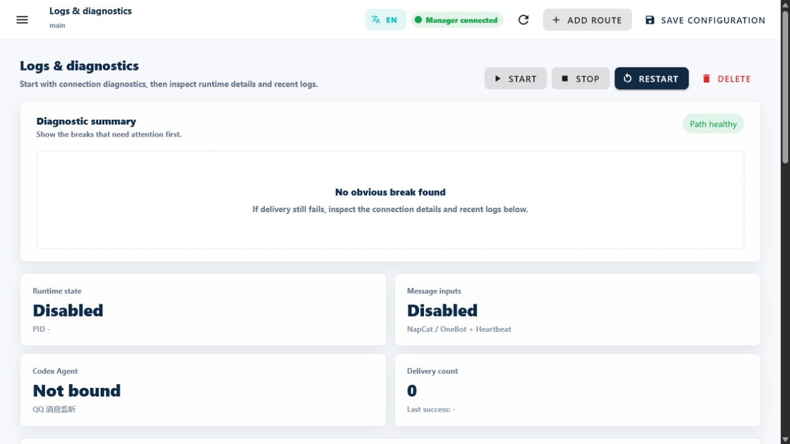

<!-- docs-language-switch -->
<div align="center">
<a href="./first-route_en.md">English</a> | <a href="./first-route.md">简体中文</a> | 日本語
</div>
<!-- /docs-language-switch -->

# 最初の Route を動かす

定期実行と Codex を使い、設定からメッセージの受信までを確認します。QQ へのログインは不要です。まずこの短い経路で、RabiRoute、RibiWebGUI、処理を担当する Agent が連携できることを確かめます。

> 完了の目安：ルートの保存が完了し、配信テストの番号と同じメッセージが、選択した Codex/ChatGPT Desktop のタスクに届くこと。定期実行ルールは別に確認します。

## 始める前に

- RabiRouteがインストールおよび構築され、マネージャを開始できる。
- Codex/ChatGPTデスクトップが開いている。
- ターゲットタスクによって使用されるプロジェクトディレクトリはわかっています。
- ターゲットタスクはアクセス可能であり、削除されていない。

Windowsパッケージで、RabiRoute Hostを起動し、トレイからWebGUIを開く。ソース モードで、リポジトリから Manager を起動します。

```powershell
npm run start:manager
```

Manager が出力した `<managerBaseUrl>` をブラウザで開きます。アドレスは OS が割り当てるため、ポート番号は固定ではありません。

## ステップ 1：ペルソナを作成する

左下の **ペルソナを作成** を選び、**ペルソナ名** と変更しない **ペルソナID** を確認して作成します。上部で既存のペルソナを選んでも構いません。この手順ではローカルのペルソナを使うため、作成前に参照先 PC がこのコンピューターであることを確認してください。

ペルソナ設定の 2 番目のタブ **メッセージアダプタ** を開き、**メッセージルートを追加** を選びます。新しいルートは現在のペルソナに関連付けられます。同じペルソナに複数のルートを追加できます。

## ステップ 2：メッセージ入力を追加する

メッセージ入力のカードで **メッセージ入力を追加** を選び、**定期実行** を追加します。これは内部の入力元なので QQ へのログインは不要です。定期実行のルールは後でペルソナの自動化設定に登録します。


画像は英語版の旧画面例です。現在の入口はペルソナ設定の **メッセージアダプタ** です。

## ステップ 3：Codex タスクを指定して保存する

同じページの **Agentハンドラー** カードで **Agentを追加** を選び、Codex を追加して **プライマリ Agent** に指定します。パラメーターを開いて次を確認します。

1. **作業ディレクトリ** に対象プロジェクトの絶対パスを入力します。
2. **タスク名 + 最後のアクティビティ** で既存のタスクを選びます。選択するとそのタスクの作業ディレクトリが使われるため、もう一度確認してください。
3. 新しいタスクが必要なら名前を入力します。一致するタスクがない場合、保存時に空のタスクが作成されます。最初の確認では、Desktop で開いている既存タスクを選ぶこともできます。

RabiRoute は完全なタスク ID を保存します。元の ID が有効なら、表示名の変更や目標の完了によって代替タスクを自動作成しません。配信は Codex/ChatGPT Desktop の元のタスクで実行されるため、Desktop を開いたままにしてください。

ルートが有効になっていることを確認し、上部の **保存** を押します。未保存の表示が消えるまで待ちます。保存結果が未確認の場合は元の保存結果を確認し、別のペルソナやルートを作り直さないでください。

## ステップ 4：配信をテストする

現在のメッセージルートで **チャンネルチェック** を開きます。入力元と Agent の状態を確認し、Codex の **配信テスト** を押します。テスト番号を含む実際のメッセージが送信されます。

画面の成功結果に加え、Desktop の同じタスクにそのメッセージが届いたことを確認します。設定の保存や状態の読み取りだけでは、配信成功の証拠にはなりません。

## ステップ 5：実際のトリガールールを確認する

配信テストで確認できるのは現在のルートから Agent までの経路です。定期実行を使う場合は、ペルソナ設定の自動化・メッセージルールでルールを保存します。その後、ログと診断で既存の `heartbeat` または `manual_trigger` ルールを手動実行し、元の Desktop タスクで受信を確認してください。



画像は停止中で実際のタスクを指定していないサンプルです。実際の状態は現在のルートで確認してください。ルールがない場合は先に設定します。配信テストの成功だけでは、定期実行ルールが動いたことにはなりません。

## 成功の確認

1. 現在のルートが保存され、チャンネルチェックに選択した Codex タスクが表示される。
2. 配信テストの番号と同じメッセージが Desktop の同じタスクに届く。
3. 定期実行を設定した場合は、手動実行と元のタスクでの受信も確認する。

## 最初の故障チェックリスト

|症状 |最初に確認してください |
| --- | --- |
|マネージャーが切断されました |ホスト `status --json` パッケージ内の世代/インスタンス/URL、またはソースモードでのこの実行の標準出力 URL |
| 有効なルートが停止している | ログと診断の起動・再起動ボタンと最近のログ |
|トリガー可能なルールがありません |あ `heartbeat` または `manual_trigger` ペルソナのルール |
|Codexはバインドされていません |ワークスペース、タスクの選択、および再スキャンの結果 |
| `no-client-found` |デスクトップが開いており、ターゲット タスクをロードできます。
|トリガーは成功しましたが、タスク メッセージが表示されません。配信チャネル、タスク ID、ワークスペース、および最近のログ |

完全なシーケンスについては、を参照してください。 [操作、ログ、トラブルシューティング](operations-and-troubleshooting_ja.md).

## 次のステップ

- QQを追加: [ルートとメッセージアダプタ](routes-and-adapters_ja.md).
- メッセージを正しいプロジェクトタスクにバインドする: [エージェント、プロジェクト、およびタスク](agents-and-sessions_ja.md).
- グループ、プライベート、またはスケジュールされたルールを構成します。 [ペルソナとメッセージのルール](personas-and-rules_ja.md).
