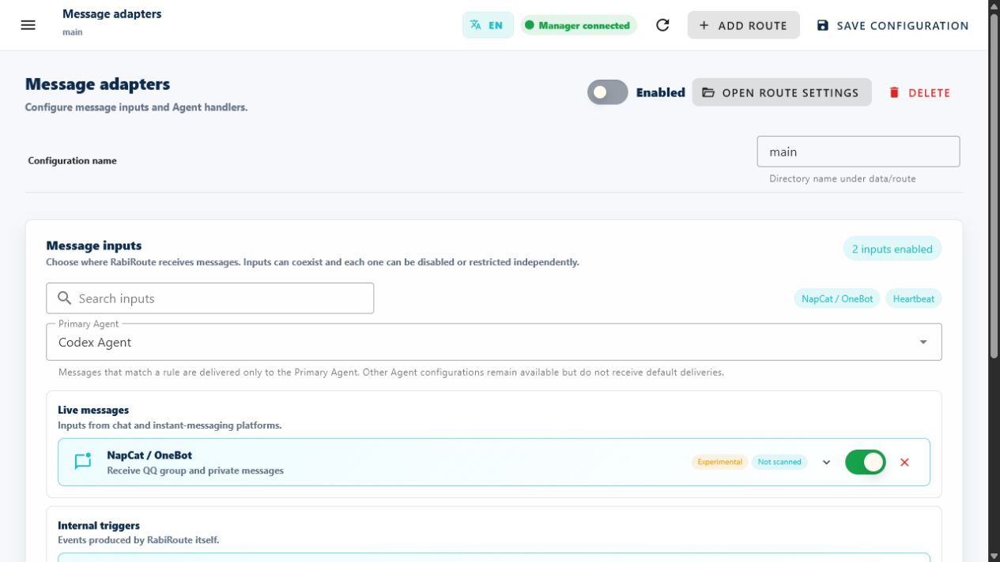

<!-- docs-language-switch -->
<div align="center">
<a href="./safety-and-data_en.md">English</a> | <a href="./safety-and-data.md">简体中文</a> | 日本語
</div>
<!-- /docs-language-switch -->

# 安全性、応答、およびデータ

RabiRoute は、エージェントが実行できる内容と、その結果が外部システムに書き込まれるかどうかを分離します。タスクの承認は永続的な送信承認ではありません。

## 2 つの許可境界

|境界 |管理対象 |設定元 |
| --- | --- | --- |
|デスクトップタスク権限 |コマンド、ファイル、ネットワーク、ツール、サンドボックス |ターゲット Codex/ChatGPT デスクトップ タスク |
|RabiRouteアクションゲート | QQ、WeCom、RabiLink、その他の出力 |パイプライン、応答コンテキスト、アダプター ポリシー |

デスクトップファイル読み取り承認では、そのファイルをグループに送信することは許可されない。 QQ テキスト出力権限では、任意のローカル ファイルのアップロードは許可されません。

## 送信ボックスの結果

|結果 |意味 |
| --- | --- |
| `sent` |要求された出力パスが完了しました。エージェント セッション ターゲットの場合、結果がそのセッションに留まったことを意味する場合があります。
| `draft` |外部送信が完了せずに下書きデータが保持されました |
| `blocked` |ポリシー、ペイロード タイプ、またはターゲットがアクションを拒否しました。
| `failed` |アクションが試行されましたが、プラットフォームまたは接続に失敗しました。

WebGUI には外部アクションを項目ごとに承認するための汎用の永続的なアクション キューはありません。 [計画] ページには、承認フィードバックを保存した後に [承認済み] と表示され、配信の確認後にのみ [分析中] に変わります。これらのマーカーは、すべての質問やオプションの承認、送信トレイの配信、または自動実装ではなく、送信と配信を追跡します。ガイダンスによってステータスは変化しません。 `draft` は出力および監査結果であり、完全な承認保留センターではありません。



入力および応答の許可は、現在のルートのアダプター設定に属します。関連するアダプターを展開して出力タイプと許可されているファイル ルートを確認し、次を使用します。 **設定の保存** 変更を適用します。

## ソース応答とプロアクティブな送信

ソースバインドされた応答の場合、エージェントは注入された `replyContext`。ルート、アダプター、およびソース ターゲットを伝送し、間違ったグループまたは間違ったアカウントの送信を減らします。

プロアクティブ送信には、明示的なターゲットが必要である。ターゲットがあいまいな場合、ペイロードがサポートされていない場合、または出力ポリシーがオフの場合、送信ボックスは返される必要があります。 `blocked` 推測する代わりに。

## ローカルファイルのアップロード

NapCat のグループアップロードでローカルの `filePath` を使う場合、既定ではディレクトリを制限しません。ユーザーが Route の `messageAdapterPolicies.napcat.allowedFileRoots` に空でないリストを設定した場合のみ、解決後のパスが指定ディレクトリのいずれかに含まれる必要があります。リストを空にすると制限を解除できます。RabiRoute は実際のパス、ファイルの存在、通常ファイルであることを確認します。

公開された例では、プレースホルダー ディレクトリを使用します。個人ディレクトリ、ビルドサーバーのパス、実際のファイル名、またはプライベートのリリースの場所を公開しないでください。

## 実際の副作用を伴うアクション

- 保存は、ローカル構成を書き込み、ルートを同期または再ロードする場合があります。
- 開始、停止、および再開始は、ルートプロセスを変更します。
- Open NapCatは、インスタンスを開始し、クイックログインを選択し、OneBot設定を修復することができる。
- 手動トリガはログを書き込み、実際のAgentPacketを配信する。
- 許可された送信箱アクションは、実際のコンテンツを外部プラットフォームに送信する。
- 削除は、ルート設定を削除するものであり、停止の代替ではない。

行動する前に、現在のルート、ターゲットプラットフォーム、および未保存の変更状態を確認する。

## データの場所

共通ローカルデータ:

```text
data/Config.json
data/route/<configName>/adapterConfig.json
data/route/<configName>/*.jsonl
data/roles/<RoleId>/persona.md
data/roles/<RoleId>/personaConfig.json
data/roles/<RoleId>/plans/
data/roles/<RoleId>/memory/
```

ルート構成、メッセージ履歴、エージェントパケット、アウトボックス、およびランタイムログは、通常、ルートの下に存在する。ペルソナのテキスト、ルール、計画、記憶、スキルはペルソナの下に存在します。

## これらの値は決して公開しないでください

- QQアカウント、グループID、プライベートメッセージ、および無害化されていないスクリーンショット。
- トークン、クッキー、パスワード、ボットシークレット、およびWebUIキー。
- 実際のローカルユーザ名、プライベート絶対パス、およびリリースディレクトリ。
- ランタイム `data/`、ログ、記録、トランスクリプト、および添付ファイル。
- ハンドラタスクからのプライベートコンテキスト。

フィールド名、ステータス、イベント順序、および最小限のエラー テキストを保持します。 ID と資格情報をプレースホルダーに置き換えます。

## バックアップと移行

移行前に関連する書き込みを停止するかマネージャを閉じてから、必要なルート設定とペルソナ ディレクトリをバックアップします。ビルド出力、 `node_modules`、およびすべての履歴ログは構成に必須ではありません。

新しいバージョンを開始する前に、変更ログを読んでください。スキーマの正規化により古いフィールドを移行できます。バックアップを使用すると、実際に保存された変更を比較できます。

## 続行

- 出力障害を診断する: [操作、ログ、トラブルシューティング](operations-and-troubleshooting_ja.md).
- サニタイズされたレポートを準備します。 [よくある質問とサポート](faq-and-support_ja.md).
