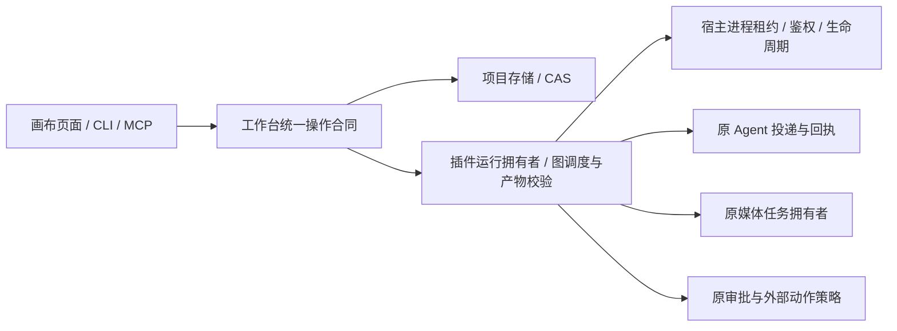

# 工作台画布设计定案

> v0.4，2026-11-17；面向项目维护者与实现者。
> 本文确定设计、迁移与验收合同；当前实现与待验收范围见[工作台画布](workbench-canvas.md)。
> v0.3 修正存储取舍：项目目录下设 canvases/，每张画布独立文件夹；复制整个画布目录即可携带其定义与专属材料。

## 1. 已确定的取舍

| 问题 | 决定 | 边界与理由 |
| --- | --- | --- |
| 升级白板还是另做流程画布 | 升级为统一节点模型 | 保留媒体编辑体验；媒体资产和生成动作分别建模，图片、音频、文字不强制成为生成任务 |
| 多画布如何保存 | 一项目一目录，canvases/ 下每张画布独立目录 | 项目元数据与画布各自 revision/CAS；复用同一存储拥有者；run 独立；支持几千张画布的分页与按需加载 |
| 执行器归哪里 | 宿主提供通用进程能力，插件拥有图调度 | 复用 ProcessLeaseRegistry；进程、权限和代际归宿主，图、节点状态与产物规则归工作台插件 |
| Agent 如何执行 | 正式路径使用现有适配器 | 固定目标和请求身份，不在结果不明时静默切到 agent-run.py 或另一 Agent |
| zaobao.json 如何处理 | 验收前保留旧真源，切换后仅作导入导出 | 每个阶段只有一个可执行真源；旧线性格式不能表达的 DAG 拒绝有损导出 |
| 名称与兼容 | 展示名改「工作台」；保留插件 ID、global.video、manager.video@1、/api/video/* | 名字保留之外，必须提供 v1 存档、旧客户端和接口版本迁移合同 |
| 图语义何时确定 | M1 定合同，M3 实现调度，默认并发 1 | 不把入度、汇聚、失败传播拖到执行内核完成后；并发是同一调度器的参数 |
| 首版节点 | command / agent / human / generate / asset 五种能力 | 变量使用参数面板；input 不作执行节点；subcanvas 延后，不支持类型明确报错 |

状态定义、参数 schema、模板与展示信息由所属插件的版本化数据提供。宿主提供受控执行与通用校验，前端读取定义和允许动作。新增已有能力的流程组合只改数据；新增执行行为才增加代码。

## 2. 实查事实与原方案的问题

### 2.1 RabiRoute

| 事实 | 源码入口 |
| --- | --- |
| 项目一文件、串行修改、revision CAS、临时文件 rename | src/plugins/io.rabiroute.manager.video/projects.mjs 的 VideoProjects |
| v1 要求 items、drafts，active 必须指向 video 卡片 | 同目录 contracts.mjs 的 projectRules；projects.mjs 的 save |
| 四类卡片为 video / image / audio / text；已有自动保存 | web/pages/VideoPage.vue 的 SavedCanvas、captureDraft 与保存监听 |
| 画布交互尚无边与运行语义 | web/pages/useVideoCanvas.ts |
| 插件要求 host.manager.video@2，清单 permissions 为空 | rabi.plugin.json、manager.mjs |
| 媒体运行时已通过宿主进程租约启动 ComfyUI、探测器和安装器 | hostRuntime.mjs；src/manager/videoRuntime.ts 的 leases.launch / terminate |

因此需要扩展面向流程的受控进程合同，复用现有租约与退出管理。不能把「没有通用 exec」写成「没有本机进程基础」，也不能将全部调度业务塞进 src/manager.ts。职责按 [宿主与插件边界](host-plugin-boundaries.md) 与 [代码架构](code-architecture.md) 执行。

### 2.2 早报

通过项目 zb.py 的 TOOLS 定位本机维护副本，核对 workflows/zaobao.json、engine.py 与 agent-run.py。私有安装路径不进入公共配置示例。

| 项目 | 本轮结果 |
| --- | --- |
| 节点 | 当前迁移快照 46；kind=cli 33、kind=agent 12、命令数组 shell 1（按 shell=false 执行） |
| 阶段 | 准备 6 / 采集 9 / 写作 18 / 制作 12 / 发布 1 |
| 门禁 | 硬门禁 16、软门禁 21；soft 记录失败但继续，只有 hard/旧 true 停止派发 |
| 产物 | outputs 非空节点 27 个、去重路径 29 条；expect 非空节点 11 个 |
| 默认关闭 | 当前快照 1 个；导入时只初始化一次，不覆盖既有期次显式选择 |
| M4 范围 | 准备 + 采集共 15 节点，其中 scout、collect、verify 是 3 个 Agent |
| Agent 降级 | 默认只有 WorkBuddy CLI；Codex 需 --allow-codex 才进入候选链 |
| 退出码层次 | agent-run.py 的 3 表示无可用 Agent；工作流层转换成 waiting_agent，对外码 4 |

原方案对旧引擎的可信度描述过强：

| 源码位置 | 实际行为 | 修正决定 |
| --- | --- | --- |
| engine.py:258 node_expect | 检查存在/通配符，排除空目录；无 expect 还会兜底查成片 | 通用节点须显式声明检查，不复制早报成片兜底 |
| engine.py:535 后 Agent 检查 | expect 中任一文件 mtime 达到节点开始时间 - 15 秒即可通过新鲜度 | 每个 required 声明都须满足；不采用任一新鲜即全过 |
| engine.py:571 后 CLI 检查 | 只查 expect 是否存在 | CLI / Agent / human 共用产物验证器，完成证据分别提供 |
| engine.py:657 后恢复 | Agent 产物已存在即可跳过，本次未真正执行 | 必须有匹配输入的旧 attempt 证据才能复用 |
| agent-run.py:318 后执行链 | 已执行失败时停止降级，避免重复写稿 | 适配器同样区分未接收、已接收、执行失败和结果未知 |

原 v0.1/v0.2 审查快照为 39 节点；本次实际迁移快照已变为 46，数量不是永久上限。导入器保存源摘要、节点数、阶段分布与转换报告，后续数量说明由同一快照生成。

## 3. 数据拥有者与调用边界



项目与画布定义由原项目存储拥有者统一管理，分别保存与处理冲突，不另造一套保存机制；run、attempt、日志和验证记录由插件运行拥有者单写。计划系统只引用 projectId / canvasId / runId，不承担节点状态机。媒体任务仍由原 job 拥有者执行，运行层保存 jobId 和回执，不再驱动第二套媒体状态。

WebGUI、CLI、MCP、定时入口调用同一合同。HTTP 请求守卫只覆盖受理过程，已受理任务转为宿主/插件拥有的后台租约，不长期持有 requestAccess。run 固定执行包身份，热更新后的请求采用新代际，旧回调不得提交到新 attempt。

### 3.1 项目与画布 v2

共享项目采用以下目录结构；目录名使用稳定 ID，显示名保存在元数据中：

```text
projects/
  <projectId>/
    project.json
    canvases/
      <canvasId>/
        canvas.json
        materials/       # 该画布专属的任务书、正文、参考及正式产物
      <anotherCanvasId>/
        canvas.json
        materials/
```

`project.json` 只保存项目元数据与默认入口，不内嵌画布正文或全量画布数组：

```jsonc
{
  "version": 2,
  "id": "project-id",
  "title": "项目名称",
  "revision": 1,
  "updatedAt": "2026-11-17T00:00:00.000Z",
  "defaultCanvasId": "canvas-id"
}
```

每个 `canvases/<canvasId>/canvas.json` 独立保存：

```jsonc
{
  "version": 2,
  "id": "canvas-id",
  "name": "主流程",
  "revision": 1,
  "updatedAt": "2026-11-17T00:00:00.000Z",
  "workspaceBindingKey": "edition-workspace",
  "variables": [{ "name": "date", "type": "date", "value": "2026-11-16" }],
  "graph": { "nodes": [], "edges": [], "groups": [] }
}
```

- 项目元数据和每张画布分别 revision/CAS。编辑画布 A 不修改项目或画布 B 的 revision；项目改名、默认入口变更只检查项目 revision。画布名称与排序键由画布自身保存。
- defaultCanvasId 是共享默认入口；当前选择、视口是客户端状态，不因打开页面就修改任何 revision。节点、边、分组使用受控创建入口分配的稳定 ID，节点分别保存能力配置与布局。
- asset 保存媒体种类与资产引用；generate 保存生成配置和原 job 引用。text、audio 不强制创建生成动作。
- 正文、图片、音频、视频不内联定义 JSON。画布专属文件放入自身 materials/，引用以画布目录为绑定根的相对路径，运行时冻结内容摘要。已有共享资产通过原拥有者引用，不擅自搬迁；外部依赖必须可列出。
- workspaceBindingKey 是可迁移绑定；解释器、工具安装、执行目录、凭据引用由执行电脑配置解析，项目不固化盘符或用户名。
- 模板按 templateId + version 引用，run 冻结解析结果。模板更新不静默改写既有节点或运行。

CAS 由同一存储拥有者按项目或画布身份串行化，写入使用临时文件与原子替换；不能仅以客户端先读后写模拟 CAS。409 后保留未保存编辑，允许重载后重新应用明确差量；禁止整份盲重试覆盖。未知字段按版本合同保留或拒绝，不静默丢失。

#### 画布目录复制与粘贴

复制整个画布目录即可携带 canvas.json 与 materials/。应用内复制和文件管理器粘贴后的导入使用同一入口：完整校验后分配新 canvasId、重置新副本 revision，并重映射节点、边、分组及其内部引用；原画布保持不变。目录中的原 ID 不能使副本覆盖已有画布，不能把显示名或目录顺序当作身份。

迁移到另一项目或电脑时，画布内相对引用随目录保留；共享资产、跨画布引用、模板与 workspaceBindingKey 等外部依赖生成清单。缺失依赖明确提示，阻止相关节点执行，不能假装复制目录便已包含外部文件、模型或凭据。复制不携带本机租约、活跃 claim、运行写锁或可继续执行的 run；新副本只在显式运行时领取执行权。

粘贴目录先进入校验与登记流程，成功发布后才进入列表；重试沿原导入请求恢复，不能重复生成副本。不完整目录、重复 ID、坏引用及中途失败均不得发布成可执行画布。文件系统手工复制的目录同样经登记后可用，不因扫描发现新目录就自动执行。

#### 列表与规模

支持同一项目累积几百至几千张画布，例如每天一期早报一张画布。列表使用稳定游标分页、服务端搜索与排序，只返回摘要；进入指定画布时才读取其定义，材料、缩略图与运行历史继续按需加载。前端虚拟化并限制缓存，不一次加载所有画布或媒体。

存储拥有者维护可重建的画布摘要索引；索引是派生数据，canvas.json 是各画布真源。正常列表读取不逐次遍历和解析所有画布正文；登记、改名与保存后更新相应摘要，索引落后或损坏时通过恢复流程修复。新增画布不重写全部已有画布；摘要更新不参与项目元数据 CAS，也不把几千张画布重新绑到一个全局保存冲突上。

创建、登记及默认入口变更等跨文件操作使用同一拥有者的持久事务与幂等回执，明确准备、发布与恢复阶段；中断不能留下可见的半张画布或悬空默认入口。不以多次 rename 冒充跨文件原子提交。

### 3.2 路由与旧数据迁移

| 地址/入口 | 确定行为 |
| --- | --- |
| 无 project | 项目列表 |
| ?project=<id>&view=canvases | 画布列表 |
| ?project=<id>&canvas=<id> | 指定画布，不存在则报可恢复错误 |
| 旧 ?project=<id> | 打开 defaultCanvasId，不使用数组第一项作为身份 |
| v1 存档 | 显式迁移时核对旧 revision 并备份原记录，经可恢复事务创建项目目录与首张画布目录；普通读取不写盘 |
| 旧客户端 | 继续操作未迁移 v1 项目；访问已迁移项目得到明确升级错误，禁止覆盖 v2 |

迁移逐项保留卡片 ID、媒体参数、drafts、positions、选中内容、serviceDeviceId 和资产引用；未知字段保存在带版本的迁移载荷。内联正文与媒体在迁移事务中落入首张画布的 materials/，回读摘要确认后再发布引用。value=null 可创建首张画布，v2 允许没有 video 节点的空画布。

旧 projects/<projectId>.json 在迁移提交前仍为真源；事务记录源 revision、摘要、备份和目标目录。完成目标回读与默认入口核对后发布 v2 路由标记并封闭旧写入；失败或重启按原事务继续或回退，不从半成品另起迁移。已有 v2 内嵌 canvases 数组的导入也必须逐张拆成目录并验证引用。备份恢复须先核对迁移与运行状态，不能让 v1/v2 同时接受写入。

manager.video@1 既有操作保持原格式语义；新增版本化 v2 项目元数据、画布分页列表、画布读写与复制/登记合同，沿原 API 前缀注册并进入发现目录。画布保存携带自己的 revision，禁止用项目 revision 代替。不能只修改 version 常量就宣称兼容。M0 验证旧包、远端客户端、迁移中断和备份恢复后，才允许批量升级。

## 4. 图与执行合同

### 4.1 DAG

- 拒绝环、自环、悬空边、重复 ID 和不支持的端口。前端预览提示，保存与运行由同一业务校验器最终确认。
- 节点提供控制入口/出口。边条件为 success 或 completed：前者要求通过/有效复用，后者允许失败终结，用于保留旧非门禁线性语义。多入边为 AND。
- 数据输入单独声明 producerNodeId + artifactKey 或外部引用。控制边满足后仍检查输入，不把顺序等同于文件已就绪。
- 禁用节点只对显式允许跳过的顺序边传递 skip；success 与必需数据依赖不会自动满足。必须门禁不可通过普通开关绕过，可选性由定义维护。
- 默认并发 1，ready 队列使用稳定拓扑序；提高并发须显式配置。共享期次/输出声明 resourceKey，由同一运行拥有者互斥。
- 普通失败阻塞 success 后继，独立分支继续。gate=true 另使整个 run 停止新派发；已运行分支受控收尾并保留结果。
- 含失败/未满足门禁的 run 不得汇总 succeeded。completed 仅允许收集诊断，不会抹去失败。

旧流程导入按节点数生成 N-1 条相邻边（当前快照 45 条）；根据上游 gate 和可选性转换边条件，验证 defaultOff 跳过路径。context.inputs / upstream 另转换为输入引用与缺口报告；后续重排仍须核对实际数据依赖。

### 4.2 run 与 attempt

run 冻结 projectId / canvasId、项目元数据 revision、画布 revision、图、模板/能力版本、变量、展开 argv、任务书/输入摘要、策略、执行电脑和触发者。画布内容以画布 revision 定位，不能以项目 revision 代替。执行中编辑只影响下一次 run。

每次尝试有独立 attemptId。状态定义、标签、终结性、允许动作从插件定义读取；初始节点状态为 pending / ready / running / succeeded / failed / skipped / blocked / waiting_human / waiting_agent / cancelling / cancelled / interrupted。复用记录 reusedFromAttemptId，不伪装本次执行。

run 状态为 running / waiting_human / waiting_agent / cancelling / cancelled / succeeded / completed_with_errors / failed / interrupted，附 reason、失败与等待集合。API 业务状态不借用子进程退出码，旧 0/1/2/4 只在兼容层转换。

汇总顺序固定为：已请求取消且仍有未确认退出的执行为 cancelling，全部核实后 cancelled；未取消且仍有执行为 running；无活动执行时，门禁失败为 failed，执行结果无法恢复为 interrupted，其后依次为 waiting_human、waiting_agent、completed_with_errors、succeeded。等待集合始终完整保留；succeeded 要求所有选定节点终结且必需合同满足。该顺序由同一状态定义发布，前端不得另推导。

| 操作 | 行为 |
| --- | --- |
| 运行 | 创建快照与 run；同一画布/业务期次写入互斥；幂等请求拒绝重复派发 |
| 单点运行 | 仍校验输入、权限与门禁，不隐式绕过前置条件 |
| 从此运行 | 选中节点的后继闭包；闭包外依赖须有匹配证据，否则报缺项 |
| 续跑 | 新 run 引用原 run；比对配置、变量、任务书、输入与产物摘要，复用有效结果；变更后继失效 |
| 重置 | 创建新 attempt/改变下次选择，不删除历史或产物；运行中先取消并核实退出 |
| 标记完成 | 提交带身份的证据，由同一验证器检查，禁止直接改成功状态 |
| 停止 | 先 cancelling，进程树/Agent 核实结束后 cancelled；结果未知不得启动替代任务 |

Agent 要有精确目标、接收回执、正式完成回执与产物校验。delivered 只表示接收。不可用转 waiting_agent；结果不明先查询原请求。换执行者或人工接手先解除原 claim，记录新 attempt，保持作者与独立核验者身份约束。

重启后回读宿主租约和原请求：活着则继续观察，确认退出且未完成则 interrupted；存活未知不释放资源写锁。TTL/PID/心跳单独不足以证明死亡。状态写入携带 owner generation + attempt token，拒绝迟到回调。不以改名释放来绕过明确的删除/访问策略限制。

## 5. 产物合同

区分 inputs（读取来源）、artifacts（展示输出）与 requirements（通过条件）。outputs 导入展示声明，expect 导入必需检查；expect 不在 outputs 中也需建检查项。关键节点缺少 expect 时生成迁移缺口，不宣称合同已经齐全。

成功要求完成证据成立、全部 required 检查通过且门禁满足。command 要退出码 0；agent 要正式完成回执；human 要带身份与证据的提交；generate 要原 job 成功。只检查已有输入的命令显式声明 validationOnly 和被检输入摘要。

每个声明含 key、绑定根、相对路径/受限 glob、类型、required、最少命中数、freshness 策略及校验器引用：

| 策略 | 判据 |
| --- | --- |
| produced | 本 attempt 生成；优先独立输出目录；兼容固定路径时核对执行前基线、本次写入证据和完成后的稳定摘要 |
| reused | 引用匹配输入的原 attempt 与产物哈希，不要求更新时间 |
| validated | 本次校验回执绑定已有文件摘要；适用于无变化也合法的增量更新，不强迫 scout 每天新增主体 |

mtime 仅作辅助，不能以 runStart - 容差作为唯一判据。相同内容重写可凭本次写入回执通过；固定路径无法取得写入证据时保持未验证，补回执或独立目录。每个 required glob 均须满足数量与类型，空目录不算文件；文件提交稳定后再取哈希。

通用合同只验证声明。新闻事实、核验者独立性、内容审阅、版权、音画和发布成功分别使用现有专用检查与回执。

产物记录 artifactId、machineId、绑定根/相对路径、sha256、bytes、attemptId 和验证结果。预览通过归属核对后的 opaque ID 读取；路径验证覆盖规范化、realpath、目录联接与访问根，禁止任意磁盘路径读取；主动内容按安全预览处理。

## 6. 受控进程与授权

进程合同提供 executable + argv、cwd、环境变量引用、stdin 引用、timeout、输出流、取消、查询与最终回执。默认 shell=false、windowsHide=true。参数按 schema 解析；未知变量、非法枚举、范围错误及无法转换的 check 参数在启动前报错，不拼 shell 字符串。

复用 ProcessLeaseRegistry、现有鉴权、插件代际、日志与生命周期。插件声明并消费能力；宿主不认识 gate、date 或 zaobao。支持平台的停止验收要求 3 秒内取得进程树终止证据，超时保持待核实，不能先显示已停止。

| 边界 | 决定 |
| --- | --- |
| 授权 | 沿用已配置鉴权连接与已有目标授权；权限可查看、修改、撤销；不额外叠加默认关闭的画布开关和每次运行确认 |
| 远端 | 按真实连接与显式配置判断；不默认只读，也不因本机来源免鉴权 |
| 任意解释器 | cwd 防误配置，不能限制 Python/Node 的读写；可信命令明确按进程账号权限运行，不宣称 OS 沙箱 |
| 导入 | 导入本身不执行；展示命令、来源与副作用；图中的字段不能给自己授权，外来文档内容不能改变可信执行策略 |
| 外部动作 | 复用既有发布/设备/删除策略和已有授权，不固定追加确认；审批绑定动作、目标和关键产物摘要，变化后判断授权适用性 |
| 凭据 | 只存宿主凭据引用，按需注入；命令、stdout/stderr、错误和回执均脱敏 |
| 幂等 | 创建 run、派发、外部提交用稳定请求身份；丢响应查原回执；投稿先查已有稿件，不换 key 重发 |

新增费用、外发目标或扩大隐私访问超出已有授权时才请求最小确认。不可信脚本需要另行使用已支持的隔离执行能力，普通本机进程合同不承担这一保证。

### 6.1 存储与观测

共享 NAS 按项目目录与独立画布目录保存定义、画布专属材料和回写证据；每张画布自己的 materials/ 随目录复制。原共享资产保持原拥有者，通过引用使用。本机保存工具、构建、运行目录、临时文件、日志和租约。每机绑定区分工具根、业务资料根、输出根和 runtimeRoot，不再用一个 workspaceRoot 混合所有位置。正式产物经核验回写到材料目录，生成过程不在 NAS 运行。

run 控制记录保存在执行电脑本机，带 projectId / canvasId / runId / machineId；共享区可保存正式回执和只读投影。资源锁以真实业务期次/输出为键，防不同画布或旧新引擎并写。跨机协调验收前，同一期只由指定执行电脑领取，不能用单机锁冒充跨机互斥。

关键操作接入现有分组日志，记录真实数据源、提交结果、关联身份、调用位置与异常栈。日志按序号增量读取、支持断线续读；历史稳定游标分页、详情按需加载、前端虚拟化，缓存和 SSE 回放有容量边界。最近 5 次只是摘要，不截断正式证据。启用自动运行前按现有记录生命周期规范确定保留与轮转；不自动删除正式产物。

## 7. 真源切换

1. 导入并记录源摘要和转换报告；未解析的命令、路径、参数、产物阻止相关节点执行。
2. 验收前旧引擎仍是正式真源。新图隔离验收；真跑某一期前显式移交该期执行权，旧 GUI/CLI/定时器不再启动该期。
3. M4 验证前 15 节点、3 Agent 的接收/完成回执、产物和门禁；先补关键节点缺失合同。
4. M5 分别验收写作、制作、审片、发布幂等与回执，迁移文档、工具、定时入口和原绑定会话，再切换正式真源。
5. 切换后旧入口仅转换/转发，不继续写旧定义和旧运行状态。回退先核对未决 Agent/投稿回执并移交执行权，禁止双跑。

zaobao.json 只表达线性子集。并行、子画布或其它不可表达语义明确拒绝导出；完整图从 M1 起使用自身版本化导入导出格式。保留已验证可恢复的旧版本，退出条件是入口全部迁移及回退验证通过，不长期维护两套业务实现。

## 8. 里程碑与验收

| 里程碑 | 交付 | 必须验证 |
| --- | --- | --- |
| M0 | 项目目录、独立画布目录、分页、路由、分级 CAS、v1 转换与版本协商 | 3 画布重开/换端一致；两个客户端分别编辑不同画布互不冲突、同画布 409 不覆盖；原媒体草稿资产不丢；整目录复制粘贴后 ID/相对引用正确、外部依赖可见；旧链接/旧包/空项目/迁移各阶段中断与备份恢复；至少 5000 张画布的分页/搜索/按需打开，首屏不读取全部正文与媒体，新增/保存不重写全项目 |
| M1 | 节点、端口、边、分组、DAG/参数合同、导入导出 | 10 节点保存恢复；坏引用与环拒绝；当前完整快照转换报告；仅改数据新增模板；未知能力不执行 |
| M2 | 单命令节点、宿主能力、快照、attempt、产物、持久日志 | 退出0但缺文件/旧文件/空目录/多产物少一项均失败；validationOnly；撤销/脱敏/停止与进程树 |
| M3 | 图调度、门禁、并发、互斥、续跑、取消与恢复 | 链/菱形汇聚；非门禁失败仍记错；改输入失效后继；双发幂等；迟到回调隔离；存活未知不重跑 |
| M4 | 真实准备+采集，15 节点、3 Agent | 真实一期完整证据；旧引擎移交；不可用/结果未知/人工接手；核验身份约束 |
| M5 | 采集段之后的全部节点、制作、审片、发布、真源切换 | 真实音画与审片；投稿查重/丢响应恢复；旧入口退役与回退演练 |
| M6 | 现有定时/事件入口、通知与日志生命周期 | 不重复领取；时区/期次正确；通知目标已授权；失败与等待可恢复 |

M4 只证明采集链路，后续配音、渲染、资源竞争、成片内容和不可逆发布各有独立验收。定时接入放在完整人工触发路径验收之后。

实现按匹配测试与构建逐步验证；最终交付核对本机构建、打包、安装、实际版本与运行行为，源码测试只报告实际覆盖范围。真实早报切换与定时接入仍按 M4–M6 的独立验收合同执行。
